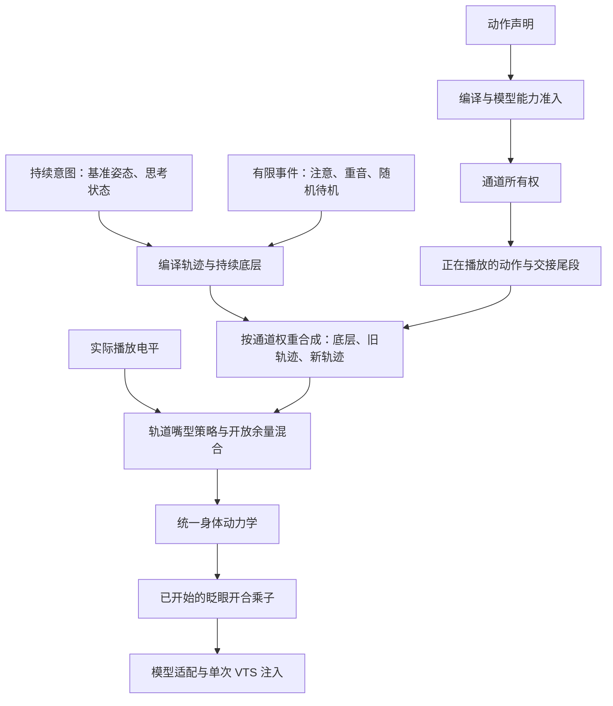

# 姿态、动作与反射的合成设计

2026-10-10 当前实施方案。创作入口见 [MOTION-AUTHORING.md](./MOTION-AUTHORING.md)，模型接入见 [MODEL-ADAPTATION.md](./MODEL-ADAPTATION.md)。本文说明为何这样设计、已落实的规则和剩余验收。

## 设计目标与归属

目标是让动作有清楚的情绪节奏，同时使连续切换和多层叠加可预测。动作内容只描述逻辑轴；播放器不通过具体动作名字分支，也不写 Cubism 参数。持续姿态、有限表演、生理微动使用同一声明、编译、采样能力，但保留各自的生命周期。

`motion.ts` 是内容编译 module，`MotionDirector` 是拥有交接、权重和所有权的合成 module，`model-adapter.ts` 是设备 adapter。公开采样 interface 允许检查真实生产轨迹；播放 interface 覆盖合成行为。这个 seam 把新姿态与新表演的创作 locality 留在动作库，模型 adapter 的 leverage 保持不变。没有增加 Core 概念。



## 第一轮设计与修正

| 检查到的旧规则 | 为什么不足 | 当前规则 |
| --- | --- | --- |
| 姿态切换立即换目标，transitionMs 只改变动力学速度 | 无法编写部位先后，不能解释实际目标时间轴 | 从当前基准轨迹绑定声明式过渡，视线、表情、头部、躯干有时序；目标轨道在定义时长结束 |
| 新动作从旧目标快照缓入 | 旧动作正在运动时，其趋势提前消失 | 最新旧轨迹继续推进，与新轨迹交叉淡入淡出 |
| 结束先回基准，再解锁其他层 | 思考或待机仍在时会发生多余回正与二次偏转 | 退出权重下降，实时底层权重上升；底层持续推进 |
| 命名表演默认可局部抢占 | 剩余表情可能与新的肢体动作语义冲突 | 产品命名表演默认原子，即兴片段保留局部让位，作者可覆盖 |
| 思考事件被遮住时直接丢弃 | 无新事件就无法在释放后显现思考 | 保存状态意图，遮挡只影响权重；若已结束就不会补演 |
| 思考固定目标直接启停 | 视线与头部同时改变，进入过程缺少节奏 | 编译先视线后头部的入场，终值保持，退出权重缓释 |
| 客户端最终用 max 覆盖嘴型 | 绕过动作权重和统一动力学，哈欠可能被语音改写 | 音频进入合成器，策略随嘴部轨道编译，不再有输出旁路 |

第二轮推敲又修正了三点：物理独占释放也需要交接；反复打断不能累积旧轨迹图；哈欠的嘴型策略必须属于声明内容，不能只是命名目录上的特殊字段。独立调用 face.sleepy_yawn、顺序组合或模型投影都应保留同一语义。

## 持续姿态

用户选择的姿态目标与当前正在呈现的基准分开。前者用于状态、保持时长与动作偏移基准；后者由编译轨道更新。切换时使用当前呈现基准作为起点。省略轴仍恢复完整 neutral，不继承上一姿态的残留。

通常视线和表情较早变化，头部随后响应，躯干最后跟随。自信与兴奋姿态身体较早展开，focused 更早对齐视线，relaxed 的头身一起松开。数值内容在 `BASE_POSES`，过程在 `POSE_TIMING` 与 `POSE_ENTRY_TIMING`，展开入口为 `compilePoseTransition`。新动作无需修改设备 adapter。

`transitionMs` 表示目标轨迹时长，不承诺画面正好在这个时刻完全静止：身体动力学仍有收敛时间。中途改向从当前轨迹位置进入新轨迹，保留身体的位置、速度和加速度。目标轨迹速度可能重新起步，最终输出由动力学承接；不把这一行为宣称为任意条件下严格的高阶连续。

限时从设置意图开始计时，包含进入过程，维持原来的工具语义。失焦停靠冻结用户姿态剩余时长，基准呈现 relaxed；反射权重渐隐。回焦恢复用户选择和剩余时间，反射按当前状态渐显，重复焦点通知不重置。

## 动作接管与退出

通道仍为 head、torso、gaze、eyes、mouth。最小通道申请在模型准入之后执行，耦合资源可能扩展通道。一次播放须取得全部请求通道，失败不先驱逐旧所有者。

独立通道直接并行。相交通道由优先级决定控制权，视觉交接允许旧动作短暂贡献，但它已失去通道，不能继续执行副作用或改变结果。产品命名表演默认 atomic；即兴片段默认局部让位。`atomic: false` 可把命名表演作为片段使用，`atomic: true` 可保护整个即兴分镜。

每个通道最终目标为：

```text
实时底层 * 剩余权重 + 最新旧轨迹 * 退出权重 + 新轨迹 * 进入权重 + 更早交接残余
```

权重用五次 smooth 曲线。单次交接期间最新旧轨迹继续采样；更早交接按当前比例合并为一个残余目标，再一起退出。每个通道只需保留最新旧轨迹和一个残余贡献，不随历史打断次数增长；这不是任意数量或并发限制。极短的新动作可以较早结束，权重归一化避免叠加超过 1。

退出背景包含当前基准过渡、留存、思考、注意反应、呼吸、待机、语流和重音。它们持续推进，所以动作退出不会先回到过时的启动姿态。普通取消立即结束执行并释放租约，视觉尾段继续短暂衰减；“结果已 cancelled”不等于输出参数被硬切。全局急停、断连、停机和模型切换直接清除这些尾段，身体动力学仍承接当前运动。

独占但没有时间线的翻转、装扮操作冻结接管目标；已遮住的旧退出轨迹清除，避免释放后重新闪现旧表演。实际呈现过的独占操作释放时，从捕获目标短暂淡出到实时底层；未呈现即取消的申请不产生视觉尾段。

留存保存完整通道目标，不在回合结束时清掉。新姿态与新动作渐进替换留存。留存的嘴型策略也保留；需要恢复语音时选择新表情或新姿态，不在后台擅自推翻作者选择。

## 条件反射与生理层

思考是持续状态：进入曲线先偏移视线，再轻歪头，保持终值并叠加小幅思考视线；说话内容开始或回合结束时退出。入场未完成就结束时，从当前贡献释放，不继续加深已经取消的歪头。重复思考通知不重启轨道。被主动动作遮住也记录状态，释放后直接显现当前阶段，已结束的思考不会重新进入。

注意反应与重音是有限事件：回合开始有轻微抬头回落，声音上升触发重音，随机待机有完整进入与退出。它们被遮挡时照常过期，不排队补演已经过时的事件。事件策略只选择状态或触发；所有权与权重归合成器，删除反射层重复 isThinking 状态和丢事件的早退判断。

呼吸、连续微动、语流和重音先合成底层，再被主动通道权重覆盖；动作退出时渐进恢复，避免在解锁帧突然全量出现。视线补偿与思考视线也按状态权重交接。装饰偏移按各轴剩余空间柔和压缩，减少贴边后截平；主动创作幅度不被这个装饰规则缩小。作者仍需检查主动偏移与基准相加后的饱和。

普通眨眼采用同一编译轨道，但开合乘子放在较慢的表情动力学之后，保证真正闭眼。新的眨眼只在眼睛空闲且未留存眼睑时准入；已经开始的眨眼会完成，接管不会把它从中途硬切。它可能在新眼部表演的开头短暂重合，这是保留完整眨眼的明确选择，真实画面仍需观察。

## 嘴型混合

嘴形与张嘴分开。`blend` 默认允许笑着说话，开放度使用：

```text
authoredOpen + (1 - authoredOpen) * audioOpen * speechGain
```

此公式连续使用剩余开放空间，不再取两条信号的最大值；极大音量仍可能使张嘴接近 1。嘴形不被语音改写。嘴型进入统一动力学，语音活跃时提高开放轴响应速度，防止较慢的表情响应过滤掉普通发声。

`withSpeech(definition, "exclusive")` 把保护策略编译到 mouth.open 轨道；该段禁止音频改变嘴部开放度。顺序的保持、切拍缓入、变速与可选轴投影同时保存策略。下一段恢复普通策略时，其自动 pose 过渡也渐进恢复嘴型；明确关键帧作者应处理拼接。工具整体 `speech` 是显式覆盖，不需要播放器识别哈欠名称。

普通动作交接与退出的 speechGain 使用相同权重，所以哈欠、语音和笑容不会从旁路互相抢写。物理独占嘴部时不允许音频越权；释放时再恢复。

## 没有采用的方案

| 方案 | 取舍 |
| --- | --- |
| 所有动画直接相加 | 绝对表情与完整动作会相互污染，容易越界；仅明确偏移组合允许相加 |
| 所有姿态都作为永久占用动作播放 | 持续底座会与点头、眨眼等争抢，姿态到期与焦点语义变复杂；持续意图保留，过渡交给编译轨道 |
| 所有反射都排队等待解锁 | 可能在状态早已结束后补演；持续状态保存，有限事件过期 |
| 无限保留每次打断的混合图 | 长时间高频 cue 会累积轨迹与采样成本；压缩更早交接残余 |
| 立即拆成逐轴独立所有权 | 当前模型存在跨轴、跨通道耦合，直接开放任意并发容易作出虚假的控制承诺；保留现有通道并复用模型控制资源 |
| 为不同模型重写动作 | 与逻辑轴设计冲突；模型差异仍通过适配、校准、可选轴与能力准入处理 |

## 验证与限制

`tests/live2d-composition.test.ts` 使用真实编译、采样、合成器和 runtime 验证：姿态部位时序、中途改向、动轨迹交叉混合、实时思考退出、500 次连续打断的残余收敛、隐藏思考显现/结束、焦点权重、语音保护/恢复、模型投影策略、实际命名原子规则，以及姿态+思考+语音+眨眼+打断的组合帧范围。已有 presentation、continuity、model-runtime 回归继续覆盖各命名动作和模型准入。

状态输出增加 active/fading/poseTransition/reflex，便于分辨仍在执行、视觉退出和持续状态。测试不会把请求接受当作视觉质量。真实 MO 的画面自然度、声卡同步和跨真实模型表现未在本轮验收，也没有修改模型保存文件。

速度限制、轴硬边界、适配范围、外部 VTS 物理/表情、事件循环卡顿仍会影响结果。交叉混合本身也可能削弱相反方向动作的峰值；无法只凭代码保证每种打断都“最好看”。设计先提供可控、可解释的过程，再用真实画面调整时序、幅度与校准。

最终验证：全量 145 个测试文件通过，1853 项通过、1 项预期失败；独立 TypeScript、6 条依赖边界规则与构建通过。限定源码格式化、diff 与 50 条本地文档文件链接检查通过。`pnpm typecheck` 包装命令仍被已有 `generated/qq-world-repair/staged-checkout-1791463628678/biome.json` 嵌套 root 配置阻断，未修改该目录。更改保留在当前工作树，未提交；其他任务已有修改保留。
