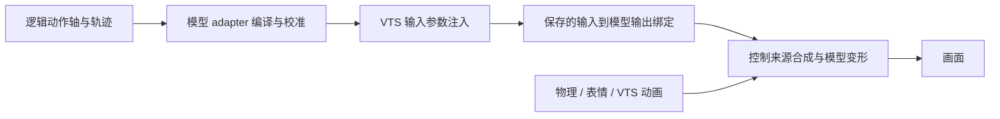

# 通用 Live2D 模型适配方案

日常操作以 [Live2D 动画与模型适配手册](./README.md) 为入口。本文保留实施阶段记录与原始研究，后半部分设计讨论中未实现的内容不属于当前能力。2026-10-10 后续审查修正了播放级确认归属、多目标准备输入、校准验证与部分执行报告，见 [适配与执行审查](./ADAPTER-REVIEW.md)。

日期：2026-10-10。状态：模型事实读取、适配编译、运行时准入与离线配置准备已实现；真实 MO 尚未应用准备或完成画面验收。下面的审计事实描述重构前状态，后续设计中未完成项在本节明确列出。

## 已实现的使用入口

- `model-profile.ts`：保留空输入/内置来源、零宽、重复绑定，读取物理图、递归模型动画/表情、资产指纹，拒绝重复模型 ID 和越界引用。
- `model-adapter.ts`：任意已存在输出 ID、单调分段校准、多目标配方、能力诊断与动作准入。标准名字只提供候选定义，不再决定控制资格。
- `model-adapters/<modelID>.json`：模型语义定义。包含 MO 的头/躯干/眼/嘴和 Param122..126 语义；未证明连续 blush，不将样式参数冒充强度。没有作者校准点的转换仍标为 provisional。
- `motion.ts`：轨道支持 `optional: true`；按完整轴省略并重映射顺序依赖，保留时长。动作库的中性重置、blush 增强和眼笑明确可选（眼笑是微笑的增强，物理拥有或输入耦合时降级为其余轴）；非中性主要动作仍必需。
- `runtime.ts`/`companion.ts`：cue、affordance、express 共用实际能力。必需能力缺失在租约前拒绝，原子播放申请全部保留资源；传输无证据返回 unknown。离线姿态仍允许保存本地意图，不声称设备已呈现。
- `vts-client.ts`：读取真实输入、模型范围、活动物理/表情；汇总注入发送/接受/失败/过滤/丢弃。低频检测文件和来源变化，来源变化取消旧播放。保存文件变化时停止控制，保持鉴权订阅等待明确模型重载事件，不把重连等同于配置已重新加载。
- `model-preparation.ts`：预览专用绑定、解除选定物理输出、同步计数、保留未知字段、备份/恢复和后续修改保护。不会更名或改写 moc3，不自动删除全局输入。

尚未实现：自动建立唯一身份的受管理模型克隆、自动清理全局旧输入、自动改写冲突表情/模型动画、交互式视觉校准和跨两真实模型画面验收。准备器遇到缺失绑定模板、未知格式、冲突动画/表情会明确拒绝，不猜测生成。当前离线应用支持 Windows 的 VTS 停机核验；其他平台使用人工配置。

实施阶段验证记录（后续清理后的结果见 DESIGN.md）：145 个测试文件通过，1825 例通过、1 例预期失败；TypeScript、六条边界检查和构建通过。统一 `pnpm typecheck` 被已有 `generated/qq-world-repair/staged-checkout-1791463628678/biome.json` 嵌套根配置阻挡，未修改该目录。真实 MO 的 CLI 只读检查得到 28 条保存绑定、49 个物理组、4 个动画/表情来源；没有 API 范围时可用轴为零，未将磁盘参数名误作真实控制证据。实际 VTS 未运行，未写真实模型、输入或认证，也未执行视觉验收。

适配文件优先读取 `UINA_LIVE2D_ADAPTER` 指定路径，其次读取本目录 `model-adapters/<modelID>.json`，最后生成标准语义候选。准备工具生成的新定义需要明确选用；不会覆盖作者定义或悄悄激活未验收文件。

### 命令工作流

操作步骤统一维护在 [手册：模型配置准备与恢复](./README.md#模型配置准备与恢复)，包含命令参数、连接/停机顺序、输入创建、配置应用和恢复。注意 inspect 报告不是 capture 快照，prepared 定义存在也不能证明模型补丁已经应用。

准备器对原目录应用可恢复补丁，不伪造模型克隆 ID。计划包括原始事实指纹，应用前重查事实。支持格式通过实际字段与物理 Version=3 检查，不代表所有 VTS 版本已经实测；快照保留活动 VTS 版本，准备后需用真实模型加载验收。

### 创作可选增强与校准

```ts
motion(1000, {
  ...track("face.blush", [[0, 0], [1000, 0.4]]),
  optional: true,
});
```

```json
{
  "version": 1,
  "axes": {
    "head.yaw": [{
      "parameter": "AnyExistingHeadParameter",
      "points": [[-30, -2], [0, 1], [30, 4]]
    }]
  }
}
```

示例数值是示意，不是 MO 校准。校准点必须单调、在实际参数范围内并包含逻辑中性点；可仅覆盖舒适子范围，超出范围的动作会被拒绝。`allowFanout: true` 明确接受额外输出联动，但不能让多个轴争用同一输入。未知额外输出会保守合并通道资源，状态仍显示 coupled。模型动画冲突采取静态拒绝；活动表情/物理变化采用低频观察，不能承诺逐帧同步外部 UI 操作。

## 结论

采用程序化模型 adapter：运行时负责发现、校准、能力判断和输出；准备阶段负责让 VTS 的绑定与参数控制来源符合要求。动作继续使用 TypeScript 声明式定义和逻辑轴，模型差异留在 Live2D World。

已经正确接线的模型可以只靠运行时适配。要在 VTS 下获得独立躯干、独立眼笑、程序呼吸等能力，部分模型需要调整 `.vtube.json`，物理写入冲突还可能需要生成经过调整的 `.physics3.json`。程序可以完成这些准备，但这与官方接口直接修改任意模型参数是不同的能力。

无需为了适配把 `.moc3` 参数 ID 改成标准名字。准备过程保留原始资产。模型没有制作相应变形，或编译模型自身把多个视觉效果绑在同一自由度上时，软件不能凭空补出独立自由度。

## 调查依据与证据边界

检查包括当前 Uina 调用链、MO 原版与安装副本、安装的 hiyori_vts 和 akari_vts 保存配置、VTS 官方接口与手册、Live2D SDK 手册和物理格式说明。MO 逐文件证据见 [MO-MODEL-COMPARISON.md](./MO-MODEL-COMPARISON.md)。

检查时没有运行中的 VTS。磁盘配置、离线调用与官方合同已经核实；活动模型、可注入输入、真实范围、VTS 对重复绑定的处理和画面未现场核验。安装副本由 VTS 历史记录定位，不能据此声称当前内存模型已核验。

官方资料核查入口（检索日期同上）：

| 编号 | 官方资料 | 使用章节 |
| --- | --- | --- |
| S1 | `https://github.com/DenchiSoft/VTubeStudio` | InputParameterList、Live2DParameterList、ParameterCreation、InjectParameterData、ExpressionActivation、Get/SetCurrentModelPhysics、ModelLoad |
| S2 | `https://github.com/DenchiSoft/VTubeStudio/wiki/VTS-Model-Settings` | 输入/输出、范围、平滑、Auto-breath、Auto-blink |
| S3 | `https://github.com/DenchiSoft/VTubeStudio/wiki/Interaction-between-Animations,-Tracking,-Physics,-etc.` | 控制来源优先级与表情 Add/Multiply |
| S4 | `https://github.com/DenchiSoft/VTubeStudio/wiki/VTube-Studio-Model-File` | `.vtube.json`、未公开格式合同、即时保存 |
| S5 | `https://github.com/Live2D/CubismSpecs/blob/master/FileFormats/physics3.json.md` | 物理组、输入/输出、计数和字典 |
| S6 | `https://docs.live2d.com/en/cubism-sdk-manual/parameters/` | SDK 按 ID/索引写参数与更新顺序 |
| S7 | `https://raw.githubusercontent.com/Live2D/CubismWebFramework/develop/src/physics/cubismphysics.ts` | updateOutputParameterValue：输出 Scale 与 Weight |

S7 是 SDK 实现证据，不是 VTS 内部实现证据；实施时应固定所用版本。S1 当前公开接口清单没有文档化的绑定读写请求，也没有任意 Cubism 参数的连续写值请求。这是当前公开合同的限制，不是对未来版本的断言。

## 完整控制链



逻辑轴表达动作含义，模型参数 ID 表达实现。创建 `UinaTorsoYaw` 只创建 VTS 输入，不会创建变形，也不会自动绑定 `ParamBodyAngleX`（S1）。官方手册允许任意 Live2D 输出参数，标准名不是控制资格条件（S2）。

绑定之外仍有控制来源合成：默认值、待机动画、追踪、一次性动画、表情、物理按优先级参与，表情 Add/Multiply 还有后续合成（S3）。所以分别记录输入创建、保存绑定、请求接受、输出回读和视觉验收；任何一项不能冒充后面一项。

## 当前缺口与旧结论修正

| 项目 | 已核实事实 | 对设计的影响 |
| --- | --- | --- |
| MO 模型本体 | 原版 19 文件中 18 个字节相同，只有原有 `.vtube.json` 不同；moc3、参数显示信息、物理均相同 | 不支持“替换本体参数后才可控”；无法重建全部历史 |
| 全局自定义输入 | Uina 创建的 7 个输入没有被 MO 保存绑定引用 | 创建没有完成接线；不能声称它们在所有模型都无用 |
| 固定输出名单 | client 就绪检查、retargeter 都依赖 `vts-axis-adapter.ts` 固定表 | 控制资格迁入适配定义与真实事实校验 |
| 自定义嘴部参数 | Param122..126 保存绑定存在，loader 可读入，但 retargeter 跳过 | 是 Uina 支持缺口，不是自定义 ID 本身不可控 |
| 自动呼吸 | ParamBreath 输入为空且 UseBreathing=true；Param125 输入 JawOpen 但 UseBreathing=true | Auto-breath 忽略输入（S2）；必须保留控制来源事实 |
| 共享输入 | FaceAngle 同时绑头/躯干；MouthSmile 同时绑嘴形/眼笑 | 一份输入无法实现任意独立目标 |
| 物理写入 | MO 对躯干、眼笑有权重 100 的物理输出 | 专用输入不提供独立性保证 |
| 范围与方向 | MO 保存嘴形下限由 -1 改为 0；其他模型有反向眼球映射 | 需要范围、中性点和方向校准 |
| 能力声明 | affordance/supportsCue 由动作目录得出 | 内容存在不等于模型能呈现 |
| 播放结果 | 时间线完成可报告 accepted，但注入可能过滤或背压跳帧 | 按播放汇总传输证据 |

离线实调 `loadModelProfile` 与 `VTSParameterRetargeter`：MO 28 条保存设置只保留 27 条，自动呼吸行丢失；五个自定义嘴部绑定被读取但输出不含对应输入；只有 `torso.yaw=10` 的帧与中性帧输出完全相同，而 `head.yaw=15` 会输出 FaceAngleX=15。没有连接 VTS，没有真实注入。

额外模型提供不同约束：akari 嘴开合参数为 ParamMouthOpen；hiyori 嘴开合/嘴形输入为 VoiceVolume/VoiceFrequency；两者都有反向眼球 X、不同眼睑端点及共享头/躯干输入。不能把 MO 的名字和路径推广给所有模型。

动作编译器、动力学、租约、连接代次与单个待确认注入请求都有真实用途。重构集中在适配与能力接线。

## 模型适配 module 的职责

把读入、解析、校准、耦合判断、准备计划与帧转换收进模型适配 module，增加 locality。其 interface 接受模型事实、适配定义和逻辑帧，给出不可变适配程序、能力报告与 VTS 输入帧。这条 seam 隔离动作与模型细节，VTSClient 保留通信职责。

设计草案，不是已实现函数：

```ts
compileModelAdapter(snapshot, definition)
  // -> { program?, capabilities, diagnostics, preparationPlan }
program.encode(logicalFrame)
  // -> { values, saturation, controlResources }
program.admit(compiledMotion)
  // -> supported | partial | unsupported，附具体原因
```

同一 VTS adapter 提供已有绑定复用和程序专用绑定两种准备策略；它们不是两个不同渲染后端。暂不创建没有实际消费者的通用渲染 interface。第二个真实后端出现时再证明那条 seam。

删除测试（deletion test）：继续分散固定名字转换与硬编码输入优先级，只会把复杂性搬来搬去；统一收进 module 才增加 depth，测试直接覆盖该 interface，形成 leverage。所有新增概念留在 `.uina/worlds/live2d`，不进入 Subject/Core。

## 模型事实、适配定义、编译产物

模型事实快照保留来源、时间和指纹：

- 模型 ID、精确路径、VTS 版本、配置/物理/资产指纹、连接与模型代次。同 ID 不代表同配置；重复 ID 不允许扫描命中第一个即采用。
- 全部 Cubism 参数的 ID、真实 min/max/default；显示名作辅助，不用 cdi3 条目数代替实际 API 参数数。
- 输入的名称、addedBy、默认值与建议范围。自定义输入 min/max 是映射建议端点，不是注入硬限制（S1）。
- 所有绑定，包括空输入、零宽、反向范围、ClampInput/Output、平滑、Auto-breath/Auto-blink、重复输出及未知字段；异常行保留诊断，不静默删除。
- 完整物理输入→输出图、权重与设置；动画/表情触及的参数、合成模式和活动状态。静态文件与运行状态不一致时保持未知。

适配定义由作者确认语义，不能只猜 `Param123` 的作用：

| 字段 | 含义 |
| --- | --- |
| 逻辑轴 | head/torso/eyes/mouth 等；扩展轴必须定义单位、中性与范围 |
| 输出目标 | 任意已存在参数 ID，或明确的多参数配方 |
| 输入路径 | 已核验输入与绑定，或待准备专用输入 |
| 校准 | 单调分段曲线、中性点、方向、舒适范围与极限 |
| 控制来源 | 程序拥有、VTS 拥有或明确允许耦合；物理/表情/动画处理 |
| 控制资源 | 共享输入、共同输出及耦合组，含受影响额外轴 |
| 能力证据 | 可达范围、独立程度、回读结果、视觉验收版本 |

`mouth.open -> ParamMouthOpen` 与 `mouth.open -> ParamMouthOpenY` 复用同一动作。`mouth.pucker -> Param123` 需确认含义并定义逻辑轴。耳朵、尾巴等特有动作使用可声明、可类型检查的语义扩展轴；其他模型没有时明确不可用。原始模型 ID 不进入通用动作库。

服装、发型、腮红样式等离散外观采用表情/热键能力，并声明触及的输出资源。MO “腮红样式”和“腮红上下”不能自动作为 `face.blush` 连续强度。

编译产物冻结映射、校准、实际资源组与能力报告。检查输出存在、输入存在、绑定有效、来源冲突、可达范围、配方冲突和非有限值。无法满足的链路给出准备步骤。

只对已证明的线性绑定反算；软限幅、平滑或来源混合不满足该模型时要求校准/准备，不能直接套线性公式并标记完全支持。先校准目标输出，再反算输入；舒适范围、Cubism 硬边界与协议限制分别校验，显式报告饱和。逻辑角度是创作约定，不宣称模型数值等于测得的实际角度。

## 已有绑定复用

只读配置，利用已核验绑定反算输入，不写文件。支持正确独立接线的轴，也可以明确接受已有耦合。不能因为复用 FaceAngle 就承诺躯干独立。

配置缺失、来源冲突或同一输入要求互不相容目标时，返回 unsupported/unknown 或 coupled。暂不引入实时约束求解器伪造不存在的自由度。

## 程序专用绑定：推荐准备流程

先生成准备计划，再按已验证版本实施。使用 `UinaHeadYaw`、`UinaTorsoYaw`、`UinaEyeSmileL` 等输入，与模型输出 ID 分开。固定轴共用输入目录，扩展轴按需要创建，不为每模型重复全量创建。遵守当前官方命名和容量合同：字母数字、4..32 字符、每插件 100/全局 300 自定义输入（S1）。

1. 官方 ParameterCreationRequest 创建输入，核验 addedBy 和定义。重建同名输入前检查使用者，不能为当前模型修改范围而破坏其他模型。
2. 在受管理副本或可恢复配置建立专用绑定；同一连续输出保留一条明确绑定，解除共享。程序拥有目标关闭相关 Auto-breath/Auto-blink，减少重复平滑；嘴部电平由 Uina 合成，避免同时接 VTS 麦克风。
3. 清点动画、表情，包括 Add/Multiply。程序目标不能被未经协调的更高优先级来源写入。外观表情保留不冲突参数，必要时生成只含外观的副本。
4. 精确处理程序拥有的物理输出，保留头发、衣物与其余物理。
5. 重新加载，核验活动身份、参数、输入与输出响应，再开放能力。

专用输入建议采用规范化坐标，而不是把某模型的原始范围写成全局输入范围。复用输入前必须验证其 default 经每个模型的绑定落在该模型的校准中性点；非对称范围由编码器与绑定共同处理。无法满足时调整绑定或使用独立输入，并检查实际剩余容量。不能仅验证正常播放而忽略控制超时后的默认姿态，也不能为新模型重设共享输入 default 破坏旧模型。

S1 没有文档化绑定写入接口；S4 指出 `.vtube.json` 可读但格式没有公开合同且 VTS 即时保存。配置准备器是版本相关 adapter，不属于播放循环：关闭 VTS 后改写，保留未知字段，执行前比对指纹，保存清单/备份，临时写入后替换。结构不匹配则生成精确手动设置表，通过官方界面完成绑定后核验；不热覆盖运行中的配置。

受管理副本为首选，但直接复制 `.vtube.json` 会保留 ModelID，不能把重复身份当两个模型。可验证的候选流程是：资产副本不带旧 `.vtube.json`，先由 VTS 初始化，再用 AvailableModels/CurrentModel 核验唯一 ID，之后应用差异。此行为需现场验证，公开接口没有模型克隆/重设 ID 合同。无法可靠建立独立身份时，采用原配置的备份与版本化补丁；不能猜 GUID。moc3、纹理和原参数名不变，物理及引用变化单独列明。

多文件准备与全局输入创建不是原子事务：恢复清单记录每步，失败恢复原件，恢复失败明确报告。清理只能删除由本插件拥有且所有模型/清单确认不再引用的输入。

## MO 物理与接线准备

MO 启用物理、强度 50、共 49 组。保存的 Live2DPhysicsFPS=3 是设置编码，不能当作 3 FPS；physics3 的 Meta.Fps=60，活动 FPS 仍需 API 核验。

| 物理组 | 输入 | 输出 | 独立控制准备 |
| --- | --- | --- | --- |
| PhysicsSetting5 | ParamAngleX | ParamBodyAngleX | 解除此输出来源 |
| PhysicsSetting6 | ParamAngleY | ParamBodyAngleY | 同上 |
| PhysicsSetting8 | ParamAngleZ | ParamBodyAngleZ | 同上 |
| PhysicsSetting13 | ParamMouthForm | ParamEyeLSmile/RSmile、Param190/191 | 只解除两个眼笑输出，保留并核验另两个 |

VTS 物理接口临时改基值/组倍率，没有按输出屏蔽的合同，不能开启用户关闭的物理；覆盖会到期且不持久化（S1）。倍率归零不是交还参数控制权的公开保证。

优先在受管理物理副本移除程序拥有参数的 Output 项；同步 Meta 计数、组和字典，保留剩余输入/粒子/输出，空组按格式和加载验证处理。通过 schema、实际加载与画面回归再启用。仅改 Scale=0 仍可能写入零；SDK 的 Weight=0 混合逻辑不证明 VTS 不再将它视为物理拥有（S7、S3）。

这会移除部分原头→躯干、嘴→眼笑跟随。自然联动在 Uina 待机/表情组合明确实现，与主动动作共同仲裁，其余物理继续由模型运行。输出参数独立仍不保证 moc3 内视觉效果独立，需要画面检查。

MO 首份定义还需：

- 校准头、躯干、眼睑、眼球、双眉、眼笑、嘴和呼吸的范围、中性与方向。
- Param125 如作为下巴动作先解除 Auto-breath；Param122..126 按视觉语义扩展，不强塞进嘴开合。
- 重新确认嘴形负值能力，不能只恢复保存下限 -1 就宣布正确。
- MouthOpen 与 VoiceVolume 都指向 ParamMouthOpenY，而官方手册描述每个输出只能选一次（S2）。当作配置歧义，准备时规整单一来源；不猜 VTS 叠加、择先或择后。
- 无连续 blush 强度证据则不可用；离散外观独立处理。新增 1.exp3.json 不含本次核查的躯干、眼笑、呼吸、下巴和嘴部目标，但其他资源仍需完整审计。
- 旧 7 个全局输入先查全部模型引用与所有权，再决定复用或删除。

## 动作准入、原子性与能力声明

- 每动作声明必需轴/范围与可选增强。必需部分无法呈现则执行前拒绝；可选部分省略须返回轴、原因和实际范围。现有动作逐项审定，不把所有缺失轨道自动当可选。
- 编译动作后经 adapter 检查，再申请逻辑通道和实际控制资源。共享输入可让头与躯干成为同一资源，不能让独立逻辑租约绕过物理冲突。
- 单动作要求互不相容目标时拒绝，或选作者定义的完整变体，不再头优先而静默丢弃躯干。
- 原子播放整体申请全部必需资源；任一抢占停止整体后续执行。已呈现效果不可回滚；原子不代表硬件事务或模型拥有额外自由度。
- 可选分支省略发生在结构编译阶段，保持顺序/并行/重复时间语义，不盲删扁平轨道。
- affordance、supportsCue、工具准入和 status 共用能力报告：区分独立/耦合、范围、缺输入/绑定/输出、VTS 拥有、物理干扰、需校准和未知。一个 ready 不能代替全部轴能力。

跨模型复用动作含义与组合，画面质量依赖模型校准和少量语义变体。同幅度不保证画面相同，设备细节仍留在 adapter。

## 运行时与执行证据

连接/模型变化先关闭旧适配程序、取消旧播放和留存、清空待发帧；新快照编译后启用。发包前核验代次，旧确认不更新新模型。同 ID 配置变化也重建：准备后主动失效指纹，准入/状态刷新检测磁盘变化，不只依赖 ModelLoadedEvent。

专用输入默认 set/weight=1，Uina 合成运动来源，不用 add 绕过冲突。保持姿态也持续刷新：超过一秒未收到输入，VTS 交还原来源/默认值（S1）。停顿进入控制丢失；停止区分回中性后保持、释放给 VTS和断线未知，不能总声称归位。

保留单待确认请求与有限队列，慢链路合并最新帧。按播放记录发送、接受、失败、丢弃和最长确认间隔；逐采样帧不等待回读。输入列表不高频读取（S1）。

工具结果沿用现有合同：必需能力缺失为 failed/effectStatus=not_started；抢占为 cancelled；派发后证据不足或失去控制为 unknown。允许可选省略时 details 明确 partial、omittedAxes 与原因，约定执行部分确有接受证据才报告 accepted。数值跟随单独记录 parameter verification，不等于视觉流畅或语义正确。

校准期间有限频率回读；历史验收绑定配置指纹，不作为每次播放的画面确认。

## 施工顺序和验收

| 阶段 | 产物 | 完成条件 |
| --- | --- | --- |
| 1. 发现与诊断 | 完整快照/能力报告 | MO、hiyori、akari 事实不丢失，异常明确 |
| 2. 定义与编译 | 任意 ID、校准、资源与帧转换 | 去掉固定控制名单，冲突在准入前失败 |
| 3. 配置准备 | dry-run、恢复清单、版本检测、手动表 | 幂等，保留未知字段，拒绝并发覆盖，身份清楚 |
| 4. 运行时接线 | 实际能力准入、传输证据 | 缺能力不假成功，旧帧不污染，超时可见 |
| 5. 真实验收 | MO 与至少另一模型记录 | 独立性、范围、物理保留、切换恢复和复杂组合通过 |

自动测试直接覆盖生产 interface：任意 ID、反向/非对称中性、配方、共享冲突、空输入内置来源、重复输出、物理多输出、表情 Add/Multiply、必需轴缺失、可选分支时序、换模型/断线/慢确认。

准备器使用隔离 fixture 验证幂等、未知字段、计数/引用、重复身份拒绝、恢复和全局引用清理，不拿真实模型作破坏性测试。

真实验收先慢速单轴并回中性，再交叉检查：转头保持躯干、转躯干保持头、嘴形保持眼笑、左右眼分别动、呼吸与说话共存。数值与画面都检查，随后验证点头+看向+微笑组合、表情切换、抢占、停止、模型重载和 VTS 重启。记录应变化/应保持输出，保留头发衣物物理证据。

至少两份实际不同模型适配通过，才称已具跨模型验证。模拟测试和请求响应不能代替画面质量验收。

## 备选方向与未验证项

自持 Cubism 渲染器能按参数 ID 写值并安排合成顺序（S6），但增加窗口、素材加载、物理、表情、捕获输出和生命周期工作，也不能补足未制作变形。当前先完善 VTS 适配。

待现场核实：副本初始化/唯一 ID、内存绑定与磁盘一致性、物理输出移除后的加载/视觉、真实范围与中性、重复绑定处理、插件抢占与控制超时。通过前不能标记全能力就绪。
