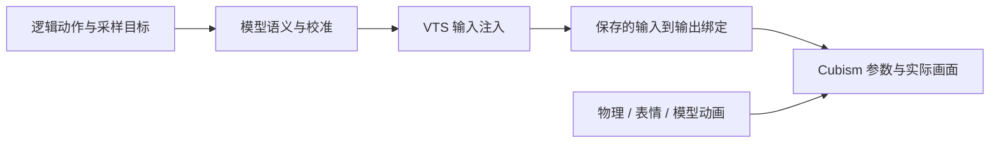

# Live2D 动画与模型适配手册

按 2026-10-10 当前源码编写。本目录拥有动作创作、播放机制和模型适配；动画概念不进入 Uina Core。

动作使用 TypeScript 声明式定义，以逻辑轴描述关键帧、曲线与组合。同一份动作可以用于不同模型，但能否播放取决于模型真实具备的变形、VTS 绑定、控制来源与校准范围。定义、编译、播放、能力准入和可恢复配置准备已实现；真实 MO 的准备应用、画面验收及跨真实模型验收尚未完成。

## 阅读入口

- [先运行与调用](#先运行与调用)
- [创作一个新动作](#创作一个新动作)
- [组合与数值规则](#组合与数值规则)
- [播放、所有权与原子性](#播放所有权与原子性)
- [姿态、叠加与交接设计](./COMPOSITION.md)
- [接入一个新模型](#接入一个新模型)
- [模型配置准备与恢复](#模型配置准备与恢复)
- [校准和质量验收](#校准和质量验收)
- [故障排查](#故障排查)
- [源码与维护入口](#源码与维护入口)

## 先运行与调用

在 VTube Studio 中加载目标模型，打开本地 API，允许 `Uina Live2D VTS` 插件授权。客户端默认连接 `ws://127.0.0.1:8001`。Windows 默认从运行中的 VTS 定位 `Live2DModels` 目录；发现失败时设置 `UINA_VTS_MODELS_DIR`。它指向所有模型的根目录，而不是单个模型文件夹。

仓库根目录启动：

```powershell
# 仅在自动发现失败或需要指定目录时设置，替换成实际路径。
$env:UINA_VTS_MODELS_DIR = 'D:/VTube Studio/VTube Studio_Data/StreamingAssets/Live2DModels'
pnpm start
```

通过 Live2D World 的 `status` action 检查 API、鉴权、控制就绪、模型能力与传输证据。API 连接成功不等于具备控制能力；具身端点还需注册，才能由 embodiment 路由 cue。身体 ID 固定为 `live2d`，与模型 ID 无关。

日常正文中使用精确名称的 cue：

```xml
<cue id="nod"/>
<cue id="nod" target="live2d"/>
<cue id="focused" target="live2d"/>
```

前两条播放命名动作，最后一条切换持续基准姿态。省略 `target` 时由具身路由选择身体。只支持目录精确名称，不支持旧别名、冒号强度或逗号组合语法。目录中存在的动作仍可能被当前模型的能力准入过滤。

以下 JSON 是 World action 的参数，不是终端命令。需要明确力度、留存或整场抢占语义时调用 `express`：

```json
{"motion":"double_nod","intensity":0.6,"atomic":true,"transition":"gentle"}
```

也可以直接编排分镜：

```json
{
  "beats": [
    {"head":"turn_right","gaze":"away_right","face":"shy","hold_ms":900},
    {"head":"tilt_left","gaze":"user","face":"tender_smile","hold_ms":1200}
  ],
  "intensity":0.6,
  "latch_last":false,
  "atomic":true
}
```

`motion`、顶层 `head/gaze/face`、`beats` 三种模式选择一种。`motion` 与非空分镜或姿态字段混用会失败；有 `beats` 时顶层 `head/gaze/face` 当前会被忽略，写分镜时只在每步填写。`hold_ms` 是每步总时长，包含过渡，必须大于零，默认 1000ms。每步强度默认继承整体强度，工具强度范围为 0..1。`latch_last` 优先于最后一步的 `latch`，中间步骤的 `latch` 不产生持久留存。

持续体态使用 `pose` action，例如：

```json
{"name":"focused","duration_ms":5000}
```

`duration_ms` 省略或为零时持续保持，大于零时到期回到 `relaxed`。失焦停靠会冻结剩余时长。离线时可保存本地姿态意图，返回 `applied` 不表示设备已呈现；离线瞬态 cue 被忽略，离线 `express` 返回未开始。

当前内容清单：

| 类别 | 名称 |
| --- | --- |
| 命名动作（19 个） | `smile`、`nod`、`double_nod`、`shake`、`curious`、`laugh`、`shy`、`peek_back`、`wink`、`pout`、`surprise`、`shrug`、`head_bop`、`look_away`、`thinking_deep`、`smug_grin`、`sleepy_yawn`、`sparkle`、`celebrate` |
| 基准姿态 | `relaxed`、`focused`、`playful`、`shy_side`、`confident`、`listening`、`smug_gremlin`、`meek_shy`、`streamer_hype` |
| head | `neutral`、`turn_left`、`turn_right`、`tilt_left`、`tilt_right`、`lowered`、`lifted`、`nod`、`shake` |
| gaze | `user`、`away_left`、`away_right`、`down`、`side_peek` |
| face | `shy`、`smug`、`pout`、`sparkle`、`shocked`、`tender_smile`、`laugh`、`winking`、`smug_grin`、`sleepy_yawn` |

启用 TTS 时，正文 cue 按段内字素偏移与播放进度触发；这是近似定位，不是逐词音频对齐。口型使用播放电平包络，主动张嘴与语音张嘴取较大值，保持笑容不会关闭语音口型。整模型 `flip` 另走 VTS 位置/角度控制与归位核验，不属于下面的参数动作语言。

### 原程序动作迁移对照

原有 18 个命名表演的内容均有新动作定义，另保留新增的 `celebrate`。下表用于内容对照；改名后的旧名称不作为兼容别名接受。动作不再调用旧映射表或旧 cue 解析器。

| 原名称 | 当前调用名 | 当前表现 |
| --- | --- | --- |
| `warm_smile` | `smile` | 温柔微笑、注视用户 |
| `happy_laugh` | `laugh` | 抬头笑后回落 |
| `curious_tilt` | `curious` | 轻歪头好奇地看向用户 |
| `affirmative_nod` | `nod` | 完整点头并回位 |
| `double_nod` | `double_nod` | 先轻点头，再认真回应，轻重与时长不同 |
| `shake_head` | `shake` | 左右摇头后回位 |
| `shrug` | `shrug` | 轻抬下巴、微后仰、偏头叹气，再微笑；当前没有肩部轴 |
| `head_bop` | `head_bop` | 左右点晃头，后续摆幅减小、柔和收住 |
| `playful_pout` | `pout` | 微偏头嘟嘴 |
| `surprised_gasp` | `surprise` | 抬头、抬眉、惊讶张嘴 |
| `shy` | `shy` | 害羞低头、避开视线 |
| `look_away` | `look_away` | 眼睛先望开，头部随后转向，保留侧向视线直到收势 |
| `peek_back` | `peek_back` | 先避开，再看回用户 |
| `thinking_deep` | `thinking_deep` | 慢歪头、轻移视线思索，想明白后回看；没有托腮动作 |
| `winking` | `wink` | 轻歪头，短暂闭合右眼，结束前已重新睁开 |
| `smug_grin` | `smug_grin` | 抬下巴、侧目，展露不对称坏笑后回看 |
| `sleepy_yawn` | `sleepy_yawn` | 眯眼、仰头慢慢张嘴，合嘴、低头，再睁眼回神 |
| `sparkle` | `sparkle` | 轻蓄势后抬眉、展开笑容，偏头收势；没有发光特效 |

单眨眼和连眨眼的开合波形也由 `AMBIENT.blink/doubleBlink` 声明并编译，阶段时长取自编译关键帧。生理层只决定触发、准入和进度，使用同一生产采样器，不保留另一套余弦开合算法。持续基准姿态通过 `compilePoseTransition` 编译分部位过渡；思考入场、注意反应、呼吸、语流、重音、随机待机和思考视线微动同样从动作库采样。详细合成规则见 [姿态、叠加与交接设计](./COMPOSITION.md)。

VTS 模型目录里的 `motion3.json/exp3.json` 属于模型资产，与已删除的程序动画实现分开。它们不经过 Uina 旧播放链路，保留文件不表示旧链路仍然存在；实际参数冲突仍按模型适配流程处理。

## 创作一个新动作

从 `motion-library.ts` 现有定义开始。新增命名动作只需在 `MOTION_LIBRARY` 加入 `{ description, definition }`，cue 声明和工具枚举随目录生成；播放器不需要认识新名字。以下完整例子可放在本目录模块中，导入路径相对于本目录：

```ts
import { compileMotion, motion, track, type MotionCurve } from "./motion.js";

const soft: MotionCurve = [0.25, 0.1, 0.75, 0.9];
const smallNod = motion(
  800,
  track("head.pitch", [[0, 0], [300, -8], [800, 0]], "baseline-offset", soft),
);
const compiled = compileMotion(smallNod);
```

它在本次播放的启动基准上低头，再回到启动基准。动作里写 `head.pitch`，模型参数名字由适配定义处理。

复用既有头部、视线与面部定义，可编排复杂表演：

```ts
import { FACE_MOTIONS, GAZE_MOTIONS, HEAD_MOTIONS } from "./motion-library.js";
import { compileMotion, delay, parallel, repeat, sequence, transform } from "./motion.js";

const greeting = sequence(
  parallel(
    repeat(2, HEAD_MOTIONS.nod),
    delay(150, FACE_MOTIONS.tender_smile),
    GAZE_MOTIONS.user,
  ),
  parallel(
    transform(HEAD_MOTIONS.tilt_left, { intensity: 0.5, durationScale: 1.2 }),
    FACE_MOTIONS.winking,
  ),
);
const compiledGreeting = compileMotion(greeting);
```

将定义放进 `motion-library.ts` 时直接使用文件里已有的常量与导入，不从该文件导入自身。保留其他目录项，新增这一项：

```ts
// 添加到现有 MOTION_LIBRARY 对象内部：
greeting: { description: "点头问候后轻歪头眨眼", definition: greeting },
```

重启或重新加载 World 后使用 `<cue id="greeting"/>`，或向 `express` 传入 `{"motion":"greeting","atomic":true}`。最终是否可用仍由模型准入决定。复用完整 `FACE_MOTIONS` 会同时写面部中性重置；只需要某一轴时，直接写该轴轨道可缩小依赖。

某些增强可选时在轨道上声明：

```ts
import { compileMotion, motion, track } from "./motion.js";

const smileWithOptionalBlush = motion(
  1000,
  track("mouth.form", [[0, 0], [300, 0.4], [1000, 0.4]]),
  { ...track("face.blush", [[0, 0], [300, 0.3], [1000, 0.3]]), optional: true },
);
const compiledSmile = compileMotion(smileWithOptionalBlush);
```

模型缺少脸红时可保留微笑和总时长。只有同一轴的所有轨道都可选，该轴才能整体省略；必需轴缺失或超出校准范围则整场拒绝。将核心动作标为可选会改变实际表达，宜只用于中性重置或附加效果。

新增基准姿态需同时维护 `types.ts` 的名字/描述和 `motion-library.ts` 的 `BASE_POSES`。基准从完整中性值重建，未写字段恢复中性，不继承上一个姿态残留。

## 组合与数值规则

| 写法 | 行为 |
| --- | --- |
| `motion(ms, ...tracks)` | 多轴关键帧片段；时长为正，轨道非空 |
| `track(axis, keys, space, curve)` | 时间为毫秒，严格递增并覆盖 0 到片段末尾；后两项默认 `absolute`、`smooth` |
| `pose(ms, values, space, optionalAxes)` | 保持目标并从前值进入；自动入场为 `min(180ms, ms × 0.4)`，后两项可省略 |
| `sequence(...definitions)` | 顺序播放；没有写某轴的后续片段保留该分支前值 |
| `parallel(...definitions)` | 同时开始，总时长为最长分支；较短分支保持终值 |
| `delay(ms, definition)` | 延后整个定义，延时不能为负 |
| `repeat(count, definition)` | 展开有限次重复，次数为正整数 |
| `transform(definition, options)` | `durationScale` 缩放时间，`intensity` 缩放幅度；默认都为 1，可嵌套，编译后数值仍须合法 |
| `compileMotion(definition)` | 校验并展开，推导轴/通道，返回与源对象分离的冻结结果 |
| `sampleMotion(compiled, atMs, baseline)` | 无设备、无时钟的纯目标采样；默认基准为 `NEUTRAL_AXES` |

`absolute` 表示逻辑绝对目标，强度围绕轴中性值缩放；闭眼目标 0、强度 0.2 得到开放度 0.8。`baseline-offset` 表示本次播放启动基准的增量，强度围绕零缩放。启动基准在整场播放期间固定；退出时融回当时实际运行的底层合成结果，包含当前姿态、反射与待机。

曲线可复用 `smooth`（五次缓入缓出）、`linear`、`hold` 或四个 0..1 的三次 Bezier 控制坐标。`track` 的曲线作用于每个右端关键帧的入段。逐段不同曲线可直接给 `motion` 传轨道对象：

```ts
import { compileMotion, motion } from "./motion.js";

const glance = motion(1000, {
  axis: "gaze.x",
  space: "absolute",
  keys: [
    { atMs: 0, value: 0 },
    { atMs: 300, value: 0.6, curve: "smooth" },
    { atMs: 700, value: 0.6, curve: "hold" },
    { atMs: 1000, value: 0, curve: "linear" },
  ],
});
const compiledGlance = compileMotion(glance);
```

不同轴可并行；同轴重叠只允许明确的 `baseline-offset` 相加，有绝对目标竞争时编译失败。组合偏移与基准相加仍可能饱和，动力学按逻辑范围裁剪。明确关键帧按作者给定的首值衔接，作者需保证拼接端点连续。`pose` 的前值缓入不替作者修复任意轨迹跳变。

当前 23 个逻辑轴：

| 轴 | 通道 | 范围 | 中性值 |
| --- | --- | --- | --- |
| `head.yaw/pitch/roll` | head | -30..30° | 0 |
| `torso.yaw/pitch/roll` | torso | -15..15° | 0 |
| `torso.breath` | torso | 0..1 | 0.5 |
| `gaze.x/y` | gaze | -1..1 | 0 |
| `eyes.left.open`、`eyes.right.open` | eyes | 0..1 | 1（正常睁眼） |
| `eyes.left.smile`、`eyes.right.smile` | eyes | 0..1 | 0 |
| `brows.left/right` | eyes | -1..1 | 0 |
| `face.blush` | eyes | 0..1 | 0 |
| `mouth.open` | mouth | 0..1 | 0 |
| `mouth.form/x/pucker` | mouth | -1..1 | 0 |
| `jaw.shrug/open`、`mouth.cheekPuff` | mouth | 0..1 | 0 |

表中斜杠用于缩写，代码中要逐个写完整轴名。正负方向的实际视觉含义需随模型校准。当前没有手部、肩部或特效轴；扩展轴需修改 TypeScript 轴表及相关实现，尚无运行时轴注册。

## 播放、所有权与原子性

定义既可以是小片段，也可以是完整表演，没有固定的“只能做原子小动作”限制。`atomic: true` 指播放时的资源语义：一起申请全部所需通道，任何通道被抢占就取消整场。已经显示的画面不能回滚。

所有播放启动时都必须获得全部请求通道，检查完成后才驱逐旧租约。模型可选轴省略发生在申请前。命名表演（cue 或 express.motion）默认原子，防止留下与新头部动作不匹配的旧表情；即兴 head/gaze/face 或 beats 默认非原子。可用 `atomic` 显式覆盖。非原子动作在播放中允许部分通道让位；全部通道失去时取消。通道粒度为 `head/torso/gaze/eyes/mouth`，只写 `head.pitch` 也会占用整个 head。模型耦合还会扩展控制通道。

优先级为待机 10、反射 20、cue 30、显式 action 50、急停 100。相交通道的新 cue 可替换旧 cue，后来的 express 可替换先前 express；互不相交通道可并行。

新动作与最新被接管动作使用仍在推进的轨迹交叉淡入淡出；更早的交接合并为当前残余贡献，连续打断不会无限保留旧表演。正常结束在退出段融回实时底层，再释放租约。普通取消保留短暂的视觉退出尾段，但立即解除执行所有权；急停、断连和换模型清空尾段。`latch_last: true` 保留最终通道目标，姿态切换或新动作渐进替换留存。`transition` 的 `snappy/smooth/gentle` 控制接管、退出和动力学响应，不改变定义时长；非法过渡值明确失败。创作速度使用 `durationScale`。

说话开放度进入合成器，与表情目标按剩余开放余量组合，然后统一经过动力学；客户端不再二次覆盖嘴型。默认 `blend` 允许笑着说话，`withSpeech(definition, "exclusive")` 保护哈欠等嘴部编排，其策略随轨道、顺序和模型投影编译。工具的 `speech: "blend" | "exclusive"` 可覆盖整场策略。哈欠结束或被替换后，说话权重随退出逐渐恢复；没有恢复到半个哈欠的队列。

播放由渲染时钟推进，不能仅凭墙钟等待判定完成。纯采样得到目标，最终画面还受动力学、生理微动、口型及 VTS 合成影响。开发底层机制时可调用 `director.play()`，但产品 cue/express 必须经过运行时模型准入。手工外部租约在申请时选择 atomic，不能在播放时升级；持有者用 `lease.release()` 清理，全局停止用 `director.abortAllMotions()`。

## 接入一个新模型

控制链如下：



不需要把 `.moc3` 中的自定义参数改成标准名字。适配器可使用任意已存在输出 ID。创建插件输入只完成输入一环，必须有保存绑定，且没有冲突控制来源，才能成为可执行能力。模型本身没有制作相应变形时，配置和程序都不能凭空增加它。

已有绑定独立且正确时，编写语义与校准 JSON 即可；共享输入、物理覆盖或自动眨眼/呼吸等来源使轴无法独立控制时，需要准备 VTS 配置。程序准备修改的是 `.vtube.json` 和必要的 `.physics3.json`，保留 moc3、贴图和原输出 ID。

适配定义读取优先级：`UINA_LIVE2D_ADAPTER` 显式文件 → 本目录 `model-adapters/<modelID>.json` → 标准名称候选。显式文件不存在或非法会失败；标准名称候选不授予控制资格。建议每份持久定义写明 `modelID`，防止误用于其他模型。

最小结构示例：

```json
{
  "version":1,
  "modelID":"替换为实际模型ID",
  "axes":{
    "head.yaw":[{
      "parameter":"AnyExistingHeadParameter",
      "input":"ActualInputName",
      "points":[[-30,-2],[0,1],[30,4]],
      "provisional":true
    }]
  }
}
```

参数名和数值都是示意，需替换为目标模型的真实事实。这不是 MO 的校准。

| 字段 | 含义 |
| --- | --- |
| `parameter` | 原模型的 Cubism 输出 ID，必须真实存在 |
| `input` | 可选，明确选择保存绑定的 VTS 输入；不会创建输入或绑定 |
| `points` | `[逻辑值, Cubism 输出值]`，不是 VTS 输入值；按保存映射反算输入 |
| `direction` | 没有显式 points 时选择推导方向，值为 1 或 -1 |
| `provisional` | 未完成视觉创作/验收的数值映射应设 true |
| `allowFanout` | 显式接受该输入带动其他输出；不能赋予共享输入的多个轴独立控制能力 |

一个轴可配置多个输出形成配方，但每个输出都需合法绑定；准备器为多目标分别生成 `Uina…Target1`、`Uina…Target2` 输入，允许各目标使用不同校准曲线，不把它们强塞进同一个输入。单目标保留 `Uina…` 命名。未知额外输出的 fanout 会保守保留全部通道。未定义的轴不可用。编译器检查真实输入、真实范围、空/重复/零宽绑定、共享资源、自动来源、物理输出、静态模型动画及活动或未知表情来源；无法证明可控时记录原因，不猜测成功。

修改适配 JSON 后重启 Uina 或重新加载 World 以重读定义。修改模型保存配置时还需在 VTS 明确重新加载模型；只重连 API 不证明新配置已进入内存。物理/活动表情的观察是约一秒一次的低频检查，不保证逐帧同步外部操作。

## 模型配置准备与恢复

下面全部命令在仓库根执行。停止 Uina，避免并行控制；需要连接 API 的步骤保持 VTS 运行并加载目标模型，需要写文件的步骤关闭 VTS。所有输出文件必须不存在，父目录必须存在；恢复目录也必须是新目录。

命令参数索引：

```text
inspect --model-id ID [--models-root ROOT] [--definition JSON] [--output FILE]
capture --output FILE [--models-root ROOT]
plan --snapshot FILE [--definition JSON] --output FILE
inputs --plan FILE [--models-root ROOT]
apply --plan FILE --recovery-dir NEW_DIR --definition-output NEW_FILE
restore --manifest FILE
```

统一前缀为 `pnpm exec tsx scripts/live2d-model.mts`。`inspect` 读取磁盘，输出 `{profile, definition, capabilities}`；没有 API 范围时可用轴为零是正常结果。**inspect 报告不能当作 plan 的 snapshot**，plan 需要 capture 输出的原始 `ModelProfile`。

1. 启动 VTS 并加载目标模型，capture 捕获真实范围、输入与模型事实；可能请求插件授权，不注入动作。

   ```powershell
   pnpm exec tsx scripts/live2d-model.mts capture --output avatar-snapshot.json
   ```

2. 据快照编辑 `avatar-adapter.json`，给真实输出赋予语义和校准。预览计划，检查 `patches`、`manualBindings` 和 `diagnostics`。文件名只是示例，选择自己专用的记录位置。

   ```powershell
   pnpm exec tsx scripts/live2d-model.mts plan --snapshot avatar-snapshot.json --definition avatar-adapter.json --output avatar-plan.json
   ```

3. 在目标模型仍加载时，创建/核验计划需要的插件输入；这一步不会写保存绑定。

   ```powershell
   pnpm exec tsx scripts/live2d-model.mts inputs --plan avatar-plan.json
   ```

4. 关闭 VTS。它关闭时可能保存配置，因此用新的输出名重新生成并审查计划。plan 重读磁盘，只有 moc3 指纹相同才复用快照 API 范围；本体改变则重新 capture。较早快照的输入清单不代表准备后的控制已经就绪。

   ```powershell
   pnpm exec tsx scripts/live2d-model.mts plan --snapshot avatar-snapshot.json --definition avatar-adapter.json --output avatar-closed-plan.json
   pnpm exec tsx scripts/live2d-model.mts apply --plan avatar-closed-plan.json --recovery-dir avatar-recovery --definition-output avatar-prepared-adapter.json
   ```

5. 重新打开 VTS 并加载模型，选择生成定义，再 capture 核验实际事实，然后启动 Uina。设置的环境变量需在同一个 PowerShell 会话中生效。

   ```powershell
   $env:UINA_LIVE2D_ADAPTER = (Resolve-Path avatar-prepared-adapter.json).Path
   pnpm exec tsx scripts/live2d-model.mts capture --output avatar-prepared-snapshot.json
   pnpm start
   ```

6. 检查状态和实际可用动作，完成下节的单轴与组合验收。确认定义后放入 `model-adapters/<modelID>.json`，取消显式覆盖并重启，让换模型时按各自 ID 选定义。

   ```powershell
   Remove-Item Env:UINA_LIVE2D_ADAPTER -ErrorAction SilentlyContinue
   ```

准备器要求目标输出已有可识别的绑定行模板。模板缺失时，在 VTS 手工建立该输出绑定，关闭后重新生成计划；不支持的配置结构也需手工处理。`manualBindings` 给出计划输入/输出及范围，不能将它的存在视为已经应用。

程序对原模型目录应用可恢复补丁，没有自动模型克隆。它合并选定输出的重复绑定，将相应平滑设为零并解除内置呼吸/眨眼来源；只删除选定输出的物理写入，保留其他物理并同步计数。遇到冲突模型动画或表情会拒绝，准备时即使表情当前未激活也会检查；不会自动重写这些内容。

应用前核验指纹、先备份后替换，失败尝试回滚。跨文件替换不具备断电级原子性。生成适配 JSON 在写模型补丁前完成，因此 **存在 prepared-adapter 文件不等于 apply 成功**，需检查退出结果、恢复清单和重载后的事实。自动 apply/restore 当前只支持 Windows 的 VTS 停机核验，其他平台按绑定表手工准备。

恢复时停止 Uina、关闭 VTS，再执行：

```powershell
pnpm exec tsx scripts/live2d-model.mts restore --manifest avatar-recovery/recovery.json
```

恢复会拒绝覆盖准备后发生的用户修改，不删除全局插件输入。恢复后同步选回原适配定义，重载 VTS 并 capture；持续使用 prepared 定义可能与恢复后的绑定不符。全局旧输入是否可删需核验其他模型引用与所有权，当前不自动清理。

MO 模型 ID 是 `da0021cd32ee464ca41f980e8c32515b`。本目录同名预设含 22 个轴，不包含未证明连续控制的 blush；`Param122..126` 分别对应 `mouth.x`、`mouth.pucker`、`jaw.shrug`、`jaw.open`、`mouth.cheekPuff`。预设仍为 provisional，并非已完成真实准备和视觉验收。原版对照证据见 [MO-MODEL-COMPARISON.md](./MO-MODEL-COMPARISON.md)。

## 校准和质量验收

校准点至少两个，数值有限，逻辑横坐标严格递增，输出严格单调递增或递减，输出值在 API 真实范围和保存绑定可达范围内，并包含逻辑中性点。自动推导和显式校准共用校验；推导退化成常量时不授予能力。允许只覆盖舒适逻辑子范围，超出范围的动作会拒绝。非零 `baseline-offset` 可能从任意合法基准启动，当前保守要求覆盖完整逻辑范围；子范围校准优先用明确绝对目标。

眼睑逻辑 1 是正常睁眼，默认推导使用模型真实默认值，不能把 VTS 保存映射的夸张上端当成正常开放度。异常方向或中性需显式 points。呼吸默认推导使用范围中点。`authored` 只说明显式数值校准的声明状态，不是程序独立核验过的视觉结论；未经观察的草稿保持 `provisional: true`。

每个新动作先离线采样，再进行设备和画面验收。离线例子可放在本目录模块中：

```ts
import { NEUTRAL_AXES } from "./motion-axes.js";
import { HEAD_MOTIONS } from "./motion-library.js";
import { compileMotion, sampleMotion } from "./motion.js";

const compiled = compileMotion(HEAD_MOTIONS.nod);
for (const baseline of [NEUTRAL_AXES, { ...NEUTRAL_AXES, "head.pitch": -20 }]) {
  const samples = [0, 320, compiled.durationMs].map((atMs) =>
    sampleMotion(compiled, atMs, baseline),
  );
  console.log(samples);
}
```

检查首尾目标、组合时序、极端基准下的偏移叠加和饱和。`sampleLoop` 只支持从零开始的独立周期轨道，延时或依赖顺序前值的表演用 `sampleMotion`。

真实验收顺序建议如下：

1. 核对 API 真实范围、模型 ID、输入绑定与能力原因，确认新配置确实已重载。
2. 每轴从中性开始，小幅分别试两侧，检查方向、中性、舒适幅度与是否牵动其他部位。不要用完整命名 nod 代替单轴检查，它还需要笑容与视线。
3. 再试头/躯干/眼/嘴组合，验证共享资源、物理、表情、VTS 平滑和中性残留。记录校准饱和及触发条件。
4. 检查连续调用、接管、取消、原子抢占、留存与姿态到期，确认退出自然且无残留。
5. 与语音一起播放，确认笑容、张嘴、眨眼与 cue 时机；切模型和断连后检查旧动作停止、能力重新生成。
6. 保存模型 ID、VTS 版本、适配定义、事实快照、测试动作和实际观察。通过数值检查后仍需真人观看画面。

证据按层区分：编译通过证明定义合法；能力准入证明当前事实满足控制条件；请求接受证明设备接受输入；时间线完成证明本地播放流程完成；输出回读和实际画面观察才支持更进一步的效果判断。express 按播放租约归属合成帧的输入确认；待机帧和其他播放的迟到确认不计入本场。完成后先释放通道，再等待本场已有待确认请求（受注入超时约束）；取消即时返回，不等待确认。缺少保留轴的输入确认、注入失败或设备代次变化时返回 `unknown`。`accepted` 只表示包含本动作贡献的合成帧被接受，不证明完整轨迹、峰值或视觉效果。

结果的 `omissions` 给出适配省略轴及原因，`interruptedChannels` 表示播放中被抢占的通道；任一存在则 `partial=true`。抢占前可能已经呈现，不能将整段描述为“未执行”。姿态工具报告 `verification=local_intent` 及可选省略，不能把本地意图当画面确认。审查依据、已修问题和后续顺序见 [适配与执行审查](./ADAPTER-REVIEW.md)。

## 故障排查

| 现象 | 优先检查与处理 |
| --- | --- |
| API 已连接，但控制未就绪 | 看初始化阶段与故障：鉴权、模型配置、参数清单、热键查询和模型切换订阅都要完成 |
| 命名动作在 cue 能力中消失 | 检查必需轴、校准跨度与控制来源；命名 nod 同时需要微笑和视线，可先用 express 的 head-only 模式定位 |
| 自定义参数有名字但动不了 | 核对创建输入后是否建立输入→实际输出绑定；再检查重复/空/零宽绑定、物理和表情覆盖 |
| 两个部位一起动，或轴被判冲突 | 检查共享输入/输出与 fanout；独立控制需准备专用绑定，allowFanout 只表示接受耦合 |
| 子范围 points 合法但动作被拒绝 | 轨道可能超出校准范围；非零 baseline-offset 当前要求完整逻辑跨度 |
| 眼睛夸张张开、姿态偏移 | 核对真实默认值与校准中性，勿直接套保存绑定上端；用显式 points 校准 |
| 改 JSON 后效果不变 | 重启 Uina/重载 World；模型文件改变还要明确重载 VTS 模型 |
| 切模型后适配身份不符 | 去掉强制 UINA_LIVE2D_ADAPTER，改用按 modelID 命名的本地定义 |
| plan 报数据不完整 | 确认输入是 capture 快照，不能传 inspect 包装报告 |
| apply 报文件变化或 VTS 未关闭 | 关闭 VTS 后重新生成并审查新计划；moc3 改变先重新 capture |
| prepared JSON 已生成但模型没准备好 | 看 apply 是否成功及恢复清单，JSON 先于补丁生成 |
| 动作时间线完成但结果 unknown | 查发送/接受/失败/过滤/丢弃与设备代次，不据本地完成推断画面成功 |
| restore 拒绝后续修改 | 保留当前修改并对照恢复清单人工核对，不盲目覆盖 |

## 源码与维护入口

| 文件 | 负责内容 |
| --- | --- |
| [motion-library.ts](./motion-library.ts) | 动作、复用片段、基准姿态与目录；新增内容主要在这里 |
| [motion.ts](./motion.ts)、[motion-axes.ts](./motion-axes.ts) | 声明语言、编译、纯采样、可选轴投影及逻辑轴范围 |
| [motion-director.ts](./motion-director.ts)、[body-director.ts](./body-director.ts) | 意图、租约、时间线、基准/留存与参数动力学 |
| [runtime.ts](./runtime.ts)、[companion.ts](./companion.ts) | action/cue 能力准入、生命周期、渲染与口型合成 |
| [model-profile.ts](./model-profile.ts)、[model-adapter.ts](./model-adapter.ts) | 模型事实、语义定义、校准、控制资格与输出编码 |
| [model-preparation.ts](./model-preparation.ts) | 配置准备、补丁核验、备份与恢复 |
| [vts-client.ts](./vts-client.ts)、[model-motion.ts](./model-motion.ts) | VTS 协议、模型失效、传输证据及整模型翻转/归位 |
| [live2d-model.mts](../../../scripts/live2d-model.mts) | inspect/capture/plan/inputs/apply/restore CLI |

维护动作和适配机制时，运行仓库类型/边界检查和相关测试：

```powershell
pnpm typecheck
pnpm exec vitest run tests/live2d-motion-authoring.test.ts tests/live2d-model-adapter.test.ts tests/live2d-model-runtime.test.ts tests/live2d-continuity.test.ts tests/live2d-presentation.test.ts
pnpm build
```

这些检查覆盖定义、准入、连续性与离线/组合行为，不能替代 VTS 真机画面验收。完整运行规则见仓库 `AGENTS.md` 和 `dev/`。

进一步阅读：[动作语言参考](./MOTION-AUTHORING.md)、[当前架构](./DESIGN.md)、[模型适配实施与研究记录](./MODEL-ADAPTATION.md)。[MO 对照](./MO-MODEL-COMPARISON.md)、[过渡审查](./PRESENTATION-REVIEW.md) 与 [审查记录](./REVIEW.md) 提供历史证据，不作为当前操作步骤。
