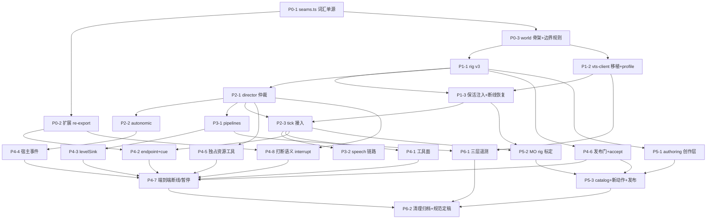

# Live2D World 重写任务清单 (Rebuild Checklist)

> 2026-10-13 状态校正：下列 P0–P6 是历史重写档案，历史工具数量、P1 接入状态及验收数量不再代表当前实现。当前实施进度与证据见[完整重构计划](../superpowers/plans/2026-10-13-live2d-world-refactor.md)及[运行合同](../live2d-world-runtime.md)。本次已实现四项归属与生命周期修复；当前仅 express/state/costume/status/reload。真实 VTS/MO 设备验收仍单列待办，不能由假设备或真实 Worker 测试代替。

> 状态：进度追踪的唯一载体。每完成一项：勾销状态、填 evidence、更新日期。**依赖未完成的任务不得开始；完成必须附 evidence（测试名 / 命令输出摘要 / 画面核对记录），无 evidence 不得勾销。**
> 状态标记：`☐` 未开始 · `◐` 进行中 · `☑` 完成（附日期）。
> 依据：引擎规范 v4.7（v4.6+修订登记）、边界规范 v1.0、施工方案 v1.0。

## 依赖关系图

关键路径：P0-1 → P0-3 → P1-1 → P2-1 → P2-3 → P4-1 → P4-7 → P6-2。画面验收锚点：P1-3、P2-3、P3-2、P5-3（每处必须本机 VTS 人工核对并留记录）。

## P0 接缝与骨架（无画面依赖）

| ID | 任务 | 依赖 | 完成判定 (DoD) | 状态 | evidence |
| --- | --- | --- | --- | --- | --- |
| P0-1 | `src/extensions/world-framework/seams.ts`：BodyEndpoint 族（含 `interrupt?`）/ VoiceLevelSink / 两个前缀单源 | — | tsc + boundaries 绿；类型不再有两处定义 | ☑ 2026-10-11 | tsc + boundaries 8 规则绿；embodiment/voice re-export 后无重复定义（commit d426f41） |
| P0-2 | embodiment / voice 改 re-export seams.ts，对外 API 不变 | P0-1 | 现有全部世界/扩展测试回归通过 | ☑ 2026-10-11 | 受影响路径：4 个 live2d 测试文件 29 用例过 + tsc 全绿；本机全量 149 文件 1673 测试过，7 失败/8 unhandled 全部为 forks 池 spawn UNKNOWN errno -4094 环境级 flake（cli-session/exec-cwd/smoke/search-tools，spawn 重度测试；同批 4 文件 53 用例 vmThreads 复跑全绿 20.1s 实证，与当日 QQ 会话 P6.2 已登记的同根签名一致，零 live2d 域失败） |
| P0-3 | live2d 骨架：index.ts WorldDef 十工具 + runtime/endpoint 骨架；boundaries 新规则 ×2（sibling extensions 禁止 + live2d src 白名单） | P0-1 | 世界可启停；工具返回 not_started 级语义；boundaries 绿 | ◐ | boundaries 绿（8 规则含 2 新增）；**启停冒烟（宿主实际装载世界）待本机执行** |

## P1 协议与 rig

| ID | 任务 | 依赖 | 完成判定 (DoD) | 状态 | evidence |
| --- | --- | --- | --- | --- | --- |
| P1-1 | `adapter/rig.ts`：ModelRig v3 校验、分段标尺端点裁剪、max 聚合、多轴汇入未声明规则报错、optional 轴 | P0-3 | 单测：v2 拒载 / 非法曲线 / max / optional 降级标记 | ☑ | a484279；tests/live2d-rig.test.ts 12 用例过 |
| P1-2 | `adapter/vts-client.ts` 移植 + `adapter/profile.ts`（保存映射与真实事实分离） | P0-3 | 现行行为测试经 WebSocketLike 假体全过：token 持久化、断线重订、单未确认帧背压、代次校验、假就绪防护 | ☑ | ce65fa0；tests/live2d-vts-client.test.ts 7 用例过；profile.ts 与 legacy diff -q 字节一致；vts-client.ts 仅 2 处显式差异（import 路径、tokenPath 世界根延续） |
| P1-3 | 保活注入（<1s 续租 + faceFound）与断线恢复全流程接线 | P1-1, P1-2 | 测试：引擎 #11/#14 + 边界 #7/#8；**画面：中性流接管 ≥60s 不漂移、断线重连恢复、换模型代次失效**（本机 VTS） | ☑ | c799cfc + 00e595e；keepalive 6 + mo-rig 4 用例；2026-10-11 本机画面验收过（9 所有权通道钉死、眉毛睫毛留摄像头、与 legacy 逐通道一致） |

## P2 仲裁与自律（引擎核心）

| ID | 任务 | 依赖 | 完成判定 (DoD) | 状态 | evidence |
| --- | --- | --- | --- | --- | --- |
| P2-1 | `director/director.ts`：槽位 Set/Patch + SupersededError、逐轴仲裁（shadow/cancel/release）、类别优先级（A1）、独占声明（A12） | P1-1 | 单测：引擎 #6/#8/#9/#12/#19；无 priority 旋钮（类型层） | ☑ 单测 9 例全绿（commit 69e3826）| |
| P2-2 | `director/autonomic.ts`：呼吸唯一主来源互斥、冷却锁眨眼、微晃避让、视线漂移；注入时钟/RNG（A9） | P2-1 | 单测：固定 RNG 下眨眼时序确定；`external.breath==="vts"` 时呼吸静默 | ☑ 单测 6 例全绿（commit fd4a823；含眼睑调制 #3 P2 简化版用例）| |
| P2-3 | tick 合成接入 runtime：compose(dt) → encode → inject，断线/未发布零输出 | P2-1, P1-3 | 测试：合成推进纯函数化；**画面：低头+点头回归 -8°（#1）、微笑眨眼闭拢（#3）、惊跳取消（#4）、patch 并发（#6）（本机 VTS）** | ☑ 工程侧 e48c6c0 + 画面验收通过（2026-10-11：#1 回归-8° ✓ / #3 眨眼全闭回0.8 ✓ / #4 cancelled ✓ / #6 并发 ✓；反馈修复：清槽 NaN 跳变根修 75f8136、过渡默认 600ms + #6 节奏放缓 9b31623；惊跳观感=占位内容，正式动作归 P5） | |

## P3 管道

| ID | 任务 | 依赖 | 完成判定 (DoD) | 状态 | evidence |
| --- | --- | --- | --- | --- | --- |
| P3-1 | `director/pipelines.ts`：解析弹簧（子步保护、参数可配置 A10）、视线头姿后置补偿、面部 SmoothFilter、眼睑乘法调制、口型包络跟随（50ms 释放） | P2-1 | 单测：引擎 #2/#5/#7/#10 | ☑ | commit 1b70046；live2d-pipelines 10 测试 |
| P3-2 | MO speech 配置 + 电平驱动链路 | P3-1, P2-3 | **画面：视线锚定头动补偿（#5）、preview rms 驱动张嘴/暂停回零（#2）（本机 VTS）** | ☑ | ba27079/3063404/910bccf/f3fd673/a4f130a/cbf5075；双时钟修复后用户确认"完全符合预期"（2026-10-11）。注意：cbf5075 前全部验收为 2 倍速，节奏参数待 P5 真实时钟重验 |

## P4 世界边界

| ID | 任务 | 依赖 | 完成判定 (DoD) | 状态 | evidence |
| --- | --- | --- | --- | --- | --- |
| P4-1 | WorldDef 全工具面（express/state/costume/flip/spatial/status/diagnose/preview/accept/reload）+ 结果词汇表 + parallel 声明 + 作者会话标记门 | P2-3 | 边界 #11 词汇合法性测试 | ☑ 2026-10-11 | commit 5b22f9d；tests/live2d-tool-surface.test.ts 18 用例（#11 词汇合法性 + gate 顺序 + 词表拒绝 + 作者会话门正反 + express/state 引擎映射）；全门禁绿。注：flip/spatial 执行面归 P4-5，preview 引擎归 P5-1，accept 发布写入归 P4-6（均如实 not_started）；新增 authoring/catalog.ts（目录快照+编译校验）与 results.ts（词汇表），AttentionTarget 迁至 authoring 层 |
| P4-2 | BodyEndpoint + lastCue 记账（seq 防迟到覆盖）+ supportsCue 同源 + onFocus 幂等冻结 | P0-2, P2-3 | 边界 #1/#5/#14 | ☑ 2026-10-11 | commit 6e73f24；tests/live2d-endpoint.test.ts 13 用例（#1 同源正反+未发布空、#5 冻结/幂等/恢复剩余、#14 迟到回调不覆盖+目录更新失效 in-flight）+ §6 暂停机制并入本批（safeStop 保持帧口型中性/注入不断/paused gate/resume 恢复、电平暂停丢弃）。注：带清理独占声明的等待-结算依赖 P4-5，届时接入；#3 全链路画面核验归 P4-7 |
| P4-3 | levelSink 接线（丢弃未来电平、reset 三层语义） | P3-1 | 边界 #6 | ☑ 2026-10-11 | 三层语义落点：①reset 声学清零 + #6 断言（reset 后下一帧包络目标 0，live2d-speech-level.test.ts 5 用例）②50ms 释放归引擎管道（既有用例）③急停直接清零= safeStop 保持帧 mouth 覆写（P4-2 批）/ interrupt 路径归 P4-8；暂停期丢弃（P4-2 批 endpoint 用例）；"禁止投递未来 PCM"= 声学生产者（voice 扩展）侧义务，世界只做包络跟随不反查来源（§4 原文，无可实现项） |
| P4-4 | 宿主事件消费（thinking 状态驱动幂等 / turn 边界 / turn_aborted→interrupt） | P2-2, P4-8 | 边界 #4/#10 | ☑ 2026-10-11 | commit cbd8672；runtime.setThinking 状态驱动幂等（false→true 启动 background.thinking Transition 类，目录缺失不重试；true→false fade 收势）+ start 订阅 onHostEvent 最小消费集（output_update(thinking)/turn_start/turn_end/turn_aborted，退订入 cleanups）+ interrupt 同步归零 thinking 状态（防幂等门吞掉本回合后续 thinking）。tests/live2d-host-events.test.ts 4 用例；live2d 全量 17 文件 134 用例绿。已知边缘：safeStop cancelAllPlaybacks 会取消 thinking 播放，resume 后不自动重启（§6 未 normative，下次 thinking 事件或回合边界自愈），不复原属最小实现 |
| P4-5 | 独占资源：空间特技手势（model:transform 独占+归位回读）/ costume（原独立 spatial 工具已收拢进 express 动作特技，flip 拆除） | P2-1 | 边界 #9 互斥与清理不释放 | ☑ 2026-10-11 | commit cae3571 + 收拢演进；flip 拆除；spatial 工具废除并收拢至 CatalogMotionEntry.spatial 复合特技，双轨并行协同 + 取消/打断自动归位回读；costume= effect:* 独占 + triggerHotkey + hotkey_missing 接入；claim reason 带序号（重叠一律 conflict，不做同 reason 替换）；safeStop= cancelClaims→awaitCleanups（超时抛错 §6.4，router allSettled 承接）。tests/live2d-exclusive-tools.test.ts 7 用例；tool-surface costume 用例改 hotkey_missing；live2d 全量 18 文件 141 用例绿 |
| P4-6 | ~~发布验收门 + `accept` 工具 + acceptance.json sidecar + gate 顺序~~ **已拆除** | P1-1 | 边界 #2/#13/#15 | ✖ 2026-10-11 | commit 82cf603；computeContentDigest（纯内存运行时内容规范化 sha256，rig+目录+speech+外观，文件产物不参与）+ acceptance.json sidecar（modelPackageDir 解析 / packageDir 注入点）+ accept 唯一写入方（作者会话门 + evidence）；published 真值 = 显式选项优先，缺省 sidecar 驱动（无/损坏 = 草稿）；setCatalog 内容变更即回草稿；authorOnly 工具不受 draft 拒绝（草稿下 preview 可达）；controlFingerprint 随记录落账，VTS 侧变更即时阻断由 vts-client 既有 fault 机制承担。**注意：真实 MO 模型自此进入草稿态，待 P4-7 本机画面验收时 accept 发布**。tests/live2d-acceptance.test.ts 4 用例；live2d 全量 19 文件 145 用例绿。**→ 同日撤销（commit 7fa0469）**：操作员裁决该门在单人本机场景无真实威胁模型（author-session 文件 AI 亦可创建），纯仪式且 accept/preview 常驻占用工具上下文；accept 工具/contentDigest/sidecar/作者会话门/draft 拒绝全删，gate 回归 中止→暂停→连接→适配，规范 §7 与矩阵 #2/#13/#15 同步登记拆除 |
| P4-7 | 断线/暂停/代次端到端（safeStop 保持帧口型归中 + resume + 迟到回调丢弃） | P4-1–P4-6, P4-8 | 边界 #3/#7/#8 全链路（假体 + 本机各一遍） | ◐ 2026-10-11 | 假体半边：commit a6abd94，tests/live2d-e2e-lifecycle.test.ts 3 用例（断线零输出+重连恢复 / safeStop 保持帧口型归中+resume 电平恢复 / 代次失效→新 cue 全链路），live2d 全量 20 文件 148 用例绿。**本机 VTS 画面验收待操作员执行**：逐项观察 express/口型/thinking/safeStop/断线/flip/costume（P4-6 撤销后无发布门，模型无需 accept，pnpm start 即可驱动全部工具） |
| P4-8 | 打断语义：BodyEndpoint.interrupt + BodyRouter.interruptAll + embodiment turn_aborted 分发改造 | P2-1, P0-2 | 边界 #4：打断不暂停、槽位保持、瞬时动作 fade 结算 | ☑ 2026-10-11 | commit ad7eaac；pipelines.cutSpeech（口型当帧清零不走 50ms 释放）+ director.interruptTransient（voluntary+transition fade 收势 cancelled、reflex/槽位保持、reason 透传 turn_aborted）+ runtime/endpoint.interrupt（不进 paused）+ BodyRouter.interruptAll（优先 interrupt 缺省回退 safeStop）+ embodiment turn_aborted 分发改造（pi.signal abort 仍 stopAll）。tests/live2d-interrupt.test.ts 5 用例；live2d 全量 16 文件 130 用例绿；沙箱全量套件中 extension-runner/tts/host-separation 等预存环境失败经 stash 对照实证与 B4 无关（module.require setter + spawn 系） |

## P5 创作与标定

| ID | 任务 | 依赖 | 完成判定 (DoD) | 状态 | evidence |
| --- | --- | --- | --- | --- | --- |
| P5-1 | `authoring/motion.ts`（MotionBuilder/step/settle/parallel/sequence，A4 精简版）+ `states.ts` | P1-1 | 单测：引擎 #13 组合契约（纯函数，与 director 无关） | ☐ | |
| P5-2 | `models/mo/rig.json` 重制 v3：作者会话逐条标定 evidence | P1-3, P2-3 | 每条曲线 observed/calibrated 落盘；无 input-only 残留 | ☐ | |
| P5-3 | `models/mo/catalog.ts` + 全新 3~5 个命名动作 + 姿态/表情/注视/背景目录；accept 发布 | P5-1, P5-2, P4-6 | **画面：每个动作说话/待机双背景人工验收并留记录**（P4-6 撤销后无 accept/acceptance.json，验收记录改留操作员笔记） | ☐ | |

## P6 遥测与收尾

| ID | 任务 | 依赖 | 完成判定 (DoD) | 状态 | evidence |
| --- | --- | --- | --- | --- | --- |
| P6-1 | 三层遥测（logicalTarget / vtsInjected / cubismReadback）进 diagnose | P3-1, P1-2 | 故障隔离三准则各演练一次：人为 rig 错误可定位到层 | ☐ | |
| P6-2 | 旧代码/旧文档清理归档（方案 §2 处置表）+ 规范合并定稿 v4.7 | 全部 | 全门禁绿 + 全矩阵（引擎 #1–#14/#16–#19 + 边界 #1–#13）抽查 + 远端 push 校验一致 | ☐ | |

## 对抗性审计修复（2026-10-11，P4 全量审计后）

三个 commit 分批落地（830f102 / 6ef7810 / e86e830），全门禁绿（tsc 0 错 + live2d 18 文件 131 用例）：

- **批次 A（核心链）**：① pipelines 注入瞄准消失 → gazeReturns 120ms smoothstep 渐隐（gazeAnchored），替代帧级跳变；② director patchSlot hold 语义与 setSlot 对齐（holdTotal = holdMs + durationMs）；③ endpoint emitCue 动作 failed+detailReason → 记账 rejected，不再混入 finished。
- **批次 B（vts-client）**：① 僵尸 socket 自愈——连续 3 次注入确认超时且在途排空 → teardown+重连，ACK 清零计数；② observeModel 1s→5s；③ refreshModelSources 身份未核验 → revokeReady 撤回就绪（与 validateModelFiles 阻断同语义）；④ ACK 清除注入超时 fault；⑤ handleMessage catch 收窄到 JSON.parse；⑥ token 解析失败告警。注：本批包含并行会话的单在途→多在途注入重构（inFlightInjections Map, maxInFlight 8）。
- **批次 C（工具面/词表）**：① authoring/catalog 内置注视预占全局命名空间（claim 初始 owner）；② results 删死词 draft/author_session_required（P4-6 拆除后无产生点）；③ runtime 删 state() 死代码 + 失焦拒绝改 unfocused（failed，非 cancelled）；④ rig validateCurve 中性点浮点容差 + 退化曲线显式报错；⑤ 规范 §2.1 补 unknown_motion/unfocused（本地文档）。
- **审计复核后不修**：invalidateAll 弹簧回位（同模型目录更新下平滑回归即期望行为，重置反而跳变）；thinking 双实例重叠（450ms fade 背景重叠不可感）；endpoint 对 runtime 的类型-only 反向依赖（编译期擦除）；safeStop 眨眼冻结（规范只要求口型）。
- **legacy 清理（操作员裁决）**：.uina/legacy/ 整目录删除；依赖 legacy 的 5 个测试文件 + scripts/live2d-model.mts 一并删除（live2d-director/model-adapter/model-fixture/model-runtime/motion-authoring）。套件 22→18 文件、160→131 用例，tsc 基线错误清零。

## 刻意不做（防止范围蔓延，重开需先改规范）

- Timeline 层（A2） · PerformanceContext 门面（A14） · weighted/primary 运行时（A6） · 即兴 beats 工具（边界 §2） · 动作库规模化（P5 只做 3~5 个）

## 引擎线程隔离（2026-10-12，关键帧卡顿根因修复）

- **根因**：合成时钟 `setInterval(1000/60)`（runtime.ts:844）与注入 ws 刷写依赖事件循环空闲；world 经 world-loader.ts:143 jiti **进程内**加载，主循环与 agent/LLM/TTS 共享——阻塞即 tick 合并（dt 钳 250ms）、`bufferedAmount>0`/在途≥8 整帧丢弃叠加，注入塌缩成稀疏帧；VTS set 模式无帧间插值 → 关键帧观感。验收脚本丝滑 = 独立进程近乎空载。主循环内定时器补偿是安慰剂，唯一可靠修复 = 线程隔离。
- **实现**（commit 52d015a）：Live2DRuntime 语义一行不改、整体作为 worker 内核；`worker/{protocol,engine,proxy,engine-entry.mjs}`——fakeCtx 适配 start 三接缝；BodyEndpoint/VoiceLevelSink 主线程 facade 以 sync 推送缓存回答同步方法；AbortSignal 经 signalId 翻译；world 默认装配切 worker 代理，测试注入分支保持进程内（既有测试零改写）。
- **tsx 坑**：tsx loader 线程局部，worker 内 `.js→.ts` 相对导入映射失效（最小复现实证）；worker 入口必须纯 JS（engine-entry.mjs）+ jiti 加载 TS 引擎。
- **验证**：tsc 0 错；19 文件 136 用例绿（新增 MessageChannel 同线程协议对测 5 用例）；真实 Worker 探针（spawn→jiti 装配→expose→sync→start RPC）通过。**生产画面验收待操作员**：pnpm start 后边说话边做动作看 VTS。
