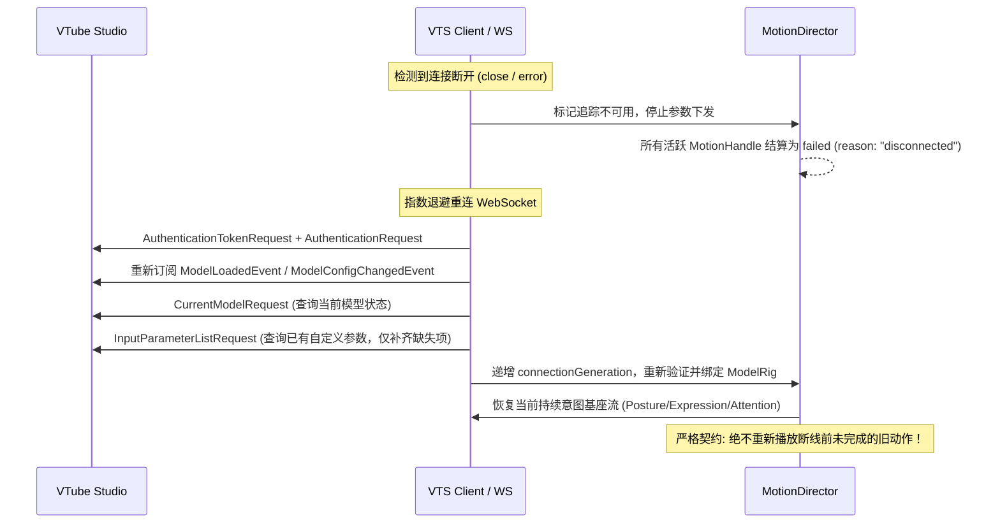
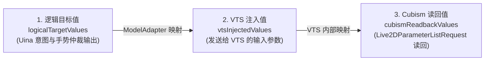

# Uina Live2D 具身控制与程序化虚拟动捕工程规范 (Procedural Virtual Tracking Spec v4.6 Final)

> 状态：已确认生效（2026-10-11，用户确认；与本文件配合生效的还有《live2d-intuitive-animation-spec-amendments.md》v4.7 修订登记——条目冲突处以修订登记为准）  
> 适用范围：Uina Live2D 具身控制机制、程序化虚拟动捕中枢、运动仲裁、VTS 协议适配与参数管道 (`.uina/worlds/live2d/`)  
> 核心定位：**Uina 并非传统动画播放器，而是运行在软件层面的“程序化虚拟动作捕捉中枢（Procedural Virtual Tracking & Somatic Controller）”。Uina 作为虚拟主播中之人，通过意图、动作、自律、反射与语音生成 60 Hz 虚拟追踪数据流，经 VTube Studio (VTS) 插件协议注入，驱动 Live2D 模型呈现逼真生命感。**

当前状态提示（2026-10-14）：本文是 v4.6 决策记录，配合 v4.7 修订阅读；Timeline 按 A2 延后，不能作为当前接口。A6 中 `weighted` 已由当前 rig 实现，`primary` 仍拒绝。具体运行合同以 [Live2D World 运行合同](../../live2d/live2d-world-runtime.md)和源码为准，真实视觉自然度未验收。

---

## 1. 系统总体架构与 VTS 宿主边界 (Architecture & VTS Host Boundaries)

```mermaid
flowchart TD
    subgraph Brain[1. Uina Somatic Intelligence (意图与动力学来源)]
        M1[持续意图: 姿态 Posture / 表情 Expression / 注视 Attention]
        M2[主动动作: 手势微动作 Gesture / 动作片段 Timeline]
        M3[自律发生器 Autonomic: 呼吸起伏 / 冷却随机眨眼 / 待机微晃 / 视线微漂移]
        M4[反射反应 Reflex: 突发刺激 / 避险惊跳打断]
        M5[信号耦合: TTS 语音开合 Lip-sync / 实际音频时钟跟随]
    end

    subgraph Runtime[2. MotionDirector (统一具身仲裁与动力学中枢)]
        subgraph StageA[阶段 A: 逐轴有效贡献决议 (Per-Axis Arbitration)]
            Slot[意图槽平滑接管 Set/Patch - 逐轴并发 / 同轴覆盖抛出 SupersededError]
            StaticPri[静态优先级: Reflex 40 > Voluntary 30 > Transition 20 > Autonomic 10]
            PerAxis[逐轴独立仲裁: 复合动作非冲突轴保持生效]
            Life[生命周期: Shadow 遮蔽 / Cancel 取消 / Release 释放]
        end
        subgraph StageB[阶段 B: 轴级专用管道 (Domain-Specific Pipelines)]
            P_Override[Override 层: 绝对目标决策 + entry: current 动态起点]
            P_Add[Additive 层: 相对增量累加 + 显式抑制遮罩]
            P_Bone[骨骼管道: 综合目标 ──► 二阶解析弹簧 ──► 姿态平滑转向]
            P_Gaze[视线管道: 依据最终头姿补偿眼球偏角 θ_eye = MapToGaze - θ_head]
            P_Face[面部管道: 基础表情 + 动作Override + 动作Additive ──► 面部平滑]
            P_Open[开合管道: 眨眼乘法调制 + 语音加权包络跟随]
        end
    end

    subgraph Adapter[3. ModelAdapter & VTS Client (虚拟动捕输入适配器)]
        Retarget[分段线性标尺端点裁剪 & 多轴聚合 RetargetingRule: max / weighted / primary]
        KeepAlive[1s 保活续租: 维持 VTS 插件控制权 + faceFound 保活]
        Queue[发送前背压丢弃: 真实单调时钟推进，网络积压丢弃过时帧]
        GenLock[Binding & Connection Generation: 模型重载/断线重连安全重绑]
    end

    subgraph VTS[4. VTube Studio & Live2D Cubism (宿主与渲染)]
        VTSRuntime[VTS 内部映射: Tracking Input ──► Cubism Model Parameter]
        HostPri[VTS 内部优先级: P5 Physics > P4 Expression > P3 Animation > P2 Tracking]
        VTSMove[MoveModelRequest: 角色整体位移与缩放 0~2s 调度]
        Render[视口画面渲染与推流]
    end

    Brain --> StageA --> StageB --> Adapter --> VTS
```

### 1.1 三层参数空间与真实物理标尺
1. **Layer 1: Uina 逻辑轴 (Logical Axis)**：面向 AI 语义的统一标准轴（如 `head.yaw` 约定 `[-30, 30]` 度，`eyes.left.open` 约定 `[0, 1]`）；
2. **Layer 2: VTS 追踪输入参数 (Tracking Inputs)**：VTube Studio 接收的追踪输入，**各具独立真实物理标尺，绝非一刀切的 `[-1, 1]`**：
   - `FaceAngleX`, `FaceAngleY`, `FaceAngleZ`：VTS 标准输入范围通常为 `[-30, 30]`；
   - `FacePositionX`, `FacePositionY`：VTS 标准输入范围通常为 `[-10, 10]`；
   - `EyeOpenLeft`, `EyeOpenRight`：VTS 标准输入范围为 `[0, 1]`；
   - `UinaArmLeft` 等自定义输入：由插件动态注册，定义各自的范围；
3. **Layer 3: Cubism 模型实际输出参数 (Model Parameters)**：Live2D 模型内部的物理参数（`ParamAngleX`, `ParamEyeLOpen` 等）。

---

### 1.2 VTS 宿主优先级栈与两类工作模式
根据 VTS 官方规范，Cubism 参数存在内部优先级栈：
$$\text{P5 (Physics)} > \text{P4 (Expression)} > \text{P3 (One-Time Animation)} > \text{P2 (Face Tracking)} > \text{P1 (Idle)} > \text{P0 (Default)}$$

Uina 注入的追踪数据处于 **P2 (Face Tracking)** 层。因此在架构上明确支持两类工作模式：
- **`tracking-driven`（默认）**：Uina 通过虚拟追踪输入驱动模型，目标参数不得被 VTS 侧激活的 P4 覆盖型表情或 P3 动画长期屏蔽；若 VTS 表情为 Add/Multiply 增量型，则允许与追踪输入共存；
- **`host-expression`（宿主辅助）**：对于需要切换贴图道具或特殊变形效果（如特殊眼泪、挂件换装）：
  - 推荐优先通过 VTS 热键触发（`HotkeyTriggerRequest`）；注意若热键为 Toggle 模式，触发前需核实当前表情状态避免反转；
  - 若使用 `ExpressionActivationRequest` 直接启闭，Uina 本地记录所激活的表情；断线期间因连接失效无法下发关闭请求，重连后通过 `ExpressionStateRequest` 尽力清理 Uina 曾激活的残留表情并恢复状态。

---

### 1.3 多逻辑轴汇入同一 VTS 输入的聚合规则 (Multi-Axis Retargeting)
当多个逻辑轴映射到同一个 VTS 输入时（例如两个同向非负眼笑量 `eyes.left.smile` 与 `eyes.right.smile` 汇入 `EyeSmile`，或双通道加权汇入）：
```ts
export type RetargetingRule =
  | { readonly strategy: "max" } // 同向非负归一化值取最大值: max(0, a, b...)
  | {
      readonly strategy: "weighted";
      readonly weights: Partial<Record<MotionAxis, number>>; // 权重非负且总和自动归一化为 1
    }
  | {
      readonly strategy: "primary";
      readonly primaryAxis: MotionAxis;
      readonly deadzone?: number; // 归一化死区，默认 0.05
    };
```
- **默认原则**：逻辑轴与 VTS 输入一对一映射；
- **多轴聚合显式声明**：必须在 `ModelRig` 中声明 `RetargetingRule`，未声明者在绑定阶段明确报错：
  - `max`：取各轴归一化幅值的最大值，**仅适用于同方向、同语义的非负量**（如均为 `[0, 1]` 的笑眼开度）；
  - `weighted`：按配置权重加权求和，**权重自动归一化**（$\sum w_i = 1$），拒绝负权重与非有限数（例如 `mouth.form` 与 `eyes.smile` 聚合时必须声明 `weighted` 权重）；
  - `primary`：指定主导轴，次要轴仅在主导轴处于归一化死区（$|\text{val} - \text{neutral}| < \text{deadzone}$）时生效；
- **标尺分段插值与端点裁剪**：`RigTarget.points` 采用**严格线性分段插值**，超出首尾关键点的值**强制端点裁剪（Clamp to endpoints）**，严禁向外推算。

---

### 1.4 控制权两层解耦与 VTS 注入契约
- **Motion Ownership（内部动作控制权）**：Uina 内部的离散动作生命周期。动作结束时释放对逻辑轴的独占，平滑回落到底层持续姿态；
- **Tracking Ownership（VTS 插件追踪控制权）**：
  - VTS 规定插件必须至少每秒重新发送一次参数以维持控制权；
  - **保活续租**：Uina 动作结束后**绝不停止 VTS 参数流**，而是持续推送当前合成底座数据进行保活续租；
  - **参数选择性占用**：只持续注入 Uina 实际配置接管的参数，不无条件霸占全部未用 VTS 输入；
  - **`faceFound: true` 策略**：纯软件虚拟动捕期间，参数包显式声明人脸已追踪到，防止触发 VTS 追踪丢失回退动画；
  - **发送前背压丢弃**：内部时钟保持单调递增推进，网络拥堵时在进入 WebSocket 发送队列前丢弃过时帧，确保下发的始终是最新姿态。

---

### 1.5 模型能力证据等级与执行性 (Capability Verification Levels)
```ts
export type MappingEvidence = "input-only" | "declared" | "observed" | "calibrated";
```
严格区分“声明存在”与“实际验证有效”，杜绝未经验证的映射被误判为完全可用：

| 能力状态 | 证据来源与判定依据 | 运行时执行行为 |
| :--- | :--- | :--- |
| **Input Available** | `input-only`：VTS 输入参数存在，但映射完全未经验证 | 允许已知基础输入（转头、眨眼、口型）以保守安全幅度尝试运行，记录 `unverified` 诊断； |
| **Declared Mapping** | `declared`：配置声明了映射关系，但尚未观察到实际生效 | 允许以保守默认幅度尝试运行，但同样标记为 `unverified` 诊断，不假定映射已调通； |
| **Model Mapped** | `observed`：运行时观察证实 Cubism 模型参数随输入产生预期响应 | 确认映射有效，允许以标准默认安全幅度正常运行； |
| **Calibrated** | `calibrated`：通过 `ModelRig` 分段标尺确认了正确的运动方向、物理范围与中性点 | 正常执行完整设计幅度； |
| **Unsupported** | 必需输入不存在或已确认目标模型缺少该骨骼部件 | 动作拒绝执行，返回 `unsupported`。 |

> [!NOTE]
> VTS 连接断开属于暂时通信不可用（`disconnected`），严禁误报为模型能力不支持（`unsupported`）。

---

## 2. 状态与动作编写层 DSL (Authoring Surface)

### 2.1 基础类型与坐标系契约
```ts
export type EaseCurve = "linear" | "smooth" | "ease-in" | "ease-out" | "ease-in-out" | "step";

export interface StateTransitionOptions {
  duration?: number;
  ease?: EaseCurve;
}

/** 归一化视线目标坐标系：原点 (0, 0) 为正视用户，[-1, 1] 映射至视口极值 */
export type AttentionTarget =
  | { x: number; y: number }
  | "user"       // 对应 (0, 0)
  | "screen"     // 对应屏幕中央 (0, -0.2)
  | "avert_down" // 对应 (0, -0.6)
  | "avert_left" // 对应 (-0.7, -0.2)
  | "avert_right";
```

#### 对称语义别名自动展开（Symmetric Axis Aliasing）：
- 编写 `"eyes.smile": 0.4` 时，编译器自动对称展开为左右双眼 `0.4`；
- 编写 `"brows.y": 0.2` 时，自动展开为左右双眉 `0.2`；
- **单侧覆盖优先**：若同时指定通用别名与单侧（如 `{ "eyes.smile": 0.3, "eyes.left.smile": 0.8 }`），单侧声明拥有绝对优先权。

---

### 2.2 姿态 (Posture) 与表情 (Expression) 状态定义

```ts
// 姿态定义 (身体宏观体态)
export const postures = {
  neutral: { "head.pitch": 0, "head.yaw": 0, "torso.yaw": 0 },
  bow: { "head.pitch": -10, "torso.pitch": -4 },
  lean_in: { "head.pitch": 6, "torso.pitch": 8 },
  tilt_listen: { "head.roll": 8, "head.yaw": -5 },
};

// 表情定义 (面部神态)
export const expressions = {
  neutral: { "mouth.form": 0, "brows.inner": 0, "face.blush": 0 },
  tender_smile: { "mouth.form": 0.4, "eyes.smile": 0.3 },
  shy: { "mouth.form": 0.3, "face.blush": 0.6, "brows.inner": 0.2 },
  pout: { "mouth.form": -0.4, "brows.inner": 0.4 },
};
```

#### 状态槽切换与逐轴最小作用域取消 (Per-Axis Promise Superseding)：
- `director.setPosture(name, options)` / `director.setExpression(name, options)`：**完整替换整个状态槽**。未声明的轴平滑归中，返回 `Promise<void>`；由于重置整个状态槽，该槽内所有旧的整槽或局部过渡立即以 `SupersededError` reject；
- `director.patchPosture(patch, options)` / `director.patchExpression(patch, options)`：**逐轴局部修改绝对目标**。
  - **原子动画独立执行，Promise 整体结算**：底层各轴运动严格独立执行与平滑过渡；单次 `patchExpression`/`patchPosture` 调用返回一个整体 `Promise<void>`；
  - **非冲突轴并发过渡**：修改不同逻辑轴的 Patch（例如 `patchExpression({ "face.blush": 0.8 })` 与 `patchExpression({ "mouth.form": 0.4 })`）**彼此完全独立、互不干扰**，各自在底层向目标平滑过渡，其各自返回的 Promise 均可正常 resolve；
  - **同轴竞争结算契约**：若新调用的 Patch 中包含与某次进行中的 Patch 产生重叠的轴，**该旧调用的 Promise 立即以 `SupersededError` reject**；但在旧调用中**未发生冲突的其他轴不受影响**，继续正常平滑完成运动；
- **眼睑保护与显式覆盖**：普通表情默认避让 `eyes.*.open`（保护自动眨眼）；特殊表情（如惊讶睁大、困倦半闭）允许显式声明接管眼睑开度。

---

### 2.3 正交动作原子库与通用积木组合契约 (Orthogonal Primitives & Composable Motion)

根据“每个工具只做一件事并做到极致”的原则，将运动生成划分为正交原子与通用组合两层：

```ts
export interface StepOptions {
  blendMode?: "override" | "additive"; // 混合模式，默认 "override"
  ease?: EaseCurve;
  intensity?: number; // 相对中性值缩放: target = neutral + (val - neutral) * intensity
  speech?: "allow" | "exclusive"; // exclusive 时压制 TTS 口型
  channels?: Partial<Record<MotionAxis, { delay?: number; duration?: number; ease?: EaseCurve }>>;
}

export interface MotionBuilder {
  readonly duration: number;
  step(duration: number, pose: PosePatch, options?: StepOptions): this;
  /** 显式平滑归中收势；若未调用，动作结束时按 fadeOut 自然释放 */
  settle(duration?: number): this;
  build(): CompiledMotion;
}

// 1. 骨骼微动作正交原子 (仅驱动头部与身体，绝不夹带面部参数)
export const gesture = {
  /** 纯粹点头：仅驱动 head.pitch (默认 additive 增量) */
  nod(options?: { count?: number; depth?: number; duration?: number }): MotionBuilder;
  /** 纯粹左右摇头：仅驱动 head.yaw (默认 additive 增量) */
  shake(options?: { count?: number; amplitude?: number; duration?: number }): MotionBuilder;
  /** 纯粹晃脑：仅驱动 head.roll (默认 additive 增量) */
  sway(options?: { cycles?: number; amplitude?: number; duration?: number }): MotionBuilder;
};

// 2. 面部动作正交原子 (仅驱动面部轴，绝不越界操作骨骼)
export const expression = {
  /** 独立微笑手势：仅驱动 mouth.form 与 eyes.smile */
  smile(options?: { intensity?: number; duration?: number }): MotionBuilder;
  /** 独立噘嘴动作：仅驱动 mouth.form 与 brows.inner */
  pout(options?: { intensity?: number; duration?: number }): MotionBuilder;
  /** 独立眨眼/眨单眼：仅驱动指定单眼 eyelid */
  wink(options?: { eye?: "left" | "right"; duration?: number }): MotionBuilder;
};

// 3. 通用积木组合器：所有运动积木共享一致的 Motion 组合契约
export function parallel(...motions: (MotionBuilder | CompiledMotion)[]): MotionBuilder;
export function sequence(...motions: (MotionBuilder | CompiledMotion)[]): MotionBuilder;

// 4. 预制组合示例 (通过积木自由组装，不侵入原子底层)
export const compound = {
  /** 打招呼：点头 + 微笑积木组合 */
  greeting: (options?: { depth?: number; smileIntensity?: number }) =>
    parallel(
      gesture.nod({ depth: options?.depth ?? 6, duration: 0.5 }),
      expression.smile({ intensity: options?.smileIntensity ?? 0.4, duration: 0.6 })
    ),
};
```

#### 统一运动组合契约 (Motion Composition Contract)：
1. **类型一致性**：`parallel()` 与 `sequence()` 接受 `MotionBuilder` 或 `CompiledMotion`，返回新的 `MotionBuilder`，支持任意层级嵌套；
2. **时长与时钟映射**：
   - `parallel` 总时长取各子项最大值 $\max(d_i)$；
   - `sequence` 总时长取各子项时长之和 $\sum d_i$；
   - 组合器将全局时钟映射为子动作局部时钟 $t_{\text{local}} = (t_{\text{global}} - t_{\text{start}}) \times \text{speed}$；
3. **取消传播**：父级动作取消时，取消信号递归下发至所有活跃子动作；
4. **多步分镜继承规则**：首步被声明的轴建立控制权；后续步骤中未声明但已受控的轴，**强制保持上一步骤的目标值**（对于 Additive 轴保持相对增量值），直到显式调用 `.settle()` 或动作完成淡出。

---

### 2.4 编排三层分工体系与时间线状态语义 (Layered Architecture & Timeline State Semantics)

消除 `motion`、`timeline` 与 `performance` 的职责重叠，确立三个清晰正交的抽象层次：

| 层次 | 定位与核心职责 | 回答的问题 | 典型能力 |
| :--- | :--- | :--- | :--- |
| **Layer 1: Motion** | **运动形态与局部几何**：只负责局部曲线、形状、相对时长与缓动，与世界宏观时间完全解耦 | *What to move* | `motion.step()`, `gesture.*`, `expression.*`, `parallel()`, `sequence()` |
| **Layer 2: Timeline** | **确定性时序曲谱**：静态绝对时间轴。安排动作与状态在何时启动、重叠与交替，编译为确定性的静态时钟图谱 | *When to move* | `timeline().to().add().at()`, 绝对时间点, label 锚点, `<` 相对偏移 |
| **Layer 3: Performance** | **动态交互因果编排**：动态运行时交互。根据环境刺激、AI 意图与条件分支决定执行何种动作序列 | *Why / How to react* | `ctx.signal`, `ctx.wait()`, `Promise.all()`, 动态条件判断, 运行时打断 |

```ts
export interface TimelineToOptions {
  duration?: number;
  ease?: EaseCurve;
  blendMode?: "override" | "additive"; // 混合模式，默认 "override"
}

export type TimelineStateEvent =
  | { type: "posture"; name: string; duration?: number }
  | { type: "expression"; name: string; duration?: number }
  | { type: "attention"; target: AttentionTarget; duration?: number };

export interface TimelineOptions {
  /** 时间线结束或取消时的状态处理：revert 恢复进入前的基准状态，retain 保持时间线结束时的状态 */
  exitState?: "revert" | "retain"; // 默认 "revert"
}

// Layer 2: 确定性时序谱示例 (将动作片段与离散状态作为统一元素编排)
timeline("greeting_timeline", { exitState: "revert" })
  .to("head.yaw", 15, { duration: 0.5, blendMode: "override" })
  .add(gesture.nod({ depth: 6, duration: 0.5 }), "+=0.1")
  .add(expression.smile({ intensity: 0.4, duration: 0.5 }), "<")
  .at(0.3, { type: "posture", name: "lean_in", duration: 0.4 })
  .build();
```

#### 时间线内持续状态的生命周期契约 (Timeline State Lifecycle)：
1. **正向时序触发**：播放指针正向到达指定时间点 $t$ 时，触发对应的状态过渡；
2. **Seek 状态重构**：当调用 `handle.seek(targetTime)` 跳转时，时间线根据时间线内所有关键状态事件，重构出目标时间点 $targetTime$ 对应的基准姿态快照并平滑应用；
3. **Repeat 循环重建**：时间线循环播放到达边界（重置到 0）时，时间线内的状态事件随循环时钟重新触发；
4. **退出与取消恢复**：当时间线播放完毕或调用 `stop()` 取消时，根据 `exitState` 配置决定：默认 `"revert"` 自动恢复到进入时间线前的基座状态，避免留下无法预测的残留状态；`"retain"` 则保留时间线最终合成状态。

---

### 2.5 综合演出编排器 `performance` 与空间控制 (Spatial)

```ts
export interface SpatialOptions {
  x?: number;        // VTS 坐标系 [-1, 1] 映射
  y?: number;
  size?: number;     // VTS 范围 [-100, 100]
  duration?: number; // 映射至 VTS MoveModelRequest (0~2s)
}

export interface PerformanceContext {
  readonly signal: AbortSignal;
  setAttention(target: AttentionTarget, options?: StateTransitionOptions): Promise<void>;
  setPosture(name: string, options?: StateTransitionOptions): Promise<void>;
  setExpression(name: string, options?: StateTransitionOptions): Promise<void>;
  patchExpression(patch: PosePatch, options?: StateTransitionOptions): Promise<void>;
  patchPosture(patch: PosePatch, options?: StateTransitionOptions): Promise<void>;
  setSpatial(options: SpatialOptions): Promise<void>;
  playGesture(motion: MotionBuilder | CompiledMotion, options?: MotionPlayOptions): Promise<MotionHandle>;
  wait(seconds: number): Promise<void>;
}

// Layer 3: 动态运行时反应示例 (根据因果与上下文自由组合正交原子)
export async function shyReaction(ctx: PerformanceContext) {
  if (ctx.signal.aborted) return;
  // 并行调度各领域正交工具，互不耦合
  await Promise.all([
    ctx.setAttention("avert_down", { duration: 0.3 }),
    ctx.setPosture("bow", { duration: 0.4 }),
    ctx.setExpression("shy", { duration: 0.3 }),
  ]);
  await ctx.wait(0.15);
  if (ctx.signal.aborted) return;
  // 临时手势作为独立积木触发，不隐式篡改其他领域
  const handle = await ctx.playGesture(gesture.nod({ depth: 4, duration: 0.4 }));
  await handle.finished;
}
```

---

## 3. 静态编译与模型适配 (Compilation & Binding)

### 3.1 核心数据结构接口定义
```ts
export interface AxisControlSegment {
  axis: MotionAxis;
  start: number;  // [start, end) 左闭右开区间
  end: number;
  kind: "drive" | "hold";
  blendMode: "override" | "additive";
  evaluatorIndex: number;
}

export interface RigTarget {
  /** 期望驱动的目标 Live2D Cubism 输出参数名（如 ParamAngleX），用于存在性核验与读回诊断 */
  parameter: string;
  /** 对应的 VTS 虚拟追踪输入参数名（如 FaceAngleX） */
  input: string;
  /** 标定曲线：严格定义为 Uina 逻辑轴数值 (Layer 1) -> VTS 注入值 (Layer 2) 的分段线性标尺，超出端点强制裁剪 (Clamp) */
  points: readonly (readonly [number, number])[];
  followers: readonly string[];
  physicsFollowers: readonly string[];
  smoothing: number;
  evidence?: MappingEvidence;
}

export interface ModelRig {
  version: 2;
  modelID: string;
  controls: Record<MotionAxis, { min: number; max: number; neutral: number }>;
  bindings: Record<MotionAxis, readonly RigTarget[]>;
  retargeting?: Record<string, RetargetingRule>;
  /** 外部主来源声明：若 breath 为 "vts"，Uina 自律发生器静默，杜绝双重呼吸叠加 */
  external: { blink: "vts" | "uina" | "none"; breath: "vts" | "none" };
}
```

### 3.2 两阶段职责明确界定
1. **Phase 1: 语法解析与时钟展开 (Model-Agnostic IR)**：
   - 解析相对时钟，展开为统一绝对时钟标尺；
   - 提取显式轴与符号姿态别名（如 `head: "tilt_left"`），**不承诺提前完成单轴展开**，输出模型无关 Motion AST。
2. **Phase 2: 模型绑定与同轴排序 (Model Binding)**：
   - 结合 `ModelMotionProfile` 展开符号姿态别名，计算跨步继承；
   - 执行**唯一的同轴冲突检查与排序**（按绝对启动时间 $t_{\text{start}}$ 排序）；
   - 划分 `AxisControlSegment` 闭开区间 `[start, end)` 并保证 $C^0$ 连续性（主动指定的 `step` 缓动曲线作为显式跳变例外）；
   - 校验必需轴完整性与 VTS 输入映射。

### 3.3 绑定代次 (Binding Generation) 与模型重绑契约
引入单调递增的整数 `bindingGeneration`：
1. **事件订阅**：监听 VTS 的 `ModelLoadedEvent` 与 `ModelConfigChangedEvent`；
2. **失效与结算**：当模型更换、卸载或映射配置变动时，代次递增。旧代次的所有活跃 `MotionHandle` 立即结算并返回 `cancelled`；
3. **真实 API 约束下的重绑流程**：
   - **VTS 协议现实**：VTS API 不提供直接导出“追踪输入到 Cubism 参数完整内部映射表”的接口；
   - **保守重验流程**：当触发重绑或收到非热键配置变动事件时，系统执行以下真实闭环：
     1. 调用 `InputParameterListRequest` 查询 VTS 当前所有可用的虚拟追踪输入列表；
     2. 调用 `Live2DParameterListRequest` 查询当前模型内部所有 Cubism 参数列表；
     3. 加载 Uina 本地权威 `ModelRig` 配置，严格校验绑定的 `input` 和目标 `parameter` 是否均真实存在于上述两个列表中；
     4. 若参数存在，重编 Phase 2 适配器恢复追踪流；必要时通过主动注入微小扰动并读回参数，重新确认映射实际有效性。

### 3.4 VTS WebSocket 断线重连与全流程恢复契约 (Disconnect & Recovery Flow)
引入连接代次 `connectionGeneration`（单调递增整数），严格划分网络生命周期：



1. **检测断开**：WebSocket 触发 `close` 或 `error`，立即停止宣称追踪可用，暂停 60 Hz 注入时钟；
2. **动作终态结算**：旧连接代次上的所有活跃 `MotionHandle` 立即以 `status: "failed"`（reason: `"disconnected"`）结算 `finished` Promise，绝不悬挂；
3. **重新认证与重订**：重新建立 WebSocket 连接并完成会话认证；由于 VTS 在断线时所有事件订阅自动失效，**必须显式重新发送官方事件订阅请求**；
4. **状态查询与自定义参数幂等补齐**：调用 `CurrentModelRequest` 重新拉取当前模型状态；由于 VTS 自定义参数会持久化存储在 VTS 侧，重连时先查询 `InputParameterListRequest`，**仅当发现缺失时才调用 `ParameterCreationRequest` 补齐**，避免重复创建覆盖用户标尺配置；
5. **代次递增与重新绑定**：递增 `bindingGeneration`，按 3.3 节流程完成参数存在性核验并重绑 Phase 2 模型适配器；
6. **持续意图无缝恢复**：从当前活跃的 Posture / Expression / Attention 状态槽重新生成基座数据，恢复 1s 保活续租参数流（**绝不重新播放断线前中断的旧离散动作**）；
7. **异步回调屏障**：所有异步响应校验对应的 `connectionGeneration`，丢弃任何来自旧连接的迟到回调，防止状态交叉污染。

---

## 4. 运行时具身仲裁与参数管道 (Runtime Engine)

### 4.1 阶段 A：逐轴有效贡献决议 (Per-Axis Arbitration & Masking)

#### 1. 静态优先级矩阵 (Static Priority Hierarchy)：
当同一逻辑轴出现多个并发输入时，按以下层级自底向上混合：
$$\text{Reflex 惊跳反应 (40)} > \text{Voluntary 主动手势 (30)} > \text{Transition 姿态/神态过渡 (20)} > \text{Autonomic 自律微动 (10)}$$

#### 2. Override 与 Additive 解耦合成规则：
- **Override 层（绝对目标）**：逐轴按优先级与时间进行仲裁，支持遮蔽与 Cross-Fade。仅 Override 轨道应用 `entry: "current"`（捕获当前 Override 合成值作为起点）；
- **Additive 层（相对增量）**：独立累加各活跃增量 $\Delta X = X - \text{Neutral}$。**默认以 0 为数学起点，绝不捕获绝对底座姿态**；
- **增量抑制遮罩 (Additive Masking)**：高优先级动作可通过 `inhibitAdditives?: boolean | readonly MotionAxis[]` 抑制自律微动或骨骼增量晃动。剧烈惊跳 Reflex 时抑制骨骼微晃；普通主动动作期间允许自律微晃自然共存；
- **速度重置策略**：由 `resetVelocity?: boolean` 控制。默认 `false`（平滑保留速度自然转向）；剧烈惊跳设为 `true`（瞬时清零速度）。

#### 3. 逐轴仲裁与被遮蔽恢复连续性：
- 仲裁细化到单个逻辑轴。复合动作（害羞：脸红+低头+微笑）执行期间插入独立点头动作，**只接管 `head.pitch` 轴**，脸红与微笑持续保持；
- **被遮蔽轴（Shadowed Axis）**：播放时间继续流逝；高优先级动作退出后，若仍处于播放区间，平滑淡入重新接管，杜绝突兀跳变。

#### 4. 动作生命周期三态语义：
- **`shadow`（遮蔽）**：低优先级轴被临时遮蔽，**播放时间继续流逝**，不中断实例；
- **`cancel`（取消）**：剧烈反射（惊跳）或显式打断，**立即终止播放**，结算 `finished` Promise 并返回 `status: "cancelled"`；
- **`release`（释放）**：动作内容自然播放完毕或调用 `stop("release")`，进入 `fadeOut` 过渡，淡出完成后终结实例，结算 `finished` Promise 并返回 `status: "completed"`（或显式主动停止返回 `"cancelled"`）；
- `stop("cut")` 立即清零权重并结算返回 `status: "cancelled"`。

---

### 4.2 阶段 B：轴级专用管道 (Domain-Specific Pipelines)

#### 1. 骨骼与体态管道 (Head & Body):
$$\mathbf{X}_{\text{bone\_target}} = \mathbf{X}_{\text{override\_composite}} + \sum \mathbf{W}_i \cdot \Delta \mathbf{X}_{\text{additive}, i}$$
$$\mathbf{X}_{\text{bone}} = \text{SpringFilter}(\mathbf{X}_{\text{bone\_target}})$$
- **解析弹簧连续转向**：采用二阶解析弹簧模型，默认设置 $\zeta = 0.85$（轻度欠阻尼/接近临界），$\omega_n = 15\text{ rad/s}$。**高优先级动作切入时默认保留当前位置与速度**，自然转向平滑过渡；仅在显式声明 `resetVelocity: true` 的剧烈惊跳时才重置速度；
- **时钟推进与卡顿保护**：时间推进使用真实的单调经过时间 $\Delta t_{\text{real}}$。解析弹簧数学解在连续时间下无条件稳定；在实际工程中，当单帧 $\Delta t > 0.1\text{s}$（出现严重卡顿）时进行子步细分或截断保护，防止过大步长导致突变过冲；网络拥堵时进入队列前丢弃过时帧，但不截断运动推进时间。

#### 2. 自律运动生成机制 (Autonomic Motion Source):
作为系统底座（优先级 10）持续运作：
- **呼吸起伏**：周期 $3.2\text{s}$ 的正弦曲线驱动 `torso.breath` 以及躯干微起伏；
  - **唯一主来源约束**：若 `ModelRig.external.breath === "vts"`，则 Uina 自律发生器**完全静默整体呼吸贡献源**（包括 `torso.breath` 及相关的躯干微动），杜绝与 VTS 内建呼吸双重叠加；仅在 `"none"` 时由 Uina 驱动；
- **待机微晃**：低频缓和噪声驱动头部轻微角度起伏（幅值 $< 1.5°$）；
- **自然眨眼**：**带最短冷却锁的随机眨眼生成器**（基础冷却 $T_{\text{cooldown}} = 2.0\text{s}$ + 服从均值 $1.5\text{s}$ 的随机延迟，平均周期 $3 \sim 4\text{s}$），触发闭眼 $60\text{ms}$ / 睁眼 $120\text{ms}$ 的生理平滑曲线；
- **避让规则**：当头部正在进行主动大动作时，微晃自动衰减抑制；当注视焦点锁定时，视线微漂移抑制。

#### 3. 视线追踪管道 (Gaze & Attention):
$$\theta_{\text{eye}} = \operatorname{Clamp}(\text{MapToGaze}(\text{TargetPos}) - \theta_{\text{head\_actual}}, \text{comfortEyeRange})$$
- Attention 维持注视目标坐标，头部提供辅助转向；
- **眼球补偿偏转角在头部实际姿态确定之后结算**，杜绝点头或转头导致注视点漂移；
- 保证逻辑视线的近似注视，视线超出模型极限时由软约束夹紧。

#### 4. 面部神态管道 (Expression & Face):
$$\mathbf{X}_{\text{face\_target}} = \mathbf{X}_{\text{override\_composite}} + \sum \mathbf{W}_i \cdot \Delta \mathbf{X}_{\text{additive}, i}$$
$$\mathbf{X}_{\text{face}} = \text{SmoothFilter}(\mathbf{X}_{\text{face\_target}})$$
- **动作决议统一接入**：面部轴（`mouth.*`, `face.*`, `brows.*`, `eyes.*.smile`）与骨骼轴共用统一的动作贡献决议：
  - 底座为当前 Expression 状态槽（`setExpression` / `patchExpression`）；
  - 主动动作（如 `compound.greeting()`、`expression.smile()` 或 `timeline.to("mouth.form", 0.4)`）的 Override 与 Additive 贡献按优先级介入合成；
  - 区别在于面部轴使用轻量阻尼平滑（SmoothFilter）而非骨骼弹簧，保证神态反应敏捷而不拖沓；
- 合成后的 $\mathbf{X}_{\text{face}}$ 输出至开合通道调制与 VTS ModelAdapter 映射。

#### 5. 开合通道管道 (Eyelid & Lip-sync):
- **眼睑开合（乘法调制）**：
  $$\text{EyeOpen}_{\text{final}} = \text{EyeOpen}_{\text{expr}} \cdot \left(1 - W_{\text{blink}} \cdot (1 - \text{Factor}_{\text{blink}})\right)$$
  微笑弯眼时眨眼能够 100% 完全闭拢，睁开后恢复微笑眼开度；
- **TTS 语音张嘴（实际音频流包络跟随）**：
  $$\text{MouthOpen}_{\text{final}} = \text{MouthOpen}_{\text{base}} + (1 - \text{MouthOpen}_{\text{base}}) \cdot L_{\text{speech}}$$
  底座闭嘴（$M_{\text{base}} = 0$）时实际音频播放流（Audio Level / RMS）包络 $L_{\text{speech}}$ 驱动正常张嘴；
  - **音频暂停处理**：音频暂停或被打断时，口型包络并非静止在当前开度，而是**立即平滑衰减回零（Fade out to 0，约 50ms 释放）**，恢复播放后重新同步；
  - 若动作显式声明 `speech: "exclusive"`（特殊嘴型），则压制语音信号 $L_{\text{speech}} = 0$。

---

### 4.3 阶段 C：VTS 映射与通信调度 (Retargeting & Injection)

1. **VTS 注入模式**：默认使用 `set` 模式（权重 1）；遇其他插件独占占用时明确报告控制失败；
2. **目标 60 Hz 调度与积压丢弃**：
   - 内部以实际单调经过时间 $\Delta t$ 积分推进运动；
   - WebSocket 通信出现网络积压时，**直接在进入发送队列前丢弃过时帧，仅推送最新帧**；
3. **持续保活**：无新动作触发时，依然定时（< 1s）发送当前基座数据，维持 VTS 插件控制权。

---

### 4.4 实时可观测三层调试契约 (Observable Telemetry)
为确保问题能快速定位于动作仲裁、模型适配或宿主渲染层，系统向诊断端暴露三层带时间戳的**近似关联采样 (Correlated Sampling)** 数据：



- **逻辑目标值 (`logicalTargetValues`)**：经 MotionDirector 仲裁、弹簧/平滑滤波后，Uina 输出的标准逻辑轴值（如 `head.yaw: 15°`, `mouth.form: 0.4`）；
- **VTS 注入值 (`vtsInjectedValues`)**：经 `ModelRig` 分段标尺映射与 `RetargetingRule` 聚合后，实际注入 VTS 追踪输入的数值（如 `FaceAngleX: 15`, `MouthSmile: 0.7`）；
- **Cubism 读回值 (`cubismReadbackValues`)**：通过 VTS `Live2DParameterListRequest` 异步查询当前模型的所有 Live2D 参数列表，筛选读回的真实物理参数值（如 `ParamAngleX: 14.8`, `ParamMouthForm: 0.68`）。

#### 异步近似对齐与故障隔离准则：
由于 VTS 注入与查询通过异步 WebSocket 请求执行，宿主无法保证绝对同帧原子对齐。诊断系统基于毫秒级时间戳进行时间窗口近似关联分析：
1. **逻辑目标异常**：说明 MotionDirector 仲裁、优先级、DSL 编译或专用管道逻辑存在缺陷；
2. **逻辑目标正常但注入值异常**：说明 `ModelRig` 标尺映射、分段线性插值端点裁剪或 RetargetingRule 聚合算法存在缺陷；
3. **注入值正常但读回值异常**：说明 VTS 宿主内部映射未建立、受 P4/P3 优先级遮蔽（如宿主表情覆盖）或被 Cubism 物理冲突覆盖。

---

## 5. 事实闭环反馈与生命周期 (Feedback & Lifecycle)

### 5.1 动作执行状态与事实分层
```ts
export type MotionTerminationStatus = "completed" | "cancelled" | "unsupported" | "failed";

export interface SomaticActionResult {
  readonly status: MotionTerminationStatus;
  readonly affectedAxes: readonly string[];
  readonly reason?: string;
}
```
- `completed`：动作已按 Runtime 时钟完整执行完毕，且通信链路正常保活；
- `cancelled`：被更高优先级的意图、反射或显式 `stop()` 打断取消；
- `unsupported`：目标模型缺少该动作必需的物理通道（如无手臂绑定）；
- `failed`：执行过程发生明确网络中断或异常。

### 5.2 播放控制生命周期 API (Playback API)
```ts
export type MotionStatus =
  | "playing"
  | "paused"
  | "releasing"
  | "finished"
  | "cancelled"
  | "unsupported"
  | "failed";

export interface MotionPlayOptions {
  priority?: number;
  fadeIn?: number;
  fadeOut?: number;
  speed?: number;
  weight?: number;
  repeat?: number; // 0 为只播 1 次不额外重复，-1 为无限重复
  entry?: "current" | "neutral";
  clock?: "system" | "audio";
  inhibitAdditives?: boolean | readonly MotionAxis[]; // 抑制自律微动或指定骨骼增量晃动
  resetVelocity?: boolean; // 剧烈惊跳时瞬时重置弹簧速度为 0，默认 false（平滑连续转向）
}

export interface MotionHandle {
  readonly id: string;
  readonly status: MotionStatus;
  readonly currentTime: number;
  readonly duration: number;
  /** 保证在所有终态（completed / cancelled / unsupported / failed）必定结算，绝不悬挂 */
  readonly finished: Promise<SomaticActionResult>;

  pause(): void;
  resume(): void;
  seek(time: number): void;
  stop(mode?: "release" | "cut"): void;
}
```

---

## 6. 验收测试矩阵 (Verification Matrix)

1. **低头点头断言**：设置低头姿态（$-8°$）叠加点头手势（$+5°$），断言最低点逻辑值为 $-3°$，手势结束后平滑回归 $-8°$；
2. **TTS 语音张嘴断言**：底座嘴部闭合（$M_{\text{base}} = 0$）时输入语音信号 $L=0.7$，断言嘴部开合输出准确为 $0.7$；音频暂停时口型包络平滑衰减回零；
3. **微笑眨眼断言**：微笑眼开度 $0.8$ 时触发眨眼，断言闭眼峰值开度精确等于 $0$，睁开后恢复 $0.8$；
4. **Reflex 惊跳断言**：点头途中触发惊跳反射，断言冲突手势被取消，头部快速后仰，反射后回归底层体态；
5. **视线补偿断言**：注视点固定时头部转动，断言眼球产生对应反向补偿偏角，保持视线锚定；
6. **Patch 独立轴并发与同轴竞争断言**：并发调用 `patchExpression({ "face.blush": 0.8 })` 与 `patchExpression({ "mouth.form": 0.4 })`，断言两轴独立平滑过渡且互不干扰；若对过渡中的 `face.blush` 发起新 patch，断言仅旧 blush Promise 抛出 `SupersededError`，mouth.form 正常过渡完成；
7. **多轴聚合断言**：`eyes.left.smile` 与 `eyes.right.smile`（同向非负量）共同汇入 `EyeSmile` 时，断言按 `max` 策略正确输出；当 `mouth.form` 与 `eyes.smile` 共同汇入时，断言按 `weighted` 归一化加权策略正确输出，无字典覆盖抖动；
8. **Handle Finished 结算断言**：主动调用 `stop("cut")`，断言 `handle.finished` 立即结算并返回 `cancelled`，绝不发生 Promise 悬挂；
9. **复合动作局部覆盖断言**：害羞复合动作（脸红+低头+微笑）执行期间插入独立点头动作，断言脸红与微笑持续保持，不被误抢占；
10. **遮蔽后平滑恢复断言**：低优先级轴被临时遮蔽退出后，断言其在重新恢复参与合成时不发生突兀姿态跳变；
11. **模型重载代次断言**：触发模型更换事件后，旧代次的所有活动 Handle 立即结算返回 `cancelled`，新代次重新建立映射；
12. **Promise Superseding 断言**：调用 `setExpression` 未完成时发起新 `setExpression`，断言旧 Promise 立即以 `SupersededError` reject，新目标立即接管；
13. **正交原子积木组合断言**：通过 `parallel(gesture.nod({ depth: 6 }), expression.smile({ intensity: 0.4 }))` 拼装复合打招呼动作，断言各原子正交无职责污染，骨骼与面部管道协同平滑输出；
14. **VTS 断线重连与恢复断言**：WebSocket 模拟断线后，所有未完成动作立即以 `failed` 终态结算，重连并重新认证订阅后，恢复当前持续姿态基座流，不重放旧动作；
15. **Timeline 持续状态生命周期断言**：时间线包含 `at(0.3, { type: "posture", name: "lean_in" })`，播放到达 0.3s 正常触发体态；调用 `seek(0.1s)` 准确重构回前序基准体态；时间线完成或退出时按 `exitState: "revert"` 自动平滑恢复进入前基座。

---

## 7. 六步施工核对清单 (Construction Checklist)

1. [ ] **VTS 协议与断线恢复**：落实 `SomaticActionResult`，区分完成、取消与不支持；建立断线后会话重连、事件重订与当前姿态恢复流程，消除虚假视觉断言；
2. [ ] **模型映射与多轴聚合**：在 `model-adapter.ts` 中实现多逻辑轴聚合（`max` / `weighted` / `primary`）、标尺分段线性插值端点裁剪与四级能力证据（区分 declared 与 observed）；
3. [ ] **控制权与保活机制**：解耦 Motion Ownership 与 Tracking Ownership，落实持续保活续租与 `faceFound` 保活，暴露三层调试遥测；
4. [ ] **MotionDirector 仲裁升级**：实现槽位 Set/Patch（带 SupersededError）、逐轴仲裁隔离、Reflex 遮蔽/取消矩阵、Override/Additive 严格解耦与 Cross-Fade；
5. [ ] **专用参数管道落地**：落实骨骼解析弹簧连续转向、面部动作合成管道、自律发生器（冷却锁随机眨眼、呼吸主来源互斥）、眼睑乘法调制、语音包络跟随（暂停平滑回零）与视线补偿；
6. [ ] **DSL 编译与两阶段构建**：完成 `animator.ts` 中的 `motion`、`timeline`、`gesture` 及 Phase 1/2 绑定，支持 `blendMode` 显式配置与代次失效。
