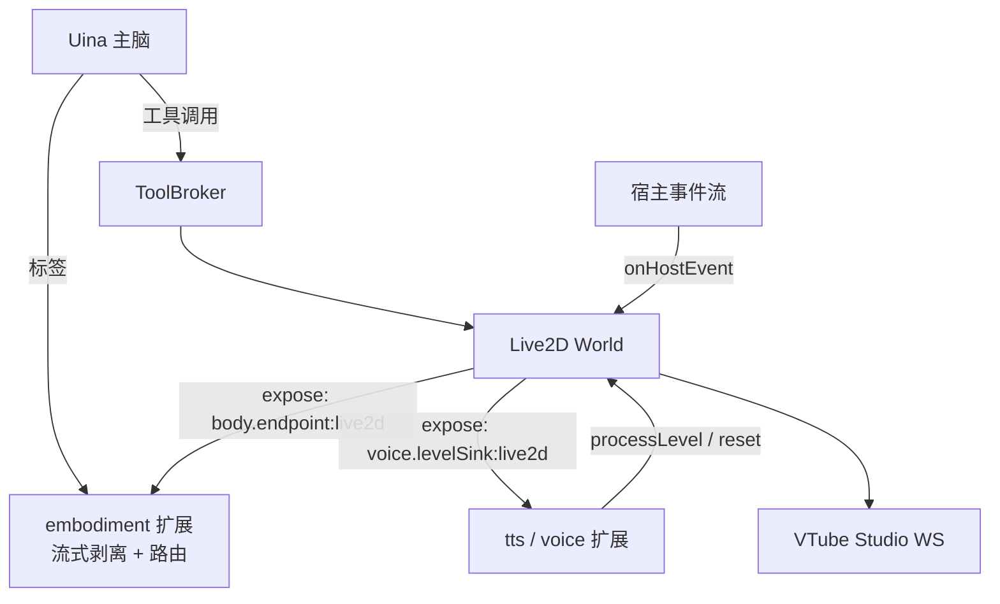

# Uina Live2D World 边界规范 (World Boundary Spec v1.0)

> 状态：2026-10-13 按已批准的完整重构计划校正；当前源码及[运行合同](../../live2d/live2d-world-runtime.md)优先。  
> 适用范围：`.uina/worlds/live2d/` 与宿主、具身扩展、声学系统的全部接缝。  
> 与引擎规范的关系：《Live2D 具身控制与程序化虚拟动捕工程规范 v4.6》+《v4.7 修订登记》构成**引擎规范**（MotionDirector 及以下：仲裁、合成、标定、VTS 注入）；本文构成**世界层规范**（工具面、cue 路由、声学接缝、宿主事件、生命周期；发布验收门已于 2026-10-11 按操作员裁决拆除，见 §7）。两者合并构成重写的完整施工依据；冲突处以修订登记与本文为准。

2026-10-14 补充：本文列出的目录/Worker/故障停车机制可在当前实现中核对。MO 曲线内容正在工作区重写；目录和类型测试不验证真实视觉自然度。当前工作区的 VTS/MO 真实画面验收未进行。

---

## 2026-10-13 当前规范增补

本次实施覆盖目录、身体意图、外部动作及线程生命周期。下文 2026-10-11 的修订保留为历史，不再据此恢复独立 posture/expression/attention/ambient/diagnose 工具。

- 目录编译前隔离作者数据，编译后递归冻结；私有索引仅经 resolve/list/resolveCue 查询。motion、posture、expression、attention、ambient、costume 的规范名与别名共用全局命名空间，内置注视也由目录解释；变体不可独立寻址。status、错误候选项、affordance 同源。
- 工具与 cue 共用 runtime 准入：调用取消 → 生命周期 → 合成故障 → 暂停 → 连接 → 模型适配 → 参数/目录。state 一次解析整组、绑定快照代次，依次施加姿态、表情、视线、环境。非法参数零副作用；每次等待后重核代次/取消，部分生效如实结算，不撤销已接受持续意图。cue 仅在真实接受/启动时记 started，异步异常落账。
- 合成故障停车（2026-10-14）：采样期不可恢复异常（bake 探测网格漏检的病态分支）在 composeTick 捕获——fault 登记、时钟停止、口型中性单帧注入、全部播放结算 cancelled、工具以 `fault` 拒绝。**禁止**异常沿 setInterval 上抛杀死 worker：线程死亡会连带摧毁在途 spatial 清理能力。恢复 = 重载 world。
- external-actions 拥有空间与热键的执行和清理。带效果的空间动作一次申请 model:transform 与 effect:*，清理期间持有资源。pose/tint/post 独立记录发送尝试，只恢复触碰的项；纯效果不移动位置，仅 tint 不读写 post。需要 post 但有效基线不可得时，发送副作用前 failed / not_started / effect_baseline_unavailable。
- 恢复前后检查模型、连接、目录代次；失效后不写旧基线。details.cleanup 分项为 not_needed/confirmed/unknown；位姿回读、tint 白色请求接受、post 开关及具名 preset 分别核验。restored/restoredEffects 由分项事实派生。必要项未知时正常完成 unknown；取消保持 cancelled 并明确未知。safeStop 汇总位姿、效果与热键全部义务，失败必须传播；未知结算后释放资源。resume 不重发或重试恢复，保留最近诊断。
- Worker/proxy/engine 生命周期为 new/starting/running/closing/dead。正常停用、启动回滚及 error/exit 均幂等撤销登记/订阅/监听、清空能力并离线；保留的 facade 引用也离线，迟到消息不得复活。预取消零投递；已投递取消等待 runtime 结构化清理结果。已投递具身调用遇死亡 unknown/engine_exited，新调用 not_started；读取失败不返回缓存成功。
- World scope 取消关闭受理、取消动作并触发暂停清理，继续接收结算；onStop 等 runtime 停止后拆除 proxy 并等待 terminate，聚合清理错误。生产每次激活新实例，Worker 与进程内测试共用 assembly。真实 Worker 测试在线程内创建假设备，无真实认证或 VTS 连接。

当前自动化证据及未完成的真实 VTS/MO 验收见运行合同；历史清单中的 P1/P4 进度与旧工具数量不能替代当前状态。

---

## 0. 分层与依赖方向



依赖方向规则（normative）：

1. world → `src/extensions/world-framework/*`：合法（与现有 `WorldDef` import 同路径）；
2. world → 其他 `.uina/extensions/*`：**禁止**（现状无先例，保持）；
3. 系统扩展 → world：仅经 `expose` 共享表的活引用，世界拿不到读取他人共享值的能力（world-framework 既有设计，不变）。

---

## 1. 接缝词汇单源化 (Seam Vocabulary Single Source)

**现状问题（源码级核实）**：`BodyEndpoint`、`ExpressiveCueDef`、`BodyState`、`BodyAffordance`、`ExtractedCue` 及两个 expose 前缀常量，在 `worlds/live2d/contracts.ts` 与 `extensions/embodiment/types.ts` 各有一份逐字重复的定义。`extensions/voice/events.ts` 的归属说明已经写明原则："一个接缝两个定义必然漂移"——该原则目前只在扩展之间执行，没有覆盖 world。

**决策**：新建 `src/extensions/world-framework/seams.ts` 作为唯一事实源，收纳：

- `BodyType` / `ExpressiveCueDef` / `BodyAffordance` / `BodyState` / `BodyEndpoint` / `BodyEndpoint.interrupt?`
- `BODY_ENDPOINT_EXPOSED_PREFIX`
- `VoiceLevelSink` / `VOICE_LEVEL_SINK_EXPOSED_PREFIX`

归属裁定：`ExtractedCue` 与 `VoiceLevelEvent` 是扩展内部词汇（cue 分发共享表传 `{id, target}` 纯对象；电平测量由 voice 自有），**不进 seams**——seams 只放真正跨越 World↔Extension 边界的词汇，防止其退化为公共类型垃圾桶。
- `extensions/embodiment`、`extensions/voice` 改为从 seams.ts re-export（对外 API 不变，消费方零改动）；
- world 从 world-framework import（依赖方向合法）；
- 结构校验函数（`isBodyEndpoint` / `isVoiceLevelSink`）留在各自消费方——"拒绝坏登记"是消费方职责，词汇是双方共同事实。

这是本次重写**唯一触及 `src/` 的改动**，且只增不改既有行为。

---

## 2. 契约一：WorldDef 工具面

世界以 `WorldDef` 向主脑暴露以下工具。目录（catalog）是工具参数的唯一合法词表来源：任何命名参数（动作/姿态/表情/外观）不存在于当前模型目录时，一律显式拒绝并附目录提示，不做模糊匹配。目录内所有命名（动作/姿态/表情/外观）共享**同一命名空间且全局唯一**——cue 派发按名字命中，命名冲突即语义歧义，绑定期校验拒绝重复。

| 工具         | 参数                                                  | 语义                                                                      | 引擎映射                                                    |
| ---------- | --------------------------------------------------- | ----------------------------------------------------------------------- | ------------------------------------------------------- |
| `express`  | `motion`, `atomic?`, `speech?`                      | 播放目录中的命名动作。`atomic: true` 表示任一轴被抢占即整场取消（命名表演默认 true，即兴默认 false）         | Voluntary 动作                                            |
| `state` | `posture?`, `expression?`, `attention?`, `ambient?`, `hold_ms?` | 一次预校验后顺序施加；省略字段保持，ambient=null 清除回落 idle；各槽独立计时 | runtime 统一持续意图执行 |
| `costume`  | `item`                                              | 执行模型包登记的外观热键。可用外观已内嵌在 status 中；经独占声明与参数动作互斥                              | ExclusiveClaim(`effect:*`)                              |
| `status` | `detail?` | 默认设备及目录；detail 包含内部诊断、近期 cue 与分项外部结算 | 只读 |
| `reload`   | 无                                                   | 显式重载当前 VTS 模型并重新核验绑定                                                    | 重绑代次                                                    |

**v1 刻意不提供的工具能力**（与 v4.6 引擎规范的差距由修订登记收敛）：

- `express` 不提供 `beats` / `head` / `gaze` / `face` 即兴片段组合。理由：即兴组合的语义需要"可复用片段目录"先存在才可验收；旧实现中它正是语义漂移的重灾区。触发重评条件：创作层产出 3~5 个经画面验收的可复用片段后，再决定是否恢复。
- 不提供自由数值轴写入口（如"把头转到 15 度"）。数值轴只属于 rig 与作者，不属于主脑；主脑的词汇是命名状态与命名动作。
- 玩具测试工具（如整圈旋转 `flip`）与空壳占位（`preview`）已拆除。测试工具不得混入主脑具身接口；未接入引擎的功能不保留虚假空壳。
- 不提供自由空间位姿调度工具（如裸露的 `spatial` 工具）。模型整体位移、缩放与特技收拢为动作手势目录扩展（`CatalogMotionEntry.spatial`），主脑通过统一的 `express` 触发，杜绝模型移走后无法安全归位的隐患。

世界声明 `executionMode: "parallel"`：state 与 express 等调用可并发，通道及资源由同一 director 仲裁，工具层不串行化。

> **历史修订（2026-10-11；第 3 项已被 2026-10-13 当前工具合同替代）**：
> 1. `accept` 工具与**作者会话机械门**已拆除。原设计在单人本机场景下无真实威胁模型，属于无收益流程仪式。gate 链回归：中止 → 暂停 → 连接 → 适配。
> 2. 移除玩具工具 `flip` 与空壳 `preview`；`costume` 取消两轮交互式 `item="list"`，外观列表内嵌至 `status` 并直连报错提示。
> 3. 当时将 state 拆为 posture/expression/attention；当前已经重新收敛为 state，旧单槽公开执行路径已删除，各槽独立计时仍保留。
> 4. 废除独立 `spatial` 工具，空间位姿特技收拢至动作目录条目（`CatalogMotionEntry.spatial?: SpatialStuntDef`）；统一经 `express` / cue 派发，执行时独占 `model:transform` 并由执行器双轨协同推进，确保结束与打断时自动归位核验。

### 2.1 结果词汇表（normative）

工具结果遵循 `ToolResultStatus` 五值（`src/core/types.ts` 单一事实）：`succeeded | failed | cancelled | unknown | not_started`。

`details.effectStatus` 约定：`not_started`（未开始）/ `applied`（本地意图已生效）/ `accepted`（外部系统已接受）/ `cancelled` / `unknown`。  
`details.verification` 约定两级：`local_intent`（仅本地意图生效，画面未证实）/ `input_accepted`（VTS 已接受注入帧）。**严禁**出现"画面已确认"级别的声称——自动化测试与注入回执都不构成画面确认。

拒绝原因词表（`rejected(reason, message)`）：

| reason                                                                          | 触发条件                                               |
| ------------------------------------------------------------------------------- | -------------------------------------------------- |
| `cancelled`                                                                     | ctx.signal 已中止                                     |
| `fault`                                                                        | 身体合成故障停车（采样不可恢复异常），需重载 world      |
| `paused`                                                                        | 身体处于 safeStop 暂停                                   |
| `model_not_ready`                                                               | VTS 未连接或连接未完成绑定核验（`disconnected` 严禁报成 `unadapted`） |
| `unadapted`                                                                     | 当前模型无本地 rig/目录，或绑定核验失败                             |
| `external_source`                                                               | 目标轴被 VTS 侧激活的覆盖型表情遮蔽（blockedAxes）                  |
| `invalid_motion` / `invalid_duration` / `invalid_params` | 参数非法 |
| `unknown_pose` / `unknown_expression` / `unknown_attention` / `unknown_costume` | 命名不在目录                                             |
| `unknown_motion`                                                                | 动作命名不在目录                                         |
| `unknown_ambient` / `unknown_cue` | 环境名或 cue 不在目录 |
| `effect_baseline_unavailable` / `preset_missing` | 后处理基线不可得或已知缺失 preset，发送前拒绝 |
| `resource_conflict`                                                             | 独占资源（model:transform / effect）被占用                  |
| `hotkey_missing`                                                                | 登记热键不在当前 VTS 模型                                    |
| `unfocused`                                                                     | 空间特技要求身体聚焦，但身体当前失焦                       |

引擎动作终态到工具结果的映射（当前实现）：`completed` 且本次所需 Rig 输入均有 VTS 接受证据时为 `succeeded`；任一输入未确认时为 `unknown`；`cancelled → cancelled`；`failed(disconnected) → unknown`（网络中断，效果不明）；其它 `failed → failed`。这是对本节早期 `completed → succeeded` 基线的收紧：本地播放结束本身不证明 VTS 接受了注入帧。

---

## 3. 契约二：BodyEndpoint 与 cue 路由

**登记**：`onStart` 中 `ctx.expose(BODY_ENDPOINT_EXPOSED_PREFIX + "live2d", endpoint)`；`onStop` 注销。端点身份（`live2d`）与模型身份解耦：切换模型不更换端点。

**方法契约**：

| 方法                 | 契约                                                                                                          |
| ------------------ | ----------------------------------------------------------------------------------------------------------- |
| `affordance()`     | 由当前模型目录生成：cues = 已登记命名动作 + 姿态；`aliases` 必须显式声明（反例：2026-09-21 别名 cue 静默丢失缺陷）                                 |
| `state()` | online 包含生命周期受理、VTS 连接与模型绑定事实；paused 为 safeStop 暂停，fault 为最近故障 |
| `supportsCue(id)`  | 目录的权威判定，必须纯内存、无 I/O、与 `affordance().cues` **同源**（同一次目录快照）。路由器以它为准，声明错误会直接造成主脑可见的误报                          |
| `emitCue(id)`      | **void，fire-and-forget**。不得阻塞输出流；世界内部异步执行并记账（下述 lastCue）。cue 命中姿态时转 `state` 槽调用，命中动作时按 cue 优先级（Voluntary）播放 |
| `safeStop()`       | §6 生命周期语义：**显式全局暂停**（进程收尾、操作员急停、宿主 abort）。结算后 `emitCue` 一律拒绝                                                                                |
| `interrupt?()`     | 可选。**回合打断语义**：取消当前全部瞬时主动动作（Voluntary clip，经 fade 收势并结算 `finished=cancelled`）、停止 thinking、口型包络清零；**不得进入 paused**——槽位（姿态/神态/注视）与自律微动保持。embodiment 扩展的 turn_aborted 分发改调此方法，不再调用 safeStop。缺省实现回退 safeStop |
| `resume()`         | 解除暂停；眨眼与限时状态倒计时恢复剩余（§6）                                                                                     |
| `onFocus(focused)` | 失焦：冻结限时状态倒计时（剩余时间保留）、取消 thinking 动作；回焦：恢复剩余时间。**相同值的重复通知必须幂等**，不得重置倒计时（REVIEW.md 教训：重复焦点吞掉限时姿态）             |
| `formatStatus()`   | 供 body 工具渲染的纯文本状态                                                                                           |

**cue 时序事实（由 embodiment 扩展拥有，world 只需知道边界含义）**：cue 标签在语音播放方拥有输出时才分发（生成期不播）；尾句 cue 在 `output_end` 后补投；未被任何身体响应的 cue 由扩展 `reportError` 可见化。world 侧的唯一义务是 `supportsCue` 与目录严格同源。

**目录快照与执行竞态（normative）**：runtime 持有不可变的 `(catalogSnapshot, modelGeneration)` 配对；**名字在调用受理时绑定到当时快照，执行时校验代次**。目录更新（模型切换/重绑）产生新快照并递增代次；旧代次上的执行要么结算 `cancelled`，要么其结果被丢弃——**绝不把旧目录的解释结果施加到新目录**（防止"删掉的动作仍可触发"）。`emitCue` 受理时通过、执行时目录已变的，按执行时事实拒绝并记入 lastCue（`supportsCue` 是路由期查询，不是兑现承诺）。

**lastCue 记账**：`{seq, id, state: received|started|finished|rejected, reason?, at}`；`seq` 为世界内单调递增序号，**迟到的旧回调不得覆盖更大 seq 的记录**。进入 `status(detail)` 输出。

---

## 4. 契约三：voice.levelSink

词汇以 `world-framework/seams.ts`（源：`extensions/voice/events.ts`）为唯一事实。

- `processLevel({rms, peak?})`：声学生产者按**播放位置**的 20ms 窗口投递测量值；禁止投递未来 PCM（REVIEW.md 教训）。世界只做包络跟随（引擎规范 §4.2-5），不反查音频来源。
- `reset()`：口型归零的**三层语义**——声学输入状态立即清零；正常播放结束经 50ms 释放平滑回零；急停（safeStop/interrupt）直接清零，**不用陈旧口型包络渲染**。"说话结束后不得永久张嘴"是兜底承诺。
- 暂停期间（`paused`）收到的电平一律丢弃。

---

## 5. 契约四：宿主事件

`onHostEvent` 最小消费集（无用途的事件不得订阅）：

| 事件                                       | 行为                                                                                  |
| ---------------------------------------- | ----------------------------------------------------------------------------------- |
| `output_update` (channel === "thinking") | `thinking = true`；按目录 `background.thinking` 启动 thinking 动作（Transition 类别）。**状态驱动幂等**：仅在 false→true 跳变时启动一次，启动失败不自动重试 |
| `turn_start` / `turn_end`                | `thinking = false`（true→false 跳变时停止）                                                |
| `turn_aborted`                           | `thinking = false`；调用 `endpoint.interrupt()`（§3 打断语义：取消瞬时动作、保留槽位与自律、**不暂停身体**）；`audio.reset()` |

明确**不消费**：`input_accepted`、`input_settled`、`agent_*`、`onActivity`。具身状态变化落史由 embodiment 扩展负责（appendCustomEntry，不唤醒），world 不重复做。

世界层没有 turn 归属信息，也**不引入 turn 任务框架**：打断 = 取消全部瞬时 Voluntary 动作，实践中与"取消本回合动作"等价——回合中止后不存在并发的新动作来源。embodiment 扩展的 `turn_aborted → router.stopAll()` 分发同步改为 interrupt 分发（`BodyRouter` 增加 `interruptAll`）。

---

## 6. 生命周期与暂停

- **start**：同源 assembly 装配 runtime，生产通过 Worker 启动并同步两个接缝、状态与宿主订阅；Worker 独立驱动时钟。生命周期尚未受理时 not_started；连接或绑定未就绪时明确拒绝。启动取消/失败局部回滚并等待线程回收。
- **tick 合约**：companion 每帧驱动 `director.compose(dt, envelope)` → `adapter.encode` → `vtsClient.inject`。断线时停止合成与注入（重连后从当前状态续合成）。
- **safeStop（急停/暂停）**：
  1. `paused = true`；捕获当前合成帧为保持帧，**保持帧的口型开合通道覆写为其中性值**——暂停瞬间的张嘴不是值得保持的姿态，冻结它等于让身体停在说话表情上；
  2. 取消全部活跃动作与独占声明（带清理的独占声明**等待清理完成**才允许 safeStop 结算）；
  3. 暂停期间注入不停止：按保活节奏持续发送保持帧——**控制权与口型归零优先于视觉静止**；
  4. 位姿、tint、post 或热键的必要义务未确认时 safeStop 抛错，包含分项未知事实；取消持续状态等待，保留已接受意图。
- **resume**：解除暂停、清保持帧、口型包络归零、眨眼与限时状态倒计时恢复剩余。显式允许继续但不自动重发/恢复，最近未知诊断保留，在途清理仍占用资源。
- **限时倒计时统一规则**：任何非播放态（失焦、safeStop 暂停）下倒计时**冻结**，回到播放态后继续剩余时间——一条规则覆盖焦点与暂停，不设两套语义。
- **stop**：safeStop 的失败**不阻塞拆除**——资源释放（停定时器、反序 expose/订阅清理、断开 WS）在 `finally` 中无条件执行；safeStop 抛错只影响 stop 的返回状态（`unknown`），绝不因外部效果未确认而泄漏定时器、共享表登记或连接。

---

## 7. 发布验收门 (Acceptance Gate) —— **已拆除**

> **修订（2026-10-11，操作员裁决）**：本节全部机制（`accept` 工具、`contentDigest` 摘要、`acceptance.json` sidecar、`author-session` 作者会话标记门、`draft`/`published` 状态、gate 顺序中的发布核验）已在 commit 7fa0469 中整体拆除，P4-6 作废。理由：单人本机场景下该门不具备真实威胁模型——标记文件 AI 同样可创建，拦不住也防不着任何实际对象，纯流程仪式且常驻占用工具上下文。原设计全文删除，若未来 Uina 获得自主修改自身行为定义的能力，可按 git 历史恢复。

---

## 8. 新 world 模块布局

```text
live2d/
  index.ts          WorldDef 装配与工具参数适配（薄层，无业务）
  endpoint.ts       BodyEndpoint 实现 + lastCue 记账 + focus 冻结
  runtime.ts        生命周期、暂停、tick 编排、工具 gate
  assembly.ts       Worker/进程内共同默认装配
  external-actions.ts 空间、效果、热键执行与分项清理
  worker/           typed protocol、engine 与 proxy 生命周期
  director/
    director.ts     阶段A：逐轴仲裁、槽位 Set/Patch、独占声明、生命周期
    pipelines.ts    阶段B：骨骼弹簧 / 面部平滑 / 视线补偿 / 眼睑调制 / 口型跟随
    autonomic.ts    呼吸 / 冷却锁眨眼 / 待机微晃 / 视线漂移
  authoring/
    motion.ts       曲线函数模型：MotionAuthoring 工厂、keys/smooth 助手、compileMotion（校验+域探测+冻结）、sampleMotion/sampleSpeechGain 纯采样（2026-10-14 替代 keyframe 定义树）
    catalog.ts      词表目录（六类名称与别名解释、变体池、spatial/effects 校验）；目录不持编译产物，runtime 独占 per-play bake
  adapter/
    rig.ts          ModelRig v3 校验 + 分段标尺 + retargeting(max)
    vts-client.ts   移植件（行为基准 = 现行实现 + 其测试）
    profile.ts      模型事实：映射 / 真实范围 / 物理群 / 来源 / 热键
  models/mo/
    rig.json        手工标定数据（v3 schema）
    catalog.ts      动作 / 姿态 / 表情 / 注视 / 背景 / 外观目录
```

依赖规则：`index → runtime → {director, adapter, endpoint}`；`models/* → authoring + adapter`；authoring 不依赖 director（编译期纯函数）；任何模块不得反向依赖 runtime。

---

## 9. 边界验收矩阵

验收分两类，**不得混同**：**工程验收**（本矩阵 + 引擎矩阵，自动化可判定）与**表现验收**（真实画面的人工自然度核对，由操作员执行）。不存在"自然度评分系统"——自然度只能由人看画面判定，任何把表现验收自动化的尝试都是自欺。

1. **目录同源**：`supportsCue` 通过集合 ≡ `affordance().cues` 集合（含别名），模型切换后两者同步更新；
2. **暂停保持**：safeStop 后注入流不中断、口型通道覆写为中性值；`resume` 后恢复合成；
3. **回合打断**：`turn_aborted` 触发 `interrupt`——瞬时动作经 fade 结算 `cancelled`、槽位与自律保持、**身体不进入 paused**、emitCue 仍可受理；safeStop（显式暂停）后 emitCue 才拒绝；
4. **焦点幂等**：相同值重复 onFocus 不重置 hold 倒计时；失焦冻结、回焦恢复剩余时间；
5. **口型兜底**：`reset()` 后下一帧口型包络为 0；
6. **断线不悬挂**：断线时全部活跃工具结果在有限时间结算（cancelled/unknown/failed），`finished` Promise 无悬挂；重连后恢复基座流、不重放旧动作；
7. **代次失效**：模型代次变化后旧 handle 全部结算 `cancelled`、catalog/affordance 更新、迟到回调被丢弃；
8. **独占互斥**：空间特技手势进行中并发另一个空间特技得 `resource_conflict`；取消/打断后归位清理完成前资源不释放，模型自动归位并核验；
9. **thinking 恰一次**：thinking 事件流中 thinking 动作启动/停止各恰一次，不重复触发；
10. **词汇合法**：所有工具 run 返回值符合 §2.1 词汇表（status ∈ 五值，effectStatus/verification 如声明）；
11. **unsupported 判定**：必需轴缺失返回 `unsupported`，可选轴缺失时动作降级执行并在 details 列出省略轴（对应引擎修订 A13）。
12. **旧目录不越代**：目录更新后，按旧快照受理的执行在新目录下不产生任何效果；迟到的 lastCue 回调不覆盖更大 seq 的记录。
