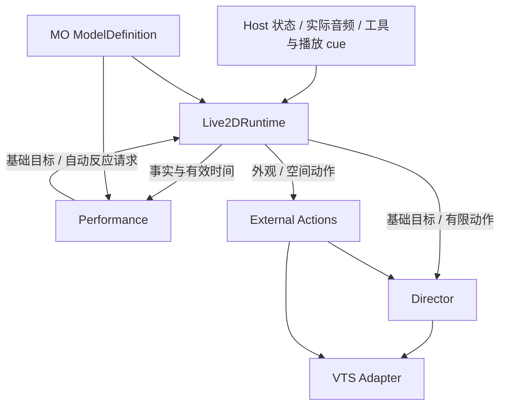

# Live2D World 持续表演系统重构设计

状态：待审阅的目标规格；尚未实施。
日期：2026-10-19。源码核对基线：`1edd435`。
范围：现有 MO 模型、VTube Studio、Live2D World、具身路由与实际语音播放接缝。
本文规定目标行为、开发原则、内部合同、模型工具、迁移与验收；不是当前运行事实或效果达标声明。

## 1. 目标、事实与边界

### 1.1 目标

角色启动后，在没有 LLM 动作调用时也应具有可读的注意、姿态调整、头身协调和停留；讲话、思考与明确反应能融入同一持续身体。最低效果目标是真人 VTuber 操纵皮套的质感，而不是参数在变、播放平滑或动作数量足够。

Neuro 截图用于识别表演层次和组合方式，不能证明其内部算法、实时速度、控制来源或动作频率。模型形变与手势能力不同，不能承诺通过程序复现全部外观效果。

### 1.2 当前事实

| 已核对位置 | 当前机制与限制 |
| --- | --- |
| `.uina/worlds/live2d/runtime.ts` | 集中持有连接生命周期、背景短句历史、姿态终点、思考与讲话强调；机制与表演策略混合 |
| `models/mo/motions/natural.ts` | 4～10 秒选择一次小幅目标；头部曲线主体是常值，主要运动集中在入场过渡 |
| `director/` | 已有逐轴仲裁、连续骨骼状态、口型、眨眼、视线补偿与动作取消；头身语义含基于来源身份的处理 |
| `index.ts`、`endpoint.ts` | 工具为 express/state/costume/status/reload/prepare_body；cue 同时命中动作与持续姿态 |
| `worker/` | 生产合成与 VTS 通信在独立 Worker；主线程代理不应拥有身体权威状态 |
| `src/extensions/world-framework/seams.ts` | 共享 BodyEndpoint 与 VoiceLevelSink；属于 Extension/World 接缝，不属于 Agent Core |
| `.uina/extensions/tts/` | 从实际播放进度投递电平和 cue，已存在 trace 所有权与取消处理 |
| `models/mo/rig.json` | 声明头、躯干、视线、眼睑和嘴部；没有手臂逻辑轴；躯干绑定声明本身不证明当前 VTS 映射可用 |

用户报告默认画面只有极小偏转和眨眼，与当前内容结构相符。先前定向测试通过只证明对应机制；真人质感、完整音画同步和同构图连续对照尚未验收。

### 1.3 纳入与排除

- 纳入：持续表演、模型能力与内容、工具/cue 合同、控制权、线程接线、音频消费、诊断、重写与验收。
- 使用程序和手工编排，不依赖真人面捕；不修改模型源文件或重做绑定素材。
- 不修改 Agent Core，不引入通用情绪引擎、行为树平台、额外服务、持久化数据库或第二个播放系统。
- 不修改真实 Provider、认证、会话或 VTS 用户配置。创建 VTS 自定义输入仍是明确的维护操作。
- 不新增权限、执行轮次、并发数量或动作容量限制。表演节奏中的停留和抑制是内容策略，不是工具准入配额。

## 2. 开发理念与必要规范

### 2.1 原则

1. **效果驱动**：以连续画面中的可见行为定义问题；源码、轨迹和测试解释效果，不能替代效果。
2. **机制与策略分离**：执行层保证组合、连续、取消和结算；表演层决定注意、姿态、时机和表达。
3. **唯一所有者**：每个权威状态只有一个拥有者。消费者获取只读事实，不重建第二份状态机。
4. **组合优先**：基础身体、持续意图、有限动作、口型和次级物理各自承担明确职责，通过一个合成器组合。
5. **有限能力产生丰富组合**：优先精修行为组织与模型映射，不以增加动作数量、随机噪声或复杂架构代替表现力。
6. **简单且可检查**：一个 World、一个 Worker、一个有效时钟、一个身体合成器；领域概念不自动获得服务、队列或管理器。
7. **诚实处理未知**：声明、受理、执行、设备接受、读回和视觉验收是不同证据；未知结果不自动重发。
8. **按终态重写**：新合同生效时删除旧路径，不保留旧参数解释器、双写、兼容别名或永久迁移开关。

这里借鉴 Unix/Linux 的职责清楚、接口可组合和实现可检查经验，不把“一个职责”误解为“一个进程”。Live2D 的价值在于美术定义的参数形变、组合与次级物理，程序不能生成模型没有制作的姿态。

### 2.2 强制规范

- 所有工具和 Worker 消息先校验，再进入唯一准入路径；不得由 UI 或模型工具直接注入 VTS 参数。
- 模型专属数据只在模型目录中定义；通用 Performance 不导入 MO 内容或 VTS 参数 ID。
- 所有新逻辑有明确状态所有者、失效条件、取消范围和返回语义。
- 必要接口先由真实消费者证明；不为未来的机器人、多角色或任意动画系统预设扩展框架。
- 生产数值单位以 rig 声明为准；逻辑轴数值不得未经标定称为真实屏幕转角。
- 时间字段命名带单位：内部使用 `Ms`，模型工具时长使用秒；禁止隐式换算或双重速度缩放。
- 内容随机只在行为决策和作者编译时抽样；逐帧采样不得消耗随机数。
- 不以清空全部姿态实现取消，不以每帧播放新 clip 实现持续身体，不静默吞掉合成异常。
- 文档中的“必须”为实现与审查门槛；“初值”必须经真实 MO 标定，不是人类运动定律。

## 3. 领域模型

| 术语 | 定义与所有者 |
| --- | --- |
| ActivityFacts | 可验证的交互事实，如 thinking、实际播放电平；Runtime 收集，不推断主观心理 |
| Intent | 模型明确设定的持续意图，含 attitude/attention/posture/expression；Performance 持有 |
| Attitude | 交流态度，调整行为概率、幅度和节奏，不等于固定表情或某组骨骼值 |
| Attention | 希望关注的方向；不证明现实中存在被观察对象 |
| Posture | 特殊身体基准、允许活动范围与动作准入约束，不默认冻结全身 |
| Expression | 明确的面部目标与必要约束，与语音开口分工清楚 |
| Behavior | 有起止阶段的自动行为，如移目、头身跟随、重心调整；Performance 持有进度 |
| PerformanceBase | 本帧完整自动基础目标与生效约束，不是动作实例；Director 只缓存最新输入 |
| Reaction | 有限的表达动作；可由工具、cue 或自动行为触发；执行层持有实例 |
| Execution | 一次有限动作及清理的权威记录；Runtime 接入现有 Director/外部执行账本，不能另造平行账本 |
| Appearance | 外观目标设置；与身体姿态、动作和视觉验证分开 |
| ModelDefinition | 当前模型的 rig、能力目录、内容与标定配置，装配后冻结 |

`neutral` 表示某个内容基准；`null` 表示没有显式意图，两者不得混用。清除表情不是把眼睛、嘴和身体全部设置为零。

## 4. 架构与依赖



### 4.1 模块职责

| 模块 | 拥有 | 禁止拥有 |
| --- | --- | --- |
| Runtime | 生命周期、身份与代次、有效时间推进、请求接入、执行记录索引 | 自动歪头规则、待机短句历史、独立情绪状态机 |
| Performance | 显式意图与到期、注意/身体/节奏行为、近期选择与下一行为计划 | VTS 连接、设备成功状态、动作实际播放进度、定时器 |
| Director | 身体控制权、实际位置/速度、有限动作句柄、视线与口型组合 | 态度解释、安静期选择、MO 专属行为规则 |
| External Actions | 外部副作用、资源声明、基线读取、恢复义务与结算 | 自主选择表演内容 |
| Adapter | 参数编码、设备事实、认证/连接/请求、绑定核验 | 表演策略、持续意图 |
| ModelDefinition | 模型内容、约束、作者函数、可见幅度标定 | 运行状态、Host/设备对象引用 |
| 主线程代理 | 消息关联、生命周期缓存、端点转发 | 表演推进、基础姿态、实际执行权威状态 |

### 4.2 建议代码组织

在 `.uina/worlds/live2d/` 内形成：

```text
performance/
  types.ts          跨 Performance/Runtime/Director 的纯数据合同
  performance.ts    单一实例、意图提交、step/reset
  attention.ts      注意行为计算
  body.ts           姿态和运动目标计算
  rhythm.ts         交互节奏、音频特征、局部反应选择
models/mo/
  performance.ts    MO 内容、行为配置、视觉标定
  catalog.ts        模型能力的唯一装配入口
```

内部三个计算文件由同一个 Performance 调用，不能分别建立生命周期、后台循环或服务注册。文件边界用于隔离真实的计算职责，不要求每个文件都有 class。

`performance/` 仅依赖本 World 的纯类型与数学/作者辅助函数，不 import Runtime、Adapter、Worker、Host 或扩展实现。共享接缝定义仍在 `src/extensions/world-framework/seams.ts`，不向内核五目录添加表演概念。

## 5. 内部合同与每帧数据流

以下 TypeScript 为目标接口规格，不代表已经存在的 API。

```ts
type IntentLane = "attitude" | "attention" | "posture" | "expression";
type IntentPatch = Partial<Record<IntentLane, string | null>>;

interface ActivityFacts {
  thinking: boolean;
  audio: { rms: number; peak?: number; stale: boolean };
}

interface ControlSnapshot {
  ownedAxes: ReadonlySet<string>; // 当前有限动作占用；只读，不允许策略修改
  foregroundActive: boolean;
  settlingExternal: boolean;
  pose: Readonly<Record<string, number>>; // 上一有效合成帧；不是 VTS 画面读回
  velocity: Readonly<Record<string, number>>; // Director 已跟踪骨骼轴的实际管道速度
}

interface PerformanceInput {
  clockMs: number;
  dtMs: number;
  activity: ActivityFacts;
  control: ControlSnapshot;
}

interface PerformanceBase {
  channels: Readonly<Record<string, number>>;
  aim: { x: number; y: number }; // 模型标定坐标中的期望注视目标
  constraints: Readonly<ResolvedConstraints>;
}

interface ReactionRequest {
  name: string;
  decisionId: number;
}

interface PerformanceOutput {
  base: PerformanceBase;
  reaction?: ReactionRequest;
}

interface Performance {
  commitIntent(patch: IntentPatch, holdMs: number | undefined, clockMs: number): IntentReceipt;
  step(input: PerformanceInput): PerformanceOutput;
  reset(reason: ResetReason): void;
}

interface IntentReceipt {
  revision: number;
  acceptedAtMs: number;
  changed: readonly IntentLane[];
  expiresAtMs: Partial<Record<IntentLane, number | null>>;
}

type ResetReason = "start" | "audio-reset" | "interrupt" | "pause" | "resume"
  | "focus-lost" | "focus-gained" | "disconnected" | "reconnected"
  | "definition-changed" | "stop";
```

`ResolvedConstraints` 是模型内容编译后的数据，不做通用规则语言：

```ts
interface ResolvedConstraints {
  ranges: Readonly<Record<string, { min: number; max: number }>>;
  fixed: Readonly<Record<string, number>>;
  motionGain: Readonly<Record<string, number>>; // [0,1]，仅缩放自动活动
  automaticReactions: "allow" | "suppress";
  speech: "allow" | "suppress";
}
```

未列范围沿用 rig 舒适范围，未列 fixed 表示不固定；motionGain 未列轴为 1。fixed 必须位于该轴范围内。约束交集为空时拒绝整组意图。所有值在模型装配时校验，逐帧对象是已解析的最终值而非可执行规则。

规则：

1. `commitIntent` 同步提交已解析的新意图；Runtime 负责生命周期/代次准入，Performance 负责意图组合合法性。
2. 每次 `step` 返回完整的基础目标；未被模型声明的轴不得出现。基础 `mouth.open` 默认中性，不用随机值伪造说话。
3. 自动反应是本帧一次性建议，Runtime 在同一有效时间进行准入；不能保留为待播放队列。
4. `decisionId` 在实例内递增，避免同一帧输出重复启动；不是外部执行 ID。
5. `ControlSnapshot` 来自执行层，只描述控制事实；不能依据上一帧观感反推动作是否结束。
6. 不使用自由文本描述执行规则，不在逐帧路径调用 LLM、文件系统或网络。

ControlSnapshot.pose/velocity 仅供启动、显式变化和交还时选取接续初值；Performance 不复制或积分这份物理状态。普通行为只持自身目标计划和阶段。无设备读回时必须将接续依据标为本地合成，不能宣称从实际可见像素反算了姿态。IntentReceipt 的 null 到期值表示无限期；被清除通道不出现在 expiresAtMs 中。

reset 不等于一律清空全部状态：audio-reset/interrupt 清音频候选与瞬时行为，pause/focus-lost/disconnected 按生命周期表冻结或撤销计划，definition-changed/stop 才清模型相关意图与历史；resume/focus-gained/reconnected 以新 ControlSnapshot 重建接续计划，不播放旧候选。

### 5.1 一帧的确定顺序

1. 接收本帧前已到达的命令；校验/提交意图、启动/取消动作，记录命令线性化顺序。
2. 根据 Runtime 状态决定是否推进；暂停/失焦不推进表演有效时间。
3. 对实际播放电平执行 stale 判断并形成 ActivityFacts；口型映射与节奏读取同一有效测量。
4. 从 Director/外部执行取得 ControlSnapshot。
5. Performance 到期清理意图，推进活动过渡与自动行为，输出基础目标和一次性反应建议。
6. Runtime 立即准入反应建议；拒绝即丢弃，记录原因。
7. `Director.setPerformanceBase(base)` 更新唯一基础来源，再推进有限动作、合成与身体管道。
8. Adapter 编码并注入；设备反馈更新执行证据，不倒过来改变已经走过的表演时间。

`setPerformanceBase` 不建立播放实例、不返回动作句柄、不设置定时器。Director 对最新输入的缓存不是第二份 Intent。

## 6. 持续表演算法

### 6.1 一个持续身体，三种协调计算

注意、身体和节奏由单一实例协调，不能各自独立抽取一套全身目标。

| 计算 | 状态 | 输出 |
| --- | --- | --- |
| 注意 | 当前目标、停留阶段、回看计划 | aim、头部跟随倾向 |
| 身体 | 当前计划目标、过渡进度、重心倾向、修正阶段 | 独立头/躯干目标与基础面部倾向 |
| 节奏 | 活动混合权重、有效音频特征、强调候选与近期行为 | 行为选择条件、幅度/时间参数、局部反应建议 |

默认活动由事实计算：有效持续音频优先采用讲话节奏；无讲话时 thinking 采用思考节奏；其余为安静活动。短暂音频空窗用模型配置中的静音确认时长避免模式抖动。不同节奏连续混合，不能重启身体。没有真实输入采集事件时不登记 listening 模式。

### 6.2 行为结构

初始行为集为安静保持、移目、回看、侧倾观察、重心调整、姿态重新平衡、浅笑变化。每个行为定义阶段和必要通道，而不是仅有一组终点常数。

- 较慢变化决定身体倾向；较快修正围绕该倾向有界发生。
- 停留是有意保留的阶段；期间允许呼吸和小修正，不要求每秒发生显著动作。
- 移目可以只动眼睛，也可以带动头/身体；不是每次机械执行全套序列。
- 注视与头身先后作为一个相关参数组采样；同一次行为共享方向、程度和节奏。
- 改变目标时从当前计划状态接续，不先回中性，不重新初始化 Director 的位置或速度。
- 目标轨迹使用现有纯曲线辅助函数；位置连续，普通阶段接续要求目标速度连续。有意顿住和明确反应单独标记，不以随机断点实现。
- 自动目标只能在已标定的舒适范围内规划。曲线验证失败时保留上一个有效计划直到其安全接续点并报告内容错误；不能反复抽样直到碰巧通过，不能提交非法值再靠最终 clamp 修饰。

目标轨迹描述“想怎样运动”；实际骨骼响应只由 Director 的一套管道计算。不能在 body.ts 再实现弹簧，然后让 Director/VTS 对同一种回弹重复加工。

### 6.3 低重复度

近期记录保存行为家族、方向、幅度档与结构变体，而不只保存动作索引。选择依次考虑当前意图/约束、控制权、适用行为、近期相似度，再做加权抽样；允许选择保持安静。

近期相似行为降低权重，不再同时承诺“最近两类绝不重复”和“安静占固定长期比例”。只有确有内容要求的连续重复禁用才是硬规则。选择概率、停留和自动反应间隔属于模型策略，不能限制显式 `perform` 调用。

独立随机流至少区分 attention/body/reaction/authoring。固定 seed 和相同输入序列可重放；真实操作系统调度不承诺逐帧相同。采样不访问 RNG，新增某个动作内部随机量不得改变全部注意行为序列。

### 6.4 初始标定起点

| 项目 | 初值／方法 | 状态 |
| --- | --- | --- |
| 活动程度过渡 | 约 0.4～0.8 秒 | 可调内容参数 |
| 小修正持续时间 | 约 0.3～1.2 秒；幅度必须可感而不形成抖动 | 待 MO 校准 |
| 较慢姿态调整 | 约 1.5～5 秒；之后有不等长保持 | 待 MO 校准 |
| 注视先于头部、身体跟随 | 约 100～220ms、再延后 120～280ms，允许只动眼睛 | 待 MO 校准 |
| 讲话强调机会 | 有效语音超过 500ms；能量变化/句段停顿提供候选 | 不等于语义重音识别 |
| 自动强调初始节奏 | 候选概率 35%，至少 2.5 秒间隔，持续约 600～1100ms | 可经录像调节；不约束工具 |
| 音频失联 | 采用现有 MO staleMs=120ms 的起点 | 需在实际播放链核实 |

幅度不在此虚构一组“正确角度”。先为 MO 校准细微修正、日常表达、明显反应三个视觉档位，再将真实 rig 数值写入模型配置。默认活动必须包含日常表达档；不能全部落在只有逐帧比较才看得出的范围。

### 6.5 讲话与反应

使用实际可听位置的音频电平驱动口型；节奏消费短时能量、变化与静音确认，不逐峰打拍子，不把音量当作语义。持续语音提供稀疏自动头身强调；明确语义仍由 cue/工具指定。

存在特殊姿态禁用自动反应、显式闭眼、前景身体动作、外部清理或不适合的活动时，自动候选即时丢弃。不得在恢复后补播。自动层不随机修改装扮、不执行外部空间副作用，不代替用户控制。

## 7. 模型内容与能力单源

### 7.1 模型定义

`ModelDefinition` 装配以下五类内容：rig、能力目录、PerformanceProfile、有限动作、外观适配。装配后复制并冻结；目录只保存作者函数和元数据，不缓存某次随机编译结果。

| 内容 | 必须声明 |
| --- | --- |
| attitude | 行为选择倾向、活动程度和节奏变化；不直接锁轴 |
| attention | 校准后的注视目标；user 解释为观众/镜头方向，screen 为模型坐标中的约定方向 |
| posture | 身体基准、自动活动范围、硬约束、允许的反应、语音开口策略 |
| expression | 面部目标、拥有轴、必要硬约束；mouth.form 与 mouth.open 不混用 |
| reaction | 作者函数、变体、必要/可选轴、组合方式、cueEligible、语音策略、外部资源 |
| appearance | item、合法 value、目标设置方式、幂等性依据、读回方式及证据等级 |

名字与别名在同一类别内唯一；工具按字段区分类别，cue 只查询 reaction。中文别名可以作为内容能力登记，但禁止保留 express/state/costume 等旧工具操作别名。所有解析、能力展示与 cueEligible 使用同一快照。

### 7.2 MO 首批内容

- 基础姿态不局限于正中站立；初始身体可向一侧轻靠并重新平衡，变化必须经过真实画面标定。
- attitude 首批为 relaxed、engaged、curious、playful、subdued；每项必须有行为差异和录像说明，否则不登记。不得仅替换随机 seed 冒充性格差异。
- attention 首批沿用已校准的 user/screen/avert_down/avert_left/avert_right；不足时明确缺失，不猜屏幕对象位置。
- posture 首批覆盖 sleep 和 sway；正常自动身体通过 `posture:null` 取得，不新建一个“正常姿态”永久锁轴。
- expression 首批覆盖 smile、closed_eyes；清除使用 `null`，不保留 neutral_expression 作为自动恢复的替身。
- reaction 首批精修 nod、shake、curious、glance、chin_up、smug_laugh、head_toss、close_up 八家族。保留有实际用途且已迁移验证的特殊动作；每个家族至少两个结构/节奏不同的版本。
- MO 无手臂轴，能力目录和描述不得使用“挥手”表示头部或整体模型移动。没有已核验外观绑定时 appearance 目录为空；该操作返回 unsupported，不虚构条目。

### 7.3 编译校验

必须检查：名称与别名冲突、未知轴、有限值与范围、曲线时域、时间单位、变体有效性、必要轴、约束交集、cueEligibility、外部资源与空间事件合法性。reaction 变体必须保持同一语义与相同的必要能力；不同含义登记成不同动作。

缺少关键能力使相关内容不可用，并在能力查询列出具体原因。非关键内容可以不装配；不能因为局部躯干绑定失败就谎报整个模型不可见，也不能在缺少身体映射时宣称身体动作已生效。

## 8. 身体合成与控制权

### 8.1 唯一合成次序

1. 完整 PerformanceBase：独立头、躯干、基础面部与注视目标。
2. 当前显式姿态/表情对应的已解析目标与约束；意图权威仍在 Performance，Director 不再维护自己的长期姿态/表情计时器。
3. 有限动作的 absolute/offset 轨迹与控制权；同轴同类动作保留“后受理者取得控制”的规则，未实际输出不得伪报设备接受。
4. 视线补偿、音频口型、单一自动眨眼来源。
5. 目标先满足生效约束，再通过唯一骨骼/面部管道，输出再次核验约束与最终安全边界；Adapter 输出，模型内物理计算头发衣物等次级运动。

硬约束如显式闭眼必须贯穿最终输出，不因普通自动行为或可选眼部轨道暂时打开。工具动作若必要轴与硬约束冲突，准入失败 `state_conflict`；可选轴按作者声明让位，不临时猜测删哪些轨道。特殊姿态也使用该规则。attitude 本身不产生硬锁。

新约束不能以立即裁剪骨骼位置制造瞬移。Performance 按模型声明的入场时间，从当前有效目标/约束过渡到新目标；过渡包络包含当前实际输出并连续收敛到最终范围。准入立即使用新意图的最终约束判断后到动作，输出使用当前包络；闭眼在入场完成后必须保持为闭合。hold_s 包含这段过渡，过早到期则从当时位置交还，不强行跳到完整姿态。入场/退场默认值由模型配置给出，装配时必须存在。

眨眼与呼吸按 rig 指定唯一主来源。暂停只保证 Uina 的身体输出保持，不能保证外部物理、其他来源和音频全部静止。

### 8.2 头身语义归一化

终态执行合同只接受独立头/躯干轴。取消最终合成中的隐式“身体等于头部”及基于背景来源身份的修补分支。

重写作者时，将旧 head-relative 躯干修正显式改成独立躯干轨迹：同方向的该动作头部增量加旧躯干修正，得到该动作真正希望贡献的躯干增量。没有同方向头部轨迹时，其自身头部增量为零。转换只用于迁移内容，目标公共作者 API 不保留旧 torso 模式解释器。

迁移后每个动作逐项对照头/躯干目标与合成输出；混用 absolute 与 offset 的内容必须重新编排，不能机械相加。头部动作需要身体跟随时由作者明确写入躯干通道，没有写就不取得躯干控制。

### 8.3 接续、覆盖与幅度

- absolute 动作从当前有效输出接管，保持身体管道的位置与速度；结束交还当时的基础/意图，不交还启动时保存的旧姿态。
- offset 动作叠加在当前基础上，入口/出口增益连续；不能先移除背景同轴目标再从中性叠加。
- 基础身体在遮蔽时继续推进意图时间，但被遮蔽的运动计划不积累追赶位移；交还时按当前可见状态重新接续，不瞬间跳到隐藏终点。
- 多个动作按现有类别与受理序处理控制权；优先级和整场协调规则属于作者合同，不给 LLM 数值优先级。
- 增量组合按当前基础与可用余量进行协调缩放，头身相关轨迹保持相关比例。不能分别裁掉头和躯干而破坏支撑关系。
- 正常内容不应依赖最终 clamp。必要的安全裁剪必须计入诊断；相同场景连续裁剪属于内容/合成失败，不是“边界保护已通过”。
- 移除重复骨骼回弹方程或重复平滑时必须用实际响应对照；不一刀切删除全部物理，也不全局绕过现有稳定管道。

## 9. 模型工具合同

保留一个 World 门面 `live2d({action, params})`，操作为 inspect/set/perform/cancel/appearance。每个 params 对象禁止额外字段；错误返回可用名字或合法值，不做模糊字符串猜测。

### 9.1 请求类型

```ts
type Live2DRequest =
  | { action: "inspect"; params: {
      section?: "state" | "capabilities";
      kind?: "attitude" | "attention" | "posture" | "expression" | "reaction" | "appearance";
    } }
  | { action: "set"; params: IntentPatch & { hold_s?: number } }
  | { action: "perform"; params: { name: string } }
  | { action: "cancel"; params: { execution?: string } }
  | { action: "appearance"; params: { item: string; value: string } };
```

### 9.2 inspect

`section` 省略为 state。kind 只允许用于 capabilities，组合错误明确拒绝。

- state：模型与目录代次、连接/暂停/焦点、声明与有效意图、各通道剩余有效时间、当前执行 ID/名称/来源/阶段、音频有效性、缺失绑定与故障。
- capabilities：省略 kind 返回各类完整短目录；指定 kind 返回用途、约束、cueEligibility、合法外观值及证据等级。不得隐藏已有能力以压缩上下文。
- 离线时可返回已加载模型的声明能力，必须标 `available:false` 和原因；不能把缓存能力当作当前设备已就绪。
- 不返回原始逐帧轨迹、认证或用户配置内容。开发诊断通过维护命令取得。
- inspect 是权威实例上的只读快照，不依赖主线程陈旧 sync 缓存拼出完整状态。

### 9.3 set

```json
{"action":"set","params":{"attitude":"curious","attention":"user"}}
```

```json
{"action":"set","params":{"expression":"closed_eyes","hold_s":3}}
```

```json
{"action":"set","params":{"posture":null,"expression":null}}
```

规范：

1. 未传通道保持；null 清除显式意图并交还自动表演。至少提供一个通道；空 set 拒绝。
2. hold_s 必须为正有限数，乘 1000 后仍为正有限数；禁止 0、负数或字符串。省略表示持续到修改/清除。
3. hold_s 只作用于本次修改的非空通道；全为 null 时不得同时传 hold_s。
4. 整组解析、约束交集与代次校验完成后，同步提交；任一无效则零提交，不逐通道等待。
5. 生效和计时起点均为提交时刻的有效时间，包含入场过渡；不承诺非常短 hold 一定能达到完整姿态。
6. 同通道后提交覆盖先提交；未修改的通道不续期。相同值带 hold_s 是显式续期；相同值且双方都是无限期为 no-op，不重启动作。
7. 到期删除该通道意图，不恢复被替换的旧值；态度到期回模型默认态度，其他通道交还自动行为。
8. 新姿态/表情硬约束若与正在执行动作的必要轴冲突，提交本身成功并立即要求冲突动作取消与清理；set 回执列出受影响 execution，不等待其外部清理。后续新动作按新约束准入。
9. attitude 可以与 sleep 等姿态同时保存；受姿态约束时 inspect 显示当前效果被抑制，不能把意图丢掉或排成未来待播动作。
10. set 成功只证明 local_intent。提交前中止为 cancelled/not_started 效果；提交后收到中止不回滚已提交意图，回执必须说明 accepted 与实际 revision。

每次有效变更返回 intentRevision 和实际更新通道。revision 是本 World 实例内的意图版本，用于事实识别，不新增持久化或公开 CAS 协议。

### 9.4 perform

```json
{"action":"perform","params":{"name":"nod"}}
```

- 只执行有限动作；不修改长期 Intent。动作变体在同一语义家族内按态度、控制状态与历史选择。
- 不向模型暴露 atomic、speech、priority、speed、variant 或自由数值轴。明确不同语义的表现登记为不同能力。
- 同步完成校验、绑定模型/目录代次并创建 execution；然后异步等待身体与外部清理终态，不能阻塞其他命令准入。
- inspect 可以在等待期间看到 execution ID；本调用终态也返回该 ID。
- 不新增工具调用频率限制。资源冲突明确失败；不自动排队等待表演空档。
- 工具 AbortSignal 只取消本次执行，不取消后到的其他动作，不清除 Intent，不暂停持续身体。
- 身体动作完成与输入接受分别记账；没有设备接受证据不能返回“画面已执行成功”。

### 9.5 cancel

```json
{"action":"cancel","params":{"execution":"execution-id"}}
```

- 指定 execution：只取消该有限执行；执行 ID 在 World 实例内唯一并包含实例标识，旧实例 ID 不得命中新实例。
- 省略：捕获受理时所有非终态有限执行，包含工具、cue、自动反应；只取消这份快照。后到动作不被追加取消。
- 不清除持续 Intent、不冻结基础身体、不撤销已经完成的外观目标设置。
- 等待被取消执行的必要清理；结果列出目标 ID、各自结算和 cleanup。任一必要外部结果未知，总结果为 unknown。
- 已终态且仍有记录为 succeeded/no-op，附原终态；找不到指定 ID 为 failed/execution_not_found。无目标的全取消为 succeeded/no-op。
- 诊断历史可以沿用现有有界保留，但不得把保留容量当作执行容量或把已淘汰 ID 猜成完成。

### 9.6 appearance

```json
{"action":"appearance","params":{"item":"glasses","value":"on"}}
```

上例仅说明结构，当前 MO 未核验此能力，不能直接登记或声称可执行。

- 只提供有明确目标语义的设置。先检查当前模型、合法值、相关资源与可用适配。
- 有读回时先核验事实；已经达到目标可以 no-op。没有读回时，只有作者证明操作本身是绝对且幂等，才允许作为目标设置登记。
- 请求已接受但没有读回时，可按能力合同报告 succeeded/request_accepted，同时 `observed:null`、`visualVerified:false`；不能返回目标已观测。
- 发送后 ACK 丢失或模型变化为 unknown，不更新 observed。requested 与 observed 分别保存；后续 inspect 允许重新读回，不重发。
- 只有 toggle 的外观登记为明确命名的 perform 动作，cueEligible=false；不伪装成 appearance 目标设置。
- 相关空间/效果资源清理未完成时拒绝冲突设置，不自动覆盖未知恢复义务。
- 当前未提供 appearance 能力时，操作返回 failed/unsupported；保留能力类别不等于虚构条目。

### 9.7 模型提示与工具说明

默认身体会自主表演；无需持续调用工具。普通语义伴随反应使用 cue；持续态度使用 set；明确的独立动作使用 perform；不确定名称时 inspect。说明应简短，但不得错误宣称“只能做大动作”或把未支持的挥手举为当前能力。

### 9.8 操作准入矩阵

所有变更先检查调用中止与实例生命周期，再按下表处理；参数错误与状态拒绝分别给出原因，不等待环境变好。

| 操作 | 离线/身份不匹配 | paused | unfocused | 合成 fault |
| --- | --- | --- | --- | --- |
| inspect | 可读声明与真实离线状态 | 可读 | 可读 | 可读故障事实 |
| set | 拒绝，不静默积压意图 | 拒绝 | 可提交意图，时间与过渡等回焦再推进 | 拒绝 |
| perform / appearance | 拒绝 | 拒绝 | 拒绝，防止看不见的动作在回焦后才开始 | 拒绝 |
| cancel | 可取消既有执行；不能因此声称外部清理成功 | 可取消 | 可取消 | 尽力取消与结算，未知如实报告 |

实例尚未创建/已释放时按 not_started 处理，不返回伪在线快照。closing 阶段允许 inspect 与既有执行的取消/清理，不受理新 set/perform/appearance。新 set 在失焦时可受理是显式意图能力；自动反应和 cue 仍不能积压。

## 10. Cue 合同与语音所有权

- 标签形式保留 `<cue id="nod"/>`，可选 target 继续用于具身路由；不增加时长、priority、姿态或外观标签属性。
- cue 只命中 reaction 中 cueEligible=true 的内容；不命中 posture、expression、attitude 或 appearance。
- 适合讲话的有限面部反应也可以是 reaction；持续表情仍走 set，二者不是同一条目复用两种寿命。
- 工具 perform、cue、自动反应复用 Runtime 的执行准入、绑定、取消和记录；它们只在来源与结果交付方式上不同。
- cueEligible 至少要求无外部空间/外观副作用、无需压制正常讲话口型、符合模型实际能力。标签不能触发隐式权限升级或异步维护。
- TTS 拥有该输出 trace 时，只在播放位置派发；文本消费者不重复派发。没有播放拥有者时才使用文字流位置，不宣称与音频同步。
- 保留生产者对 trace/segment/cue index 的去重与旧 trace 撤销。重复进度事件不能重复表演；无法保证跨崩溃 exactly-once，不自动补发已失去权威的 cue。
- 未知/不适用/离线/暂停的 cue 明确记录 rejected 及原因；不建立伪模型回合来反馈。
- cue 投递不阻塞文本或音频流，执行终态通过同一个近期执行账本可查。不要另建一份 cue 完成状态来推断动作结果。
- BodyAffordance、supportsCue 和执行解析必须来自同一目录代次；主线程缓存只用于发现，Worker 受理时再次核验。

具身路由的 target 与多端点发现职责保留，不因 Live2D 重构改写其他身体行为。Live2D 端点未获焦时拒绝 cue，不能创建冻结后待回焦播放的实例。路由阶段已拒绝的 cue 由现有派发诊断记录原因；只有进入该 World 的执行才登记 execution，不能为了统一账本伪造已受理记录。

保留 VoiceLevelSink 的 `processLevel({rms,peak?})/reset()` 接缝。生产者必须在调用前拒绝已撤销 trace 的迟到测量；消费者负责 stale 和本地生命周期门，不假定音量能识别说话内容。若未来真实证据显示该合同无法阻止跨生产者串流，再单独扩展来源标识；本次不凭空增加跨扩展协议。

## 11. 结果与执行记录

沿用 ToolExecutionResult 的 succeeded/failed/cancelled/unknown/not_started，不新增并列顶层结果体系。

| 操作 | succeeded 的边界 |
| --- | --- |
| inspect | 成功取得带连接/代次事实的快照 |
| set | 新意图同步提交；不证明目标姿态已达到 |
| perform 本地身体 | 身体有限执行完成，相关实际发出输入满足既有接受判据 |
| perform 含外部副作用 | 必要执行/恢复义务按合同结算；任何必要项未知不能成功 |
| cancel | 受理快照中的目标已取消/已终态，必要清理完成或无需清理 |
| appearance | 按本能力声明的请求接受或读回合同完成，证据字段指出是哪一种 |

details 使用现有 effectStatus/verification/cleanup，并补充必要的 execution、intentRevision、requested/observed；不把所有操作硬塞进同一个巨大结果对象。

verification 的目标值为 local_intent（意图提交）、input_accepted（身体输入接受）、request_accepted（外观等外部命令接受）、state_readback（状态读回）；没有对应证据时不填或保持未知，禁止把这些值解释成视觉自然度。执行阶段统一为 running/releasing/settling/terminal；终态使用现有五值结果和必要的 reason，不另造一份 finished 布尔真值。inspect 输出来源与证据时间，区分当前读回与历史观测。

必要区分：

- 生命周期未启动为 not_started；已启动但名称/参数/状态冲突为 failed，effectStatus=not_started。
- 请求执行中取消保留 cancelled；若必要副作用仍未知，details.effectStatus/cleanup 记录 unknown。cancel 操作本身汇总此情况为 unknown。
- 异常发生于发送前可明确失败；发送后结果不明为 unknown。无法判断时保留不确定性，不猜测未开始。
- 任意成功均不能自动生成 visual_verified。视觉验收只存在开发验收记录中。

执行 ID、动作名、来源(tool/cue/automatic)、模型/目录令牌、阶段、终态和证据由同一执行记录汇总。局部身体句柄和外部阶段对象仍各持其真实职责，不把汇总索引扩展成另一个通用 Job 系统。

## 12. 时间、生命周期与故障

### 12.1 时间

Runtime 使用单一单调有效时间。正常运行时推进；暂停、失焦、断连或身份不匹配时冻结表演时间。渲染 dt 可以沿用现有防长帧边界，动作/意图到期读取同一个有效时间，不各自使用 Date.now。

外部网络超时和清理预算使用实际经过时间，不能因暂停冻结而永久持锁。时间戳日志统一 UTC，必要时另外标注 Asia/Shanghai；日志时间不参与表演决策。

### 12.2 状态表

| 事件 | 持续意图 | 自动行为与音频 | 有限执行与外部义务 |
| --- | --- | --- | --- |
| 首次就绪 | 从模型默认值建立 | 从当前可取得的有效姿态平滑进入；无读回时从 rig 中性进入，并注明限制 | 不恢复旧实例执行 |
| safeStop | 保留，冻结剩余时间 | 冻结身体；清音频候选与开口 | 取消有限动作，等待必要清理；保持帧维持 Uina 控制 |
| resume | 继续剩余时间 | 从保持状态接续，只消费新电平 | 不重放旧动作或自动反应，不自动重试未知恢复 |
| 失焦 | 保留并冻结 | 冻结；清音频候选 | 参数动作冻结；无法冻结的空间执行取消并清理 |
| 回焦 | 接续 | 不补演遮蔽期间候选 | 仅恢复仍合法的冻结参数执行 |
| 回合 interrupt | 保留 | 终止当前瞬时反应、清思考及音频候选，继续基础身体 | 取消受理时所有有限表演快照；不是 safeStop |
| 工具 AbortSignal | 已提交 set 不回滚 | 不影响其他自动基础行为 | 仅取消该调用对应执行 |
| 断连 | 同模型下保留并冻结剩余时间 | 清音频与候选 | 所有活动有限执行取消；已发送但未确认部分按 unknown 结算；旧令牌恢复不得写入新连接 |
| 同模型重连 | 重新核验能力；有效意图仍可用 | 从新观测状态接续，不追赶旧位移 | 不恢复旧有限执行、不重发副作用 |
| 模型/目录更换 | 清除模型相关意图，采用新定义默认值 | 清行为计划和历史，绑定新定义 | 撤销旧代次；旧异步回调只能结算旧记录，不得写新环境 |
| stop/Worker 退出 | 释放 | 释放；旧接收端离线 | 聚合清理结论，撤销暴露与订阅，全部等待者有限结算 |

interrupt 当前接缝没有可靠的 per-turn 执行归属，因此本设计明确取消全部当前有限表演，不声称只取消某个回合创建的动作。若未来需要更细归属，必须先引入真实来源合同。

### 12.3 故障处理

- 模型内容/配置在启动时无法校验：明确失败，不能静默换成任意默认模型。
- 缺少部分可选绑定：禁止依赖该绑定的内容，公开具体限制；必需基础绑定缺失则进入 fault，不宣称完整自然身体可用。
- Runtime 采样出现非有限数、未知轴或不可恢复异常：沿用可见停车，停止自动合成并中性化口型，有限执行进入取消/清理，不杀死仍承担外部恢复义务的线程。
- 清理预算耗尽：释放本地生命周期时保留 unknown，不能重试同一未知副作用制造二次执行。
- Worker 崩溃：代理撤销端点、让等待调用以实际证据结算，迟到 sync 不复活状态；恢复必须创建新实例。
- 观测/诊断回调故障不能改变执行结果，但必须可定位；不能把核心合成异常放进“诊断回调忽略”分支。

## 13. 并发与 Worker 协议

工具保持 parallel；命令的准入/提交按到达 Worker 的顺序同步线性化，有限执行完成异步等待。不得用等待整场 perform 的 Promise 链阻塞后续 cancel、set 或失焦命令。

新 RPC 操作为 inspect/set/perform/cancel/appearance，及已有 start/stop、endpoint.safeStop/resume/setFocus、维护操作。旧 express/state/costume RPC 删除。维护方法是内部能力，不代表日常模型工具。

- set 整组提交没有 await 间隙；目录变更不能夹在同一次提交的两个通道之间。
- perform 在启动部分绑定环境令牌，后续身体/外部流程沿用既有每次必要写入前核验。
- cancel 捕获 execution 快照后立即发起取消，再异步等待；新动作可继续准入，真实资源冲突仍明确拒绝。
- setFocus 的受理顺序与工具一致；其回执表示引擎已处理焦点命令，不由主线程猜测。
- 音频与 cue 沿用非阻塞投递；同一生产者先前发出的消息不得越过它发出的 reset/撤销顺序；生产者仍须撤销迟到 trace。
- 主线程不得发送逐帧 PerformanceBase，不新建远端表演进程。所有表演计算在拥有时钟的 Worker 内完成。
- 进程内测试与 Worker 通过同一 assembly 创建实例；测试不得仅覆盖另一份简化算法。

## 14. 维护、诊断与预览

### 14.1 从日常工具移出的维护能力

通过明确的开发脚本提供：

```text
pnpm mo:maintain -- inspect
pnpm mo:maintain -- prepare-body
pnpm mo:maintain -- reload
```

inspect 为只读设备/绑定/时序诊断；prepare-body 明确创建/复用已有模型隔离输入，不改写 `.vtube.json`；reload 为显式设备重载。prepare-body、reload 必须在没有其他 Uina 控制实例写入同一模型时执行；无法证明独占时拒绝并说明应先停用 World，不能争夺控制。

为此在 Adapter 的设备所有权边界增加一个本地 Uina 写入所有权记录，World、真实预览和变更型维护脚本共用，不另建服务。按规范化 VTS endpoint 建键，在 World 数据根创建独占 owner 文件（原子 exclusive-create），记录 pid、随机 owner token 和实例标识，不记录认证。活进程已持有则拒绝第二个 Uina 写入者；旧 pid 已确认不存在才允许回收，权限不足/进程身份不确定时拒绝并报告。释放仅删除 token 仍属于自己的文件；崩溃后的回收规则相同。该互斥保护同一套 Uina 参数所有权，既不禁止其他 VTS 插件，也不是任意并发配额。只读维护不获取写入权、不注册控制输入。

### 14.2 诊断事实

按需输出：连接/模型/目录令牌、意图及到期、活动权重、行为 ID/阶段/选择原因、当前基础目标、实际合成目标/输出、逐轴控制来源、反应抑制原因、clamp/余量缩放、有效 dt 分布、注入 sent/accepted/failed/dropped/filtered、外部清理。

声明能力、绑定可用性、设备接受和视觉标定证据分别显示。生产默认不持续收集完整轨迹；预览诊断可开启，不引入后台遥测服务或用户数据上传。

### 14.3 可复现预览

`mo:preview -- --scenario idle|speech|mixed [--offline] [--seed N]` 保留，必须使用正式 Performance/Runtime/Director。

- idle：5 分钟，完全无模型动作调用。
- speech：3 分钟；离线为明确标记的模拟电平；真实音画验收必须另外使用实际 TTS 播放。
- mixed：2 分钟，包含状态提交/到期/清除、动作开始后实际中断、局部覆盖和恢复。无外观能力明确跳过，不假装测试了装扮。
- 单动作作者预览保留，但不能代替启动后的默认身体验收。
- 日志标注 seed、源码版本、模型/rig/profile 版本、模拟或真实输入；离线传输不伪造 VTS ACK。
- 完整场景支持输入记录与固定 dt 离线重放。只记录开发用合成事实和公开测试语料，不读取或改写真实会话。

## 15. 代表流程

### A. 启动后无人说话

核验模型与必要映射 → 建立 relaxed 默认意图 → 持续注意与身体计算 → 定期出现可读的移目/调整/回看和安静保持。整个过程不依赖 cue 或工具调用，不通过“播放全部动作”制造活跃。

### B. 好奇地回答

set(attitude=curious, attention=user) 原子提交 → 基础身体平滑调整 → 实际音频推动口型与稀疏强调 → 播放位置收到 nod cue → 同一执行入口叠加点头 → 交还仍在变化的好奇身体，不回正、不重复派发。

### C. 三秒闭眼期间收到动作

set(expression=closed_eyes, hold_s=3) → 闭眼硬约束生效 → nod 若不要求睁眼可准入，可选眼轨让位；wink 等必要眼部能力冲突则明确拒绝 → 有效三秒到期删除闭眼意图 → 平滑交还自然眼部状态，不恢复已被覆盖的旧表情。

### D. 特殊姿态与局部表演

set(posture=sway) → 该姿态约束下持续摇摆，局部眼神/讲话仍可工作 → perform(glance) 按必要轴准入 → 结束交还当前摇摆身体 → set(posture=null) 平滑回到当前自动身体，不播放退出后积压反应。

### E. 执行中取消与断连

perform 创建 execution → inspect 可见 running → cancel(id) 请求取消，保留基础身体 → 身体收势与外部清理结算 → 返回取消事实。若清理期间断连，旧环境不得继续恢复，结果保留 unknown；重连后不重新执行该动作。

### F. 外观结果未知

appearance 绑定目标并发送绝对设置 → ACK 超时 → requested 保留、observed 未知、回执 unknown → inspect 可按能力重新读回；没有读回则继续未知，不能通过再次 toggle“确认”。

## 16. 替换与删除清单

| 当前内容 | 终态处理 |
| --- | --- |
| express/state/costume/status 日常操作 | 替换为新五操作，无旧操作别名 |
| prepare_body/reload/detail 诊断 | 移入维护脚本；底层实现按职责保留 |
| cue 解析 posture | 删除，只查询 reaction.cueEligible |
| Runtime 短句历史、终点拼接、speechBehavior 决策、syncBackgrounds 默认路径 | 删除；相关表演状态归 Performance |
| background.idle/thinking/phrases/accent/ambient 多套作者入口 | 删除；内容分别迁移为行为、reaction 或 posture |
| Director 长期 posture/expression 槽与独立到期 | 删除；消费 Performance 解析后的基础与约束，避免双重意图权威 |
| head-relative 运行时解释、隐式头带身和来源身份补丁 | 内容迁移后删除；终态仅独立轴 |
| 自动行为和旧自律生成器重复的微晃/视线漂移 | 删除重复来源；保留唯一眨眼、音频包络和模型主呼吸来源 |
| 旧作者素材、重复 helper、无人使用的测试夹具 | 有替代内容及验收后删除，不保留“备用”执行路径 |
| 骨骼连续状态、语音包络、目录校验、环境令牌、外部清理、Worker 生命周期 | 以新合同审查后保留，不因文件较旧就重写 |
| 动作质量历史基线 | 保留适用的安全断言；针对新内容建立有说明的新基线，不用批量更新吞掉未解释变化 |

实施时先建立新合同和失败测试，再迁移一个真实纵向场景，随后在同一替换过程中删除旧入口。允许开发中的分支暂时不完整，不允许向用户交付两套可同时驱动的系统。旧接口调用清晰失败；不修改历史会话来伪装兼容。

## 17. 开发顺序与交付门槛

| 阶段 | 工作 | 出口证据 |
| --- | --- | --- |
| P0 基线与标定 | 保存现有源码/工作树归属，记录同构图当前表现，核实每个必要轴和 VTS 映射；定义三档可见幅度 | 源码、绑定事实、画面对照与限制清单；不能只引用 rig.evidence |
| P1 合同与归一化 | 定义新目录/意图/结果类型、独立轴作者合同、基础输入；编写控制权与寿命失败测试 | 类型/结构校验、非零基础叠加、动态交还、约束冲突测试 |
| P2 连续身体 | 实现单一 Performance、注意/身体/节奏与 MO 首批行为；接正式 Worker | 一分钟真实无声待机可读，无模型调用；轨迹与画面对照 |
| P3 新工具与接线 | 实现五操作与新 RPC，迁移 cue/提示/消费者；删除旧工具、默认调度和重复状态 | 原子 set、并发 cancel、cue 单派发、旧操作拒绝、正式启动接线 |
| P4 讲话与内容 | 接实际音频与稀疏反应，精修八家族及特殊姿态，核验外观能力 | 一分钟实际讲话与交互切换；无固定回正/机械打拍子 |
| P5 清理与验收 | 删除替代路径、更新运行合同与开发命令，完成长场景和故障验证 | 第 18 节全门槛和审查结果 |

P2/P4 是短样本的质量门，不是最终交付替代品。效果不成立时回到模型标定、内容与时序调整，不继续堆框架或动作数量。开发阶段不自动提交、合并或推送；用户明确要求提交时再按范围操作。

## 18. 验证与验收矩阵

### 18.1 自动化合同

| 类别 | 必测场景 |
| --- | --- |
| 工具与目录 | 五操作 schema、额外字段、未知能力、别名同源、离线声明、旧接口拒绝、无手臂/无外观不虚构 |
| set | 多字段零部分提交、不同通道独立寿命、续期、null 清除、到期不恢复旧值、提交前后中止、相互约束冲突 |
| 持续身体 | 固定 seed/输入复现、采样无 RNG、多 seed 结构变化、安静与可读行为共存、非零姿态接续、遮蔽后无追赶 |
| 合成 | absolute/offset、独立头身、必要轴拒绝/可选轴让位、闭眼硬约束、动态基础叠加、动作结束交还最新目标、无普通场景 clamp |
| 音频 | 静音/弱音/峰值/停顿、stale/reset、旧 trace 拒绝、实际播放窗口、口型与嘴角分离、强调不逐峰、恢复不补播 |
| cue | 播放/文字唯一拥有者、重复进度不重复动作、取消 trace、尾部 cue、未知/不适用可见、不能设置长期姿态或外观 |
| 并发 | perform 等待时 set/cancel/focus 可受理、按命令顺序提交、cancel 快照不包含后到动作、旧回调不能污染新执行 |
| 生命周期 | 暂停/恢复、失焦/回焦、interrupt、断连/重连、模型/目录替换、停止、启动回滚、Worker 错误/退出与保留引用离线 |
| 外部副作用 | 发送前失败、ACK 未知、环境变化、恢复预算耗尽、已有清理冲突、幂等目标与 toggle 差异、禁止未知自动重发 |
| 维护/预览 | 正式装配同源、维护与运行互斥、离线零设备写入/零伪 ACK、实际动作中断、模拟电平标记 |

目标轨迹与实际输出分开采样；检查位置、速度接续、数值范围、削顶、来源所有权和口型释放。保持姿态不以“所有片段结束必须回中”为通用断言。

### 18.2 真实画面验收

使用相同模型、构图、帧率设置与公开测试语料，记录改造前后录像，不修改用户既有 VTS 配置来掩盖程序问题。

| 场景 | 时长 | 必须观察 |
| --- | --- | --- |
| 纯待机 | 5 分钟 | 正常观看可读的移目、头身调整、重心和安静期；不是每几秒极小偏转，也不是持续钟摆 |
| 实际 TTS 讲话 | 3 分钟 | 可听音频与口型对应、自然句段节奏、适当目光接触、停顿收住、身体不逐峰点头 |
| 混合交互 | 2 分钟 | 态度变化、限时闭眼/姿态、cue、动作中断、交还；模型确有外观能力时加入外观，无则明确列限制 |

判定至少回答：是否仍明显像片段拼接；是否频繁回正；是否能很快看出重复顺序；头身是否协调；是否必须盯着才能看出变化；实际讲话是否比无声待机更有交流节奏。任何一项明显不成立都不能标“真人质感达标”。

记录 frame dt 的 p50/p95/p99、实际注入和 ACK 分布、失败/丢帧/过滤、clamp 与行为选择，定位内容、调度、映射或设备问题。性能阈值按同机基线和真实目标帧率确定，不以虚构的固定 ACK 延迟作为成功标准。

最终交付必须区分 implemented/tested/observed/accepted。没有实际音频、连续录像或人工审看时，相应项保持未验收；不可把静帧、模拟电平和 ACK 数量拼成效果证明。

### 18.3 检查命令

实现阶段按受影响范围运行 Live2D、具身 cue、TTS 接线和 Worker 定向测试；再运行 TypeScript、8 条依赖边界、改动范围格式和 diff 检查。整仓测试结果单列，既有失败不得归功或归罪于本次改动。

固定入口：`pnpm start`、`pnpm exec tsc --noEmit`、`pnpm check:boundaries`、`pnpm typecheck`、`pnpm test`；依赖已安装时可沿用单命令 `--config.verify-deps-before-run=false`。新维护脚本须在 package.json 中正式登记；设计文档里的命令不等于当前已经存在。

## 19. 完成定义与规范优先级

完成必须同时具备：新合同接线、默认持续表演、有效音频消费、模型内容标定、旧路径删除、故障与控制权验证、正式启动验证及真实画面验收。仅完成 Performance 类或工具重命名不构成交付。

实施前以源码事实为准；本文是待审阅目标。实施被批准后，本文为该重构的目标施工规格；实现中发现设计与真实约束冲突时，先记录具体冲突及裁决并同步本文，不能静默另建兼容层。完成后更新 `docs/live2d/live2d-world-runtime.md` 的当前事实，本文件保留设计与验收依据。

同目录旧作者模型、v4.6/v4.7、旧表现设计和历史计划不再定义本次终态；未被本文推翻的真实协议/恢复约束仍由当前源码与验证支持。本文不授权修改 Pi、真实认证或用户会话。

## 20. 资料与证据入口

- [当前运行合同](../../live2d/live2d-world-runtime.md)：区分已经存在的机制和未验收项。
- [当前作者说明](../../../.uina/worlds/live2d/MOTION-AUTHORING.md)：迁移前的真实作者合同。
- [Live2D 参数操作](https://docs.live2d.com/en/cubism-sdk-manual/parameters/)：参数来源与操作机制参考。
- [Live2D 淡入淡出](https://docs.live2d.com/en/cubism-editor-manual/about-fade/)：不同通道的过渡参考，不作为整体表演质量保证。
- [VTS 官方 API](https://github.com/DenchiSoft/VTubeStudio)：参数注入、控制所有权、外部能力与实际返回合同。
- [Linux 编码指南](https://docs.kernel.org/process/coding-style.html)：职责清楚与实现可理解的参考，不等于套用内核架构。

本文不依据历史记忆宣称当前设备状态；设备、映射与效果均需按 P0 和最终验收重新核实。
