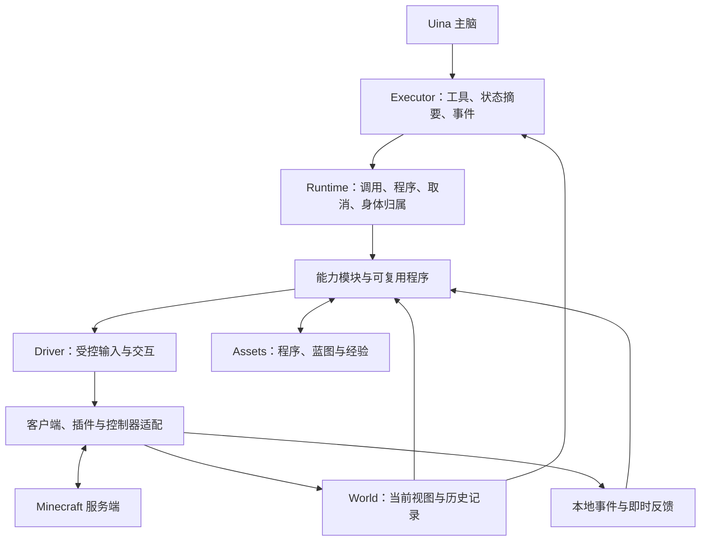
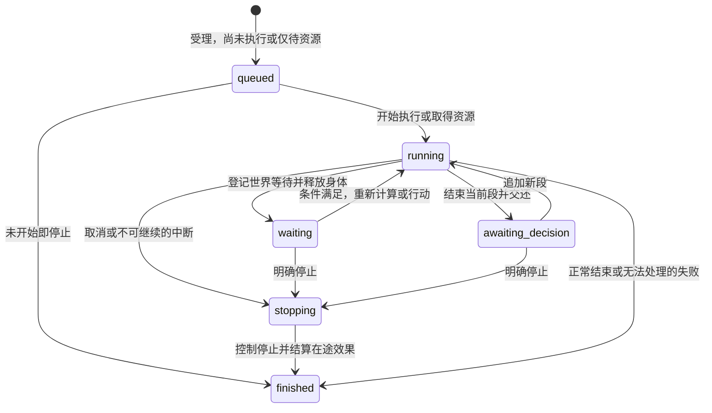

# Uina Minecraft World — 概要设计

日期：2026-10-16（初稿），2026-10-18（修订）。状态：推荐的终态概要设计。World 与 Driver 核心已实现并通过 fake bot 集成验收，Runtime 未实现，尚未经过真实 Minecraft 游玩验收。

本文只保留目标、边界、职责、模型接口、玩法流程和未验证项。跨模块身份、依赖、受理与停止的合同见 [详细契约](contracts.md)，方法、值与错误的唯一定义见 [公开接口](public-api.md)，Runtime 内部见 [Runtime 详细设计](modules/runtime.md)，Driver、World、Assets 见各自模块文档，证据与替代方案见 [研究记录](research.md)。本文不重复这些文档的机制细节。

<a id="goals"></a>

## 1. 目标与边界

Minecraft World 让 Uina 熟练、自主地参与游戏：常用操作简单可靠，特殊操作可以编程组合，成果能够保存和改进。成功标准是实际游戏目标的完成质量，以及时间、模型往返、上下文和失败恢复的综合成本。

| 要求 | 含义 |
| --- | --- |
| 熟练 | 一次能力调用完成站位、选具、操作和恢复，不要求模型逐帧控制 |
| 自主 | 主脑选择目标、委托深度、策略与风险，可改默认行为，也可编写未预设方法 |
| 可信 | 受理、尝试、预测、服务端观察和目标满足不混为一谈；无法确认的效果保持未知 |
| 可组合 | 成熟能力、精细操作、查询、事件和已保存代码都能用普通程序语言组织 |
| 持续 | 长动作不占住主脑，重要事件能唤醒，终态可查询，重连和重启不盲目重放 |
| 可维护 | 公共机制有明确状态与生命周期；具体玩法可局部修改，接口随真实需求演进 |

### 1.1 已确认边界

| 用户已确认选择 | 含义 |
| --- | --- |
| 完整 Java 原版 | 覆盖原版完整玩法；允许模组与特殊服务器适配，不承诺兼容任意模组 |
| 客户端结构化感知 | 使用服务器下发的客户端数据，不额外模拟严格人类视野；协议可知、当前可见、历史记录和未知分别表达 |
| 主脑可调整自保 | 常态自动避险；主脑可为诱敌、潜水、战斗和冒险改变策略；明确的操作者急停仍有效 |
| 游戏任务独立于思考回合 | 已受理任务不因主脑转去聊天或停止本次推理而取消；明确停止任务、停用 World 或全局急停时停止动作 |

### 1.2 验收基线

- **版本**：不维护硬编码版本百科，连接后按协商版本与上游功能检查判定能力，并区分“协议可用、状态可采集、底层操作可用、插件适配通过、玩法可完整运行”五级。跨版本结论不互相代替。
- **服务器**：单人存档、原版多人、常见插件服。不用管理员命令、传送或补发物品代替普通玩家操作；若提供管理能力，须标明性质与实际权限，不混入生存成绩。
- **客户端**：本地 Java 客户端加受控插件；结构化协议是主路径，图像与 GUI 感知是补充。
- **时延**：物理反馈与局部控制闭环在执行侧完成，模型往返不参与物理循环。

成功标准的场景、指标与比较方法见 [验证场景](research.md#validation)；本文不设统一达标数字。

### 1.3 非目标

- 不另建游戏 Agent、第二套任务状态或长期目标系统；目标、委托与风险选择归主脑。
- 不维护全知世界模型，也不维护第二份实时状态机。
- 不建通用侦察或预演子系统；只读规划由相应能力提供。
- 不建 Steps 依赖图、游戏 DSL 或第三套注册生命周期。
- 不承诺任意模组协议，不做管理员式作弊路径。
- 一个账号对应一个身体：同时启用多个世界时，非当前世界明确不可取得身体，而不是排队等前者释放。

<a id="architecture"></a>

## 2. 总体结构与职责

### 2.1 术语

| 术语 | 含义 |
| --- | --- |
| Run | 一次受理的执行单元，有稳定记录，可含多个执行段；对外以 run 引用 |
| Segment | 一段连续执行；身体资格、取消与证据以段为单位 |
| Call | 一次能力调用；程序内部调用建立子 Call，不建立子 Run |
| Body | 身体写入资格；同一时刻一个所有者，按段授予 |
| Effect | 已派发动作及其确认程度，与目标是否达成分开表达 |
| Evidence | 支撑结论的观察、回执与执行记录引用 |
| Runtime | 受理、调度、身体归属、执行记录与结果结算的所有者 |
| Driver | 客户端连接、协议状态、受控输入与客户端事实来源 |
| World | 观察、历史、地图与工程记录的所有者 |
| Assets | 程序、蓝图与经验的不可变版本及证据副本 |
| Program | Runtime 支持的一种执行方式：普通 JS 组合与局部控制 |
| Executor | Uina 侧接入：工具入口、事件递送、状态摘要与进程监管 |

### 2.2 结构

推荐结构是：**可靠动作库、普通程序组合、本地反馈控制，共用执行、取消与效果记录。** 不另建负责长期目标的 Agent。



这是运行关系图，不是代码 import 方向。

| 组成部分 | 拥有 | 不拥有 |
| --- | --- | --- |
| Executor | World 生命周期、工具入口、事件递送、状态摘要、进程监管 | 游戏算法、第二套任务状态、长期目标 |
| Runtime | 运行句柄、调用上下文、取消、身体归属、进度、执行记录 | 战斗策略、配方规则、建筑算法 |
| Driver | 连接、协议状态、受控输入、交互、回执来源、插件适配 | 主脑战略、独立任务调度 |
| 能力模块 | 导航、采集、制作、战斗、容器、工程及各自领域核验 | 全局身体锁、重复连接状态、顶层队列 |
| World | 当前视图、历史空间信息、容器记录、工程进度、事故 | 全知世界模型、暗中移动或操作游戏 |
| Assets | 程序、蓝图、经验的保存、版本、检索与证据关联 | 身体控制、另一份库存或任务真相 |

Program 是 Runtime 支持的执行方式，能力目录是模块导出的索引，二者不构成第二套玩法内核。

### 2.3 进程与 Uina 边界

游戏执行环境在独立进程中运行，拥有 Driver、Runtime、World 与 Assets。物理反馈与局部控制不逐 Tick 绕回 Uina，大范围扫描、路径与施工规划也不阻塞客户端心跳；进程间只传递调用、运行状态、查询结果与重要事件。进程创建与监管只有 Executor 一条路径，Runtime 不重复管理；语言运行时与存储引擎的选型不在本文冻结，行为边界见 [Runtime 详细设计](modules/runtime.md)。

Minecraft 专属状态、动作与恢复都留在本 World；通用主体、模型调用、工具执行与会话记录仍归 Uina Core 与 Host。

### 2.4 依赖与局部开发

<a id="module-ownership"></a>

**各玩法模块独立拥有领域算法与策略，通过统一的 Callable、World 与 Driver 契约协作。模块内部可按需选择算法组合，不要求共享同一策略框架。新增或改进玩法算法原则上不修改其他玩法模块和基础运行时；确需新的底层能力时，由 Driver 扩展受控适配。**

- 客户端适配不依赖具体玩法；Runtime 不导入某个采集或建筑实现。
- 能力模块依赖运行上下文、只读观测、Driver 接口以及明确使用的其他能力。
- 持久数据与资产由各自所有者写入，查询索引是派生视图。
- 组合根装配能力、Runtime、客户端与存储；公开契约由所属模块维护，统一从 [public-api](public-api.md) 导航。
- 新能力通过普通模块导出接入，优先复用已有操作；需要新协议、传感或控制方式时扩展相应接口。

修改弓箭瞄准主要影响战斗与控制接口，修改蓝图旋转主要影响建筑数据与状态转换。不规定固定模块数量、目录模板或通用业务基类。

详细设计按所有权展开：Combat 拥有近战、远程、走位及版本战斗规则；Navigation 拥有路径、避障与跟随；Inventory 拥有容器、槽位、交易与物品匹配；Crafting 与 Construction 拥有配方、施工顺序、物资与修复；Program 拥有普通 JS 组合与局部控制；[World](modules/world.md) 拥有查询、地图与历史。目标、委托与风险选择仍归主脑。

<a id="capability-loading"></a>

### 2.5 能力装配、发现与调用

能力模块导出其可调用工作、只读查询或规划、必要的底层操作及说明。每个导出至少表达稳定名称、输入输出含义、可发生的效果、失败与核验方式、所需客户端支持、实现版本。read/act 决定业务写权；只有需要控制身体时才取得 Body，act 也可能只写记录或聊天，不靠命名猜测。

组合根连接客户端、存储与 Runtime，装配原生模块并读取保存程序的元数据。轻量能力目录索引这些导出，供直接调用、JS 绑定和 `describe` 共用；它不执行游戏、不维护队列，也不另设注册生命周期。

```text
模块导出与版本 → 组合根装配 → 目录生成描述与签名
  → 直接调用 / JS 调用 / 保存程序调用 → 同一运行上下文
  → 领域实现使用观测、Driver 或其他能力 → 领域结果与证据
```

`describe` 的搜索返回简短候选，精确读取返回签名、结果含义、示例、依赖与限制，描述从定义生成。能力存在不代表当前连接支持：缺客户端操作或版本不兼容时，目录保留发现入口并说明原因，不靠隐藏能力让模型误判范围。配方、材料清单等游戏知识不属于能力目录，由相应能力的只读查询提供。

新增采集算法通常只增加或替换采集模块；新增载具控制可导出原生控制器，需要新协议时扩展客户端适配。在途段固定版本，更新只影响之后的运行或明确换版的新段；World 停用则撤回入口并停止所属运行。

### 2.6 覆盖范围与归属

以下工作必须承载，不是顶层工具清单，也不要求每项对应独立服务；模块与能力名为代表，不冻结划分。

| 游戏工作 | 需要承载的能力 | 归属与代表能力 |
| --- | --- | --- |
| 探索与旅行 | 未知区域搜索、地标与路线、洞穴与水域、跨维度返回、跟随、载具和鞘翅 | Navigation（`movement.goto`、`follow`、路径与避障）；World（地图、地标） |
| 生存与战斗 | 饮食、装备、状态效果、脱险、近远程战斗、盾牌与走位、撤退、死亡恢复 | Combat（`combat.attack`、走位）；Inventory（装备、进食）；World（事故） |
| 资源与制作 | 采集、拾取、钓鱼、合成、熔炼、酿造、锻造、附魔、铁砧与工作站 | Crafting（`gather.collect`、`crafting.craft`、熔炼、酿造、附魔） |
| 物品与交互 | 容器、精确槽位与匹配、方块面与点击位置、副手、交易、骑乘与实体交互 | Inventory（容器、槽位、交易）；Driver（`interact`、`openContainer`） |
| 工程与创造 | 放置状态与朝向、挖掘区域、施工与修复、农业与养殖、红石与新操作 | Construction（`placeAt`、`build`、规划与修复）；World（工程现场） |
| 协作与连续活动 | 游戏聊天、响应玩家、等待世界过程、长期行动、保存与改进成果 | `say`；Runtime（等待、续段）；Assets（保存与版本） |

<a id="interfaces"></a>

## 3. LLM 交互与核心接口

对 LLM 使用一个 Minecraft World façade，内部提供少量稳定入口。名称说明职责，不冻结最终 Schema。

| 入口 | 输入意图与输出含义 | 身体与副作用边界 |
| --- | --- | --- |
| `observe` | 查询自身、目标、区域、库存、地图或历史；返回范围、时间、来源与未知项 | 只读已有信息；需要开箱或移动时给出缺口，不暗中执行 |
| `describe` | 搜索能力与已保存程序，按引用精确读取签名、示例、支持条件与不可用原因 | 不占身体；游戏知识由相应能力的只读查询提供 |
| `run` | 调用能力、执行 JS，或运行已保存程序；返回终态、待决策或受理引用 | 同一执行上下文；只有控制身体的部分参与身体仲裁 |
| `runs` | 查询进展、等待、停止、继续待决策运行，查看 Program 容量 | 查询不占身体；继续要重新检查条件并排队 |
| `library` | 保存、搜索、读取和发布程序、蓝图及经验 | 改代码不等于执行游戏动作 |
| `say` | 发送游戏聊天，返回发送结果及可确认范围 | 不排在身体动作后；遵守服务器实际规则 |

顶层说明包含少量程序约定、代表性调用和能力类别，具体能力按需读取。不把完整目录塞进巨型 Schema，也不因为附近没有怪物就隐藏战斗能力。原生能力与保存程序进入同一发现入口，但保留实现来源、版本与证据差异；调用时校验真实参数，不要求模型记住所有签名。

### 3.1 简单调用与长动作

受理是承诺点，完成是另一事实。`run` 与 `continue` 受理后最多等待一个窗口（缺省 3 秒，可由参数或 Executor 配置调整）：窗口内取得持久终态或待决策快照就直接返回；超时返回受理引用，完成或决策随后经事件与查询到达。**超时不是失败。**

工具等待被取消只结束这次等待，不停止运行。`observe`、`describe` 和显式 `runs.wait` 直接查询，不占身体，也不消费通知。通知可能丢失、重复或晚于查询，一律以查询到的记录为准：不重放动作，也不承诺恰好一次。

### 3.2 关键接口的语义

| 接口边界 | 必须表达的内容 |
| --- | --- |
| 运行上下文 | 当前调用归属、取消、策略与任务约束、内部调用、进度与证据；内部调用不重新排顶层任务 |
| Driver | 操作目标或输入、控制有效性、连接有效性、可观察结果；生成程序不直接获得原始 Bot |
| 观测接口 | 查询范围、当前与历史来源、有效性；未知区块不能当空气，实体引用失效不能当击杀 |
| 资产接口 | 内容、明确版本、依赖与执行证据；运行中不静默替换依赖 |
| Executor | 已受理与已完成分开；结论进入正文，诊断与完整记录保留引用 |

寻路试算、材料清单和施工冲突由相应能力提供只读规划，不建通用 `scout` 子系统。计划要说明使用了哪些当前或历史信息；无法预测时返回未知，不假装任意 JS 都能无副作用预演。

<a id="call-contract"></a>

### 3.3 一次完整的外部交互

`minecraft({action, params})` 表示 World 调用，JSON 表示模型可见正文；下文用 `action(params)` 简写。二者确定交互关系，不是完整 wire Schema。工具自身的五态结果与正文中的运行状态分别保留。

```text
describe({query: "采集原木"})
→ 候选 gather.collect：采集并拾取指定数量

describe({ref: "gather.collect"})
→ 输入：方块类型、额外收集数量及约束
  输出：实际入包数量与状态；不足时返回进度和原因
  示例：collect({block: "oak_log", count: 32})

run({call: "gather.collect", args: {block: "oak_log", count: 32}})
→ {"requestId":"q17","kind":"accepted","run":"r17","phase":"running",
   "progress":{"collected":0,"target":32}}
```

`run` 接收能力或保存程序引用及参数，或代码与输入，二者互斥。代码模式使用同一调用上下文，不是让模型在运行中的脚本里再调用顶层 `run`；保存程序按带版本的引用调用，不必重传源码。临时代码以 `input` 读参数，以 `mc` 使用运行接口：`code: "return await mc.call('user.wood.collect@2', input);"`。

requestId 由 Executor 生成并持久保存，模型不填写；重试与受理查询复用原 ID，结果未知时回执给出该引用供核对。新的 run 是新意图，相同参数不自动合并。

```text
runs({op: "status", run: "r17"})
→ {"run":"r17","phase":"finished","outcome":"failed",
   "reason":"target_unreachable","progress":{"collected":19,"target":32},
   "unknownEffects":[],"record":"执行记录引用"}
```

本次目标未达，但已收集的 19 个物品没有消失；下一次扩大搜索时按实际持有量计算缺口，不从零重复请求。显式查询读取记录，不确认通知已交付。

### 3.4 等待、停止与决策继续

`runs.wait` 只等待记录变化，不占身体；等待超时或思考被中断都不取消游戏运行，状态未变化时不制造进度事件。

```text
runs({op: "stop", run: "r24"})
→ {"run":"r24","phase":"stopping","control":"stopping"}
稍后：
→ {"run":"r24","phase":"finished","outcome":"cancelled","control":"stopped",
   "progress":{"collected":19},"unknownEffects":["最后一次交互的效果引用"]}
```

第一份回执只确认停止请求已登记；只有控制不再输出后才能确认 `stopped`，在途效果未知独立保留。尚未开始且没有身体操作的运行可以立即结束。重复停止复用既有意图；停止已结束的运行直接返回终态，不改写原先结论。

运行需要主脑选择时返回 `awaiting_decision`，附决策引用、原因、事实和检查点。主脑用 `runs.continue` 指定运行、当前决策引用及新的能力或代码段：保留同一运行和累计进度，但不恢复旧 JS 栈。旧决策已处理时，重复的同一继续请求返回既有记录，其他过期请求拒绝；终态运行不通过继续复活。

```text
→ {"run":"r30","phase":"awaiting_decision","decision":"d2",
   "reason":"materials_missing","checkpoint":"施工进度引用"}
runs({op: "continue", run: "r30", decision: "d2",
      call: "construction.build", args: {project: "e4", blueprint: "cottage@2"}})
→ {"run":"r30","phase":"queued","segment":"s2","kind":"accepted"}
```

### 3.5 上下文成本

短摘要持续回答“我在哪里、身体在做什么、关键风险是什么”；搜索只返回候选与展开引用；精确描述给出可执行签名。回执带上本次决策需要的变化，不要求模型再查一次才知道动作是否完成。

大地图、完整库存、错误轨迹、源码和历史证据提供可展开引用，但正文必须保留完成量、未知与停止结论，不能全部移进 `details`。这些规则用一次真实目标的总调用、Token、时间和恢复成本检验。

### 3.6 能力之间共享的数据语义

| 数据 | 共同约定 |
| --- | --- |
| 位置与区域 | 区分连续坐标与整数方块格，关联世界与维度；蓝图局部坐标附明确变换 |
| 数量 | 签名明确额外获得量、最终持有量或执行次数；合成产出与配方次数不混用，超额如实返回 |
| 物品选择 | 明确名称、组件、附魔、耐久与替代条件；精确选择失败不静默换物品 |
| 实体与窗口 | 引用带连接或会话归属；编号复用、窗口重开或连接变化后重新定位，不拿旧引用写入 |
| 时间与有效性 | 观察时间、反馈序列与游戏 Tick 分别表达；本地 Tick 不充当服务端确认 |
| 内容与进度引用 | 运行、执行段、效果、工程和资产版本可稳定关联；查询不依赖模型还保留此前文本 |

这些语义由接口所有者维护，传输字段可以演进；不要求新增承载所有业务逻辑的 `shared` 框架。

<a id="programs"></a>

## 4. 普通程序组合与开放操作

JS 是条件、循环、函数、计算、异常和事件组织的组合语言。直接调用、程序内部调用和已保存程序使用相同上下文、控制与结果机制；不另建 Steps 依赖图或游戏 DSL。

```javascript
await mc.call("gather.collect@3", { block: "oak_log", additional: 16 });
await mc.call("crafting.craft@2", { item: "oak_planks", additional: 32 });
const self = await mc.read({ ref: "self@1", input: {} });
if (self.value.health < 10) await mc.call("movement.returnTo@1", { landmark: "base" });
```

成熟能力减少机械调用；细粒度能力允许模型改变具体方法。编程操作面覆盖状态与事件、移动与视角、按键组合、物品与副手、槽位与窗口、点击面与点击位置，以及动作时序。

### 4.1 本地反馈逻辑

精细控制同时支持定长输入、常用条件终止和本地闭环。有限的 `until` 条件可以是快捷方式，不能成为唯一反馈口。

新跑酷、移动射击或特殊载具操作，应能在执行侧读取连续反馈、运行普通逻辑并输出受控动作：模型不必逐 Tick 推理，程序也不必每 Tick 跨 IPC 查询。复杂控制器可复用原生实现，也允许生成新的局部逻辑。

这不保证任何玩法都能凭现有接口创造出来：缺少的传感、协议与模组操作仍需扩展。控制精度受客户端物理、网络、服务器负载和纠偏影响；输入能细到一个 Tick，不代表落点或命中具有同样精度。

### 4.2 程序执行边界

脚本故障不能冻结客户端心跳、取消处理和必要的自保。生成程序与宿主对象隔离，游戏访问通过受控接口；普通代码可以组织流程，但不能绕过失效控制权或重用旧连接引用。

具体沙箱与运行时仍待验证。独立进程本身不能解决同一进程内脚本卡死控制循环的问题，必须验证可终止性：执行域对每个调用强制计算与内存配额，超限即终止并结算；配额按实测配置，不凭空设定。**这与是否限制游戏动作数量无关**——动作总数、轮次和任务时长不设默认上限，由真实成本决定。

程序可以捕获领域失败并尝试另一条已允许的方法；取消、控制失效与连接失效不能因被 `catch` 捕获就恢复旧资格。程序返回的自述不覆盖执行证据。需要主脑思考时，程序结束当前段，返回原因、事实和可序列化进度，不偷偷调用第二个 LLM，也不承诺保存任意 JS 执行栈。

<a id="program-values"></a>

### 4.3 程序内部的值、失败与效果

**成功的 `await` 返回领域值，不要求每行代码都拆一层通用工具回执。** 执行上下文自动保存调用、进度和证据。能力必须说明它承诺完成什么：`collect(count: 32)` 的成功意味着额外入包达到目标；一次攻击输入的成功只意味着输入按其合同执行，不意味着击杀。

| 情况 | 程序看到什么 | Runtime 保留什么 |
| --- | --- | --- |
| 满足合同 | 领域值，如实际收集数量或交互回执 | 确切能力版本、效果及证据 |
| 目标不足但效果已知 | 可捕获的领域错误，携带领域进度与原因 | 部分完成不回滚；原调用记录未达标 |
| 参数、前置或支持不足 | 可解释错误，区分未派发与已尝试 | 失败原因及是否产生效果 |
| 副作用可能发生但未确认 | 可捕获的不确定效果错误及效果引用 | 待核验效果，不能因 `catch` 或 `return` 被抹掉 |
| 取消、连接或资格失效 | 中断执行；旧资格不能继续操作 | 停止过程、已完成工作及未确认效果 |

```javascript
let collected = 0;
for (const block of ["oak_log", "birch_log"]) {
  try {
    collected += (await mc.call("gather.collect@3", { block, additional: 32 - collected })).collected;
  } catch (error) {
    if (error.code !== "TARGET_NOT_MET") throw error;
    collected += error.progress?.collected ?? 0;
  }
  if (collected >= 32) break;
}
return { collected, target: 32 };
```

失败携带领域进度对象，不做通用度量数组；错误名与字段是示例。不能把全部失败当成零效果，也不能把不足量默认当成功。允许部分完成的能力可正常返回部分结果，但必须在合同中明确，不能靠调用者猜测。

不确定错误不进入普通自动重试。程序可以读取新事实、调用核验方法或交还主脑；核验结果追加到原效果引用，原记录不改写。只能证明目标现在满足时，就报告当前目标满足，不据此补造先前动作的因果。对未知交易或物品消耗，后续行动先核验有关库存与结果，再决定是否重做。

程序正常返回表示执行段正常结束。原生能力和保存程序可通过入口合同声明可核验目标；临时代码用明确查询与断言检查自己的组合目标，不能靠 `completed: true` 声明世界事实。没有可核验目标时，成功只指程序按合同结束，回执仍列出实际效果。

拟正常结束时，若入口合同建立的必需完成证据仍无法确认，整体结果保留 `unknown` 并呈现已知进度。“必需”由派发前的合同确定，不是脚本事后可改的标记；程序断言也不自动认证其表达了用户意图。已确定取消停止可结算为 `cancelled`，已确定合同失败或未处理错误可结算为 `failed`；这两种确定结论不表示副作用已知，仍须附未解决的效果引用。已结算的普通失败可以被成功的替代路径解决，原证据仍可追溯；具体规则见 [完成证据合同](contracts.md#effects)。

### 4.4 精细操作的基本操作面

名称为推荐签名片段，不是全部函数目录。

| 操作面 | 使用关系与返回含义 | 明确不隐含 |
| --- | --- | --- |
| `mc.read(query)` | 读取自身、方块、实体、背包、地图或最近容器记录，带有效性 | 不自动走近、开箱或把未知当空 |
| `body.drive` 与顺序组合 | 有界按键与视角动作段，返回实际位置、结束原因和反馈 | 不保证按若干 Tick 达到推算位移 |
| 放置能力 | 声明目标格与方块状态，求解有限范围的站位、参照面和放置，再核验 | 不自动展开成远距离旅行、采料或拆重要结构 |
| `body.interact` | 指定对象、面、点击位置、主副手，返回尝试与可得效果 | 不把点击当成机制必然触发 |
| `body.attack` 与物品使用 | 一次攻击或一段物品使用，可与移动和视角协同 | 不自行选择交战目标，不默认等于命中或击杀 |
| `body.openContainer` | 打开并核验窗口，在临时会话内读取槽位、转移与关闭 | 不提供跨窗口的永久句柄或服务端原子事务 |
| `mc.wait` | 等待条件或事件，并说明是否结束身体行动段 | 不把事件到达或时间到期当成目标完成 |
| `mc.decide` | 以事实和检查点结束当前段，等待下一段 | 不调用另一模型，不保留任意 JS 栈 |

放置朝东的上半楼梯可用 `placeAt` 声明结果；研究新摆放方法时，则明确站位、视角、参照面和点击点调用 `interact`，再读实际状态。两种粒度共用同一身体与证据路径。

容器会话内的一组转移属于一个交互段，每步按当前槽位重新检查；取消或关窗后临时句柄失效，已发生的转移不回滚，重开同一箱子产生新会话。输入物品按名称、组件及本次匹配约定选择，输出报告实际槽位与数量变化。

### 4.5 本地控制循环与事件等待

局部控制逻辑在独立受限且可退役的 Program 域运行，不能堵塞 Driver 心跳、停止和必要自保；执行侧的查询与规划也须切片或卸载。语言、桥接与资源选型由 Program 执行域验证，行为边界见 [Runtime §9](modules/runtime.md#9-program-执行合同与资源准入)。

脚本先声明所需反馈并建立一个控制段。执行侧提供带时序和有效性标记的快照，每次反馈中的普通函数计算下一组运动、视角与物品输入，受控接口检查当前资格后才生效。循环结束或失效时停止持续输入、撤销订阅并结算证据；反馈没有及时产生下一份输入时，不允许上一次按键无限保持。

```javascript
await mc.withBody(async body => {
  await body.loop(frame => {
    if (frame.self.value.onGround && reachedLanding(frame.self.value)) return { done: true };
    return { keys: chooseKeys(frame), look: aimForLanding(frame) };
  }, { collision: { ref: "nearby_collision@1", input: { radius: 3 } } });
});
```

`reachedLanding`、`chooseKeys`、`aimForLanding` 是同一脚本内的普通函数，可使用参数与局部状态。反馈函数不再调用异步寻路或抢占其他身体行为，复杂感知在进入循环前配置；缺传感时扩展反馈源。动作时限可由任务声明，不用固定小 Tick 上限代替可中断性。

这个接口不逐 Tick 调用主脑，也不跨 IPC 传输每帧函数。生成代码在原有执行域注册本地函数，反馈与受控输出走执行侧桥接；桥接延迟、丢帧与计算终止仍需实测。原生控制器使用相同资格与效果合同，可替换算法而不改变上层流程。

身体作用域内的定长输入与短等待保持当前控制段；要等待世界条件必须先退出 `withBody`、释放输入与窗口，作用域内调用等待返回明确错误。组合条件（如“雨停且附近无怪”）由程序分别读取多项事实判断，再把各自引用交给等待接口，不为组合预建查询类型。底层观察仍须由 World 提供，独立读取不承诺联合快照；计时只安排复查，不证明完成。`await` 保留闭包与 guest，进程重启不恢复，见 [Runtime §10](modules/runtime.md#10-等待交还与续段)。

<a id="control"></a>

## 5. 身体控制、委托与运行生命周期

### 5.1 一个控制归属，允许复合动作

同一时刻只有一个有权决定当前身体行为的所有者。同一行为内可协同移动、瞄准、攻击、盾牌或载具操作；互斥限制的是竞争写入，不是这些通道必须串行。

控制资格授予完整行动段，并沿内部调用传递。底层操作不逐个争锁，内部能力不创建相互等待的顶层任务；客户端写入处检查资格，原生插件的定时器与回调也必须纳入这条路径，不能成为旁路控制主人。

身体调度以行动段为单位。一次高层能力及其内部调用通常共同构成一段；查询、计算和世界等待可在段外执行。程序相邻能力默认可在各自作用域间释放；需要连续独占时显式 `withBody`，并用回调提供的 `body.call` 组合嵌套能力。连续控制、离散输入和有状态交互共享写入资格，不强制统一为 Tick 输入。需要协同运动、瞄准与交互时，由能力或程序提供的协调者安排依赖与顺序，不让两个独立控制器竞争。Driver 的边界见 [模块详细设计](modules/driver.md)。

默认规则是：**普通就绪段按进入就绪队列的时间顺序执行，当前段不被新普通请求打断。** 世界等待、待决策和暂停恢复期间不占执行位置；再次可执行时按新的就绪时间入队，长任务不能靠保留旧名次在每次等待后优先夺回身体。

| 提交关系 | 推荐行为 | 对旧工作的影响 |
| --- | --- | --- |
| 普通排队，默认 | 进入普通就绪队列 | 不取消当前段或其他运行 |
| 显式抢占当前运行 | 登记停止当前身体所属运行，交接完成后优先执行新段 | 旧运行以取消结算，保留进度与未知效果；其他待执行项保留 |

显式抢占需给出预期当前运行：先一并持久受理新运行与旧运行的停止意图，确认后撤销旧控制，Driver 交接完成才执行新工作；校验失败不影响旧运行。独立 stop 与急停立即撤销，不等待新工作受理，急停门不能绕过，详见 [接入契约](contracts.md#ingress)。

查询与计算可以并行。程序根部并发发起的独立能力各自建立子调用，需要身体时按队列先后获得与释放，不因并发退役整段。已持身体时再用外部上下文申请独立资格，或同一资格内出现不兼容的竞争写入，得到可捕获的局部冲突（`CONTROL_CONFLICT`），已派发效果仍保留；只有隔离失守或无法清理才升级到段级退役。

### 5.2 任务等待与身体占用

| 等待类型 | 处理 |
| --- | --- |
| 落地、拉弓、短交互、容器事务 | 属于当前身体行动段，保持必要控制与一致性 |
| 熔炼、作物、之后的玩家事件 | 不持续占用身体，可安排其他工作；条件满足只表示重新检查的机会 |
| 等待主脑决策 | 结束当前执行段并释放身体，保留可解释进度与原因 |

持久的观察或等待可以持续到取消，不要求一律设置超时；故障超时用于发现不再响应或不再进展的操作。世界等待前结束窗口会话、停止有关插件并释放持续输入；结束后重新参与调度并检查条件，不能直接抢回旧控制权。

物品没有隐式长期锁。“为施工保留 32 块木板”是使用策略，不阻止其他玩家取走箱内物资；等待后按实际库存与组件重新核验，不依赖旧槽位或资源预留。

### 5.3 委托与自保策略

主脑决定目标、战术、重要资源取舍和委托边界。本地能力处理寻路、站位、普通重规划、工具更换和其他已委托的机械工作。选择替代材料、扩展搜索区域或改变工程设计是否可自动完成，取决于本次委托，不预设都需要询问，也不预设都可擅自决定。

任务可以表达保留物品、材料偏好、禁止破坏区域、风险与停止条件；自动补光、搭桥、支撑和工具替换遵循这些约束。物品判断考虑实际组件、耐久和附魔，不只比较名称。

默认自保策略可在危险时接管：按当前策略停止或挂起旧段，先完成避险；原能力有明确恢复点时重新观察并排队，否则交还主脑，不盲目重跑。主脑能读取、修改并理解当前策略，使诱敌、潜水、守卫和冒险不被隐藏反射破坏。感知采集器只发布事实，不因为看到怪物就自行成为战斗规划器。没有实际进展的重复恢复应暴露阻碍。

稳定的常态策略与本次运行覆盖分开：新运行继承常态，可覆盖自保方式、可用材料和停止条件；覆盖只作用于该运行及其内部调用。修改常态只影响之后的运行；改变在途运行需显式指定，由执行侧在安全交接点应用，已派发动作不被事后改写。当前策略和来源可查询。

明确的操作者限制、服务器权限和急停约束始终生效，任务内调用不能放宽。主脑可以降低自己的保命优先级或改为诱敌，不代表获得原本没有的权限。

### 5.4 停止、交接与恢复

停止必须区分：收到请求、停止旧控制器、使旧异步工作失效、观察最后效果、交接给新行为。不能只取消等待或清除寻路目标就声称身体已经停止。

旧回调不能在抢占后继续发动作，也不能在清理时清掉新所有者的按键。正常停止应说明是否还有在途效果；最后一次交互可能已发生但未确认时，停止控制与效果未知分别记录。

控制 `stopped` 指该段不再产生输入和协议动作，不保证角色因重力、击退或服务端已有运动而立刻静止；需要“站稳在安全地面”时，这是新的目标或停止策略的一部分。

思考回合中断不取消已受理任务；明确的游戏任务停止、World 停用与全局急停终止相关控制。解除急停后重新判断继续方式，不自动重放未确认动作。

连接丢失、死亡和重生使不再有效的动作与实体、窗口引用失效。重连先核验账号与世界绑定，再开放动作。进程重启可以恢复任务意图、实际进度和待核验效果，不能恢复旧控制资格或假定 JS 栈仍在。

<a id="run-lifecycle"></a>

### 5.5 运行状态与继续责任

运行有稳定记录，可经历多个执行段；身体归属只存在于正在控制身体的段。`phase` 是供模型决策的投影，按 `finished`/`awaiting_decision` → `stopping` → `running` → `queued` → `waiting` 取优先级最高的一个值，真实状态分布在调用、等待项与 `control` 中；结果五态单独记录。



图示主要转移；`phase` 按优先级投影，模型据 `phase` 与 `control` 判断下一步，不把它当作完整状态机。

| 状态 | 谁负责下一步 | 身体与代码的含义 |
| --- | --- | --- |
| `queued` | Runtime 调度 | 无活动执行也未持身体；从未开始或仅待 Program 容量 |
| `running` | 当前能力或程序 | 有活动执行；`control` 表示是否持身体 |
| `waiting` | 已登记条件或有关世界过程 | 不持身体；保留内存中的 `await` 需能力明确支持 |
| `awaiting_decision` | 主脑继续或停止 | 旧段已结束，无待恢复的 JS 栈；保留原因、检查点与决策引用 |
| `stopping` | 执行侧清理与结算 | 不接受新动作；正在停止，不伪称已停 |
| `finished` | 调用方读取或另建运行 | 终态不复活；保留结论与进度 |

所有进入终态的路径都先释放该段控制、窗口与订阅，并结算已知和在途效果；正常返回不跳过清理。整个运行从未执行过任何动作时，停止结算为 `not_started`；已有执行段或动作的运行停止则是 `cancelled`，累计进度不能丢。

`mc.decide` 是控制转移，不是可忽略的返回值：先停止当前段动作并退役其执行域，再交还主脑；待决策期间 stop 另记一次终止结论，原段证据保留。`runs.continue` 校验当前决策引用，追加新段；检查点经只读上下文提供，与本次参数分开，累计进度不清零，各段代码、依赖与结果分别可追溯。

Program 容量耗尽会让新程序一直排队；主脑可用 `runs` 查看占用、排队与所属段，并显式停止或调整。停止、取消、查询和纯原生能力不排容量队列。

例如建造缺料：运行在第 12 层进入待决策并释放身体；主脑可先用另一个运行取材，再给原运行追加续建段。若改蓝图，新段明确引用新设计和原现场，不让旧执行栈从“第 13 层”盲目继续；原运行已终止则新建关联运行。

受阻不自动等于待决策。能力内可恢复的问题由当前代码处理；处理不了但需要主脑选择时进入待决策；本次目标已无法完成且没有交还请求时以失败结束并报告部分进度。`partial` 和受阻原因不另造生命周期终态。

### 5.6 连接恢复与进程恢复

连接断开时，当前资格撤销并结算在途效果。可证明安全恢复的原生能力可以等待新连接，核验身份与事实后从检查点重新排队；生成程序未显式提供恢复方式时结束旧段并交还主脑。旧实体、窗口和控制循环均不跨连接复活。

进程重启后，曾处于运行、等待或停止中的执行段都不能继续被报告为仍在执行。执行侧先恢复记录，标出在途未知并检查持久意图。已受理的停止、取消、World 停用或急停意图优先：只完成必要核验与结算，不当作崩溃后可续跑的任务；重新启用 World 或重连不自动解除急停或撤销原取消。对没有停止意图的中断，有可验证检查点则退役旧段并交还主脑，显式 continue 才创建新段；无检查点则 `unknown`。已登记条件可恢复为记录，不自动重建活动复查，闭包、Promise 和 VM 栈不当作持久数据。

恢复保持原运行关联并追加新段，不覆盖原段的中断证据。查询必须显示当前连接与执行状态，不能把“磁盘记录恢复成功”说成“游戏任务恢复成功”。

<a id="perception"></a>

## 6. 感知、上下文与自主活动

### 6.1 知识边界

服务端是游戏权威；World 管理自己知道什么，不维护全知真相。未加载区域不是空气，实体离开跟踪范围不是死亡，历史箱子库存不是现存可取物资。

| 信息性质 | 表达与用途 |
| --- | --- |
| 协议可知 | 服务器已下发的客户端数据，可查询遮挡后的已加载方块；不声称亲眼看到 |
| 当前可见 | 按视线、距离等明确判据得到的子集；必要时支持视觉或射线核验 |
| 历史记录 | 带世界、维度、时间和来源的既往观察；重新使用前检查是否需要核验 |
| 推测与未知 | 明确缺少信息或使用估计；不能因未发现就断言不存在 |

查询缓存不占身体。走到目标、开箱、转头或探索以获得新信息属于行动，经同一运行与控制机制执行；只读规划也只能利用实际拥有的信息。

结构化协议是主路径，图像、地图图像和特殊 GUI 感知是补充。模组或客户端能力按实际支持声明，不以视觉占位接口承诺任意 GUI 操作。

### 6.2 本地反馈与模型摘要

本地控制持续使用高频状态，模型只接收决策需要的信息。Minecraft 参与当前活动时，每次模型请求携带一段短的绝对摘要：时间与状态有效性、自身、当前运行、关键风险和附近必要事实；具体目标、区域或记录通过查询展开。

摘要从当前视图纯读取，不在投影时推进“模型已读”游标；请求检查、重建或重试不消费变化，压缩后也不依赖旧的增量基线。可变状态不反复写入稳定系统提示，历史与详细过程按需读取。

### 6.3 何时需要主脑

任务完成、受阻、需要新策略、重要玩家交互、连接变化或模型明确关注的事件可以促成决策。普通位移、一般库存变化和 Tick 不单独唤醒；进度可合并，重要状态可查询。

事件进入已有 Subject 输入入口，不自行启动第二个认知循环。紧急事件递送不能代替本地避险，`urgent/steer` 不等于物理控制已被强制打断；输入受理、进入历史和模型回复也不是同一事实。

主脑可设置关注条件、等待事件或预约检查，持续游玩由任务结果接续下一次决策。没有新任务时是否继续探索、停留或休息属于主体选择，不由 World 内部偷偷生成长期目标；断线或停止后不再制造无效唤醒。

### 6.4 查询、订阅与投影怎样协作

客户端事件先更新当前视图，有持久价值的观察由对应记录所有者保存；本地控制器直接订阅这些反馈，不等待模型看到。适配层判断哪些变化需要主脑，事件只携带稳定的事实或运行变更引用，递送时读取相应记录与最新摘要。

有活跃运行、待处理的重要事件，或当前回合明确使用 Minecraft 时，状态投影提供短摘要；仅启用而无相关活动时，不把整个游戏环境塞进其他世界的每次决策。摘要视图随时可查询，是否生成新决策由事件递送决定。

```text
服务端事件 → 客户端当前视图 → 本地控制/条件等待
                       ├→ 历史与场景记录（有保存价值时）
                       ├→ 模型请求的短绝对摘要（纯读取）
                       └→ 需要决策的事件引用 → Subject → 主脑
```

观察 API 返回数据和时间有效性；事件只表示某处变化；程序等待在唤醒后重新核验；投影只提供本次请求可用的最新摘要。四者共同读取事实，不分别维护库存或动作状态。

<a id="results"></a>

## 7. 结果真实性与核验归属

运行生命周期、目标进度和效果证据分别表达，不把 `partial`、受阻、暂停和未知混成一个万能枚举。

| 问题 | 需要表达的事实 |
| --- | --- |
| 运行是否继续 | 运行中、等待或已结束；谁负责下一步 |
| 目标完成多少 | 实际数量、剩余工作、停止原因和必要决策信息 |
| 效果确认到哪里 | 未派发、已发送、本地预测、服务端观察或仍未知，以及观察范围 |

对接 Uina 继续使用 `succeeded`、`failed`、`cancelled`、`unknown`、`not_started` 的工具结果合同。受理成功可以是成功的工具调用，但正文必须明确只是受理，不能解释为游戏目标成功。取消已确认、最后效果仍未知时，两项事实都保留。

结论针对本次声明的合同裁定：从未执行为 `not_started`；明确取消且控制已停止可为 `cancelled`；已确认目标或程序失败可为 `failed`；无法确认完成或停止程度时保持 `unknown`，停止仍在进行则先保留非终态；合同满足且完成范围可确认才为 `succeeded`。每种结论携带自己的效果与进度，`unknownEffects` 不因失败或取消的原因已知而被清空。此处规定语义，不授权投影层替生产者重判。

Driver 负责协议回执和本地预测来源，能力负责领域后置条件，Runtime 汇总和保存证据，主脑判断开放目标是否符合意图；各层不重复实现同一套核验。

采集要分开说明挖过多少、实际入包多少；合成明确目标物品与材料变化；放置核验目标格及状态；攻击区分尝试、可观察命中和击杀。目标状态满足不自动证明全是本次动作造成，已有物品不能凭空成为击杀证据。程序返回 `completed: true` 不覆盖这些事实；没有通用服务端回执的行为不强求伪造确定结论，而是如实报告证据、影响范围和核验入口。

回执默认紧凑但足以继续决策：目标、进度、已确认效果、未知项、停止原因、关键状态和记录引用。日志不整段灌入模型，详细错误与轨迹可展开；不能通过投影或经验整理把失败、取消与未知改成成功。

<a id="persistence"></a>

## 8. 世界状态与持久化

### 8.1 数据所有权

| 数据 | 权威归属与规则 |
| --- | --- |
| 当前客户端状态 | 客户端与适配层拥有，其他模块读视图，不复制第二套实时状态机 |
| 地标、路线、资源与危险 | World 持久保存观察与标注，保留历史与有效性 |
| 背包与容器 | 背包用当前读数；容器保留最后观察，存取前重新核验 |
| 世界持续过程 | 记录已确认投入、预计进展与最后观察，预计时间不是完成证明 |
| 工程现场 | 绑定世界、维度、位置和设计版本，记录完成、冲突与待核验部分 |
| 死亡与事故 | 记录位置、重生、可能遗失物、原因证据及中断任务，恢复策略归主脑 |
| 程序、蓝图与经验 | Assets 保存内容，通过引用关联世界与执行证据 |
| 长期意图与偏好 | 主体侧拥有，World 只保存执行所需关联与进度，不假设已有长期记忆产品 |

持久世界身份与连接代次分开：重连不等于新世界，相同地址也可能世界重置。空间记录按实际世界与维度隔离，未知身份不能偷偷绑定旧地图。

地图包含已知地形、语义地标、资源、危险、路线与未知区域；可以命名地点、复查旧地点和关联跨维度路线，但不把局部寻路器当作全世界路线规划器。

### 8.2 记录与恢复

执行记录保存受理后的动作、代码版本、进度和副作用证据，与会话记录通过引用关联；二者不构成跨进程原子事务，也不把每 Tick 轨迹复制两份。

有副作用的未确认操作在重启后仍是未知。恢复先核对世界与实际效果，再决定跳过、补做、替代或交还主脑。本地提交标识不能创造服务端恰好一次语义。

<a id="reuse"></a>

## 9. 程序、蓝图与经验复用

### 9.1 工作文件与不可变版本

人类用编辑器与 Git，Uina 用已有文件工具编辑普通 `program.js` 与清单。工作目录没有额外的草稿生命周期；并发编辑由文件工具与调用方交接，发布时的比较交换只防覆盖，不做编辑合并。

只有明确的 `library.publish` 才创建不可变版本：目录管理名称与 head，文件包保存实际内容，源码、清单与包摘要固定。回退用旧内容对当前 head 发布新版本，不移动旧版。

发布顺序是先形成不可变包，再由一次提交发布版本与 head；文件存在不等于已发布。目录已提交但包缺失要报告损坏，包已写但未提交只报告 orphan。备份必须同时复制目录与文件树，具体合同见 [Assets 详细设计](modules/assets.md#storage)。

### 9.2 蓝图原件、目标与现场工程

Raw 保留 `.schem`、`.litematic` 等原始字节；Target 的 set/clear/preserve/unknown 由 Construction 解释，不默认把未知区域或 air 变成拆除，已知 air 需明确 set_air 或 preserve。解码、旋转/镜像、Block State、多方块与 NBT 转换及损失说明属于领域能力，保存原件不要求现在可施工。

Plan 与 Project 绑定世界、维度、落点、确切设计、现场观察和实际进度，不回写蓝图。迁址创建关联工程；改版按当前现场差异重算，不把旧版完成量计入新目标。

### 9.3 经验与证据

Experience 是作者的不可变判断及其适用条件，改变判断、方法或解释才新版本。新增运行事实通过可信端口关联独立 Evidence，副本保留原时间、预测、未知与覆盖，不自动修改判断、摘要或立场；普通出处是可失效的弱链接，不冒认长期证据。

<a id="asset-flow"></a>

### 9.4 从运行段保存程序

```text
library.publishFromRun(run=r20, segment=s1, record=record20,
  name=user.wood.collect, expectedRef=null)
→ 固定该段源码与入口绑定 → 生成包内容 → 同一 publish → 新版本
```

只导出入口自身的绑定；原生段生成调用确切引用的包装，不声明依赖，也不把原生引用当资产依赖。不复制本次输入、检查点、返回值或后代；来源已删除则失败，不从当前 head 重建历史。保存成功、语法正确、当前可调用与执行有效是四个不同结论。需要长期复核时另附证据副本，由 Assets 拥有。

### 9.5 发现、检查与调用

`library` 搜索给简短候选，读取按需核验清单、完整性与格式支持；源码和大原件按需读取，不进入默认模型上下文。Runtime 在受理时解析确切引用，完整捕获并核验源码字节，编译同一份缓冲，在途段不漂移至新 head。不可调用仍可发现并说明原因。

### 9.6 边界

Runtime 拥有执行与效果，World 拥有观察和工程修订，Assets 拥有内容与证据副本，Construction 拥有设计解释和施工语义。领域可以保存自己的分析结果及其来源、参数与版本；不增加第四类通用资产、后台学习队列或可写第二世界模型。

<a id="flows"></a>

## 10. 核心运行流程

### 10.1 基础生存与持续任务

主脑决定要获得工具和食物，读取状态与能力说明，组合采集和制作。能力处理局部机械步骤，回执说明实际入包、制作结果和阻碍；长动作受理后主脑可以处理其他世界，终态事件促成后续决策。缺材料时是否继续搜索由本次委托决定，不能暗中无限展开科技树。

1. 观察返回位置、背包与已知资源；缺签名时读 `describe`。
2. 提交直接调用或代码，运行固定模块版本；受理记录建立后才报告运行句柄。
3. 能力在段内导航、选具、挖掘与拾取，数量依据实际入包。
4. 原木不足时，代码处理携带进度的领域错误并换一种树；需要改变委托则进入待决策。
5. 达到数量后继续制作，原生能力核验产物，运行记录分别保存各步效果。
6. 窗口内取得终态就直返，否则返回受理引用，完成或决策随后到达。

### 10.2 洞穴遇险与有意诱敌

出现危险时，本地按当前策略停止旧控制并避险，保留已采数量、位置、损失与未知效果；主脑据新状态继续或改目标。若明确在诱敌，控制器按相应策略执行，不因看到敌人自动改成攻击；需要即时反馈的走位在执行侧完成。

### 10.3 熔炼与其他工作并行

开炉、投料和槽位核验是身体操作；投入确认后世界过程独立存在，身体可以去收割或旅行。预计到期只安排检查；区块未加载、燃料变化或材料被取走，都不能凭时间推断完成。

| 顺序 | 熔炼运行 A | 农田运行 B | 身体归属 |
| --- | --- | --- | --- |
| 投料 | 开炉、核验投入、关窗 | 尚未执行 | A 的交互段 |
| 等待 | 登记产物条件与检查点，释放身体 | 进入就绪队列并开始收割 | B 的工作段 |
| 条件变化 | 重新检查；需要取产物则重新排队 | 继续当前段，不被普通唤醒抢占 | 仍归 B |
| 取回 | 获得新资格，重新开炉读槽位 | 已完成或释放当前段 | A 的新交互段 |

燃料不足时，A 可按已委托策略补燃料，否则进入待决策。原窗口句柄和先前物资估计不能跨等待直接沿用。

### 10.4 建造、改设计与恢复

主脑选择或生成蓝图，检查现场、冲突与物资；施工记录实际差异，缺料或重要冲突时提供可决策信息。暂停或断线后重新读取现场，再续建或按新版本改建，不能只按原进度计数跳过被别人改动的部分。

运行 r30 缺料时保存工程 e4、设计版本和检查点，结束旧段并进入待决策 d2；主脑可另建取料运行，材料到位后向 r30/d2 提交续建段。新段从 e4 的真实差异生成计划并保留累计工作；改用另一设计版本要重算新增、保留和拆除部分；取消 r30 不撤销已完成的建筑。

### 10.5 发明新操作并再次复用

主脑用普通代码组合读数、成熟能力和精细操作，尝试新跑酷或红石方法；本地反馈决定动作调整，运行留下代码和证据。有效方法可参数化保存，以后按版本调用；失败关联原版本，修订后通过场景比较，而不是直接追加“已学会”。

跑酷时先读地形与身体状态，代码计算目标并进入本地控制循环，反馈函数按位置、速度与碰撞调整输入；落地、停止、失效或结束条件使循环释放身体。一次落地只验证该次条件；保存为参数化模块后，用不同落点、网络条件和中断场景比较，失败时可找回确切版本的动作与反馈记录。

### 10.6 断线、多人变化与跨维度返回

交易中断线后先核验库存、窗口与可得的交易状态，未知交互不自动再发。历史箱子不足以证明当前物资，返回前要考虑别人可能改动。跨维度旅行使用明确身份的地点与路线，在当前可知地形上重新执行。死亡恢复保留物品遗失的不确定性，不自动补发物品或撤销后果。

<a id="open-questions"></a>

## 11. 尚需验证的技术判断

以下问题不通过文档写作视为解决；场景、指标与证据边界由 [研究与验证记录](research.md) 维护。

1. 原生插件与生成程序能否真正停止和交接，旧回调是否仍会发动作或清除新输入。
2. 目标版本中哪些状态来自服务端、哪些来自预测；缺少确定回执时如何准确报告。
3. 脚本执行方式能否兼顾本地反馈延迟、正常异步编程、宿主调用和强制终止。
4. 直接调用、代码组合、按需发现和短摘要，是否减少真实任务成本并支持未预设玩法。
5. 驱动对原版长尾操作的覆盖与版本差异，以及需要补充的图像、GUI 和专用控制能力。
6. 首个验收锁定哪个具体 Java 版本与服务器形态，哪些结论可以跨版本复用。
