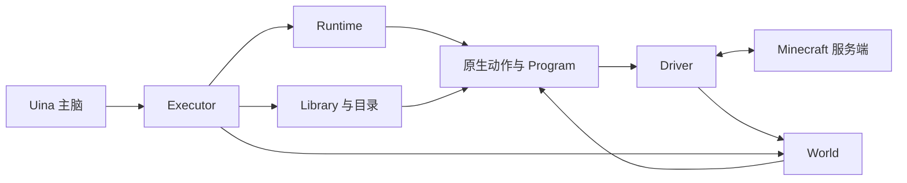

# Uina Minecraft World — 概要设计

日期：2026-10-25（原概要 2026-10-18）。状态：终态概要，部分实现；当前 I1/K1、采集、窗口容器与生产链已落地，完整主脑接入、程序复用及其余玩法仍待实现。实时状态见 [README](README.md)，施工顺序唯一见 [总规划 §10](development-plan.md#10-剩余施工总纲2026-10-25-重排)；历史 fake bot 或专项场景不证明完整设计已验收。

本文说明目标、组成与使用流程。行为合同由各模块唯一维护，[contracts](contracts.md) 只导航所有权与协作，[public-api](public-api.md) 定义跨模块类型。开发顺序见 [development-plan](development-plan.md)，统一施工与验证约定见 [development-guide](development-guide.md)。

<a id="goals"></a>

## 1. 目标与边界

让 Uina 用可靠动作和普通 JS 熟练游玩 Minecraft，能够精细操作、编写新方法、保存并改进程序。评价实际目标、耗时、模型往返、上下文和恢复成本，不以能力数量或日志量代替效果。

### 1.1 已确认边界

- 覆盖 Java 原版完整玩法，按实际客户端支持扩展模组/插件服。
- 并列支持 Microsoft 认证和 offline 登录。离线服只需地址、实际端口和名字；本机/LAN 不自动决定认证方式。单人存档须开放 LAN 或启动服务端。
- 使用客户端收到的结构化数据，区分服务端事实、本地预测、历史和未知；不模拟额外的严格人类视野。
- 常态本地自保可由主脑按玩法调整；操作者急停始终有效。
- 已受理游戏任务独立于一次思考回合；明确 stop、停用 World 或急停才停止相关动作。

### 1.2 验收基线

声明支持范围必须记录实际协议、客户端及依赖组合。协议能连接、状态能采集、操作能执行和玩法能完成分别验证。正常生存验收不靠管理员传送、补物品或改世界代替玩家行动。真实游戏与模型体验见 [研究场景](research.md#validation)。

### 1.3 非目标

不另建游戏 Agent、Steps DSL、任务运行时、全知地图、发布系统、依赖管理器或自动学习队列。缺少协议/传感能力时扩展对应适配，不把所有操作塞进一个通用命令。

<a id="architecture"></a>

## 2. 总体结构与职责

### 2.1 术语

| 概念 | 含义 |
|---|---|
| Run | 一次受理的游戏意图，可关联多个执行段 |
| Segment | 一份固定入口、输入与检查点的连续执行范围 |
| Call | 一次动作/程序调用；内部调用不建立子 Run |
| Body | 一次身体控制资格，可显式委托给子调用 |
| Operation | Driver 中短操作或持续会话的活动来源 |
| Effect | 操作已派发的效果及确认程度 |

### 2.2 组成



| 所有者 | 职责 |
|---|---|
| Executor | Uina 接入、伴生进程、IPC、请求凭证与结果交付 |
| Runtime | 受理、调用、唯一身体队列、停止、决策续段和执行记录 |
| Driver | 唯一客户端当前状态、实际输入、操作资源与控制隔离 |
| World | 观察查询、历史、Watch、证据与领域记录 |
| Program | 普通 JS、宿主桥、源码固定、guest/worker 及退役 |
| Library | 程序/蓝图/经验的工作文件、元数据、CRUD 与发现 |
| 领域模块 | 导航、物品、制作、战斗、施工等算法与目标核验 |

### 2.3 进程与 Uina 边界

Executor 在 Uina 侧管理一个 Node 伴生进程。Driver、Runtime、World、Library 与原生能力在执行侧装配，Program 使用共享 worker/独立 QuickJS guest；各持久存储有自己的 I/O 路径。模型往返不参与物理闭环。

Uina Core/Host 继续拥有 Subject、工具执行、会话和主体生命周期。Minecraft 不向 Core 引入游戏任务/地图概念。进程监管只由 Executor 负责，见 [Executor](modules/executor.md)。

<a id="module-ownership"></a>

### 2.4 局部开发

领域模块独立拥有算法，通过 Runtime、World 与 Driver 的公开接缝协作。修改战斗策略不改运行调度，修改蓝图变换不改客户端协议。新增玩法优先组合已有操作；确实缺少底层输入或事实时才扩展 Driver。依赖边界见 [contracts §2](contracts.md#2-依赖与唯一写入者)。

<a id="capability-loading"></a>

### 2.5 装配与目录

原生动作和查询由普通模块导出，组合根静态装配。每个动作一份 CallableDescriptor，每个查询一份 QueryDescriptor；查询不再另注册为 read Callable。保存程序的可选契约来自 Library 文件头。

同一目录合并这些声明与库元数据，供 describe 使用；它不执行游戏、不建任务队列。已声明但当前不支持的能力保留原因。目录与检索合同见 [Library §8](modules/library.md#8-发现)，类型见 [public-api §3](public-api.md#callables)。

### 2.6 玩法覆盖与归属

| 工作 | 主要能力 |
|---|---|
| 旅行探索 | goto/follow/flee/surface/explore/transit/ride，地标与跨维度地点 |
| 生存战斗 | equip/eat/attack/fight，本地避险与风险参数 |
| 资源制作 | mine/collect/craft/smelt/brew/enchant/anvil/grindstone/fish |
| 物品交互 | container/transfer/drop/pickup/use/trade/lead，精确窗口与副手操作 |
| 工程创造 | place/build/excavate/tunnel、蓝图、目标差异、材料与修复 |
| 协作复用 | chat（含 /指令）、普通 JS、世界等待、程序/蓝图/经验文件 |

这是能力覆盖，完整参数与完成条件只在 [能力面](modules/capabilities.md)。

<a id="interfaces"></a>

## 3. LLM 交互

模型使用一层 `minecraft({action,params})`，不需要知道进程、心跳或请求 ID 生成方法。

| action | 用途 |
|---|---|
| observe | 读取已有世界事实，不暗中移动或开箱 |
| describe | 找能力/库条目，按需读取合同与示例 |
| run | 执行动作、临时代码或保存程序 |
| runs | 查进展/记录、等待、停止、继续或恢复基础设施 |
| library | 管理普通文件库；describe 与 list 共用文件读取材料 |
| chat | 发一条消息或 /服务器指令，共用 chat@1 的受理路径 |

工具参数与结果由 [Executor §2](modules/executor.md) 拥有。常驻模型指南唯一见 [Program 附录 A](modules/program.md#附录-a模型的最小指南)，其他说明按需 describe。

<a id="call-contract"></a>

### 3.1 发现、调用与结果

```text
describe({query:"整理背包"})
→ transfer@1 的用途、参数与调用示例
run({selector:"transfer@1",input:{to:"nearest",item:"iron_ingot",count:24}})
→ 窗口内完成则返回固定结果；否则返回 requestId/run/segment
runs({op:"record",ref:"返回的记录引用"})
→ 读取确切完整记录
```

接受任务与任务完成是不同事实；工具等待取消不停止已受理 Run。受理未知先按原请求引用查证，停止同样可直接使用该引用。短直返与后台通知共用一份报告，通知可重复，不能重跑游戏动作。

### 3.2 组合数据

计划和执行复用目标参数；位置保留维度，方块格为整数，物品可按组件/耐久精确选择。transfer 统一两个方向的数量与结果；drop.toward 只证明丢出，不证明接收。源码、完整记录和大范围数据按路径/引用展开，正文仍保留真实结论、进度与未知项。

<a id="programs"></a>

## 4. 普通程序与精细操作

```js
async function main(mc, input) {
  const {value: inventory} = await mc.read("inventory@1");
  const missing = Math.max(0, 8 - (inventory.counts.oak_log ?? 0));
  if (missing) await mc.call("collect@1", {item:"oak_log", count:missing});
  return await mc.call("craft@1", {item:"oak_planks", count:16});
}
```

JS 负责顺序、条件、循环、函数、异常和 Promise 组合。查询用 read，动作/程序用 call；相同能力在直接调用、程序内部与保存程序中使用同一合同。

细操作通过 withBody 的 body/window/反馈句柄完成，支持单步输入、挖掘、攻击、交互、装备、窗口点击与本地闭环。生成程序不能访问原始 Bot、文件、网络或数据库。缺少底层能力时明确扩展，不承诺任意玩法现成可用。

<a id="program-values"></a>

程序 API、资源预算与关闭见 [Program](modules/program.md)。成功 await 返回领域值，失败抛结构化错误；helper 不成为公共 Call。程序正常返回只说明 execution 完成，不认证开放游戏目标。

<a id="control"></a>

## 5. 身体与执行生命周期

Runtime 唯一排身体队列，Driver 唯一授予并隔离实际资格。一次 withBody 可组合兼容操作，通过 body.call 明确委托；委托沿子调用传播，上层写句柄挂起，子退出不释放祖先身体。

默认安全介入只处理明确的岩浆、缺氧和低血受伤，复用同一身体仲裁；普通进食由程序决定，不加自动反击/常驻策略系统。独立介入有自己的记录与效果归属，死亡或重生不恢复旧调用。阈值和结束条件见 [能力面 §2.14](modules/capabilities.md#survival)。

withBody 在回调等待期间仍保留身体，输入/反馈有效期独立检查。需要其他任务使用身体时在作用域外等待；原生能力自行取得身体时在长期世界等待前释放。委托和停止见 [Runtime §3–§4](modules/runtime.md)，实际屏障见 [Driver §10](modules/driver.md)。

自保策略归领域能力，可按显式参数调整。独立介入经过同一身体与停止机制，不绕过停用、Owner Lost 或急停门。

<a id="run-lifecycle"></a>

phase 表示活动，control 表示控制归属；waiting 可以仍持身体。程序 decide 是可捕获请求，根未处理才结束旧段并交还；continue 明确创建新段，不恢复旧栈或资源。恢复只重建记录和基础设施，不自动重放旧动作，见 [Runtime](modules/runtime.md)。

<a id="perception"></a>

## 6. 观察、等待与主脑交互

Driver 拥有当前事实，World 保存选定历史与领域记录。未加载方块不是空气，实体离开跟踪不是死亡，历史箱子不是现存可取库存。事实保留真实来源、时间、覆盖与未知。

read/watch 只读取和提示复查；主动获取信息仍调用移动、开箱等能力。反馈复用纯采样，不逐 Tick 访问历史数据库。等待条件使用普通 JS 和各自游标，不另建条件 DSL。

工具结果与通知携带当次有时间依据的摘要；精确状态通过 observe/runs 查询。MC 不在每次模型请求隐式注入状态或推进“模型已读”游标。普通进度不唤醒主脑，完成、待决策与明确的重要事件沿 Host 输入入口交付。

聊天/系统/动作栏及伤害、死亡、连接事实统一从 events@1 读取：after 是增量位置，next 是固定窗口分页，观察 version 用于等待；不维护隐式已读位。重要事件可沿已有 Host 输入提示，完成报告仍有自己的持久回执合同，二者不混同。

players 读取当前服务端公告名单，entities 读取实际跟踪实体；名单不补远处坐标。item.sources 给获取知识，recipe 计算配方/材料；explore 支持找生物，复杂条件交给普通 JS。告示牌读进 block、写进 use，专用编辑不是槽位 click。

map 读取真实地图包，主脑工具附带同切面 PNG；guest 只收 JSON/图片文件引用。没有地图中心就不换算世界坐标，不读本机服务器存档补玩家感知。self 与反馈共用身体事实，氧气、免疫等缺失保持未知。具体签名见 [能力面](modules/capabilities.md)，读取和交付见 [World §8](modules/world.md) / [Executor §2、§8](modules/executor.md)。

<a id="results"></a>

## 7. 结果真实性

Driver 提供实际派发及协议/预测依据，能力核验声明目标，Runtime 保存并结算执行事实，主脑判断结果是否符合开放意图。

目标不足保留已完成量和 remaining 并抛领域错误；会话能力报告真实结束原因。取消不回滚已发生效果，失败也可带未知效果。五态结算与持久屏障由 [Runtime §5](modules/runtime.md) 唯一定义；后续核验追加到原 Effect，不改写历史报告。

<a id="persistence"></a>

## 8. 数据与恢复

### 8.1 所有权

当前客户端事实归 Driver；空间/容器历史、地点、事故和工程记录归 World；调用和效果归 Runtime；工作文件归 Library。实体/窗口活引用不跨连接复活，历史地点保留 world/worldRevision/dimension。地址与离线名字不自动证明持久世界身份。

### 8.2 存储位置

数据根沿用 Host 提供的 worldDataDir，不另配路径。

| 路径 | 所有者 |
|---|---|
| programs/、blueprints/、experiences/ | Library 工作文件 |
| runs/<run>/sources/<sha256>.js | Runtime 记录所用执行快照，由 Program 写入 |
| runtime.db | Runtime 受理、执行与结算 |
| world-history.db | World 历史、领域记录与证据 |
| exports/<sha256>.json | Runtime 按需导出的可再生读取缓存 |
| executor.db | Uina 侧接入身份、请求凭证和交付尝试 |

各存储互不代写，不合成跨库事务。恢复与故障边界分别见所属模块。

<a id="reuse"></a>

## 9. 保存、复用与修订

Library 是普通文件库，没有发布、包管理或依赖锁。程序头的输入/输出契约可以不声明；坏头可读但运行失败，完整源码替换与 metadata 修改互斥。

<a id="asset-flow"></a>

试做后 `library.save {name,summary,from:{run,segment,call}}` 保存确切调用源码。修改工作文件不改变本段已解析字节，新段读取新文件。快照支持源码追溯，不承诺依赖锁定或原世界重放。

蓝图分 Raw、Target、Project：保留原件、解释设计、绑定现场分别负责；Construction 以同一目标差异流程处理建造/清空/修复。经验是带适用条件的判断，记录引用可断链，不自动认证为事实或触发学习队列。细节见 [Library](modules/library.md)。

<a id="flows"></a>

## 10. 代表流程

| 场景 | 应有体验 |
|---|---|
| 基础生存 | 查材料/配方 → 采集/制作 → 不足看具体差额和错误，不从零重做 |
| 熔炼并行 | 投料核验后释放自有身体 → 其他任务使用身体 → 重新申请并开炉验产物；祖先委托则保留身体 |
| 建造与修复 | 同一目标先计划、再按现场差异执行；缺料保留部分量，改设计重算，不沿用旧完成量跳格 |
| 存取与投物 | transfer 统一 from/to；drop.toward 走近后丢出，接收结果需另有证据 |
| 发明新操作 | 用普通 JS、细操作和本地反馈试做 → 查确切源码/效果 → 保存 → 换场景修改复用 |
| 读消息与互动 | events 取得 after → 发 chat → 增量读取/分页/等待 → 依据实际正文决定下一步，不自动认证命令成功 |
| 游戏内指引 | players 区分名单和实体；map 只解释收到的图；block/use 读写告示牌，写后未确认如实保留未知 |
| 断线与故障 | 停旧控制、保留已发生与未知、重建基础设施后核验；不自动重投料/交易/续建 |

## 11. 尚需验证

<a id="open-questions"></a>

真实 QuickJS 桥与资源成本、Windows Job 退役、插件异步写源隔离、协议完成证据、反馈时延、长期历史成本、全玩法覆盖与模型复用体验均待实现验证。静态文档检查不证明这些行为。实验场景及证据边界见 [research](research.md)，阶段门见 [开发规划](development-plan.md)。
