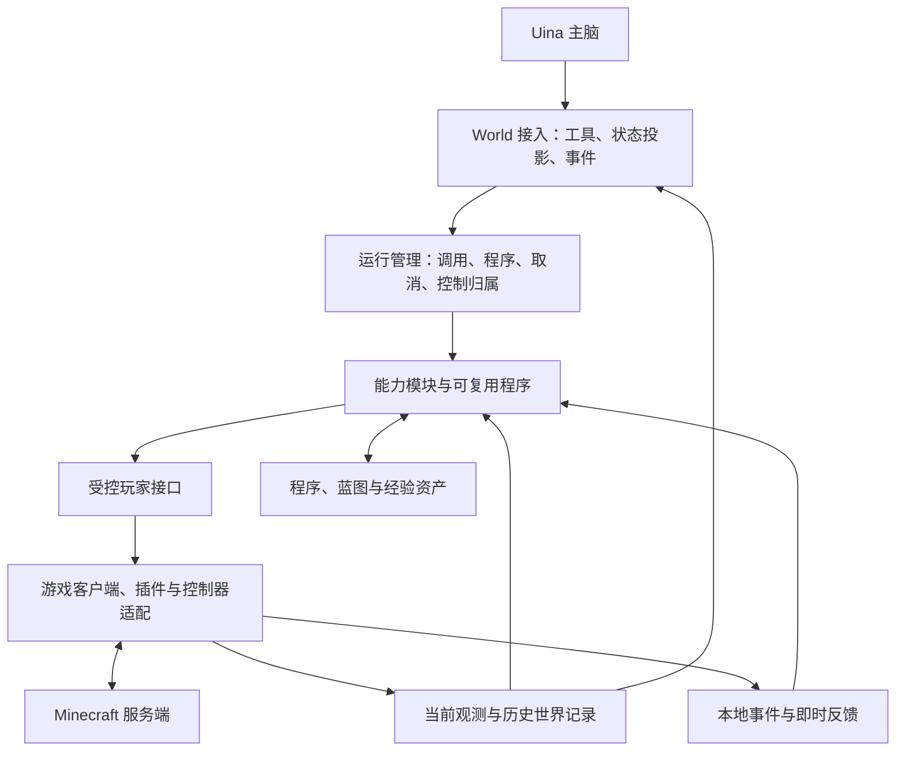
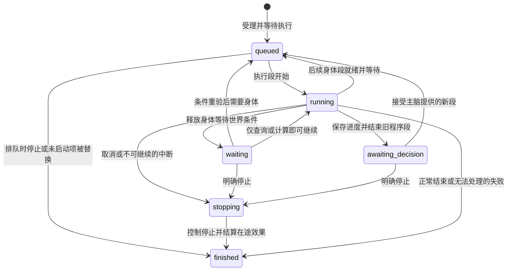

# Uina Minecraft World — 概要设计

日期：2026-10-16（Asia/Shanghai）。状态：推荐的终态概要设计，尚未实现或经过游戏验收。

本文概述 Minecraft World 的完整推荐方案。用户已确认的边界见下表；其余架构选择是研究后的推荐，不代表当前代码事实。本文保留目标、职责、交互和游戏流程；跨模块身份、依赖、受理/停止、递送、控制与数据的具体合同集中于 [详细契约草案](contracts.md)，供审阅；模块方法、值与错误的唯一候选定义见 [公开接口](public-api.md)，完整玩法 Schema、类与存储格式尚未冻结。本文不包含 MVP、版本阶段、实施排期或代码开发授权。源码证据、替代方案、旧稿归并及验证要求见 [研究与验证记录](research.md)。

<a id="goals"></a>

## 1. 目标与已确认边界

Minecraft World 让 Uina 熟练、自主地参与游戏：常用操作简单可靠，特殊操作可以编程组合，游玩成果能够保存和改进。成功标准是实际游戏目标的完成质量，以及时间、模型往返、上下文和失败恢复的综合成本。

| 用户已确认选择 | 含义 |
| --- | --- |
| 完整 Java 原版 | 设计覆盖原版完整玩法；允许模组与特殊服务器适配，不承诺兼容任意模组 |
| 客户端结构化感知 | 使用服务器下发的客户端数据，不额外模拟严格人类视野；协议可知、当前可见、历史记录和未知分别表达 |
| 主脑可调整自保 | 常态自动避险；主脑可为诱敌、潜水、战斗和冒险改变策略；明确的操作者急停仍有效 |
| 游戏任务独立于思考回合 | 已受理任务不因主脑转去聊天或停止本次推理而取消；明确停止任务、停用 World 或全局急停时停止动作 |

### 1.1 核心要求

- **熟练**：一次常用能力调用可以完成站位、工具选择、操作和适当恢复，不要求 LLM 逐帧控制。
- **自主**：主脑选择目标、委托深度、策略与风险，可以改变默认行为，也可以编写未预设的新方法。
- **可信**：受理、尝试、预测、服务端观察和目标满足不混为一谈；无法确认的效果保持未知。
- **可组合**：成熟能力、精细操作、查询、事件和已保存代码都能通过普通程序语言组织。
- **持续**：长动作不占住主脑，重要事件能够唤醒，终态可以查询，重连和重启不盲目重放。
- **可维护**：公共机制拥有明确状态与生命周期；具体玩法可局部修改，接口允许随真实需求演进。

### 1.2 完整能力的覆盖范围

以下是系统必须承载的游戏工作，不是顶层工具清单，也不要求每项对应一个独立服务。

| 游戏工作 | 需要承载的能力 |
| --- | --- |
| 探索与旅行 | 未知区域搜索、地标与路线、洞穴与水域、跨维度返回、跟随、载具和鞘翅 |
| 生存与战斗 | 饮食、装备、状态效果、环境脱险、近远程战斗、盾牌与走位、撤退、死亡后的恢复 |
| 资源与制作 | 采集、拾取、钓鱼、合成、熔炼、酿造、锻造、附魔、铁砧及相关工作站 |
| 物品与交互 | 容器、精确槽位与物品匹配、方块面与点击位置、副手、交易、骑乘、牵引与实体交互 |
| 工程与创造 | 放置状态与朝向、挖掘区域、施工与修复、农业与养殖、红石及自行发明的操作 |
| 协作与连续活动 | 游戏聊天、响应玩家、等待世界过程、长期目标下的持续行动、保存与改进成果 |

不使用管理员命令、传送或补发物品来代替普通玩家操作的成功。若明确提供管理能力，应标明其性质和实际权限，不混入生存成绩。

<a id="architecture"></a>

## 2. 总体结构与职责

推荐结构是：**可靠动作库、普通程序组合、本地反馈控制，共用执行、取消与效果记录。** Minecraft World 不另建一个负责长期目标的 Agent。



这是运行关系图，不是代码 import 方向或必须独立部署的服务清单。

| 组成部分 | 拥有的职责 | 不拥有的职责 |
| --- | --- | --- |
| Uina 接入 | World 生命周期、工具入口、事件递送、模型状态摘要、与游戏执行进程通信 | 游戏算法、第二套任务状态或长期目标 |
| 运行管理 | 运行句柄、调用上下文、取消、身体归属、进度、执行记录、程序执行边界 | 战斗策略、配方规则、建筑算法 |
| 游戏客户端与受控玩家接口 | 连接、协议状态、受控输入、交互、回执来源、插件和控制器适配 | 主脑战略、独立任务调度 |
| 能力模块 | 导航、采集、制作、战斗、容器、工程等工作，以及各自的领域核验 | 全局身体锁、重复连接状态或另一套顶层队列 |
| 观测与世界记录 | 当前状态视图、历史空间信息、容器记录、工程进度、持续过程和事故 | 全知世界模型、暗中移动或操作游戏 |
| 可复用资产 | 程序、蓝图和经验的保存、版本、检索、引用与证据关联 | 身体控制、另一份世界库存或任务真相 |

Program 是运行管理支持的执行方式；能力目录是模块导出的索引。二者不形成另一套玩法内核。受控玩家接口在实际写入处落实控制有效性，不再另建一层只转发调用的 Gateway 来重复管理相同状态。

### 2.1 部署与 Uina 边界

游戏执行环境独立进程运行，拥有 Driver、Runtime 和 World 当前路径；各所有者 SQLite 使用专用 Worker。Program 拥有独立受限 guest 执行/桥接/容量，优先采用每活动 Segment 一个受管子进程、每次 Program Call 一个独立 QuickJS runtime/context、Promise bridge 和显式 job pump；语言/性能/隔离仍待原型验证。Executor 拥有 Uina 接入、IPC 与唯一最终进程树监管；Program 使用其受管创建能力，Runtime 不重复管进程。行为合同见 [Runtime / Callable](modules/runtime.md)，引擎与桥接实现见 [Program](../../../.uina/worlds/minecraft/modules/program.md)。

进程之间传递调用、运行状态、查询结果和重要事件；物理反馈循环不逐 Tick 绕回 Uina。大范围扫描、路径计算和施工规划不能长时间阻塞客户端心跳与控制循环。

Minecraft 专属状态、动作和恢复都留在 World。Core 继续拥有通用主体、模型调用、工具执行与 canonical journal；Host 继续拥有主体生命周期；UI 展示和输入。现有扩展接缝及其限制见 [Uina 接入事实](research.md#uina-seams)，不能把旧 Cognition 或 Job 扩展当成现成依赖。

### 2.2 依赖与局部开发

<a id="module-ownership"></a>

**Minecraft World 的各玩法模块独立拥有领域算法与策略，通过统一 Callable、World 和受控 Player 契约协作。模块内部可按实际需要采用策略模式或算法组合，但不要求所有玩法共享同一策略框架。新增或改进玩法算法原则上不修改其他玩法模块和基础运行时；确需新的底层能力时，由 Driver 扩展受控适配。**

- 客户端适配不依赖具体玩法；运行管理不导入某个采集或建筑实现。
- 能力模块依赖运行上下文、只读观测、受控玩家接口以及明确使用的其他能力。
- 持久数据与资产由各自所有者写入，查询索引是派生视图。
- 组合根装配能力、执行器、客户端和存储；公开契约由所属模块维护，统一从 [public-api](public-api.md) 导航至唯一类型定义。
- 新能力通过普通模块导出接入，优先复用已有操作。需要新协议、传感信息或控制方式时，允许扩展相应接口。

例如修改弓箭瞄准，主要影响战斗能力与控制接口；修改蓝图旋转，主要影响建筑数据和状态转换。不能承诺任何新玩法都永远只需注册一个函数。也不规定固定模块数量、每个模块的目录模板或通用业务基类。

详细设计按所有权分别展开：Runtime / Callable 拥有注册、发现与调用机制；Combat 拥有近战/远程/走位及版本战斗规则；Navigation 拥有路径搜索、避障与跟随；Crafting / Construction 拥有配方、施工顺序、物资与修复规则；[Program](modules/program.md) 拥有普通 JS 组合和控制算法执行；[World](modules/world.md) 拥有统一查询、地图、知识与历史；目标、委托和风险选择仍归主脑。Driver 只定义这些模块共用的客户端操作、控制隔离与事实入口，不代替它们设计策略。这里只明确归属，不预建其余模块文档。

<a id="capability-loading"></a>

### 2.3 能力装配、发现与调用

一个能力模块导出其可调用工作、只读查询或规划、必要的底层操作及说明。每个导出至少表达：稳定名称、输入与输出含义、可发生的效果、失败与核验方式、所需客户端支持，以及实现版本。read/act 决定业务写权；只有实际需要控制身体时取得 Body，act 也可能只写领域记录或聊天，不靠命名猜测。模块自己的领域策略与算法仍留在模块内部。

组合根连接客户端、存储与运行管理，装配原生模块并读取保存程序的元数据。一个轻量能力目录索引这些导出，供直接调用、JS 绑定和 `describe` 共同使用。它不执行游戏、不维护队列，也不另设 Skill、Operation、Observation 三套注册生命周期。

```text
模块导出与版本
  → 组合根装配支持条件与依赖
  → 能力目录形成可查询描述及程序签名
  → 外部直接调用 / JS 函数调用 / 保存程序调用
  → 同一运行上下文
  → 领域实现使用观测、受控玩家接口或其他能力
  → 返回领域结果与执行证据
```

`describe` 的搜索返回简短候选；精确读取返回当前签名、结果含义、示例、依赖与已知限制。有关描述从定义生成，不在工具层再维护一套。能力存在不代表当前连接支持：缺少客户端操作或版本不兼容时，目录保留发现入口并说明不可调用原因，不靠隐藏能力让模型误判系统范围。

保存程序索引元数据和源码分别保存。受理先捕获确切版本/字节/摘要与声明依赖，再仅提交 Runtime 自己的受理事实；准备 @3 后 head 发布 @4 仍运行 @3，不暗示跨库冻结。内部调用传可信上下文、不 submit 子 Run；同段独立 Body 申请并发等待 FIFO，委托复用。仅持 Body 调用谱系独立重入局部 CONTROL_CONFLICT，不因普通 Promise.all 退役整段。

新增采集算法通常只增加或替换采集模块。新增特殊载具控制可以导出原生控制器；需要新协议时扩展客户端适配，再将操作经同一受控接口公开。在途段固定版本，更新只影响之后的运行或明确换版的新执行段；World 停用则撤回调用入口并停止所属运行。具体文件扫描与包加载格式不在此冻结。

<a id="interfaces"></a>

## 3. LLM 交互与核心接口边界

对 LLM 使用一个 Minecraft World façade，内部提供少量稳定入口。下列名称说明职责，不冻结最终工具 Schema 或字段。

| 入口 | 输入意图与输出含义 | 身体与副作用边界 |
| --- | --- | --- |
| `observe` | 查询自身、目标、区域、库存、地图或历史记录；返回范围、时间、来源与未知项 | 只读取已有信息；需要开箱或移动时给出缺口，不暗中执行 |
| `describe` | 搜索能力、配方和相关知识，读取准确签名、示例与适用条件 | 不占身体；说明来自能力定义与有关资料 |
| `run` | 直接调用一个能力，执行 JS，或运行已保存程序；返回结果或运行句柄 | 通过同一执行上下文；只有会控制身体的部分参与仲裁 |
| `runs` | 查询进展、等待结果、停止运行、继续待决策运行、读取中断与恢复信息及 program_capacity | 查询不占身体或 Program 名额；容量查询给出占用/排队与所属 Segment，继续重新检查条件并排队 |
| `library` | 保存、搜索、读取和修订程序、蓝图及经验 | 修改设计或代码不等于执行游戏动作 |
| `say` | 发送游戏聊天，返回发送结果及可确认范围 | 不排在身体动作后；仍遵守服务器实际规则 |

顶层说明包含少量程序约定、代表性调用和能力类别；具体能力文档按需读取。不会把完整技能目录塞入一个巨型 Schema，也不会因为附近没有怪物就隐藏战斗能力。

能力定义统一提供用途、参数与结果说明、读写性质、适用条件和示例。原生能力与保存程序进入同一个发现入口，但保留实现来源、版本与证据差异。能力调用时校验真实参数；不要求模型记住所有签名。

### 3.1 简单调用与长动作

run/continue 在受理后的短等待窗口内完成，直接返回同一 Run 已持久的真实终态或待决策快照/completionRef；超过窗口返回 accepted/run/segment，后台完成或决策经 World 输入。工具取消只结束等待，Run 继续；observe/describe 和显式 runs.wait/read 直接查询，不占身体、不自动消耗通知。

正常直返先在 Executor 请求记录固定 request/segment/completionRef，再记 tool_handoff 并抑制主动通知；桥接交出响应后关闭本地请求，这不是 Host canonical ACK。恢复只对本 owner 未结请求对账；tool_handoff 且仍 eligible 的同一报告建立一个持久补报意图，重启续用，pending 走正常 drain，已消费 decision 跳过。允许 ACK 丢失等故障重复呈现，已关闭请求的最终交接缺口可按原引用查询；不重做游戏动作、不扫描会话，不发明恰好一次协议。

受理前确定取消才不启动，受理后生命周期归 Runtime。回执丢失保留系统 requestId、查询受理，不另起副作用任务。各通道读取同一 completion，无第二运行状态机。decision 在投递/渲染前核验仍未消费；最后 render→canonical 竞态可能展示历史，continue CAS 阻止重复行动。

### 3.2 关键接口的语义

| 接口边界 | 必须表达的内容 |
| --- | --- |
| 运行上下文 | 当前调用归属、取消、策略与任务约束、内部能力调用、进度与证据；内部调用不重新排顶层任务 |
| 受控玩家接口 | 操作目标或输入、控制有效性、连接有效性、实际可观察结果；生成程序不直接获得原始 Bot |
| 观测接口 | 查询范围、当前与历史来源、有效性；未知区块不能当空气，实体引用失效不能当击杀 |
| 资产接口 | 内容、明确版本、依赖与执行证据；运行过程中不静默替换依赖 |
| Uina 接入 | 已受理与已完成分开；模型所需结论进入正文，诊断和完整记录保留引用 |

寻路试算、材料清单和施工冲突由相应能力提供只读规划方法，不建立通用 `scout` 子系统。计划说明使用了哪些当前或历史信息；无法预测时返回未知，不假装任意 JS 都能无副作用预演。

<a id="call-contract"></a>

### 3.3 一次完整的外部交互

以下用 `minecraft({action, params})` 表示 World 调用，用 JSON 表示模型可见正文；它们确定交互关系，不是完整 wire Schema。工具自身的五态结果与正文中的运行状态分别保留。

先找能力，再在必要时精确读签名；已知签名时可以直接行动，无需强制每次搜索：

```text
minecraft({action: "describe", params: {query: "采集原木"}})
→ 候选 gather.collect：采集并拾取指定数量；可读完整签名与限制

minecraft({action: "describe", params: {ref: "gather.collect"}})
→ 输入：方块类型、额外收集数量及本次约束
  输出：实际入包数量与有关状态；不足目标时返回进度和原因
  示例：collect({block: "oak_log", count: 32})

minecraft({action: "run", params: {
  call: "gather.collect",
  args: {block: "oak_log", count: 32}
}})
→ {"requestId":"q17","run":"r17","phase":"running","effect":"accepted",
   "progress":{"collected":0,"target":32}}
```

同一个 `run` 入口可以接收能力/保存程序引用和参数，或代码与输入；二者互斥。代码模式使用同一个调用上下文，不是让模型在运行中的脚本里再调用顶层 `run`。保存程序通过带版本的引用调用，不必重传源码。

临时代码以 `input` 读取本次参数，以 `mc` 使用当前运行接口，例如：

```text
minecraft({action: "run", params: {
  code: "return await mc.call('user.wood.collect@2', input);",
  args: {count: 32}
}})
→ 与直接调用相同的运行/终态回执，另关联本次代码快照
```

接入在任何 IPC 前生成并持久保存 requestId；模型不填写。传输重试/受理查询复用原 ID，受理未知时回执提供该引用；进程恢复也从 pending 请求取回。新的普通 run 是新意图，相同参数不自动合并。现有 invocationId 只作追踪，不能假定持久唯一。

长动作之后可以由事件收到终态，也可以主动查询；两条通道读取同一份运行记录：

```text
minecraft({action: "runs", params: {op: "status", run: "r17"}})
→ {"run":"r17","phase":"finished","outcome":"failed",
   "reason":"target_unreachable","progress":{"collected":19,"target":32},
   "unknownEffects":[],"record":"执行记录引用"}
```

这表示本次目标未达，但已收集的 19 个物品没有消失。下一次若扩大搜索，按实际持有量计算缺口，不从零重复请求。短运行在受理后的等待窗口内取得持久 completion 可直接返回；超时后才返回 accepted 并由 World 输入递送同一报告。显式查询读取记录，不确认通知已交付。

### 3.4 等待、停止与决策继续

`runs.wait` 仅等待记录变化，不占身体；本次等待超时或思考被中断，都不取消游戏运行。状态未变化时不制造进度事件。以下停止示例针对另一个仍在执行的运行 r24：

```text
minecraft({action: "runs", params: {op: "stop", run: "r24"}})
→ {"run":"r24","phase":"stopping","control":"stopping"}

稍后查询或收到结算：
→ {"run":"r24","phase":"finished","outcome":"cancelled",
   "control":"stopped","progress":{"collected":19},
   "unknownEffects":["停止前最后一次交互的效果引用"]}
```

第一份回执只确认停止请求已登记。只有控制不再输出后才能确认 `stopped`；在途效果未知独立保留。对于尚未开始且没有身体操作的运行，可以立即结束。

重复停止同一运行复用既有停止意图；停止已经结束的运行直接返回其终态，不重新进入停止状态，也不改写原先的成功或失败。

运行需要主脑选择时返回 `awaiting_decision`，附当前决策引用、原因、事实和检查点。主脑通过 `runs.continue` 指定运行、当前决策引用及新的能力或代码段。它保留同一运行及累计进度，但不会恢复旧 JS 栈。旧决策已经被处理时，重复的同一继续请求返回既有记录；其他过期继续请求拒绝。终态运行不通过继续接口复活，需要新建有关联的运行。

```text
决策通知/查询：
→ {"run":"r30","phase":"awaiting_decision","decision":"d2",
   "reason":"materials_missing","checkpoint":"施工进度引用"}

补料后主脑提交下一段：
minecraft({action: "runs", params: {
  op: "continue", run: "r30", decision: "d2",
  call: "construction.build", args: {project: "e4", blueprint: "cottage@2"}
}})
→ {"run":"r30","phase":"queued","segment":"s2","effect":"accepted"}
```

### 3.5 状态、能力发现与回执的上下文成本

短摘要持续回答“我在哪里、身体在做什么、关键风险是什么”；搜索只返回候选与展开引用；精确描述给出可执行签名。回执带上本次决策需要的变化，不要求模型再查一次才能知道动作是否完成。

大地图、完整库存组件、详细错误轨迹、源码和历史证据提供可展开引用。正文仍保留完成量、未知与停止结论，不能把这些内容全部移进 `details`。这些规则用一次真实目标的总调用、Token、时间和失败恢复成本检验，不单看某一份回执是否最短。

### 3.6 能力之间共享的数据语义

| 数据 | 共同约定 |
| --- | --- |
| 位置与区域 | 世界位置区分连续坐标与整数方块格，关联世界和维度；蓝图局部坐标附明确变换，不直接混作世界坐标 |
| 数量 | 签名明确额外获得量、最终持有量或执行次数；采集示例中的 `count` 是额外入包目标，合成产出量与配方执行次数不混用，批次超额如实返回 |
| 物品选择 | 明确名称、组件、附魔、耐久与可接受替代条件；精确选择失败不静默换物品 |
| 实体与窗口 | 引用带有效连接或会话归属；实体编号复用、窗口重开或连接变化后重新定位，不拿旧引用继续写入 |
| 时间与有效性 | 观察时间、客户端反馈序列与游戏 Tick 含义分别表达；本地 Tick 不充当服务端确认 |
| 内容与进度引用 | 运行、执行段、效果、工程和资产版本可稳定关联；查询完整记录不依赖模型还保留此前文本 |

这些语义由接口所有者统一维护，具体传输字段可以演进。它们用于避免模块各自解释相同数据，不要求新增承载所有业务逻辑的 `shared` 框架。

<a id="programs"></a>

## 4. 普通程序组合与开放操作

JS 是条件、循环、函数、计算、异常处理和事件组织的组合语言。直接能力调用、程序内部调用和已保存程序使用相同上下文、控制与结果机制；不另建 Steps 依赖图或游戏 DSL。

以下仅展示调用粒度，不是冻结的 SDK：

```javascript
await mc.call("gather.collect@3", { block: "oak_log", additional: 16 });
await mc.call("crafting.craft@2", { item: "oak_planks", additional: 32 });

const self = await mc.read({ ref: "self@1", input: {} });
if (self.value.health < 10) {
  await mc.call("movement.returnTo@1", { landmark: "base" });
}
```

成熟能力减少机械调用；细粒度能力允许模型改变具体方法。完整的编程操作面应覆盖状态与事件、移动与视角、按键组合、物品与副手、槽位与窗口、点击面与点击位置，以及动作时序。

### 4.1 本地反馈逻辑

精细控制同时支持定长输入、常用条件终止和本地闭环控制。有限的 `until` 条件可以是快捷方式，不能成为唯一反馈口。

对于新跑酷、移动射击或特殊载具操作，程序应能在执行侧读取连续反馈、运行普通逻辑并输出受控动作。模型不必逐 Tick 推理，程序也不必每 Tick 通过 Uina IPC 查询。复杂控制器可以复用原生实现，也允许生成新的局部控制逻辑。

这不保证任何玩法都能凭现有接口创造出来：缺少的传感、协议与模组操作仍需扩展。控制精度也受客户端物理、网络、服务器负载和纠偏影响；输入能细到一个 Tick，不代表落点或命中具有同样精度。

### 4.2 程序执行边界

脚本故障不能冻结客户端心跳、取消处理和必要的自保。生成程序与宿主对象隔离，游戏访问通过受控接口；普通代码可以组织流程，但不能绕过失效控制权或重用旧连接引用。

具体沙箱、JS 运行时和类型检查方式保持待验证。独立进程本身不能解决同一进程内脚本卡死控制循环的问题，必须验证可终止计算及宿主调用边界。CPU、内存和反馈预算应有实际依据，不默认添加游戏动作总数、轮次、任务时长或世界修改数量上限。

程序可以捕获领域失败并尝试另一条已允许的方法；取消、控制失效与连接失效不能因被 `catch` 捕获就恢复旧操作资格。程序返回的自述不覆盖执行证据。

需要主脑思考时，程序结束当前段，返回原因、相关事实和可序列化进度；不偷偷调用第二个 LLM。再次行动根据新决策和新观测继续，不承诺持久保存任意 JS 执行栈。

<a id="program-values"></a>

### 4.3 程序内部的值、失败与效果

**成功的 `await` 返回领域值，不要求每行代码都拆一层通用工具回执。** 执行上下文自动保存调用、进度和证据。具体能力必须说明它承诺完成什么：`collect(count: 32)` 的成功意味着额外入包达到目标；一次攻击输入的成功只意味着输入按其合同执行，不意味着击杀。

| 情况 | 程序看到什么 | 运行管理保留什么 |
| --- | --- | --- |
| 满足能力合同 | 领域值，如实际收集数量、目标状态或交互回执 | 确切能力版本、有关效果及证据 |
| 目标不足但效果已知 | 可捕获的领域错误，携带已完成进度与原因 | 部分完成不回滚；原调用仍记录未达标 |
| 参数、前置条件或当前支持不足 | 可解释错误，区分未派发与已经尝试 | 失败原因及是否产生效果 |
| 副作用可能发生但未确认 | 可捕获的不确定效果错误及效果引用 | 待核验效果，不能因 `catch` 或正常 `return` 被抹掉 |
| 取消、连接或控制资格失效 | 中断当前执行；旧资格不能继续操作 | 停止过程、已完成工作及未确认效果 |

例如，原木不足可以换一种树；本次进度必须计算在内：

```javascript
let collected = 0;
for (const block of ["oak_log", "birch_log"]) {
  try {
    const value = await mc.call("gather.collect@3", { block, additional: 32 - collected });
    collected += value.collected;
  } catch (error) {
    if (error.code !== "TARGET_NOT_MET") throw error;
    const measure = error.progress?.measures.find(m => m.name === "collected" && m.unit === "items");
    if (!measure) throw error;
    collected += measure.value;
  }
  if (collected >= 32) break;
}
if (collected < 32) throw new Error(`目标未满足：只收集到 ${collected}`);
return { collected, target: 32 };
```

错误名和字段为示例；推荐语义是失败携带可组合的实际进度，不能把全部失败都当成零效果，也不能把不足量默认当成功。允许部分完成的能力可以正常返回部分结果，但必须在其合同中明确，不能靠调用者猜测。

不确定错误不进入普通自动重试。程序可以读取新事实、调用相关能力的核验方法或交还主脑；核验结果追加到原效果引用，原始记录不改写。若只能证明目标现在满足，就报告当前目标满足，不能据此补造先前动作的因果。对未知交易或物品消耗，后续行动先核验有关库存与结果，再决定是否重做。

程序正常返回表示执行段正常结束。原生能力和保存程序可以通过其入口合同声明可核验目标；临时代码用明确查询与断言检查自己的组合目标，不能靠返回一个 `completed: true` 声明世界事实。没有可核验目标时，成功只指程序按合同结束，回执仍列出实际效果，不自动解释为完整游戏目标成功。

拟正常成功结束时，若入口目标或操作合同建立的必需完成证据仍无法确认，整体结果保留 `unknown` 并呈现已知进度。“必需”由派发前的操作合同确定，不是脚本事后可改的关键性标记；程序查询与断言也不自动认证其正确表达了用户意图。若已经确定因取消而停止，则仍可结算为 `cancelled`；若已经确定发生合同失败或未处理程序错误，则可结算为 `failed`。这两种确定结论不表示所有副作用已知，仍必须附未解决的效果引用。已结算、已处理的普通失败可以被成功的替代路径解决，原证据仍可追溯；具体范围与结算规则见 [完成证据合同](contracts.md#effects)。

### 4.4 精细操作的基本操作面

下面明确自动化边界；名称为推荐签名片段，不是全部函数目录。

| 操作面 | 使用关系与返回含义 | 明确不隐含的行为 |
| --- | --- | --- |
| `mc.read(query)` | 读取自身、方块、实体、背包、地图或最近容器记录，带有效性 | 不自动走近、开箱或把未知当空 |
| `body.drive` / 普通 JS 顺序组合 | 有界按键与视角动作段，返回实际位置、结束原因和反馈 | 不保证按若干 Tick 就达到推算位移 |
| 放置能力 callable | 声明目标格及方块状态，求解有限范围的站位、参照面和放置，再核验 | 不自动展开成远距离旅行、采料或拆除重要结构 |
| `body.interact` | 指定对象、面、点击位置、主副手，返回尝试与可得效果 | 不把点击当成目标机制必然触发 |
| `body.attack / drive` 的物品使用 | 一次攻击或一段物品使用，可与同一行为的移动和视角协同 | 不自行选择长期交战目标，不默认等于命中或击杀 |
| `body.openContainer` 与窗口句柄 | 打开并核验窗口，在临时会话内读取槽位、转移与关闭 | 不提供跨窗口重开的永久句柄或服务端原子事务 |
| `mc.wait` 与身体内定长输入 | 等待条件或事件，并说明是否结束身体行动段 | 不把事件到达或时间到期当成目标已完成 |
| `mc.decide` | 以事实和检查点结束当前程序段，等待主脑提供下一段 | 不在脚本里调用另一模型，不保留任意 JS 栈 |

例如放置朝东的上半楼梯，可以用 `placeAt` 声明结果；研究新摆放方法时，则明确站位、视角、参照面和点击点调用 `interact`，再读取实际状态。两种粒度共用同一身体与证据路径。

容器会话内的一组转移属于一个交互段；每一步根据当前槽位重新检查。中途取消或窗口关闭后，临时句柄失效，已发生的转移不回滚。重新打开同一箱子也产生新会话；旧清理不能关闭新窗口。输入物品按名称、组件及本次匹配约定选择，输出报告实际槽位与数量变化。

### 4.5 本地控制循环与事件等待

生成的局部控制逻辑在独立受限且可退役的 Program 域运行，不能堵塞 Driver 心跳、停止和必要自保。宿主查询/规划也须切片或卸载。QuickJS WASM+段子进程是优先原型，不是领域不变量；语言/桥接/资源/延迟归 Program 验证，进程树监管归 Executor 验证。Runtime 依赖执行合同，见 [Runtime §9、§16](modules/runtime.md#9-program-执行合同与资源准入)。

脚本先声明所需反馈并建立一个控制段。执行侧向它提供带时序和有效性标记的快照；每次反馈中的普通 JS 函数计算下一组运动、视角与物品输入，受控接口检查当前控制资格后才生效。循环结束或失效时停止持续输入、撤销订阅并结算证据。反馈没有及时产生下一份有效输入时，不允许上一次按键无限保持。

```javascript
await mc.withBody(async body => {
  await body.loop(frame => {
    if (frame.self.value.onGround && reachedLanding(frame.self.value)) {
      return { done: true };
    }
    return {
      keys: chooseKeys(frame),
      look: aimForLanding(frame)
    };
  }, { collision: { ref: "nearby_collision@1", input: { radius: 3 } } });
});
```

`reachedLanding`、`chooseKeys` 和 `aimForLanding` 是同一脚本内的普通函数，可使用参数与局部状态。反馈函数不再调用异步寻路或抢占另一个身体行为，复杂感知在进入循环前配置；需要的传感尚未提供时扩展反馈源。动作时限可由任务明确声明，不用固定小 Tick 上限代替可中断性。

这个接口不是逐 Tick 调用主脑，也不跨 Uina IPC 传输每帧函数。生成代码在原有执行域注册本地函数，反馈与受控输出走游戏执行侧的桥接；桥接延迟、丢帧与计算终止仍需实测。原生控制器使用相同控制资格及效果合同，可以替换算法而不改变上层任务流程。

身体作用域内的定长输入/短等待保持当前控制段；等待世界条件前须退出 withBody 并释放输入/窗口，活动作用域内调用 wait 返回 BODY_SCOPE_ACTIVE。领域可复用条件通过 WaitConditionDef；临时条件由普通 Program 分别读取多个 mc.read 事实、在 JS 组合判断，再将各自 query/cursor 交给 mc.waitForChange；任一失效或时间唤醒后重读。这样“雨停且附近无怪”等组合不必预建组合 QueryDescriptor 或领域等待 Callable；底层各项观察仍须由 World 明确提供，独立读取不承诺联合快照，Runtime 不制造观察或合成 cursor。计时只安排复查，不证明完成。await 保留闭包和 guest，进程重启不恢复。具体合同见 [公开接口 §5–6](public-api.md#world) 与 [Runtime §10](modules/runtime.md#10-等待交还与续段)。

<a id="control"></a>

## 5. 身体控制、委托与运行生命周期

### 5.1 一个控制归属，允许复合动作

同一时刻只有一个有权决定当前身体行为的所有者。同一行为内可以协同移动、瞄准、攻击、盾牌或载具操作；互斥限制的是竞争写入，不是这些通道必须串行。

控制资格授予完整行动段，并沿内部调用传递。Primitive 不逐个争锁，内部 Skill 不创建相互等待的顶层任务。客户端写入处检查资格；原生插件的定时器与回调也必须纳入这条路径，不能成为旁路控制主人。

身体调度以行动段为单位。一次高层能力及其内部调用通常共同构成一段；查询、计算和世界等待可以在段外执行。程序相邻能力默认可在各自身体作用域间释放；需要连续独占时显式 withBody，并用回调提供的 body.call 组合嵌套能力。连续控制、离散输入和有状态交互共享写入资格，不强制统一为 Tick 输入；成熟插件可受控独占，也可复用适合组合的算法。需要协同运动、瞄准与交互时，由能力/程序提供的协调者安排依赖与操作顺序，不让两个独立控制器竞争。Driver 的具体边界见[模块详细设计](modules/driver.md)。

默认规则是：**普通就绪段按进入就绪队列的时间顺序执行，当前段不被新普通请求打断。** 世界等待、待决策和暂停恢复期间不占队列中的执行位置；再次可执行时按新的就绪时间入队。长任务不能靠保留旧名次，在每次等待后优先夺回身体。

提交可明确选择以下关系；它们是身体调度意图，不是另一门编排语言：

| 关系 | 推荐行为 | 对旧工作的影响 |
| --- | --- | --- |
| 普通排队，默认 | 进入普通就绪队列 | 不取消当前段或其他运行 |
| 替换待执行提交 | 用新提交替换明确范围内尚未开始执行的提交 | 被替换项以 `not_started` 结束；不清掉已有进度的续段或世界等待 |
| 显式抢占当前运行 | 登记停止当前身体所属运行，交接完成后优先执行新段 | 旧运行以取消结算，保留进度与未知效果；其他待执行项继续保留 |
| 本地紧急接管 | 按当前自保策略停止或挂起旧段，先完成应对 | 原能力有明确恢复点时重新观察并排队；否则交还主脑，不盲目重跑 |

替换范围未给出时只替换有可信身份的同一调用来源尚未启动的待执行提交；当前 ActionContext 没有调用者身份，接入未取得该身份时必须明确提交引用，不能把操作名当来源。显式抢占核验预期当前运行，先一并持久受理新 Run 和旧 Run 停止意图，确认后撤销旧控制，Driver 交接后才执行新工作。校验/事务失败不因该提交取消旧运行；提交未知先对账。独立 stop/emergency 仍立即撤销，不等待新工作受理；急停门与停止确认不能绕过，详见 [接入契约](contracts.md#ingress)。

查询与计算可以并行。Program 根部 `Promise.all` 发起的独立 Callable 分别建子 Call，需要身体时按 Runtime 队列先后获得/释放，不因此退役整段。Body 内用 `body.call` 显式委托；已持 Body 的调用谱系再要求独立资格，或同一资格内出现 Driver 判定不兼容的竞争写入，局部 CONTROL_CONFLICT，可由程序处理并保留已派发效果。只有隔离失守或无法安全清理才升级到段级退役，不以任意 Promise.all 作为段失败理由。

### 5.2 任务等待与身体占用

| 等待类型 | 处理 |
| --- | --- |
| 等待落地、拉弓、短交互或容器事务 | 属于当前身体行动段，保持必要控制与一致性 |
| 熔炼、作物、之后的玩家事件等世界过程 | 不持续占用身体，可安排其他工作；条件满足只表示重新检查的机会 |
| 等待主脑决策 | 结束当前执行段并释放身体，保留可解释进度与原因 |

持久的观察或等待可以持续到取消，不要求一律设置任意超时。故障超时用于发现不再响应或不再进展的操作，应与正常长期等待区别。世界等待前结束当前窗口会话、停止有关插件并释放持续输入；等待结束后重新参与身体调度并检查条件，不能直接抢回旧控制权。

物品也没有隐式长期锁。记录“为施工保留 32 块木板”是本主体的使用策略，不阻止其他玩家取走箱内物资。等待后根据实际库存和组件重新核验，不依赖旧槽位或旧资源预留。

### 5.3 委托与自保策略

主脑决定目标、战术、重要资源取舍和委托边界。本地能力处理寻路、站位、普通重规划、工具更换和其他已委托的机械工作。选择替代材料、扩展搜索区域或改变工程设计是否可自动完成，取决于本次委托，不预设都需要询问，也不预设都可擅自决定。

任务可以表达保留物品、材料偏好、禁止破坏区域、风险与停止条件。自动补光、搭桥、支撑和工具替换遵循这些约束。物品判断考虑实际组件、耐久和附魔，不只比较名称。

默认自保策略可在危险时接管。主脑能够读取、修改并理解当前策略，使诱敌、潜水、守卫和冒险不被隐藏反射破坏。感知采集器只发布事实，不因为看到怪物就自行成为战斗规划器。没有实际进展的重复恢复应暴露阻碍，而不是永久重复相同动作。

推荐把稳定的常态策略与本次运行覆盖分开：新运行继承当前常态策略，可以明确覆盖自保方式、可用材料和停止条件；覆盖只作用于该运行及其内部调用。修改常态只影响之后的运行。改变在途运行需显式指定它，由执行侧在安全交接点应用；已派发动作不被事后改写。当前生效策略和来源可以查询。

明确的操作者限制、服务器实际权限和急停约束始终生效，任务内调用不能放宽这些约束。主脑可以降低自己的保命优先级或改为诱敌，不代表获得原本没有的服务器权限；这里不额外建立一套虚构的权限审批流程。

### 5.4 停止、交接与恢复

停止必须区分：收到请求、停止旧控制器、使旧异步工作失效、观察最后效果、交接给新行为。不能只取消等待或清除寻路目标，就声称身体已经停止。

旧回调不能在抢占后继续发动作，也不能在清理时清掉新所有者的按键。正常停止应能说明是否还有在途效果；最后一次交互可能已发生但未确认时，停止控制与效果未知分别记录。

控制 `stopped` 指该段不再产生输入和协议动作，不保证角色因重力、击退或服务端已有运动而立刻静止。需要“站稳在安全地面”时，这是新的目标或停止策略的一部分，要另行观察确认。

思考回合中断不取消已受理任务；明确的游戏任务停止、World 停用与全局急停终止相关控制。急停应阻止新身体动作，解除急停后重新判断继续方式，不自动重放未确认动作。

连接丢失、死亡和重生使不再有效的动作与实体、窗口引用失效。重连先核验账号与世界绑定，再开放动作。进程重启可以恢复任务意图、实际进度和待核验效果，不能恢复旧控制资格或假定 JS 栈仍在；继续执行需基于持久进度与新事实重新建立运行。

<a id="run-lifecycle"></a>

### 5.5 运行状态与继续责任

一个运行拥有稳定记录，可以经历多个执行段；身体归属只存在于其中正在控制身体的段。以下是推荐生命周期，结果五态仍单独记录：



| 状态 | 谁负责下一步 | 身体与代码的含义 |
| --- | --- | --- |
| `queued` | 运行管理调度 | 无身体资格；可能是初次运行或内存中已到达下一段的程序 |
| `running` | 当前能力或程序 | 可执行查询与计算，需要身体的部分持有当前段资格 |
| `waiting` | 已登记条件、本地恢复事件或有关世界过程 | 不持身体；正常世界等待可保留内存中的 `await`，紧急接管后的恢复需能力明确支持 |
| `awaiting_decision` | 主脑显式继续或停止 | 旧程序段已结束，没有待恢复的 JS 栈；保留原因、检查点和决策引用 |
| `stopping` | 执行侧清理与结算 | 不接受该段新动作；正在停止控制，不伪称已经停止 |
| `finished` | 调用方读取结果或另建运行 | 终态不复活；保留成功、失败、取消、未知或未开始的结论与进度 |

所有进入终态的路径都先释放该段控制、窗口与订阅，并结算已知和在途效果；正常返回不跳过清理。排队项从未开始时可结算为 `not_started`，已经做过工作的运行回到队列后被取消则是 `cancelled`，不能丢掉累计进度。

`mc.decide` 是执行控制转移，不是可忽略的普通返回值：先封闭当前段动作、退役控制与 guest，再经记录屏障持久报告，运行进入待决策。completionRef 指固定执行报告，reportKind=decision 只表示段交还，terminal 才表示 Run finished；待决策时 stop 另写 terminal，保留原报告。`runs.continue` 校验当前决策引用，追加新的代码或能力段；检查点经只读执行上下文提供，和本次参数分开。累计进度不清零，各段的代码、依赖和结果分别可追溯。

普通子 Call 逻辑关闭并将完成材料有序入队即可返回；Segment 封口才等记录提交屏障，精确持久 record 读取另等对应提交。await mc.wait 长期占用执行域；全部容量耗尽可让新 Program 一直排队，主脑通过 runs.program_capacity 与关联等待项判断并显式停止/调整；停止、取消、查询和纯原生能力保持可用，不自动换出闭包。

例如建造缺料：运行在第 12 层进入待决策并释放身体；主脑可以先用另一个运行取材，再给原运行追加续建段。若决定改蓝图，新的段明确引用新设计和原现场，不让旧执行栈从“第 13 层”盲目继续。原运行已终止时则新建关联运行。

受阻不自动等于待决策。能力内可恢复的问题由当前代码处理；处理不了但需要主脑选择时进入待决策；本次目标已无法完成且没有交还请求时以失败结束并报告部分进度。`partial` 和受阻原因不另造生命周期终态。

### 5.6 连接恢复与进程恢复

连接断开时，当前资格撤销并结算在途效果，运行退出可发动作状态。可证明安全恢复的原生能力可以等待新连接，核验身份与事实后从检查点重新排队；生成程序未显式提供恢复方式时结束旧段并交还主脑。旧实体、窗口和控制循环均不跨连接复活。

进程重启后，曾经处于运行、等待或停止中的执行段都不能继续被报告为仍在执行。执行侧先恢复记录，标出在途未知并检查持久意图。已经受理的停止、取消、World 停用或急停意图优先：只完成必要核验与结算，不把它们当作崩溃后可以续跑的任务；重新启用 World 或重连不自动解除急停或撤销原取消。对没有停止意图的中断，有可验证检查点则退役旧段并交还主脑，显式 continue 才创建新段；无检查点则 unknown。从未开始的 queued 结算 not_started。已登记条件可恢复为记录，不自动重建活动复查，闭包、Promise 和 VM 栈不当作持久数据。

恢复可以保持原运行关联并追加新段，不能覆盖原段的中断证据。查询必须显示当前连接与执行状态，不能把“磁盘记录恢复成功”说成“游戏任务恢复成功”。

<a id="perception"></a>

## 6. 感知、上下文与自主活动

### 6.1 知识边界

服务端是游戏权威；World 管理自己知道什么，不维护一份全知世界真相。未加载区域不是空气，实体离开跟踪范围不是死亡，历史箱子库存不是现存可取物资。

| 信息性质 | 表达与用途 |
| --- | --- |
| 协议可知 | 服务器已经下发的客户端数据，可以查询遮挡后的已加载方块；不声称是亲眼看到 |
| 当前可见 | 根据视线、距离等明确判据得到的子集；必要时支持视觉或射线核验 |
| 历史记录 | 带世界、维度、时间和来源的既往观察；重新使用前检查是否需要核验 |
| 推测与未知 | 明确缺少信息或使用了估计；不能因未发现就断言不存在 |

查询缓存不占身体。走到目标、开箱、转头或探索以获得新信息属于行动，经同一运行与控制机制执行。只读规划也只能利用自己实际拥有的信息。

结构化协议是主路径；图像、原生地图图像和特殊 GUI 感知可以补充它。模组或客户端侧能力按实际支持声明，不以一个视觉占位接口承诺任意 GUI 操作。

### 6.2 本地反馈与模型摘要

本地控制持续使用高频状态；模型只接收决策需要的信息。Minecraft 参与当前活动时，请求尾部提供短的绝对摘要：时间与状态有效性、自身、当前运行、关键风险和附近必要事实。具体目标、区域或记录通过查询展开。

摘要从当前视图纯读取，不在投影时推进“模型已读”游标。请求检查、重建或失败重试不会消费变化；压缩后也不依赖旧的增量基线。可变状态不反复写入稳定系统提示。历史记录和详细执行过程仍按需读取，不在每次请求重传。

### 6.3 何时需要主脑

任务完成、受阻、需要新策略、重要玩家交互、连接变化或模型明确关注的事件可以促成决策。普通位移、一般库存变化和 Tick 不单独唤醒；进度可合并，重要状态可查询。

事件进入已有 Subject 输入入口，不自行启动第二个认知循环。紧急事件递送不能代替本地避险；`urgent/steer` 不等于正在运行的物理控制已被强制打断。输入受理、进入历史和模型回复也不是同一事实。

主脑可设置关注条件、等待事件或预约下次检查，持续游玩可由任务结果接续下一次决策。没有新任务时是否继续探索、停留或休息属于主体选择，不由 World 内部偷偷生成长期目标。断线或停止后不再不断制造无效唤醒。

### 6.4 查询、订阅与投影怎样协作

客户端事件先更新当前视图，有持久价值的观察由对应记录所有者保存；本地控制器直接订阅这些反馈，不等待模型看到它们。适配层另行判断哪些变化需要主脑，事件队列只携带稳定的事实或运行变更引用，在实际递送时读取相应记录与最新摘要。

有活跃 Minecraft 运行、待处理的重要 Minecraft 事件，或当前回合明确使用 Minecraft 时，状态投影提供短摘要。仅启用但没有相关活动时，不持续把整个游戏环境塞进其他世界的每次决策。摘要视图仍随时可查询，是否生成一次新决策由事件递送决定。

```text
服务端事件 → 客户端当前视图 → 本地控制/条件等待
                       ├→ 历史与场景记录（有保存价值时）
                       ├→ 请求尾部的短绝对摘要（纯读取）
                       └→ 需要决策的事件引用 → Subject → 主脑
```

同一执行报告支持窗口内直返和窗口后 World 输入通知；decision/terminal 分别表示段交还/Run 终结，每份报告不可变。工具交接只抑制正常通知、不代表 canonical ACK；输入以 input_settled.committed 确认。恢复对本地未结请求按原报告建立一次可重试补报意图；已消费 decision 不主动投递，渲染前复查，最后跨 Host 竞态仍可能展示历史。允许故障重复或查询缺口，不重放游戏，不增 Core 记录后事件或扫描全会话。时序见 [递送契约](contracts.md#delivery)。

观察 API 返回数据和时间有效性；事件只表示某处发生了变化；程序等待在唤醒后重新核验；状态投影只提供本次请求可用的最新摘要。四者共同读取事实，不分别维护一套库存或动作状态。

<a id="results"></a>

## 7. 结果真实性与核验归属

运行生命周期、目标进度和效果证据分别表达，不把 `partial`、受阻、暂停和未知混成一个万能状态枚举。

| 问题 | 需要表达的事实 |
| --- | --- |
| 运行是否继续 | 运行中、等待或已经结束；谁负责下一步 |
| 目标完成多少 | 实际数量、剩余工作、停止原因和必要决策信息 |
| 效果确认到哪里 | 未派发、已发送、本地预测、服务端观察或仍未知，以及观察范围 |

对接 Uina 继续使用 `succeeded`、`failed`、`cancelled`、`unknown`、`not_started` 的工具结果合同。受理成功可以是成功的工具调用，但正文必须明确只是 `accepted`；不能把它解释为游戏目标成功。取消控制已确认、最后一次效果仍未知时，两项事实都要保留。

运行结论针对本次所声明合同裁定：从未执行为 `not_started`；明确取消且控制已停止可为 `cancelled`；已确认的目标或程序失败可为 `failed`；无法确认本次完成或停止程度时保持 `unknown`，停止仍在进行则先保留非终态；合同满足且完成范围可确认才为 `succeeded`。每种结论都携带自己的效果与进度，`unknownEffects` 不因失败或取消的原因已知而被清空。此处规定语义，不授权投影层替生产者重判结果。

客户端适配负责协议回执和本地预测来源；具体能力负责领域后置条件；运行管理汇总和保存证据；主脑判断开放目标是否符合意图。各层不重复实现同一套核验。

例如采集分开说明挖过多少、实际入包多少；合成明确目标物品与材料变化；放置核验目标格及需要的状态；攻击区分尝试、可观察命中和击杀。目标状态满足也不自动证明全是本次动作造成，已有物品不能凭空成为击杀证据。

程序自身返回 `completed: true` 不覆盖这些事实。没有通用服务端回执的行为不强求伪造确定结论，而是如实报告证据、影响范围和核验入口。

回执默认紧凑但足以继续决策：目标、进度、已确认效果、未知项、停止原因、当前关键状态和记录引用。日志不整段灌入模型；详细错误与轨迹可以展开。不能通过投影或经验整理把失败、取消与未知改成成功。

<a id="persistence"></a>

## 8. 世界状态与持久化

### 8.1 数据所有权

| 数据 | 权威归属与规则 |
| --- | --- |
| 当前客户端状态 | 客户端/适配层拥有，其他模块读取视图，不复制成第二套实时状态机 |
| 地标、路线、资源与危险记录 | World 持久保存观察与标注，保留历史与有效性 |
| 背包与容器 | 背包使用当前读数；容器保留最后观察，实际存取前重新核验 |
| 世界持续过程 | 记录已确认投入、预计进展与最后观察，预计时间不是完成证明 |
| 工程现场 | 绑定世界、维度、位置和设计版本，记录实际完成、冲突与待核验部分 |
| 死亡与事故 | 记录位置、重生、可能遗失物、原因证据及中断任务，恢复策略由主脑决定 |
| 程序、蓝图与经验 | 资产保存可复用内容；通过引用关联世界与执行证据 |
| 长期意图与偏好 | 主体侧拥有，World 只保存游戏执行所需关联与进度，不假设已有长期记忆产品 |

持久世界身份与连接代次分开。重连不等于新世界；相同服务器地址也可能世界重置。空间记录按实际世界与维度隔离，未知身份不能偷偷绑定旧地图。

地图包含已知地形、语义地标、资源、危险、实际路线与未知区域。可以命名地点、复查旧地点和关联跨维度路线，但不把局部寻路器当作全世界路线规划器。

### 8.2 记录与恢复

Assets 采用 SQLite 目录与 CAS 加普通文件内容：SQLite 保存仓库、名称头、不可变版本、依赖、来源、Evidence 索引和可选操作终局；Program 源码、Raw Blueprint 原件、Target JSON 与 Experience 文件保存在 Host 提供的 World 数据目录。文件先形成稳定不可变包，再由一次 SQLite 事务发布版本和 head；物理文件存在不等于已发布，数据库已提交但包缺失时保留已提交事实并报告损坏，包已写入但事务未提交时只报告 orphan。完整备份必须同时复制数据库与资产文件树；具体合同见 [Assets 详细设计](modules/assets.md#storage)。性能、journal 参数和断电边界仍待实测，运行数据与安装源码分离。

Uina journal 保存工具调用与决策事实；Minecraft 执行记录保存受理后的动作、代码版本、进度和副作用证据，通过引用关联。二者不构成跨进程原子事务，不把每 Tick 轨迹同时复制进两份日志。

有副作用的未确认操作在重启后仍是未知。恢复先核对世界与实际效果，再决定跳过、补做、替代或交还主脑。本地提交标识不能创造服务端恰好一次语义。

<a id="reuse"></a>

## 9. 程序、蓝图与经验复用

### 9.1 普通工作文件与不可变版本

人类使用 VS Code/Git，Uina 使用已有文件工具编辑普通 `program.js` 函数体与 Manifest。工作目录无 Assets Draft ID、所有者、编辑 CAS 或生命周期；外部并发编辑由文件能力/调用方交接处理，不能把发布 CAS 当作编辑合并。

明确 `library.publish` 才创建不可变 Revision。SQLite 管理名称/head/CAS，普通文件包保存实际内容；源码、Manifest 与包摘要固定。回退用旧内容对当前 head 发布新版本，不移动旧版。既有编辑/发布合同与平台持久边界只见 [Assets](modules/assets.md)。

### 9.2 蓝图原件、目标与现场工程

Raw 保留 `.schem`/`.litematic` 等原始字节；Target 的 set/clear/preserve/unknown 由 Construction schema 解释，不默认把未知区域或 air 变成拆除。已知 air 需明确 set_air/preserve 策略，来源未知始终 unknown。解码、旋转/镜像、Block State/多方块/NBT 转换与损失说明属于领域能力，保存原件不要求现在可施工。

Plan/Project 绑定世界/维度/落点、确切设计、现场观察和实际进度；不回写蓝图。迁址创建关联工程，改版按当前现场差异重算，不能把旧版完成量自动计入新目标。

### 9.3 Experience 与 Evidence

Experience 是作者的不可变判断及其适用条件，改变判断/方法/解释才新版本。新增运行事实通过可信端口关联独立 Evidence，副本保留原时间、prediction、unknown 与覆盖，不自动修改判断、内容摘要或 stance。普通出处是可失效弱链接，不冒认长期证据。

<a id="asset-flow"></a>

### 9.4 从运行段保存程序

先读取并选择不可变 record，再调用同一仓库的发布适配：

```text
library.publishFromRun(run=r20, segment=s1, record=record20,
  name=user.wood.collect, expectedRef=null, authorMetadata=...)
→ 可信 ProgramSourcePort 固定实际源码/入口绑定或冻结原生 descriptor
→ Assets 内程序格式适配生成文件内容 → 同一 publish/CAS → 新 Revision
```

Program 段只导出入口自己的绑定；原生段生成调用确切 ref 的简单包装，dependencies/bindings 都为空，不把原生 ref 当资产依赖。不复制实际 input、checkpoint、value、全段运行或全部后代。导出流取得本次读取保护，来源已删除则明确失败，不从当前 head 重建历史。

资产不为运行来源建立跨库 capture O/C、持久 pending 或 retain/release 协议。需要长期复核时另行 attachEvidence(copy)，Assets 拥有已安装副本。保存成功、语法正确、当前可调用与执行有效是四个不同结论。

### 9.5 发现、检查与调用

search 给简短候选，read/inspect 按需核验 Manifest、完整性与格式支持；源码和大原件按需读取，不进入默认模型上下文。Runtime 在受理时解析确切 ref，完整捕获并核验源码字节，编译同一份缓冲；在途段不漂移至新 head。不可调用仍可发现并说明原因，缓存不阻止确切读取。

### 9.6 现场与资产边界

Runtime 拥有执行与效果；World 拥有观察和工程修订；Assets 拥有内容与证据副本；Construction 拥有设计解释和施工语义。普通分析结果可由领域保存不可变来源/参数/版本；不增加第四类通用资产、后台学习队列或可写第二世界模型。

<a id="flows"></a>

## 10. 核心运行流程

### 10.1 基础生存与持续任务

主脑决定要获得工具和食物，读取已有状态与必要能力说明，组合采集和制作。能力处理局部机械步骤，回执说明实际入包、制作结果和阻碍。长动作受理后主脑可以处理其他世界；终态事件促成后续决策。缺材料时是否继续搜索由本次委托决定，不能暗中无限展开科技树。

以收集木材并制作工具为例：

1. 观察返回当前位置、背包与已知资源；缺少能力签名时读取 `describe`。
2. 主脑提交直接调用或代码，运行固定有关模块版本；受理记录建立后才报告运行句柄。
3. 能力在当前段内导航、选择工具、挖掘与拾取，回执数量依据实际入包。
4. 原木不足时，代码可以处理携带进度的领域错误，换一种允许的树木；需要改变委托则进入待决策。
5. 达到数量后继续制作；原生能力核验产物。程序返回领域结果，运行记录分别保存各步效果。
6. 受理后在短等待窗口内取得持久报告则直接返回；超时返回 accepted，后台递送同一 completion。故障按原引用查询/补报，不重放游戏动作。

### 10.2 洞穴遇险与有意诱敌

采矿时出现危险，本地按当前策略停止旧控制并避险，保留已采数量、位置、损失与未知效果。主脑根据新状态继续或改变目标。若当前明确在诱敌，则控制器按相应策略执行，不因看到敌人自动改成攻击；需要即时反馈的走位在执行侧完成。

### 10.3 熔炼与其他工作并行

开炉、投料和槽位核验是身体操作；投入确认后世界过程独立存在，身体可以去收割或旅行。预计到期只安排检查；区块未加载、燃料变化或材料被别人取走，都不能凭时间推断完成。

| 顺序 | 熔炼运行 A | 农田运行 B | 身体归属 |
| --- | --- | --- | --- |
| 投料 | 开炉、核验投入、关闭窗口 | 尚未执行 | A 的交互段 |
| 等待 | `waiting`，登记产物条件与检查点 | 进入就绪队列并开始收割 | B 的工作段 |
| 条件变化 | 重新检查；需要取产物则重新排队 | 继续当前段，不被普通唤醒抢占 | 仍归 B |
| 取回 | 获得新资格，重新开炉并读槽位 | 已完成或释放当前段 | A 的新交互段 |

如果燃料不足，A 可以根据已委托策略补燃料；否则进入待决策。原窗口句柄和先前物资估计不能跨等待直接沿用。

### 10.4 建造、改设计与恢复

主脑选择或生成蓝图，检查现场、冲突和物资。施工记录实际差异，缺料或重要冲突时提供可决策信息。暂停或断线后重新读取现场，再续建或按新版本改建；不能只根据原进度计数跳过实际被别人改动的部分。

例如运行 r30 缺料时保存工程 e4、设计版本和检查点，结束旧段并进入待决策 d2。主脑可另建取料运行；材料到位后向 r30/d2 提交新的续建段。新段从 e4 的真实差异生成现场计划，保留原有累计工作。若改用另一设计版本，要重新计算需新增、保留和拆除的部分；取消 r30 也不撤销已经完成的建筑。

### 10.5 发明新操作并再次复用

主脑用普通代码组合读数、成熟能力和精细操作，尝试新跑酷或红石方法。本地反馈决定动作调整，运行留下代码和证据。有效方法可参数化保存，以后按版本调用；失败关联原版本，修订后通过有关场景比较，而不是直接追加“已学会”。

跑酷时先读取地形与身体状态，代码计算目标并进入本地控制循环。反馈函数根据当前位置、速度与碰撞调整输入；落地、停止、失效或任务结束条件使循环释放身体。一次落地成功只验证该次条件。保存为参数化模块后，用不同落点、网络条件和中断场景比较；失败时可找回确切版本的动作与反馈记录，再修订对应逻辑。

### 10.6 断线、多人变化与跨维度返回

交易中断线后先核验库存、窗口和可得的交易状态；未知交互不自动再发。历史箱子不足以证明当前物资，返回前要考虑别人可能改动。跨维度旅行使用明确身份的地点与路线，在当前可知地形上重新执行。死亡恢复保留物品遗失的不确定性，不自动补发物品或撤销游戏后果。

<a id="open-questions"></a>

## 11. 尚需验证的技术判断

以下问题不通过文档写作视为解决；具体场景、指标和证据边界由 [研究与验证记录](research.md) 维护。

1. 原生插件与生成程序能否真正停止和交接，旧回调是否仍会发动作或清除新输入。
2. 目标游戏版本中哪些状态来自服务端，哪些来自预测；缺少确定回执时如何准确报告。
3. 脚本执行方式能否兼顾本地反馈延迟、正常异步编程、宿主调用和强制终止。
4. 直接调用、代码组合、按需发现和短状态摘要，是否减少真实任务成本并支持未预设玩法。
5. 游戏驱动对原版长尾操作的覆盖与版本差异，以及需要补充的图像、GUI 和专用控制能力。

设计不以“少一个工具”“更多抽象”或“成功运行一次”作为优势证明。只有在相同场景与信息、权限条件下，实际目标质量、效率、恢复和开放性得到改善，相关技术选择才获得相应强度的证据。
