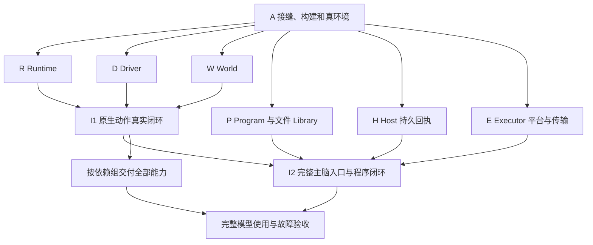

# Minecraft World 总开发规划

日期：2026-10-19（2026-10-24 校正现状与剩余总纲）。状态：施工规划；A/I1 已实现并真服 PASS，**K1 能力面（9 查询 + 8 动作）已收口并真服 PASS**，其余模块与工作包待施工，剩余排期见 §10。执行者同时阅读 [开发规范](development-guide.md)；行为以 [概要](design.md)、[公开合同](public-api.md) 及所属模块为准。

目标：完成当前设计的 **16 个查询、35 个动作**，以及支持它们的运行、控制、观察、文件复用与恢复机制。先后交付的是正式实现的一部分，最终范围不因首个可用流程缩减。

## 1. 顺序裁决与当前起点

采用 **先落实最小共享接缝，再按依赖并行实现，持续接通真实流程**。各模块不用等整个项目完成才集成；共享语义也不能留到模块写完后再补。

2026-10-19 的仓库事实：

| 事实 | 对开发的影响 |
|---|---|
| Minecraft 已落地 I1 子集，并在 2026-10-23 收口 K1（contracts/driver/world/runtime/capabilities + events 历史 + 构建接线），真服 I1/K1 均 PASS，tests/mc 12 files / 78 tests | 新工作按现行设计增量推进；K2 起从 K1 的真实能力面继续生长 |
| MC 重置/新设计仍有未提交工作树修改，仓库还有无关改动 | 并行 worktree 必须从整合后的共同基线开始；直接从当前 HEAD 分支会带回旧实现 |
| Host/World 已有生命周期、工具、输入和图片接缝，但没有 HostDeliveryPort/receipt | Host 回执是独立基础任务；普通 emitEvent 不能代替持久接收 |
| 会话实现仍是 v3，src/ 内无 receipt 类型；[回执规范](../runtime/delivery-receipts.md) 已裁决升级 v4、拒绝旧格式 | H 仍完全未实现：与回执同批修改写入、恢复及相关消费者；不迁移真实会话 |
| 类型检查与构建均已包含 Minecraft（tsconfig.build 纳入 `.uina/worlds/minecraft`，Worker 路径按产物/源码双态解析） | 构建接线已完成；后续 Worker/WASM 资产按首次采用时补复制规则 |
| package.json 固定 mineflayer=4.39.0、vec3=0.1.7；QuickJS 尚未列入依赖 | 记录实际采用的依赖组合；研究快照不自动等于安装版本 |
| 当前 Node=v24.13.1、pnpm=11.5.2；Java 命令可见，真服验收未开始 | 固定实际服务端/Java/协议组合后直接接真服；不宣称已有验收环境 |

不先建设完整通用平台。源码归属、控制交接、记录身份和加载方式先确定；具体算法、文件拆分与高级玩法细节在相应工作包中落定。

## 2. 开发依赖



这张图表示集成依赖，模块间调用方向仍遵守 [contracts](contracts.md#2-依赖与唯一写入者)。R/D/W 可以基于已落源码的接缝并行写；它们在 I1 使用真实实现相接，不互相导入内部对象。I1 所需的少量 K1 查询/动作随基础模块一起接通；后续能力不必全部等待 I2，但最终模型验收必须经过 I2。

关键的循环在装配处解开：Driver 消费 Runtime 的核验/效果接收函数，Runtime 消费 Driver/World 端口；Library 消费 compile-only/源码读取函数，Program 消费只读文件材料。组合根注入这些窄依赖，不建立相互持有完整服务的对象环。

## 3. 源码落点与公共接缝

这是归属地图，不要求先创建空目录、空类或占位实现。首次实现相应职责时再建文件。

| 位置 | 内容 |
|---|---|
| `.uina/worlds/minecraft/contracts/` | 跨模块纯值、错误和端口；按所有者拆分，只导出真正共享的合同 |
| `driver/` | 客户端、版本 Adapter、Operation、窗口/输入/反馈；唯一接触 Bot 的位置 |
| `world/` | 查询、Watch、证据/领域存储与 SQLite Worker |
| `runtime/` | 受理、Call/BodyScope、效果、结算与 runtime.db |
| `program/` | QuickJS worker、guest 桥、执行材料与快照 |
| `library/` | 文件、元数据、CRUD 和扫描检索材料 |
| `capabilities/` | 按导航、物品、制作、战斗、施工、交互组织的普通函数、声明与领域类型 |
| `executor/` | Uina façade、请求账本、私有 IPC、进程/Job 监管、结果交付 |
| `companion/` | 执行侧静态装配及真正的 Node 入口；不重复业务规则 |
| `worlddef/` | WorldDef、生命周期和 BodyEndpoint 适配 |
| `tests/`、`scripts/` | 仓库现有测试与工程命令；只加入实际需要的验证入口 |

World 加载使用现有 `package.json#uina.entry` 明确指向 `worlddef/index.ts`；构建产物对应已编译入口。不要在根目录再放一个承担第二套装配的 index。具体执行路径从实际加载模块解析，不能按“哪个文件存在就启动哪个”选择可能过期的产物。

共享合同只落一份源码：

| 接缝 | 定义来源 | 直接消费者 |
|---|---|---|
| 值、CallFailure、EffectReceipt、声明 | public-api §2–§3 | 所有模块 |
| BodyOps/PlayerPort、ControlOwner、核验与 sink | public-api §4、§7.1 | Driver、Runtime、原生能力 |
| ClientFactsPort、当前值、证据通知 | public-api §4.1 | Driver、World、反馈 |
| WorldReadPort/WorldPort、观察与保留 | public-api §5 | World、Runtime、查询与领域模块 |
| ProgramPort/ProgramHostApi | Program §7 | Program、Runtime、装配 |
| LibraryPort、文件元数据 | Library §5.4 | Library、目录、Program 装配 |
| ExecutorClient、记录/受理/交付 | public-api §7 | Executor、执行侧分派 |
| HostDeliveryPort/receipt | Host 回执规范 | Host/Session/Subject、World、Executor |

A 只落实首批模块实际交换的合同。领域输入类型放所属能力模块；高级玩法缺少的 Driver 专用操作到该工作包再定义。接口变化由提供方和直接消费者同批修改，不在各自目录复制类型。

## 4. 基础设施工作包

每个工作包按“接缝 → 正式实现 → 最短真实接通 → 所需故障检查”推进，不等待整个模块全部完成才集成。下面的完成条件是交付要求，不是要求逐条建立独立测试工程。

### A · 落实接缝、构建与真实开发环境

依赖：无。后续各包从它取得共享源码和工程约定。

- [ ] 确认共同开发基线包含本轮 MC 重置和现行设计，再开并行分支/worktree；只整合明确范围，不夹带无关修改。本规划修订本身不执行提交。
- [ ] 把首批公共合同落成严格 TypeScript，消除文档示意中影响实现的歧义；登记各端口唯一负责者。
- [ ] 将新 MC 源码加入现有类型/边界检查和构建。源码启动用现有 TS 执行方式，产物启动用实际 JS；Worker、WASM、native 资产路径与复制规则在首次采用时一起接好。
- [ ] 固定一个可复位的真实 Java 服务端、Java/协议版本、offline 连接和显式世界绑定；单独保存开发 World/Session 数据。Microsoft 验收使用真实授权账号，不能用 offline 结果代替。
- [ ] 复用现有测试/脚本工具，提供一个薄的开发运行入口：装配正式模块、调用相同端口、输出真实结果。只有服务端启动、场景准备和结果检查属于验证代码。

完成：新模块确实进入工程检查；开发入口没有旁路 Bot/权限；环境与复现命令可直接交给另一个开发者。真服暂不可用时，只阻塞对应游戏验证，不阻塞真实 SQLite/QuickJS/OS 等工作。

### R · Runtime 受理、调用、身体与记录

依赖：A；消费 Driver/World/Program 接缝。主要位置：`runtime/`、其公开合同及真实 SQLite 存储路径。

- [ ] 先实现原生调用所需的受理、请求幂等/撤销、CallFrame、BodyScope、停止与 Effect 记录；使用真正的 SQLite 和提交屏障。
- [ ] 与 D/W 接通 I1，验证停止后旧写源不能再动作；不为先跑通而安装宽松 verifier 或空 sink。
- [ ] 随 P 接入程序调用、段内源码固定、决策传播与显式 continue；落实部分进度、未知效果及记录读取。
- [ ] 完成安全介入归属、恢复与交付记录。只恢复事实和基础设施，不自动恢复游戏行动。

完成：同键不重复执行、未知受理可撤销；独立/嵌套/委托调用共用控制规则；关闭先退役控制再持久结算，故障范围能从记录解释。

### D · Driver 正式客户端与控制适配

依赖：A；实际动作验证需要 R 的核验/记录接线。主要位置：`driver/`。

- [ ] 先接真实 offline 服务端，完成协议就绪、身份/化身、当前 self/inventory/block/entity 与事件捕获；同时完成 Microsoft 的独立配置/认证路径。
- [ ] 实现 Body/Operation、实际写入检查和 close 屏障；先覆盖走路、挖放、装备、交互、chat，再随第一批容器/制作能力完成窗口与反馈。
- [ ] 成熟插件按实际写源和停机路径接入；优先保留算法，只补确有需要的受控适配。不要复制原始 Bot 到能力层，也不要重写整套客户端。
- [ ] 对停止、迟到异步写入、断线及持续输入过期做针对性验证。真实协议可验证的效果直接看服务端，不用假 Bot 返回 ok 代替。

完成：可在 I1 真正操作玩家，停止/资格撤销可证明；未确认的挖放、窗口和发送不会被报告成已完成。名单、地图、牌面及专用窗口随对应能力补齐，不提前铺空方法。

### W · World 当前查询、历史与 Watch

依赖：A；消费 D 的事实协议，查询装配与能力作者协作。主要位置：`world/`。

- [ ] 先用真实 Driver 提供当前读数与来源/覆盖/unknown；纯当前查询不等待历史数据库。
- [ ] 用真实 SQLite Worker 实现选定证据接收、提交屏障、事件历史/分页/缺口、观察 cursor、Watch 和记录保留。
- [ ] 接通 events 增量读取及 read→watch 竞争；没有新的领域消费者时，不预建混合查询对齐或动态查询规划器。
- [ ] 领域记录、地形切片、名单/地图查询按后续工作包扩充，沿同一查询声明和存储路径。

完成：I1 有实际可读事实；历史与当前分清，重连/重启/缺口有可解释结果；没有第二份可写游戏世界或后台探箱流程。

### P · Program 与普通文件 Library

依赖：A；语言/文件部分可独立开发，运行集成消费 R/W/D。主要位置：`program/`、`library/`。

- [ ] 直接采用真实 QuickJS、共享 worker/独立 guest；落实 compile-only、JSON/错误桥、公平 pump、取消和局部退役，不先做 Node vm 或另一个临时引擎。
- [ ] 实现 Library 的程序文件/坏头诊断/CRUD；通过函数注入复用同引擎编译和精确 Call 源码，不各维护一份解析器。
- [ ] 接通 read/call/body/window/feedback、waitUntil、决策与 checkpoint；并发等待时新的合法调用仍可运行。
- [ ] 跑通临时代码→纠错→save from→普通文件局部修改→新段复用。在途段保持原字节；参数/schema 校验不认证游戏目标。

完成：I2 使用正式引擎和文件库；同步死循环可退役，其他正常调用不被普通取消误杀；保存能明确追到实际 Call。

### H · 通用 Host 持久回执

依赖：A，独立于 Minecraft 玩法。主要位置：现有 `src/core/types.ts`、`src/tools/{broker,pipeline}.ts`、`src/agent/{loop,queue}.ts`、`src/session/`、`src/host/` 及 World 上下文；只改实际调用链需要的文件。

- [ ] 按 [既定合同](../runtime/delivery-receipts.md) 同批加入 receipt、inspect/retire、输入/工具接收与恢复索引，并完成 journal v4。
- [ ] 同步当前运行文档及会话版本说明；切换验收使用新 v4 会话，保留原日志，不为验证自动重写真实数据。
- [ ] 从现有 mailbox、执行交换和 canonical history 得出状态；不建回执数据库或 Minecraft 专属 Core 分支。
- [ ] 用真实 SessionStore 与 Subject/Host 路径检查 append 前后中断、同 key 去重、retire 竞争、回调丢失及回溯。测试只控制有关输入/故障，不要求调用模型证明磁盘提交。

完成：committed 必须来自真实持久会话；pending/unavailable/absent 各有事实依据；通知重试不触发游戏动作。旧 v3 明确拒绝，真实会话不自动改写。

### E · Executor 进程、IPC 与接入

依赖：A；平台和传输可并行，最终装配需要 R/W/P/H。主要位置：`executor/`、Windows native 绑定、`companion/`、`worlddef/`。

- [ ] 先做正式 Windows Job 绑定、创建/归属/退出核验与私有 IPC；用真实 Node 进程树验证父强杀、双 Job 竞争/嵌套及宿主已在 Job 中的情况。
- [ ] 同时实现固定方法的 IPC 分派、启动身份、Owner 门/心跳、域外退役和关闭。Job 合同若在真实环境不成立，就先修订这一处设计，不保留两套候选架构。
- [ ] 接入六个 façade、请求凭证、短结果/后台交付、记录读出、图片附件和 BodyEndpoint。小游戏动作算法不进入 Executor。
- [ ] 接 H 的真实回执后才开放完整 World；缺依赖明确失败，不把“已交给 emitEvent”标成 committed。

完成：I2 中进程生命周期、短/长任务、停止、交付、产物加载均走正式路径；退出不明不接管，recover 不重放游戏动作。

## 5. 两次集成节点

| 节点 | 需要的实现 | 实际跑什么 | 通过后继续什么 |
|---|---|---|---|
| I1 原生真实闭环 | R 的原生调用/记录/控制，D 的真实连接/基本操作，W 的当前读/最小证据存储 | `read self → submit chat/goto → read result → stop → disconnect`；专用开发入口调用正式模块 | 一边完善剩余基础设施，一边实现基础物品/制作；不能把开发入口发布成缺少监管的 World |
| I2 完整主脑闭环 | R/D/W/P/H/E 的上述合同与正式 WorldDef 装配 | `describe → observe → run 原生/JS → accepted → 完成回执 → record → save from → 修改复用`；加入 stop、决定交还与重启 | 从同一套实现继续能力交付，不替换运行时或重写接入层 |

I1 不需要等待 Host 回执或全部 Program 完成；它验证实际游戏、权限与记录链。I2 才认证主脑接入、独立长任务、通知和复用。两者复用正式代码，差别是已接通的职责范围。

## 6. 全量能力按依赖组推进

P0/P1/P2 保留为能力范围和优先级标签；以下是施工顺序。K1/K2 优先补齐生存与生产，K6 可在条件具备时提前并行；K7/K8 不必等待大型施工完成。

<!-- capability-coverage:start -->
| 组 | 查询 | 动作 | 直接依赖与交付 |
|---|---|---|---|
| K1 基础观察与操作（**2026-10-23 实现，真服 PASS**） | self inventory block blocks entities item recipe world events | goto mine place equip eat use chat attack | I1 起步，I2 验收。完成真实身体/知识/消息、空手装备、牌面编辑与效果确认；先打通这些操作再包装长任务 |
| K2 物品与生产 | container.last | container transfer drop pickup collect craft smelt | K1、窗口/拾取/配方、历史。完成木→石→铁、两向转移、熔炼等待与部分剩余；自身持有和祖先委托分别正确 |
| K3 导航与战斗 | route.plan | follow flee surface explore fight | K1/K2 的移动、挖掘、装备/输入和实体事实。复用路径/攻击算法，补实体探索、战斗结束原因与默认 safety |
| K4 空间与记录 | region places | remember forget tunnel excavate | K1 挖放、W 切片/领域记录、K3 导航。交付真实未知覆盖、维度地点、连通矿道和清空目标 |
| K5 施工与蓝图 | build.plan | build | K2 供料、K4 地形/挖放、Library 蓝图文件。完成 Raw→Target→Project、同目标计划/执行、差异修复与局部改图 |
| K6 玩家与地图 | players map | — | 当前名单/实体、地图包、现有图片附件；可与 K2–K5 并行。名单不造实体，地图不造中心或像素 |
| K7 专用工作站 | — | brew enchant anvil grindstone trade | K2 窗口、装备/物品与材料；经验/效果当前值。按真实协议补选择、改名等受控操作及完成口径 |
| K8 旅行与活动 | — | transit ride lead fish sleep | K1/K3 的移动/交互/反馈；transit 另需挖放建门。完成骑乘/牵引/捕鱼/睡眠与跨维度，明确等待和身体归属 |
<!-- capability-coverage:end -->

合计 16 查询 + 35 动作，无重名别名或遗漏。没有列在单独动作中的 safety、精细 body/window/反馈、Library 和程序组合也属于基础设施与各组完成条件。

### 领域详细设计的时机

每组动工时，用真实版本和任务补一段足够实现的设计：输入/默认值、成功条件、已有算法复用、失败/部分量、停止与未知，随后直接实现。只把稳定的公共变化写回所属合同；不为每条能力生成一份长设计文档。

下列细节必须在各自代码前解决，不在总规划里凭空定算法：

- K2：概率掉落与拾取归因、配方选择、燃料/容器占用和关窗复查。
- K3：危险判断、停止位置、远程攻击与 stance 的实测阈值。
- K4/K5：支撑/顺序、材料替换、Block State、蓝图解释版本及现场冲突。
- K7：专用窗口输入、交易/附魔随机性和真实费用核验。
- K8：载具控制与上下车、牵引释放、捕鱼回执、睡眠取消、传送门/维度切换。

若缺底层合同，先修改提供方与消费者再接入；某项依赖不支持不能把 unavailable 当最终完成。记录阻塞并继续独立工作，不能默默缩小 51 项目标。

## 7. 并行协作与集成责任

| 可以并行 | 开始前要有 | 不共享修改的边界 |
|---|---|---|
| R、D、W | 核验/sink、事实与 World 接缝已落源码 | 各自状态、数据库和目录由本包负责；接口变化指定一个整合者 |
| P/Library 与 R/D/W | ProgramHostApi、源码加载/编译回调 | 一个负责人协调共享文件材料；不要让两方各自写解析器 |
| H 与全部 MC 内部实现 | Host 回执合同与 v4 范围已明确 | H 独占这一批 Core/Host/Session 变更，MC 作者只消费端口 |
| E 平台/传输与 R/D/P | 启动/IPC/退役形状 | E 拥有进程和 channel，业务模块不再各做监管者 |
| K6、K7、K8 与 K4/K5 | 所需底层操作已可用 | 分模块/能力家族认领，避免多人同时改公共窗口或 Driver Adapter |

个人项目默认同时推进 2–3 个低冲突工作包即可；这是建议，不是运行时并发限制。独立 worktree 可以减少文件竞争，但不能消除接口协调。总规划不要求使用特定代理工具或固定人数。

每次认领只写清：目标、依赖、拥有的文件/接口、这一批的真实验收。共享合同先由一个负责人落地；提供方变化通知直接消费者，同批更新，不各自加兼容别名。整合者尽早接 I1/I2，不等各包宣布“全完成”再拼。

## 8. 最终完成与验证安排

验证方式按 [开发规范 §5](development-guide.md#5-验证选择) 选择。同一个事实只在合适边界验证一次；正常路径不要求 fake、集成和真服各复制一套。

- 真实生存/生产：无硬编码资源坐标完成工具升级、熔炼并行和容器整理，缺料只补剩余。
- 真实探索/战斗/施工：找动物、避险/撤退、矿道、蓝图建造/改图修复；只按实测目标完成量结算。
- 真实交互/高级玩法：消息与系统反馈、牌面/地图、名单、全部 K7/K8 能力；按当前支持版本完整兑现合同。
- 模型使用：仅凭短指南和按需发现完成试做、纠错、保存、换场景复用与局部迭代；记录真正造成学习负担的字段并修订。
- 工程交付：源码与构建产物各跑实际入口；完成关键停止/断线/强杀/未知效果/通知恢复检查。更早已通过且未受后续改动影响的结果直接引用，不全部重跑。

最终报告列出 51 项的实际状态、支持版本、对应证据与未解决问题。设计写完、schema 齐全、能连接或假依赖返回成功都不算完整交付。

## 9. 第一批可直接开工的任务

1. A：落实首批合同、类型/构建接线及专用真实服务端环境。
2. 从 R/D/W 选可控的并行范围，尽快完成 I1；E 的 Windows 监管同时推进，尽早发现真正会改变架构的 OS 限制。
3. P 与 H 独立推进；H 一次处理 v4，不临时承诺旧日志也有回执保证。
4. I1 后立即完善 K1/K2，同时接齐 I2；其余组按 §6 的真实依赖进入就绪队列。

首批不创建通用插件平台、FakeBot 产品分支、自动学习系统或完整测试调度框架。后续出现真实复用收益时，按开发规范把它提炼出来。

## 10. 剩余施工总纲（2026-10-24 裁决）

§1–§9 给依赖与工作包，本节给**实际开工顺序**。原 K1–K8 是能力分组，不是施工批次；把分组当批次会让一批里混进量级完全不同的风险（例如 K2 同时含"无窗口的组合动作"与"整块窗口协议"）。

### 10.1 排期原则

1. **按"能玩到哪一步"排批，不按文档章节排。** 每批的交付物必须是一条能在真服跑完的玩家任务，而不是一组同层 API。
2. **一批一个真服场景。** 沿用 `dev/k1.ts` 的形状：op 指令只摆地形/物品/状态，被测行为全走能力面，逐步记录、末行汇总 `K2 PASS/FAIL (m/n)`。场景脚本就是这一批的验收单。
3. **风险集中在单点时先做 Driver。** 窗口（driver §7.6）与高频反馈（driver §8）是能力层无法替代的两块底层；它们没落地前，`container/transfer/craft/smelt` 与 `fight` 都不开工——否则会在能力层反复绕底层缺口。
4. **不为排期做占位实现。** 缺就报缺：`openContainer`/`feedback`/`verifier`/`program` 入口当前都如实抛错，保持这个习惯。
5. **每个里程碑后校准一次顺序。** 能力驱动排期只能保证"该有的都有"，保证不了"模型真的用得顺"；用真实游玩暴露的卡点重排后续批次。

### 10.2 批次

| 批 | 交付物 | 前置 | 真服判据 |
|---|---|---|---|
| **批 0（已完成 2026-10-23）** | K1：9 查询 + 8 动作；I1 入口；K1 场景 19 步 | A/R/D/W 的 I1 子集 | I1 PASS；K1 19/19 PASS |
| **批 1（已完成 2026-10-24）** · 采集闭环（K2a） | `collect@1`、`pickup@1`、`drop@1`；Driver 新增 `BodyOps.toss` 与掉落物实体身份（`ClientEntityValue.item`）；顺带修 `searchBlocks` 的段排序/上限裁剪与 `goto` 已在邻域内的空转 | K1、知识里的方块来源 | K2 11/11 PASS（真服）：徒手挖 3 土/2 原木、带镐挖 2 圆石、无来源/没工具/数量不足/背包满四条失败面、丢 2 捡回 |
| **批 2（已完成 2026-10-24）** · 窗口与容器 | `WindowSession`（服务端快照/单包点击确认/关闭、槽位布局、revision 与期望槽位/光标校验）；`container@1`、`transfer@1`、`container.last@1`（复用 World 窗口证据历史） | 批 1 | 源码与构建产物均通过 13 项真服场景；两向精确数量、源不足与目标满的部分量、nearest/all、实体容器、关窗复查、过期 revision `CONFLICT`、历史关闭重建可读 |
| 批 3 · 生产链（K2b 后半） | `craft@1`（3×3 布局、配方选择、材料替换）、`smelt@1`（燃料、占用、等待）；熔炼数据表落地 | 批 2 | **[capabilities §10](modules/capabilities.md#10-实施顺序与验收) 阶段 A 第 1 条整链**：空手→8 原木→工作台→木镐→3 圆石→石镐→3 粗铁→熔炼→铁镐，全程不写坐标 |
| 批 4 · 校准点（非代码） | 用现有 17+N 项能力让模型真玩 30–60 分钟，记录"想做什么→卡在哪" | 批 3 | 产出 K3–K8 的重排表；判定是否插入被低估的瓶颈（如"看不见远处"→ region/explore） |
| 批 5 · 移动与探索（K3a） | `follow@1`、`flee@1`、`surface@1`、`explore@1`、`route.plan@1` | 批 1 | 跟随不撞墙、脱离到安全距离、洞穴回地面、按 block/entity/biome 找到目标 |
| 批 6 · 反馈与战斗（K3b） | driver §8 反馈帧/反馈循环/背压；`fight@1` | 批 5 | [capabilities §10](modules/capabilities.md#10-实施顺序与验收) 阶段 A 第 3、5 条：三只僵尸下打完或撤退且血量 ≥6；三档 stance 差异可复现 |
| 批 7 · 空间与记录（K4） | `tunnel@1`、`excavate@1` → `region@1` → `places@1`、`remember@1`、`forget@1` | 批 5 | 挖到指定层不卡；洞穴回地面；region 的已加载/未加载分界如实；重启后 `places` 仍在 |
| 批 8 · 蓝图与施工（K5） | Library 最小件（只读蓝图文件）→ `build.plan@1`、`build@1` | 批 3、批 7 | [capabilities §10](modules/capabilities.md#10-实施顺序与验收) 阶段 B 第 6、12 条：5×5 木屋缺料→补料→全放；改蓝图后 build 报 `CONFLICT` |
| 批 9 · 程序与库（P） | Library 三类文件 CRUD；Program（QuickJS worker、guest 桥、执行材料）→ I2 入口 | 批 8 | 模型仅凭短指南完成试做、纠错、保存、换场景复用 |
| 批 10 · 回执（H） | 会话 v4 + receipt 类型 + 持久接收查询 + 尝试退役 | 批 9 | 强杀后回执可查、不重放未确认交付 |
| 批 11 · 执行平台（E） | 六入口、私有 IPC、Windows Job 监管、结果交付 | 批 10 | 源码与构建产物各跑真实入口；停止/断线/强杀/未知效果检查 |
| 批 12 · 余下玩法 | K6（`players/map`）、K7（`brew/enchant/anvil/grindstone/trade`）、K8（`transit/ride/lead/fish/sleep`） | 批 4 的评估结果 | 按 §8 的对应条目逐项；不再按组整批做，按评估出来的价值排序 |

批 9–11 的内部顺序可以调整（P/H/E 三者只通过窄接缝相接），但**三者都在批 8 之后**：没有真实能力面可跑的程序与执行平台只是空转。

### 10.3 与原 K 顺序的差异（显式登记）

| 偏差 | 原规划 | 现判据 |
|---|---|---|
| K2 拆成批 1/批 2/批 3 | K2 一组含 `container.last/container/transfer/drop/pickup/collect/craft/smelt` | 三类风险不同量级：组合动作（无新底层）、窗口协议（整块 Driver）、生产逻辑（依赖窗口+数据） |
| `drop` 需要 Driver 支持 | 视作纯能力层组合 | 当前 Driver 明确"不丢物品"（`equip(null)` 只是腾空手），必须新增 `BodyOps.toss` |
| K3 拆成批 5/批 6 | `follow/flee/surface/explore/fight` 并列 | `fight` 依赖反馈时序与 stance 实测阈值，其余四项只依赖 goto/mine/entities |
| K4 内部改序 | `region/places` 在前，`tunnel/excavate` 在后 | `tunnel/excavate` 是 mine+goto 的组合（成本低、收益直接）；`region` 要新切片、`places` 要新领域存储 |
| 插入批 4 校准点 | 无 | 纯能力驱动排期无法发现"用得顺不顺"，而这是本项目真正的目标 |
| K5 与 Library 同批（只读部分） | K5 在 Library 之后 | build 只需要"读蓝图文件"，不需要 Library 的完整 CRUD 与检索 |

### 10.4 待裁决（附我的建议）

| 决策 | 建议 | 理由 |
|---|---|---|
| 熔炼数据从哪来 | 自建最小表（燃料 + 约 40 条配方，标注来源与版本），不做全量 | minecraft-data 3.117.0 对 1.21.11 无熔炼/交易数据（`item.sourcesComplete=false` 就是它的投影）；等上游等于无限期推迟 P0 链条 |
| H 是否插队 | 不插队，保持批 10 | H 的收益是"崩溃后不丢交付"；当前瓶颈是能力面不足。此时做 H 只扩大跨模块改造半径（会话 v3→v4） |
| K6（`players/map`） | 暂缓 | 单人开发环境没有第二名玩家；地图要做像素级核验，成本高、当前收益窄 |
| Program guest 边界 | 按 program.md 的 QuickJS | `node:vm` 不是安全边界，拿它换开发速度会把限制写进架构 |
| 是否为 P1/P2 能力扩面 | 先跑批 4 再决定 | 17 项能力能否撑起一次像样的自主游玩，是比"总数 51"更硬的指标 |

### 10.5 每批固定门禁与产物

门禁（顺序固定，全绿才推进）：

```text
biome format . → node scripts/check-boundaries.mjs → tsc --noEmit
→ vitest run --pool=vmThreads <显式 mc 文件列表> → tsc -p tsconfig.build.json → 真服场景
```

产物三件套：源码（含失败面）+ 该批真服场景脚本 + 文档（`changelog.md` 条目、`README.md` 状态表、`dev/MC-WORLD.md` 的经验笔记）。未跑真服的批次一律标注"单测覆盖，未真服"，不提前写 PASS。

### 10.6 技术债（按触发条件，不提前还）

| 债 | 触发条件 | 处理位置 |
|---|---|---|
| world 无保留/清理，历史只增 | I2 长跑或库文件膨胀 | 批 9 之前补 retention/清理 |
| 事件 Watch 不可用（`ObservationCursor` 不覆盖 events） | 需要"等一条聊天/等受击"的程序 | 批 9（Program 的 waitUntil 依赖它） |
| `ItemSelector.components` 未实现匹配 | 需要按组件区分物品（带魔咒/自定义名） | 批 3 或 K7 |
| `world@1.difficulty` 常为 null | 需要按难度决策（饥饿伤害、刷怪） | 读并缓存 `game_state_change`，不做也能活 |
| `vitest run tests/mc` 连带匹配 `tests/mcp-*` | 每次跑全量都会看到 2 例无关失败 | 顺手改成显式文件列表或调整测试目录 |
| 拾取半径内才报 `dropped` | 需要"挖完就拿到"的强保证 | 由调用方 `goto` 到被挖格上方；已在 K1 场景固化为写法 |
