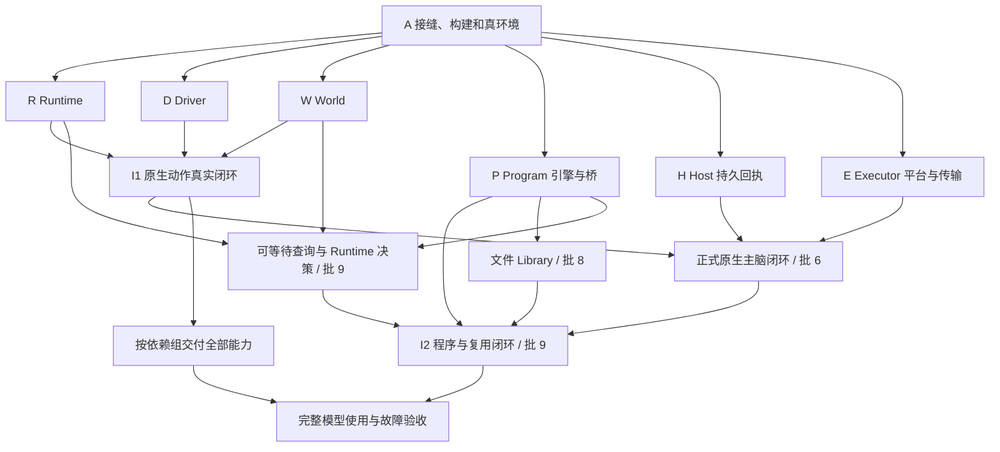

# Minecraft World 总开发规划

日期：2026-10-25（批11 更新 2026-10-30）。状态：施工规划；批 0–3 的 I1/K1、采集、窗口容器和生产链已实现，后续按本次重排执行。当前能力目录实际为 **12 查询 + 18 动作（30/51）**，以 `buildCapabilities()` 的装配结果为准；此前“12 查询 + 15 动作”的计数错误在本轮更正。批 4–5 底座与批 6 正式原生入口已实现并完成首次真实模型校准；最终审查/验收见 [实施记录](archive/native-host-implementation.md)，批 7 程序执行闭环已实现，详见 [实施记录](archive/program-implementation.md)；批 8 Library 文件与发现复用已实现，见 [实施记录](archive/library-implementation.md)；批 9A 可等待查询与程序等待已实现，见 [实施记录](archive/wait-implementation.md)；**批 9B 的决策、调度、现有历史引用清理与 I2 已实现**，实现与验收边界见 [实施记录](archive/decision-implementation.md)。完整程序闭环 I2 在批 9，详见 §10。

K1/采集/容器落在 `d77d20f`，Driver 修复在 `6157834`；本次核查的分支为 `codex/phase0-baseline`，批 6 开工 HEAD 为 `9ac9cbd`，已包含批 4–5；批 6 在 `58f1ba0` 接通正式原生模型入口，见 [实施记录](archive/native-host-implementation.md)，不迁移真实数据。执行者同时阅读 [开发规范](development-guide.md)；行为以 [概要](design.md)、[公开合同](public-api.md) 及所属模块为准。

目标：完成当前设计的 **16 个查询、35 个动作**，以及支持它们的运行、控制、观察、文件复用与恢复机制。先后交付的是正式实现的一部分，最终范围不因首个可用流程缩减。

## 1. 顺序裁决与当前起点

采用 **先落实最小共享接缝，再按依赖并行实现，持续接通真实流程**。各模块不用等整个项目完成才集成；共享语义也不能留到模块写完后再补。

2026-10-25 开工起点核查（保留各批历史证据；批 6 的本轮验证另见实施记录）：

| 事实 | 对开发的影响 |
|---|---|
| contracts/driver/world/runtime/capabilities 已接通 I1、K1 和完整 K2 能力组；目录实测 10 查询 + 15 动作；当前核查中 MC 28 文件/236 项、`pnpm typecheck` 通过 | 现有采集、存取、合成和熔炼已是模型与程序的真实消费者，不再以“能力不足”为由推迟接入 |
| 真服已有 Paper 1.21.11 build132、Java 21、offline UinaDev 的专项验收记录；生产链源码/产物 K3 各 14/14、修复场景各 7/7，见生产链实施记录 | 这些证明对应场景；未证明模型自主游玩、Microsoft 认证或其他版本 |
| `9ac9cbd` 已包含生产链修复、Executor 平台与批 5 Host 回执 | 保留开工基线归属；正式 MC 消费与通知由本批 6 接通 |
| Host/World 已有生命周期、工具、输入、图片与 HostDeliveryPort/receipt 接缝 | 批 6 直接消费正式端口，不以 emitEvent 返回代替持久接收 |
| 会话为 journal v4；带标记 canonical 记录增量形成提交索引，旧 v3 明确拒绝 | H 已实现，保留真实旧日志；验收使用独立会话，见批 5 实施记录 |
| 类型检查与构建均已包含 Minecraft（tsconfig.build 纳入 `.uina/worlds/minecraft`，Worker 路径按产物/源码双态解析） | 构建接线已完成；后续 Worker/WASM 资产按首次采用时补复制规则 |
| package.json 固定 mineflayer=4.39.0、mineflayer-pathfinder=2.4.5、vec3=0.1.7；QuickJS 0.32.0 已在批 7 锁定（含窄宿主补丁） | 批 7 已接引擎、WASM/Worker 与正式桥；证据和限制见 archive/program-implementation.md |
| Executor/Companion 已受管装配原生执行侧，批 6 WorldDef/工具/可靠通知已接通，Program 执行与最小只读材料已接入，Library 管理/发现已在批 8 接通 | 批 6 接正式原生主脑入口；批 7–9 接程序与复用，不造临时模型桥 |
| Runtime 已受理原生 call / Program + enqueue；feedback、通用领域记录、事件 Watch 和效果核验器尚缺 | 按下文实际消费者补齐；原生集成不冒充完整 Runtime、Driver 或 I2 |

不先建设完整通用平台。源码归属、控制交接、记录身份和加载方式先确定；具体算法、文件拆分与高级玩法细节在相应工作包中落定。

## 2. 开发依赖

这张图表示集成依赖，模块间调用方向仍遵守 [contracts](contracts.md#2-依赖与唯一写入者)。H、E 平台与 Program 引擎可独立实现；正式原生主脑闭环必须接齐 H/E，I2 再接程序、文件复用及等待/决策。玩法实现按直接依赖进入就绪队列，不要求全部等待 I2；玩法的模型验收使用已经交付的正式入口。蓝图施工不是 P/H/E 的前置。

关键的循环在装配处解开：Driver 消费 Runtime 的核验/效果接收函数，Runtime 消费 Driver/World 端口；Library 消费 compile-only/源码读取函数，Program 消费只读文件材料。组合根注入这些窄依赖，不建立相互持有完整服务的对象环。

## 3. 源码落点与公共接缝

这是归属地图，不要求先创建空目录、空类或占位实现。首次实现相应职责时再建文件。

| 位置 | 内容 |
|---|---|
| `.uina/worlds/minecraft/contracts/` | 跨模块纯值、错误和端口；按所有者拆分，只导出真正共享的合同 |
| `driver/` | 客户端、版本 Adapter、Operation、窗口/输入/反馈；唯一接触 Bot 的位置 |
| `world/` | 查询、Watch、证据/领域存储与 SQLite Worker |
| `runtime/` | 受理、Call/BodyScope、效果、结算与 runtime.db |
| `program/` | QuickJS worker、guest 桥、执行材料与快照 |
| `library/` | 文件、元数据、CRUD 和扫描检索材料 |
| `capabilities/` | 按导航、物品、制作、战斗、施工、交互组织的普通函数、声明与领域类型 |
| `executor/` | Uina façade、请求账本、私有 IPC、进程/Job 监管、结果交付 |
| `companion/` | 执行侧静态装配及真正的 Node 入口；不重复业务规则 |
| `worlddef/` | WorldDef、生命周期和 BodyEndpoint 适配 |
| `tests/`、`scripts/` | 仓库现有测试与工程命令；只加入实际需要的验证入口 |

World 加载使用现有 `package.json#uina.entry` 明确指向 `worlddef/index.ts`；构建产物对应已编译入口。不要在根目录再放一个承担第二套装配的 index。具体执行路径从实际加载模块解析，不能按“哪个文件存在就启动哪个”选择可能过期的产物。

共享合同只落一份源码：

| 接缝 | 定义来源 | 直接消费者 |
|---|---|---|
| 值、CallFailure、EffectReceipt、声明 | public-api §2–§3 | 所有模块 |
| BodyOps/PlayerPort、ControlOwner、核验与 sink | public-api §4、§7.1 | Driver、Runtime、原生能力 |
| ClientFactsPort、当前值、证据通知 | public-api §4.1 | Driver、World、反馈 |
| WorldReadPort/WorldPort、观察与保留 | public-api §5 | World、Runtime、查询与领域模块 |
| ProgramPort/ProgramHostApi | Program §7 | Program、Runtime、装配 |
| LibraryPort、文件元数据 | Library §5.4 | Library、目录、Program 装配 |
| ExecutorClient、记录/受理/交付 | public-api §7 | Executor、执行侧分派 |
| HostDeliveryPort/receipt | Host 回执规范 | Host/Session/Subject、World、Executor |

A 只落实首批模块实际交换的合同。领域输入类型放所属能力模块；高级玩法缺少的 Driver 专用操作到该工作包再定义。接口变化由提供方和直接消费者同批修改，不在各自目录复制类型。

## 4. 基础设施工作包

每个工作包按“接缝 → 正式实现 → 最短真实接通 → 所需故障检查”推进，不等待整个模块全部完成才集成。下面的完成条件是交付要求，不是要求逐条建立独立测试工程。

### A · 落实接缝、构建与真实开发环境

依赖：无。后续各包从它取得共享源码和工程约定。

现状：首批合同、工程接线、offline 真服环境和薄开发入口已落地；新执行域的资源接线随所属批次完成。工作树整合与以后版本/认证验收分别记录。

- [ ] 确认共同开发基线包含本轮 MC 重置和现行设计，再开并行分支/worktree；只整合明确范围，不夹带无关修改。本规划修订本身不执行提交。
- [x] 把首批公共合同落成严格 TypeScript，消除文档示意中影响实现的歧义；登记各端口唯一负责者。
- [x] 将现有 MC 源码及两个 SQLite Worker 加入类型/边界检查和构建；源码/产物入口均有专项运行记录。新的 Worker、WASM、native 资产在首次采用时一起接好。
- [x] 固定 Paper 1.21.11 build132、Java 21、offline 连接和显式开发绑定；验收使用独立数据。Microsoft 认证仍待其专项，不由 offline 结果代替。
- [x] 提供薄开发入口，装配正式模块、调用相同端口、输出真实结果；仅场景准备与断言属于验证代码。

完成：新模块确实进入工程检查；开发入口没有旁路 Bot/权限；环境与复现命令可直接交给另一个开发者。真服暂不可用时，只阻塞对应游戏验证，不阻塞真实 SQLite/QuickJS/OS 等工作。

### R · Runtime 受理、调用、身体与记录

依赖：A；消费 Driver/World/Program 接缝。主要位置：`runtime/`、其公开合同及真实 SQLite 存储路径。

- [x] 实现原生调用所需的受理、请求幂等/撤销、CallFrame、BodyScope、停止与 Effect 记录；使用真正的 SQLite 和提交屏障。
- [x] 与 D/W 接通 I1，并完成停止/资格与效果结算的专项检查；没有安装宽松 verifier 或空 sink。
- [x] 随 P 接入程序调用、段内源码固定、决策传播与显式 continue；落实部分进度、未知效果及记录读取。
- [ ] 完成安全介入归属、恢复与交付记录。只恢复事实和基础设施，不自动恢复游戏行动。

完成：同键不重复执行、未知受理可撤销；独立/嵌套/委托调用共用控制规则；关闭先退役控制再持久结算，故障范围能从记录解释。

### D · Driver 正式客户端与控制适配

依赖：A；实际动作验证需要 R 的核验/记录接线。主要位置：`driver/`。

- [ ] 先接真实 offline 服务端，完成协议就绪、身份/化身、当前 self/inventory/block/entity 与事件捕获；同时完成 Microsoft 的独立配置/认证路径。
- [ ] 实现 Body/Operation、实际写入检查和 close 屏障；先覆盖走路、挖放、装备、交互、chat，再随第一批容器/制作能力完成窗口与反馈。
- [ ] 成熟插件按实际写源和停机路径接入；优先保留算法，只补确有需要的受控适配。不要复制原始 Bot 到能力层，也不要重写整套客户端。
- [ ] 对停止、迟到异步写入、断线及持续输入过期做针对性验证。真实协议可验证的效果直接看服务端，不用假 Bot 返回 ok 代替。

完成：可在 I1 真正操作玩家，停止/资格撤销可证明；未确认的挖放、窗口和发送不会被报告成已完成。名单、地图、牌面及专用窗口随对应能力补齐，不提前铺空方法。

### W · World 当前查询、历史与 Watch

依赖：A；消费 D 的事实协议，查询装配与能力作者协作。主要位置：`world/`。

- [ ] 先用真实 Driver 提供当前读数与来源/覆盖/unknown；纯当前查询不等待历史数据库。
- [ ] 用真实 SQLite Worker 实现选定证据接收、提交屏障、事件历史/分页/缺口、观察 cursor、Watch 和记录保留。
- [ ] 接通 events 增量读取及 read→watch 竞争；没有新的领域消费者时，不预建混合查询对齐或动态查询规划器。
- [ ] 领域记录、地形切片、名单/地图查询按后续工作包扩充，沿同一查询声明和存储路径。

完成：I1 有实际可读事实；历史与当前分清，重连/重启/缺口有可解释结果；没有第二份可写游戏世界或后台探箱流程。

### P · Program 与普通文件 Library

依赖：A；语言/文件部分可独立开发，运行集成消费 R/W/D。主要位置：`program/`、`library/`。

- [ ] 直接采用真实 QuickJS、共享 worker/独立 guest；落实 compile-only、JSON/错误桥、公平 pump、取消和局部退役，不先做 Node vm 或另一个临时引擎。
- [x] 实现 Library 的程序文件/坏头诊断/CRUD；通过函数注入复用同引擎编译和精确 Call 源码，不各维护一份解析器。
- [ ] 接通 read/call/body/window/feedback、waitUntil、决策与 checkpoint；并发等待时新的合法调用仍可运行。
- [ ] 跑通临时代码→纠错→save from→普通文件局部修改→新段复用。在途段保持原字节；参数/schema 校验不认证游戏目标。

完成：I2 使用正式引擎和文件库；同步死循环可退役，其他正常调用不被普通取消误杀；保存能明确追到实际 Call。

### H · 通用 Host 持久回执（批 5 已实现）

依赖：A，独立于 Minecraft 玩法。主要位置：现有 `src/core/types.ts`、`src/tools/{broker,pipeline}.ts`、`src/agent/{loop,queue}.ts`、`src/session/`、`src/host/` 及 World 上下文；只改实际调用链需要的文件。

- [x] 按 [既定合同](../runtime/delivery-receipts.md) 同批加入 receipt、inspect/retire、输入/工具接收与恢复索引，并完成 journal v4。
- [x] 同步当前运行文档及会话版本说明；切换验收使用新 v4 会话，保留原日志，不为验证自动重写真实数据。
- [x] 从现有 mailbox、执行交换和 canonical history 得出状态；不建回执数据库或 Minecraft 专属 Core 分支。
- [x] 用真实 SessionStore 与 Subject/Host 路径检查 append 前后中断、同 key 去重、retire 竞争、回调丢失及回溯。测试只控制有关输入/故障，不要求调用模型证明磁盘提交。

完成：committed 必须来自真实持久会话；pending/unavailable/absent 各有事实依据；通知重试不触发游戏动作。旧 v3 明确拒绝，真实会话不自动改写。

### E · Executor 进程、IPC 与接入

依赖：A；平台和传输可并行，最终装配需要 R/W/P/H。主要位置：`executor/`、Windows native 绑定、`companion/`、`worlddef/`。

- [ ] 先做正式 Windows Job 绑定、创建/归属/退出核验与私有 IPC；用真实 Node 进程树验证父强杀、双 Job 竞争/嵌套及宿主已在 Job 中的情况。
- [ ] 同时实现固定方法的 IPC 分派、启动身份、Owner 门/心跳、域外退役和关闭。Job 合同若在真实环境不成立，就先修订这一处设计，不保留两套候选架构。
- [ ] 接入六个 façade、请求凭证、短结果/后台交付、记录读出、图片附件和 BodyEndpoint。小游戏动作算法不进入 Executor。
- [ ] 接 H 的真实回执后开放批 6 的正式原生 World；Program/Library 等按 [Executor 分阶段交付](modules/executor.md#31-配置与入口) 的明确范围接入。可靠通知与监管不能降级为临时路径。

完成：I2 中进程生命周期、短/长任务、停止、交付、产物加载均走正式路径；退出不明不接管，recover 不重放游戏动作。

## 5. 集成节点与校准

| 节点 | 需要的实现 | 实际跑什么 | 通过后继续什么 |
|---|---|---|---|
| I1 原生真实闭环 | R 的原生调用/记录/控制，D 的真实连接/基本操作，W 的当前读/最小证据存储 | `read self → submit chat/goto → read result → stop → disconnect`；专用开发入口调用正式模块 | 一边完善剩余基础设施，一边实现基础物品/制作；不能把开发入口发布成缺少监管的 World |
| 正式原生主脑闭环（批 6） | 现有 R/D/W/K1/K2 + H + E、Companion、WorldDef | 真模型经 `describe → observe → run 原生 → 直返/后台完成回执 → record/stop` 使用现有 25 项能力；源码/产物都走正式入口 | 首次受控模型校准；按记录修接入与能力，不宣称已支持 JS、保存或完整 I2 |
| I2 完整主脑闭环 | R/D/W/P/H/E 的上述合同与正式 WorldDef 装配 | `describe → observe → run 原生/JS → accepted → 完成回执 → record → save from → 修改复用`；加入 stop、决定交还与重启 | 从同一套实现继续能力交付，不替换运行时或重写接入层 |

I1 验证实际游戏、权限与记录链；批 6 验证正式原生接入、独立长任务和可靠通知；I2 在批 9 验证程序、复用、等待与决策。I2 仍不表示 51 项玩法、高频反馈或所有认证/版本已交付。三者使用同一条正式装配路径。

批 6 首次校准与批 9 程序复用校准分别进行。先以可重复的真实生产任务检查发现、参数理解、失败补料与停止，再安排 30–60 分钟自主任务观察；时长是观察窗口，不能代替任务结果。记录目标、所用调用、卡点、模型往返/耗时、错误与恢复，把已复现瓶颈排在下一工作包。校准调整优先级，不删除完整设计范围。

## 6. 全量能力按依赖组推进

P0/P1/P2 和 K1–K8 是能力范围与优先级标签；实际施工顺序见 §10。K1/K2 已实现，其余按真实消费者与直接依赖选择，K6–K8 不要求等待大型施工。

<!-- capability-coverage:start -->
| 组 | 查询 | 动作 | 直接依赖与交付 |
|---|---|---|---|
| K1 基础观察与操作（**2026-10-23 实现，真服 PASS**） | self inventory block blocks entities item recipe world events | goto mine place equip eat use chat attack | I1 起步，I2 验收。完成真实身体/知识/消息、空手装备、牌面编辑与效果确认；先打通这些操作再包装长任务 |
| K2 物品与生产 | container.last | container transfer drop pickup collect craft smelt | K1、窗口/拾取/配方、历史。完成木→石→铁、两向转移、熔炼等待与部分剩余；自身持有和祖先委托分别正确 |
| K3 导航与战斗 | route.plan（**2026-10-30 实现**） | follow flee surface explore（**2026-10-30 实现**） fight | K1/K2 的移动、挖掘、装备/输入和实体事实。复用路径/攻击算法，补实体探索、战斗结束原因与默认 safety |
| K4 空间与记录 | places（**2026-10-30 实现**） | remember forget（**2026-10-30 实现**） tunnel excavate | 地点只依赖 W 领域记录和当前位置，可先做；地形切片及空间作业各自消费 K1 挖放与必要导航，不等待整组 K3 |
| K5 施工与蓝图 | build.plan | build | K2 供料、K4 地形/挖放、Library 蓝图文件。完成 Raw→Target→Project、同目标计划/执行、差异修复与局部改图 |
| K6 玩家与地图 | players map | — | 当前名单/实体、地图包、现有图片附件；可与 K2–K5 并行。名单不造实体，地图不造中心或像素 |
| K7 专用工作站 | — | brew enchant anvil grindstone trade | K2 窗口、装备/物品与材料；经验/效果当前值。按真实协议补选择、改名等受控操作及完成口径 |
| K8 旅行与活动 | — | transit ride lead fish sleep | K1/K3 的移动/交互/反馈；transit 另需挖放建门。完成骑乘/牵引/捕鱼/睡眠与跨维度，明确等待和身体归属 |
<!-- capability-coverage:end -->

合计 16 查询 + 35 动作，无重名别名或遗漏。没有列在单独动作中的 safety、精细 body/window/反馈、Library 和程序组合也属于基础设施与各组完成条件。

### 领域详细设计的时机

每组动工时，用真实版本和任务补一段足够实现的设计：输入/默认值、成功条件、已有算法复用、失败/部分量、停止与未知，随后直接实现。只把稳定的公共变化写回所属合同；不为每条能力生成一份长设计文档。

下列细节必须在各自代码前解决，不在总规划里凭空定算法：

- K2：概率掉落与拾取归因、配方选择、燃料/容器占用和关窗复查。
- K3：危险判断、停止位置、远程攻击与 stance 的实测阈值。
- K4/K5：支撑/顺序、材料替换、Block State、蓝图解释版本及现场冲突。
- K7：专用窗口输入、交易/附魔随机性和真实费用核验。
- K8：载具控制与上下车、牵引释放、捕鱼回执、睡眠取消、传送门/维度切换。

若缺底层合同，先修改提供方与消费者再接入；某项依赖不支持不能把 unavailable 当最终完成。记录阻塞并继续独立工作，不能默默缩小 51 项目标。

## 7. 并行协作与集成责任

| 可以并行 | 开始前要有 | 不共享修改的边界 |
|---|---|---|
| R、D、W | 核验/sink、事实与 World 接缝已落源码 | 各自状态、数据库和目录由本包负责；接口变化指定一个整合者 |
| P/Library 与 R/D/W | ProgramHostApi、源码加载/编译回调 | 一个负责人协调共享文件材料；不要让两方各自写解析器 |
| H 与全部 MC 内部实现 | Host 回执合同与 v4 范围已明确 | H 独占这一批 Core/Host/Session 变更，MC 作者只消费端口 |
| E 平台/传输与 R/D/P | 启动/IPC/退役形状 | E 拥有进程和 channel，业务模块不再各做监管者 |
| K6、K7、K8 与 K4/K5 | 所需底层操作已可用 | 分模块/能力家族认领，避免多人同时改公共窗口或 Driver Adapter |

个人项目默认同时推进 2–3 个低冲突工作包即可；这是建议，不是运行时并发限制。独立 worktree 可以减少文件竞争，但不能消除接口协调。总规划不要求使用特定代理工具或固定人数。

每次认领只写清：目标、依赖、拥有的文件/接口、这一批的真实验收。共享合同先由一个负责人落地；提供方变化通知直接消费者，同批更新，不各自加兼容别名。整合者尽早接 I1/I2，不等各包宣布“全完成”再拼。

## 8. 最终完成与验证安排

验证方式按 [开发规范 §5](development-guide.md#5-验证选择) 选择。同一个事实只在合适边界验证一次；正常路径不要求 fake、集成和真服各复制一套。

- 真实生存/生产：无硬编码资源坐标完成工具升级、熔炼并行和容器整理，缺料只补剩余。
- 真实探索/战斗/施工：找动物、避险/撤退、矿道、蓝图建造/改图修复；只按实测目标完成量结算。
- 真实交互/高级玩法：消息与系统反馈、牌面/地图、名单、全部 K7/K8 能力；按当前支持版本完整兑现合同。
- 模型使用：仅凭短指南和按需发现完成试做、纠错、保存、换场景复用与局部迭代；记录真正造成学习负担的字段并修订。
- 工程交付：源码与构建产物各跑实际入口；完成关键停止/断线/强杀/未知效果/通知恢复检查。更早已通过且未受后续改动影响的结果直接引用，不全部重跑。

最终报告列出 51 项的实际状态、支持版本、对应证据与未解决问题。设计写完、schema 齐全、能连接或假依赖返回成功都不算完整交付。

## 9. 现在可直接开工的任务

1. 批 4–6 已沿正式受管入口接通原生能力、Host 回执、WorldDef 和首次模型校准；本批证据与最终收口见 [实施记录](archive/native-host-implementation.md)。
2. 批 7 Program 与批 8 Library 文件/发现已接通：同一 QuickJS、精确快照、文件管理和程序复用沿正式工具、IPC 与生命周期运行。
3. **下一工作包为移动鲁棒性与完整战斗**（follow/flee/surface、fight）：批11已接领域记录（G1 关闭）、地点（places/remember/forget）与路径探索（route.plan/explore），能力面 **30/51**；位置记录与找资源/返回基地已可用，见 dev/MC-WORLD.md 批11 节。
4. 不迁移真实旧日志或数据库，不新建通用插件平台、FakeBot 产品分支或临时模型桥。

## 10. 剩余施工总纲（2026-10-25 重排）

本节是当前施工顺序的唯一来源，替换 2026-10-24 的剩余排期；模块正文继续拥有行为合同。已完成批 0–3 不重新编号，历史场景 `dev/k3.ts` 仍指生产链，不等于能力组 K3。

### 10.1 排期依据

1. **先接真实消费者。** 现有 25 项能力已经覆盖采集与生产，足以支撑正式原生主脑和普通 JS；P/H/E 不依赖矿道、战斗或蓝图完成。
2. **先验证会改变装配的风险。** E 的 Windows 所有权与域外退役、H 的持久回执、P 的真实引擎分别验证；不把三者留到玩法末尾一次拼接，也不先造通用框架。
3. **分阶段交付同一条正式路径。** 原生接入先交付，程序与文件随后接入；缺少 H/OS 监管不开放正式 World。未交付的程序/库/反馈操作明确不可用，不能以空结果或临时桥代替。
4. **实现就绪与集成完成分开。** H、E 平台、P 引擎可独立施工；集成点必须等直接依赖。默认单线顺序是批 4→5→6→7→8→9，已有独立实现可提前合入，不要求并行代理或固定人数。
5. **验收跟随责任边界。** 游戏协议看真服，回执看真实 Host/Session，进程看真实 OS，引擎看真实 QuickJS；模型体验通过正式入口验证。校准后按收益重排玩法，不缩减 51 项终态范围。

已完成的批次与对应历史证据：

| 批 | 已交付范围 | 已有证据 |
|---|---|---|
| 0 | K1：9 查询 + 8 动作，I1 原生闭环 | I1、K1 19/19 的真服记录 |
| 1 | collect/pickup/drop，受控 toss 与掉落物身份 | 采集场景 11/11 真服记录 |
| 2 | WindowSession、container/transfer/container.last、容器观察历史 | 源码/产物容器场景各 13 项通过的记录 |
| 3 | craft/smelt、工作台/熔炉窗口、配方图案与熔炼表；后续生产链修复 | 最终源码/产物 K3 各 14/14、production-repair 各 7/7；详见实施记录 |

### 10.2 正式接入与程序闭环（批 4–9）

每批开始时按开发规范写清行为、依赖、归属与验收；不在总纲预写尚未核实的函数实现。下面给出可独立审阅的交付边界。

| 批 | 交付物与归属 | 直接前置 | 完成判据 |
|---|---|---|---|
| **4 · Executor 平台底座（已实现）** | `executor/`、`companion/` 及 Windows x64 native：两个命名 Job、受管 bootstrap、启动身份、固定 IPC、Owner 门/心跳、关闭与退役；同步修正 Runtime 持久受理 | 已有 A/I1；Executor 平台合同 | 实际结果见 [实施记录](archive/executor-platform-implementation.md)：真实 OS/Node、SQLite/Worker 和源码/产物受管入口；此批不宣称模型工具已可用，Windows 10 与 ARM 未验收 |
| **5 · H 通用持久回执（已实现）** | 按既定规范同批完成 Host/Subject/Tool/Session receipt、inspect/retire、恢复索引与 journal v4；扩展上下文提供同一端口 | 既有 Host/Session；独立于批 4、Program 与玩法 | 临时 v4 会话走真实 Host/Subject/SessionStore：append 前后中断、同键去重、retire 竞争、回调丢失与回溯均有事实依据；旧 v3 明确拒绝，真实日志不迁移 |
| **6 · 正式原生主脑闭环与首次校准（已实现）** | `worlddef/`、`companion/`、`executor/` 与必要 Runtime 交付接缝：配置/绑定、目录发现、查询、原生 run/chat、请求查证/停止/记录、短结果/后台可靠通知、BodyEndpoint；先支持已验收的 offline 1.21.11 范围 | 批 4 + 批 5 + 现有 R/D/W/25 项能力 | 源码/产物各经真实 WorldTool/Host 路径运行；工具取消只结束等待、显式 stop 才停止 Run，停用/急停撤销写源；完成通知由真实 Host receipt 确认，恢复不重放动作。随后真模型仅凭短指南完成发现、采集生产、缺料纠错与停止，记录首次校准 |
| **7 · Program 执行闭环（已实现）** | `program/`、Program 合同、Runtime 程序入口与正式 IPC 分派：真实 QuickJS/Worker、compile-only、JSON/错误桥、公平 pump、局部取消/退役、容量与段内源码固定；先接 read/call/progress/sleep/withBody 及已有精细 body/window 操作 | 已有 R/D/W；引擎可提前独立施工；模型验收需批 6 | 真实引擎验证同步/微任务死循环、等待者并存、晚消息与局部取消；普通 JS 经正式入口组合现有能力，保存确切执行源码，能解释父/子 Call 和部分/未知效果。未接等待、决策、反馈的 API 不宣称可用 |
| **8 · Library 文件与发现复用（已实现）** | `library/` 及发现装配：程序/经验/蓝图文件的命名、头/metadata、CRUD 与扫描；程序 compile-only 和 save from 复用批 7 的编译/精确源码接缝。蓝图解释和现场 Project 随施工包实现 | 批 7 的编译与执行材料；文件部分可独立实现 | 真实临时文件验证坏头、并发修改和来源追溯；模型完成试做→纠错→save from→局部改文件→新段复用。在途段仍用原字节；经验判断不冒充事实 |
| **9A · 可等待查询与程序等待（已实现）** | 当前查询的确切版本、events 合法增量等待、SQLite 提交版本与库身份、Program waitUntil、world_change 投影及停止清理；历史库 v2 | 批 6–8 | 实际范围、源码/产物真服与模型证据见 [实施记录](archive/wait-implementation.md)；不计作完整 I2 |
| **9B · 决策、调度与 I2 收口（已实现）** | decide/checkpoint、continue、决策传播与消费；replace_pending/preempt_current；World 保留/引用保护与历史清理；相关停止/交付竞争 | 批 6–8 + 9A；对应 World/Runtime/Program 合同 | 决定交还后只由显式 continue 开新段，重复/过时决策拒绝；关闭重开只恢复事实；引用与清理不制造悬空。经正式模型入口完成完整 I2 |

批 6 是同一正式 World 的阶段性交付，具体可用范围与状态口径见 [Executor §3.1](modules/executor.md#31-配置与入口)。已声明应装配的模块或资产缺失仍启动失败，不能把损坏部署当成尚未交付。批 9 的 I2 不等待蓝图、完整战斗或全部活动，但仍须兑现所用 API 的正式合同；高频反馈与高级能力继续按下节补齐。

### 10.3 玩法就绪队列（默认优先级，可据校准调整）

以下不是“前一行全部完成才能开始下一行”的串行表。**批11已接地点记录与路径探索（places/remember/forget/route.plan/explore，G1 关闭）；接下来先做移动鲁棒性与完整战斗（follow/flee/surface、fight），随后空间作业和施工**；其他项有真实消费者且直接依赖齐全即可提前。每行是一项能力或紧密共享同一机制的工作包，K 标签仅指原能力组。

| 工作包 | 交付范围 | 直接依赖与边界 | 验收任务 |
|---|---|---|---|
| 地点记录（K4） | places、remember、forget | World 领域记录、世界/revision/维度分区和当前位置；不等 region、矿道或完整 K3 | 记住基地，关闭重开后读取和使用；同名覆盖/删除只作用于对应世界记录 |
| 路径与探索（K3） | route.plan、explore | 已有寻路与当前 block/entities/world 事实；plan/执行复用目标语义，覆盖未知不算目标不存在 | 无硬编码资源坐标找到方块/动物/群系；耗尽预算保留真实结果；结合地点返回基地 |
| 跟随与逃离（K3） | follow、flee | 已有导航、实体引用/失效和控制归属；共享实际重规划/停止机制，不复制另一套身体仲裁 | 目标移动时跟随绕障；失去跟踪不冒认到达；逃离达到声明距离 |
| 洞穴/水下脱困（K3） | surface | 导航、受控挖掘/游动与可站立/露天判据；单独解决竖向运动风险，不当成普通 goto 包装 | 从洞穴和水下分别回到满足判据的位置；不可达/超时与部分动作如实 |
| 高频反馈与默认自保（批10已接通，见 archive/feedback-implementation.md） | Driver feedback/loop/背压，Program 控制桥，Runtime safety 介入和效果归属 | 同一 ClientFactsPort、控制资格与停止合同；默认自保是明确交付项，主脑可按玩法调整 | 测完整 sample→guest→apply 时延和过期输入撤销；移动/挖掘等动作被介入后进度、控制与未知效果保留，禁止旧写源复活 |
| 完整战斗（K3） | fight | 反馈与自保、跟随/逃离、装备与攻击；cautious 使用的 surface 路径就绪 | 真服三僵尸打完或撤退、血量≥6，三档 stance 可复现；目标失踪不算击杀 |
| 地形切片（K4） | region | Driver 实际已加载区块、World 当前/历史来源与编码；不依赖 fight | 解码与真实区域一致；未加载/历史格明确标注；大小上限与切片提示符合合同 |
| 空间作业（K4） | tunnel、excavate | 必要导航、挖掘/支撑与目标差异核验，region 可供现场读取；不依赖完整战斗 | 阶梯矿道连通可走、清空目标计数正确，落沙/液体/冲突、缺工具与取消保留进度 |
| 蓝图与施工（K5） | Library 的 Raw→Target→Project、build.plan、build | 文件库、region/现场差异、挖放与材料；复用空间作业的共同差异逻辑，不为它们另造玩法 Runtime | 5×5 木屋缺料→补料→完成；含门/火把与 preserve/unknown；plan 后改图产生 CONFLICT，修复只做真实差异 |
| 玩家名单（K6） | players | Driver 实际公告名单和跟踪实体分别投影；可独立提前 | 玩家离开跟踪后名单仍可保留，tracked=null；离线 UUID 不认证正版 |
| 地图（K6） | map、正式 observe 图片附件 | 真实地图包/局部像素/图标、World 记录与 Executor 图片出口；与 players 分开验收 | 部分矩形其余像素未知，图标更新不抹像素；重连不复活旧覆盖，模型实际收到图片 |
| 睡眠（K8） | sleep | 床/位置交互、游戏时间与中断；无完整战斗前置 | 真服睡到天亮；怪物/占床/非夜间失败和取消如实 |
| 捕鱼（K8） | fish | 受控使用、鱼漂/咬钩反馈与收竿归属 | 真服抛竿→实际捕获入包；超时/取消不留持续使用 |
| 骑乘（K8） | ride | 实体交互、载具输入、上下车与停止 | 实际上车/移动/下车；载具消失、取消和急停有真实结论 |
| 牵引（K8） | lead | 实体/拴绳交互、导航与释放证据 | 牵引、系绳和释放分别核验，不以走到位置代替牵引成功 |
| 酿造（K7） | brew | 酿造台专用窗口、材料/燃料与进度事实 | 实际药水及消耗确认；等待释放自有身体，委托归属保持 |
| 附魔（K7） | enchant | 专用选择协议、经验/青金石与物品组件 | 随机结果按实际组件报告，核验真实费用；未知选择不重复支付 |
| 铁砧（K7） | anvil | 输入/改名/结果窗口、经验和组件 | 合并/改名与费用真实，冲突/取消保留已发生事实 |
| 砂轮（K7） | grindstone | 专用窗口、组件与结果确认 | 实际去附魔/修复结果和消耗；不能套普通容器搬运伪造成功 |
| 交易（K7） | trade | 商人报价、专用选择/确认、材料与费用 | 实际报价/限额/产物/消耗；缺报价数据不猜交易成功 |
| 跨维度旅行（K8） | transit | 导航、必要挖放/建门、维度/化身代次与原控制退役 | 真服建/找/进入门并在目标维度落位；堵门/缺料按阶段报错，不自动恢复旧控制 |

该表覆盖尚缺的 **6 查询 + 20 动作**，与已实现的 10 查询 + 15 动作合计 16 + 35。feedback、自保、程序和文件等基础设施另计，不能由能力数量代替。

### 10.4 本次顺序裁决与取舍

| 裁决 | 依据与影响 |
|---|---|
| 保留已完成批 0–3，重排未施工部分 | 既有采集/窗口/生产拆分有效；历史运行与提交归属保持可追溯，不回头重做已验收事实 |
| E 平台和 H 前移，随后交原生模型入口 | 两者是现行正式接入承诺的实际依赖；会前移跨层工作成本，但能尽早暴露停止、通知和模型调用问题 |
| 原生入口先于完整 Program，Program 不等待玩法扩面 | 先用既有能力校准发现/调用，随后检验 JS 组合与复用；不用一次性交付全部 P/H/E，也不新建临时模型桥 |
| Program 执行、文件复用、等待/决策分批 | 三者可以各自验收；I2 只有全部接齐后才能宣布，其他正常调用不被等待者或普通取消误伤 |
| 地点早于完整空间作业；反馈/自保有独立消费者和验收 | 地点由探索立即使用；默认自保和精细控制不再藏在“fight 完成”或最终验收中 |
| 高级能力按任务收益和直接依赖进入队列 | players 不必等 map，sleep 不必等 transit；表中终态范围全部保留，不设一个不可执行的“余下玩法大批” |
| 算法与版本细节在开工时核实 | 复用现有客户端/寻路与版本适配；QuickJS 仍用正式引擎，不用 node:vm 过渡；已落实的熔炼数据与 mode-0 决策见 §10.7.1 |

### 10.5 验证与产物

遵守开发规范 §5，不再对每种工作统一套用“全 MC 单测→构建→真服”。每批交付正式实现与接线、证明该责任的检查、状态/经验记录；只有游戏批次必须提供相应真服场景。

| 变更责任 | 必要检查边界 |
|---|---|
| E 平台/传输 | 真实 Windows/Node 进程与 IPC 故障；涉及 native/Worker 时源码和产物各跑实际入口 |
| H、Runtime 持久结算 | 真实临时 SessionStore/SQLite 和恢复，按合同安排竞争；跨 Core/Host/Session 时完成受影响全量回归 |
| Program/Library | 真实 QuickJS/Worker、正式桥、临时文件及来源快照；模型复用另经正式主脑入口 |
| Driver/玩法 | 相关确定性回归 + 所支持版本真服；场景准备可用 op，被测行为全部走正式端口，生存目标不靠补料/传送代替 |
| 完整接线/发布 | pnpm typecheck（格式/边界/TS）、相关回归、pnpm build 与真正产物入口；已有未受影响证据直接引用 |
| 文档修订 | 内容/数量/依赖一致、相对链接与 git diff --check；无行为变化不重跑游戏或模型 |

MC 专项回归继续使用 PowerShell 显式文件列表：`$mcTests = @(rg --files tests/mc -g '*.test.ts'); pnpm exec vitest run --pool=vmThreads @mcTests`。Host/扩展加载及全仓门禁使用仓库默认池，不能把 MC 的 vmThreads 约束推广到它们。

未验证的责任按其边界标明“未验证”，不能把一次 mock、本地 Provider 或历史日志改记为当前真服/模型通过。校准后的重排只更新本节与索引，不复制另一份施工表。

### 10.6 剩余合同的收口归属

| 剩余事项 | 何时、由谁补齐 |
|---|---|
| Runtime 交付记录、Owner 门、恢复与独立 Run 生命周期 | 批 4–6 随 E/H 正式接入落实；不得只包装 submit/wait 就称接入完成 |
| replace_pending/preempt_current、decide/continue/checkpoint | 批 9B 由 Runtime/Program/World 各自实现并集成，不把受理/决策状态复制到 Executor |
| World 事件等待、历史保留、Runtime 引用保护 | 可等待查询已在 9A 接齐；持续运行所需清理/精确引用保护由 9B 在 I2 收口，不能永久只增不清 |
| ctx.verify 与后续效果核验 | 首个需要显式复查 unknown 的真实能力工作包落地对应 verifier（默认空间/施工包），同步 Runtime 接缝；最终验收关闭缺口，不先建无人消费的注册框架 |
| feedback、过期输入、默认自保与 safety 记录 | 批10已接通；完整 fight 随后实现。当前含真实 guest 控制桥、控制撤销与 safety 持久记录，见 archive/feedback-implementation.md |
| goto 站姿/空间完成判据 | 路径/脱困工作包落实实际可站立判据，保留现有 GoalNear 的真实节点语义，不用欧氏距离误拒 |
| Microsoft 认证与账号身份核验 | 正式原生入口后可独立开工；有授权账号时验收客户端认证、profile/账号独占，未验收前仅声明 offline 范围。最终完整交付仍须支持两条认证路径 |
| 其他协议版本、窗口与物品组件差异 | 真实接入该版本/工作站时在同一 DriverProtocol 窄口处理；当前只确认 1.21.11，不提前声明兼容 |
| Library 蓝图解释/工程材料、经验条件与证据 | 文件生命周期在批 8；蓝图语义在施工包，经验不认证成事实；完整 Library 验收涵盖三类材料 |
| players/map 图片、工作站/载具专用控制与知识缺口 | 各自工作包随真实消费者接线；不能用普通窗口、名单或静态猜测代替实际协议事实 |

最终按 §8 收口 51 项能力及全部模块合同、认证/支持范围与故障行为。原生接入、I2、单个玩法通过均是局部里程碑，不能代替最终交付。

## 10.7 批 3 前置（2026-10-25 开工时记录，现已补齐）

以下保留批 3 开工时核实的缺口与裁决来源，均已补齐，不是当前待办；初版收口见 §10.7.1，后续生产链修复在既有工作树中另行记录。它说明生产链需要知识与窗口前置，并非纯能力层增量。

| 当时缺口 | 当时源码 | 补齐内容 |
|---|---|---|
| 工作台/炉子窗口 | `driver/window/session.ts` 的 `layout()` 只接受 `minecraft:generic_9x1-6`、`generic_3x3`、`hopper`、`shulker_box`，`crafting`/`furnace` 报 `UNSUPPORTED_WINDOW`；`container@1` 的 `BLOCK_CONTAINERS` 也不含 `crafting_table`/`furnace` | 布局判定、结果槽与输入/燃料槽语义。`WindowSnapshot.properties` 已能收 `set_window_property`（炉子进度可用），不需新采集路径 |
| 配方图案 | `driver/facts/knowledge.ts` 把 `inShape` 拍平成 `ingredients` 计数，`KnowledgeRecipe.station` 只区分 hand/crafting_table | 保留行/列图案（含空格）、同一产物多配方的选择策略、材料替换 |
| 熔炼数据 | 该数据版本无熔炼配方与燃烧刻数（`item.fuel === null`、`sourcesComplete === false`） | 当时建议自建最小表并标注来源与版本，实际落地范围见 §10.7.1 |

顺序：知识层（纯确定性可测）→ Driver 窗口类型 + 一次窄真服探测（手摆 2×2 木板后 mode-0 点结果槽是否被服务端接受、revision 如何变）→ `craft@1` → `smelt@1` → K3 场景。

当时待裁决的是结果槽是否支持 mode-1（shift/quickMove）；已在 §10.7.1 关闭为“不开放 mode-1、逐批摆料取货”，不再作为当前待办。

### 10.7.1 批 3 收口（2026-10-25）

三处前置全部补齐，实际做法与 §10.7 的建议有三处偏离，均在真服验证后确认可行：

| 项 | 实际做法 | 依据 |
|---|---|---|
| 结果槽点击 | **不开 mode-1，也不放宽完成判定**：每批只摆"恰好一批"料，结果槽点击就是"空光标取走产物、结果槽归空"的纯交换，沿用现有 `expectedClick` 推演 | 探针确认 shaped/shapeless 每格恒为 1 件，一批即全部消耗；真服 14/14 通过 |
| 熔炼数据 | 从 `dev-env` 的 paper-1.21.11 jar 抽 73 条 `minecraft:smelting`（`#tag` 展开、带 `cookingtime`）生成 `driver/facts/smelting.ts`；燃料刻数手工最小集（约 30 条）并标注来源 | `minecraft-data` 的 PC 数据确实没有熔炼与燃烧刻数；服务端 jar 是权威版本源。生成脚本 `scripts/extract-mc-smelting.mjs` 需要本地 jar（不入库），生成物入库且头部记录来源 |
| 炉子取产物 | `transfer@1` 只支持 `from`（区域 `result → player`），`to` 显式拒绝并指向 `smelt@1`；自动搜 `nearest` 不含熔炉 | 避免把燃料塞进 input 槽；`wait:false` 的取货路径因此可用 |
| 炉子 revision | `WindowSnapshot.revision` 收窄为"只随槽位/光标推进"，`properties` 不再推进 | 炉子进度每秒数次，否则燃烧期间每次点击都撞 CONFLICT（已有专门测试） |
| 工作台获取 | 附近 8 格先找，没有就用背包里的放到四个水平相邻格并回读确认；**用完不拆走** | 留在地上更接近真实玩法，省掉一次破坏与掉落确认 |

真服还确认了一条与实现假设有关的服务端行为：**炉子里剩下的燃料是正常的**——上一轮的燃烧刻数没用完时，新放入的燃料不会被消耗，因此"炉内清空"只能要求 input/result 为空。

### 10.7.2 生产链审查修复

批 3 后续修复替换了初版的产量净差、长持身体等待和固定64燃料截断：合成/熔炼各自实现，搬运复用实例匹配与跨槽分装，确认时快照直接推进记账。熔炼等待前关闭窗口、释放自有身体，实际开炉复查后取货；累计进度覆盖失败和取消。燃料按实际槽位/刻数预算，自动选择一次固定一种，不建设混合燃料规划。当前验证证据和边界见 [生产链修复实施](archive/production-repair-implementation.md)。
