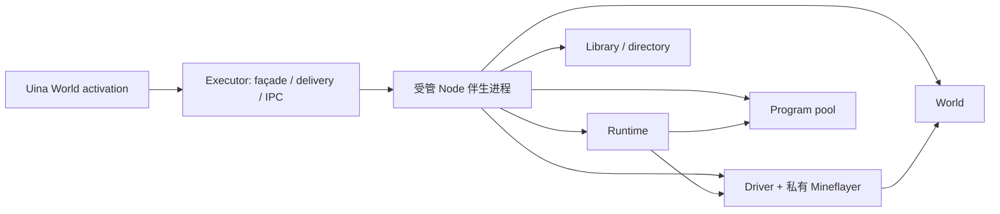

# Executor 详细设计

日期：2026-10-25。状态：终态详细设计，批 4 的平台/传输与受管执行侧已实现；批 6 已接通工具投影、请求凭证、可靠通知及 WorldDef，见 [实施记录](../archive/native-host-implementation.md)。目标部署为本机 Windows 10+，当前真实验收仅 Windows 11 x64。本文拥有 Uina 接入、伴生进程、IPC、工具投影和通知递送；Run、身体调度与结算由 [Runtime](runtime.md) 拥有。运行交换类型见 [public-api §7](../public-api.md)，程序和文件操作分别见 [Program](program.md)、[Library](library.md)。

批 4 状态与实际证据见 [平台实施记录](../archive/executor-platform-implementation.md)。开发入口 `pnpm dev:mc:executor` 直接使用正式受管 bootstrap/IPC；批 6 正式模型工具另由 WorldDef 装配。当前只接受已交付的 offline 配置（支持 binding:null 的显式未绑定分区），Program 执行与批 8 Library 文件/发现已接通；Microsoft、等待/决策续段仍明确不可用。后续按同一装配继续，不另建桥。

## 1. Uina 得到什么

模型只使用 `minecraft({action, params})`。调用、保存和查询不需要知道进程、端口、心跳或请求 ID 的生成方法。

```json
{"action":"describe","params":{"query":"采集原木"}}
```

```json
{"action":"run","params":{"selector":"collect@1","input":{"item":"oak_log","count":8}}}
```

`run`/`chat`/`runs.continue` 只回答**受理**：`accepted` 表示已交给运行时（任务在后台跑，结算由 `minecraft_completion` 通知投递），`not_accepted` 表示没有派发，`unknown` 表示受理结果未知、必须用原 `request` 查证而不是重发。受理回执给 `requestId/run/segment`，不给 phase，也不给完成快照——模型要看当前进度就读状态帧，要结果就等通知，更久的显式等待用 `runs.wait {run,timeoutMs}`。等待工具回复被取消不停止已受理任务。失败和未知回执给出可直接复制的查询，不让模型猜是否应该重新执行。

**批 41 起**：默认 3 秒等待窗与公开 `wait` 参数整体删除。原因是同一个结果曾同时存在两条通道——窗口内完成就把终态当工具结果返回，超时就把 `accepted` 返回、终态再从完成通知来一次；模型无法从返回值判断自己拿到的是终态还是受理态，宿主也无法保证两处措辞一致。删除后工具层只有一个语义，任务快慢只决定通知什么时候到。

**批37 起**：世界状态不再推送。`state.snapshot` 是窄的只读 RPC，一次采样给三段的有界文本（见 [world §9.5](world.md)），由 `WorldDef.requestContext` 在每次模型请求前调用、宿主附在投影尾部；空闲世界零输入。事件只承载"发生了什么"：`minecraft_event` 按种类分流——死亡、断线、玩家私聊、本地安全响应没脱险（`blocked`/`timeout`）走 `urgent`（steer，当前执行前提已失效或有人在等回应），其余走 `queued`（等下一次决策一起处理）。已脱险的安全干预带 `interruptedRun` 上报。**批39 起**终止态的上报判据改看起因而非终态值：世界自己关门（`cancelled`）不上报，连接身份变了导致的失效不上报（`connection`/`death` 事实已经说了同一件事），其余一律上报——包括没有连接事实承担的失效（抢占失败、会话关闭出错、崩溃恢复留下的未结算记录），它们意味着"危险触发过、脱险没跑成"，没有任何别的事实替它说。同一世界的后续输入（外部事件与自身完成）在宿主侧合成一次决策。

```json
{"action":"runs","params":{"op":"request","request":"q17"}}
```

要撤销它可直接使用原引用；不必先等到 run：

```json
{"action":"runs","params":{"op":"stop","request":"q17"}}
```

旧段的固定报告和记录通过同一入口展开：

```json
{"action":"runs","params":{"op":"record","ref":"completion-s1"}}
```

正常使用只需记住：查事实用 observe，找能力用 describe，执行用 run，查进度或停止用 runs，保存用 library，聊天和服务器指令用 chat。进程恢复是故障时按返回的 `nextCall` 操作。

```json
{"action":"chat","params":{"text":"我回来了"}}
```

```json
{"action":"chat","params":{"text":"/list"}}
```

### 1.1 选择与边界

| 问题 | 选择 | 后果 |
|---|---|---|
| 部署 | Uina 管理一个 Node 伴生进程，使用私有 Node IPC | 没有端口发现、独立常驻服务或远程接管 |
| 执行所有权 | 伴生进程内装配 Runtime、Driver、World、Program、Library | Executor 不复制 Run 状态机，不写 `runtime.db` |
| 故障边界 | guest → Program worker → 整个伴生进程，逐层处理 | 单个 guest 的正常取消不升级为进程重启 |
| 平台 | Windows 两个命名 Job 合并目录/账号独占与进程树回收 | 冲突拒绝；不做跨 Uina 自动抢占或第二套资源锁 |
| 重启 | 已证明旧进程树退役后可重建基础设施；恢复动作门需明确确认 | 不恢复旧 JS 栈，不自动重放游戏动作 |
| 接入持久化 | 一个小型 `executor.db`，只存接入身份、请求原件、交付尝试和本地停止意图 | 不成为第二份运行库；执行结论仍向 Runtime 查询 |

终态承诺：World 启用、持久材料可用且 Host/存储最终恢复处理时，仍适用的完成通知至少持久进入会话一次；通知含结论、摘要和读取引用，完整正文仍以 Runtime 记录为准。允许重复，不重跑动作。普通 progress 不主动唤醒。Host 通用回执是完整交付的实现依赖，不以“已交出”替代持久接收。

同进程方案缺少域外终止能力；独立常驻服务多出发现、身份移交和升级生命周期。本设计选择受管子进程。平台依据、当前源码和替代方案见 [研究记录 §9](../archive/research.md#executor-evidence)。

## 2. 工具接口与结果

### 2.1 一层 façade

`WorldDef.name="minecraft"`，`actions` 直接含六项：`observe/describe/run/runs/library/chat`，`executionMode="parallel"`。由现有 `createWorldTool` 生成一层 `{action,params}`；不再登记一个名为 minecraft 的内层 action。并行工具需要的身体顺序由 Runtime 决定。

各 action 的结构 schema 由本节和所属模块生成。`input` 的具体 schema 来自描述，不把整个能力目录复制到工具 schema；执行侧仍校验真实参数。未知字段、互斥字段混用、无效引用和非 JSON 值在执行前明确拒绝。

| action | 参数与分派 | 返回 |
|---|---|---|
| observe | `{selector,input?}`；缺省 input=`{}`，只允许查询目录中的 read 入口 | 原样保留 Observation 的 value、version、范围、来源、时间和 unknown |
| describe | `{query,cursor?}` 检索（空参数或仅 cursor 读取家族目录）；或 `{selector}` 精确能力/程序；或 `{kind,name}` 精确条目，三者互斥 | 同一目录的候选或完整说明，附工具/程序调用形状和声明的示例 |
| run | 下列 Run 参数 → Runtime.submit | 受理、固定结果的展示投影或受理未知 |
| runs | 下列 Runs 参数 → 运行读取、控制或接入恢复 | 对应事实及必要 nextCall；普通查询不消费通知 |
| library | [Library §5](library.md) 的统一请求 | 文件事实、摘要、路径或明确错误；不创建 Run、不自动重试写入；写入派发后回执未知时保留 unknown，给 get 读回而非重试写入 |
| chat | `{text}` → 与 `run({selector:"chat@1",input:{text}})` 相同的受理路径；首字符 `/` 是服务器指令 | 相同受理与展示投影；不申请身体；发送完成不认证指令生效，领域合同见 [chat@1](capabilities.md#chat) |

observe 使用与 `mc.read` 相同的查询分派、参数校验和只读限制，生命周期属于本次查询，不创建持久 Run。不能借 observe 调用 `access=read` 但不属于查询目录的普通程序，也不能暗中移动、开箱。保存程序仍通过 run 调用。

原生能力与查询的作者提供符合 input/output schema 的 examples；接入只包上相应工具/程序调用形式，不自己猜游戏参数。文件条目未声明 examples 时明确说明缺少示例，给出调用形状及已有 schema；不能把猜出的空 input 标为已验证可用。

动作门关闭时，已就绪接入仍允许观察、发现、运行记录读取和 Library 文件操作；run/chat/continue 不能由此绕过门。整个 activation 正在关闭时不再接新工具操作。

```typescript
type MinecraftEntryParams = {input?: JsonValue} & (
  | {selector: Selector; code?: never}
  | {code: string; selector?: never}
);
type MinecraftContinueEntry = MinecraftEntryParams;
type MinecraftRunParams = MinecraftEntryParams & {schedule?: Schedule};
type MinecraftObserveParams = {selector: Selector; input?: JsonValue};
type MinecraftDescribeParams =
  | {query: string; cursor?: string; selector?: never; kind?: never; name?: never}
  | {selector: Selector; query?: never; cursor?: never; kind?: never; name?: never}
  | {kind: DiscoveryKind; name: string; query?: never; cursor?: never; selector?: never};
interface RecoveryExpectation {attachment: Ref; gateRevision: number}
type MinecraftRunsParams =
  | {op: "status"; run?: Ref}
  | {op: "list"; activeOnly?: boolean; cursor?: string}
  | {op: "request" | "retry"; request: Ref}
  | {op: "wait"; run: Ref; afterRevision?: number; timeoutMs?: number}
  | {op: "record"; ref: Ref; format?: RecordFormat}
  | {op: "delivery"; ref?: Ref; retry?: false}
  | {op: "delivery"; ref: Ref; retry: true; expectedAttempt: Ref}
  | {op: "calls"; run: Ref; parent?: Ref; cursor?: string}
  | ({op: "stop"} & StopTarget)
  | {op: "continue"; run: Ref; decision: Ref; entry: MinecraftContinueEntry;
      environment?: "inherit" | "current"}
  | {op: "recover"; expected?: RecoveryExpectation};
```

- run 缺省 schedule={kind:"enqueue"}。selector/code 恰一，input 缺省 {}。selector 含 @ 就是能力引用，否则是合法程序名；不猜测裸名对应原生能力，不保留 name 调用别名。映射为 Entry.call 或 Entry.program.source={name}，不解析源码；continue 的原生引用仍须是指定环境中的确切 ref，裸名按新段程序解析。委托、风险与材料偏好通过具体能力/程序的 input 表达，不增加泛化 policy 字典或策略注册协议。
- status(run) 返回 RunSummary；无 run 时返回 ExecutorStatus、活动引用与 Program 容量。list 缺省只列活动运行；calls 返回 CallSummary，完整输入/输出按 record 展开。
- record({ref,format?}) → RecordReply：不可变 record/completionRef 精确读原件；run/segment/call/effect 身份引用先固定最新已提交 record。前者不随运行推进变化。auto 缺省，合理大小直接返回完整记录；inline 明确读全文，file 明确导出，见 §5.5。
- delivery 查询待交付数、活动尝试、Host 状态/忙碌提示、最后核对时间、错误和恢复 nextCall。retry 必须指定 ref/expectedAttempt；它只对账或退役旧交付再呈现同一报告，不重建进程、不重跑动作，见 §8。
- wait 缺省等待当前 Run 的完成或待决策报告，已是二者之一立即返回 kind=result。显式 afterRevision 则等待一次修订变化：当前 revision 更大即 changed，已 finished 即 result；afterRevision 大于当前值报 REVISION_INVALID。默认模式忽略普通 progress 唤醒，避免模型反复轮询。timeoutMs 缺省无限、0 为立即检查；超时返回 kind=timeout 和同一当前投影，取消只结束查询。读与登记必须复查以避免丢唤醒。
- request({request}) → SubmissionLookup；found 提供原 segment、当前小投影和原 completionRef，历史报告用该 completionRef 读取。cancelled 表示从未受理且已持久撤销；unavailable 保持未知。retry 复用原键和原请求，见 §6.2。
- stop 支持 run 或 request 二选一，模型不生成停止命令 ID。只有 requestId 时也能撤销该意图；停止不关闭其他 Run 的门，见 §6.3。
- recover 不带 expected 只重建/核对；带完整 {attachment,gateRevision} 才显式解除 owner_lost，且本次不能再重建实例。两项缺一拒绝；不能解除 emergency，见 §7.3。
- **机械对账在激活时自动完成**（2026-11-09 起）：`launch` 只有在旧执行树被证明退役后才开始，所以新域 attach 成功即证明旧控制不可能再写世界。此时 `disabled` 与 `owner_lost` 由 Executor 自动解除，`status().recovery` 如实报告 `{clearedGates, blocked}`；`emergency` 永不自动解除，且它关着时 `owner_lost` 一并保持关闭。`runs recover` 仍保留给显式重连与人工干预。

<a id="observation-images"></a>

### 2.1.1 观察图片

map@1 的 JSON 合同与 PNG 缓存由 [能力面](capabilities.md#map) / [World](world.md#map-observation) 拥有。直接 observe(map@1) 且请求 image=true 的工具适配同时返回 JSON 元数据与已有 ToolExecutionResult.images；image=false 只返回元数据；路径字符串本身不是模型可见的图片。图片只能取本次查询产生的 ImageFileRef，核验 realpath 在本 World exports/images 内、长度和摘要后异步读取，填现有 ImageContent 的 MIME/base64/alt。不要把 guest 返回的任意 path 对象当附件授权。

图片读取失败就给 image 未交付的明确原因和原路径，元数据不冒充图片；可用现有 read_image 按路径回看。纯文本模型或只需坐标/标记时显式请求 image=false；能力未知允许沿现有图片规则尝试。Executor 不私自探测、改写 Provider 能力或切换模型；图片请求被现有 Provider 路径拒绝时保留真实错误，可重读无图元数据，不重跑游戏动作。不要为地图另建图片工具、VLM 调用、永久媒体库或一套 IPC 二进制协议。PNG 路径通过现有受信任伴生进程读出，图片字节不经 Program RPC。

mc.read(map@1) 仍只返回 JSON；程序可返回文件引用供主脑后续 observe/read_image，完成记录不会递归把任意 JSON 路径自动展开为图片。

### 2.2 工具 status 与正文

| 接口事实 | ToolExecutionResult.status | 正文必须保留 |
|---|---|---|
| 确定未发送的预取消、准入关闭 | not_started | 未执行原因；若有本地请求凭证则保留它 |
| 参数/来源/合同拒绝 | failed | 稳定错误码、出错字段及修正入口 |
| 已受理，窗口结束 | succeeded | `kind=accepted`、requestId/run/segment、phase；不能写“目标完成” |
| 固定 terminal 报告 | snapshot.outcome | completionRef、完成范围、value/error 或读取入口、progress 完整性、unknownEffects 总数与 record |
| 固定 decision 报告 | succeeded | `kind=result, reportKind=decision`、待处理 decision、reason、checkpoint 或其读取入口；没有最终 outcome |
| 停止意图已持久登记 | succeeded | intent、control、当前 snapshot；`stopping` 不能写成已停止 |
| 接口已发送但受理/写入不明 | unknown | 原 requestId 或文件目标、已知派发范围、真实查询 nextCall |
| 只读查询取消 | cancelled | 仅本次查询已取消；Run 未因此取消 |

停止 intent=unknown 时即使 control=stopped 仍返回 unknown，并同时保留已知控制事实。safeStop 的正常 resolve 要求更强，见 §7.4。查询得到一个 failed Run 时，查询工具可以 succeeded，正文仍保留该 Run 的 failed；run/chat/continue 只回本次受理，不映射执行 outcome。

本表约束 Executor 产生的回执；框架在调用 action 前取消时，仍由框架返回其既有取消回执。chat 的 sent 只表示完整消息/指令已到达声明的协议发送边界，不表示其他玩家已读、服务器允许指令或目标已改变。指令和普通消息都经过同一 Runtime 动作门，不自动重试。

`details` 保存结构化投影、诊断及 inline/record/file/unavailable 的载荷形态；正文保留真实结论、进度完整性、未知效果总数和读取入口。未展开的正文按 record 读取，导出的大载荷交普通文件能力读取，不把文件内容再次全量塞进 details。完整读取失败也不能洗掉已确认的 outcome；见 §5.5。

### 2.3 状态与最小指南

```typescript
interface RetirementRequest {
  launch: Ref; source: "runtime" | "driver" | "program"; subject: Ref | null;
  code: "CONTROL_ISOLATION_FAILED" | "EXECUTION_DOMAIN_UNRETIRED";
  detail: string;
}
interface ExecutionSideStatus {
  launch: Ref; storageId: Ref; observedAt: string;
  authMode: "offline" | "microsoft"; // 配置选择，不代表已认证或已连接
  owner: OwnerState | null;
  connection: "connecting" | "syncing" | "ready" | "disconnected" | "faulted";
  world: WorldAvailabilityValue;
  runtime: "ready" | "unavailable";
  safety: {active: Ref | null; last: Ref | null}; // 介入身份；完整事实仍经 readRecord
  program: ProgramCapacity | null; // 原生阶段尚未装配时为 null；损坏/故障不能伪装成未交付
  faults: {code: string; message: string}[];
  retirement: RetirementRequest | null; // 当前 launch 内一旦请求便锁存
}
interface DeliveryDiagnostics {
  observedAt: string;
  pendingCount: number | null; // 积压总数（Runtime 与分页同条件算），不是本轮检查了几条
  scan: {inspected: number; budget: number; resumable: boolean}; // 本轮检查条数/预算/是否还有续扫位置
  hostBusy: boolean | null;
  activeInputs: {key: Ref; channel: "input"; attempt: Ref; createdAt: string;
    lastCheckedAt: string | null; host: HostDeliveryState}[]; // 本激活派发的与宿主正在处理的，多份互不占位
  item?: {key: Ref; disposition: DeliveryDisposition; eligible: boolean; host: HostDeliveryState};
  error?: {code: string; message: string};
}
interface ExecutorStatus {
  phase: "starting" | "ready" | "unavailable" | "closing" | "closed" | "faulted";
  observedAt: string; actionsAllowed: boolean; reasons: string[];
  side: ExecutionSideStatus | null;
  lastKnown?: ExecutionSideStatus; // 断流时的旧截面，绝不当作当前值
  delivery: DeliveryDiagnostics;
}
```

ready 只表示执行侧已握手、运行库可用；游戏连接、World 历史和动作门分别显示。`actionsAllowed` 是接入门的当前判断，不担保某能力目标可执行。World 历史 opening/unavailable 不遮蔽当前读；Runtime 库不可用则不能受理新 Run。状态推送只刷新有时间的缓存，精确 status 按需读取；断流立即将 side 置空，lastKnown 明确标旧。

Program 未装配的原生阶段，`program=null`，最小指南和发现结果明确实际支持范围；不填写零容量假装已健康，也不暴露未实现 API 的可运行示例。已装配 Program 的故障由实际容量/诊断报告，不降回 null。默认自保尚未交付时也须在指南/诊断说明，`safety.active=null` 本身不能证明自保已启用。

常驻指南从 [Program 附录 A](program.md#附录-a模型的最小指南) 的同一要求生成，只包含当前交付范围；原生阶段保留工具/查询/原生动作、accepted/unknown/停止等说明，程序与库接入后再加入对应说明。动作 schema 提供工具调用形状，能力家族按需 describe。OS、协议字段和存储配置不进入模型指南。

## 3. 装配与启动



Executor 是 Uina 侧实例；companion 是游戏侧组合根，不把它们再命名成两个 Executor。旧占位实现已删除；新代码按各自所有权分开建立 Executor 与 Runtime。

### 3.1 配置与入口

默认无参 World 工厂只定义 actions 和生命周期，不连接、不读宿主状态。onStart 收到 `ServiceCompanionContext` 后创建本次 activation 的 Executor。

- `worldDataDir` 由框架原样注入并规范化；不自行拼另一份 profile 路径。缺少它、emitEvent、onHostEvent、expose 或持久 Host delivery 端口时，启动明确失败。无 UI Host 可使用这些接缝；不依赖终端或 isBusy。
- **批25 双根（v3 §4.1）**：`Executor.open` 接收 `ownershipDir`（所有 Profile 共享的稳定 MC 根，Windows 目录 Job 在此目录上唯一——单活跃写源跨 Profile 成立）、`sessionDataDir`（本 Profile 的 executor.db/runtime.db/runs/exports 根）与 `sharedDataDir`（world-history.db 与 library/ 共享根）。executor.db 与 runtime.db 的身份守卫都在 sessionDataDir 内成立；World 不再启用即开执行域，执行域由 `SessionController` 按会话创建。
- **批25 连接身份**：`worlddef/session-identity.ts` 由 connect 目标 + settings.json 解析出 `ProfileIdentity` 并计算 `profileId`（64 位 hex，进入磁盘路径前必须校验）；`identity.json` 不可变，`observed.json` 记录可验证登录观测。世界包的 `config.json` 不再是启用前置——只在旧布局一次性迁移与 settings 种子时读取；连接统一经 `session.connect`（settings.json 提供 defaultUsername 与服务器别名），初版唯一合同 offline + 1.21.11，version 不开放自由字符串。
- `authMode` 必填，两条连接路径并列支持。offline 的 username 是实际登录名，不要求 Microsoft 登录、缓存或正版 UUID；microsoft 的 username 是上游认证缓存/账号选择标识，accountId 是操作者已确认的游戏 profile UUID。交互认证未完成时如实显示，不宣布可用；凭证/cache 复用客户端认证机制，不写入命令行、工具正文或诊断。
- 源码运行显式用当前 Node + `--import tsx` 启动仓库内 bootstrap；构建运行使用随 World 发布的 bootstrap 与 Worker/QuickJS/native 资源。entry 使用模块相对绝对路径，不继承整份 `process.execArgv`，不拼 shell 命令。两条路径分别验收。
- 本轮固定静态装配能力；改模块代码需关闭旧 activation、证明退役后重启。不增加热加载服务；编辑库文件仍按 Program 的段内快照规则生效。

**分阶段交付（2026-10-25 排期裁决）**：按 [总规划 §10](../development-plan.md#10-剩余施工总纲2026-10-25-重排)，先开放已验收 offline 1.21.11 的正式原生入口，再沿同一装配接入 Program/Library，最后接齐等待/决策与 I2。原生阶段已经包含正式进程监管、Owner 门、请求账本、Runtime 记录、Host 持久回执和 BodyEndpoint，不能用同进程临时工具或普通 emitEvent 替代。

六个 action 的终态形状保留。原生阶段 observe/describe/run 原生/runs 的已实现操作/chat 真实可用；code、程序名、library、continue 等尚未交付的分支明确失败且不执行或写入。发现只列真实条目，状态按 §2.3 表示 Program 未装配；不建立第二套 façade、配置模式或运行状态机。已声明应装配的模块、native/Worker/WASM 资产缺失仍启动失败，不能以阶段性未交付为由回退；后续交付必须同步指南、schema/分派和产物。Microsoft 路径在其真实认证验收前明确不可用，不自动改用 offline；最终仍须完成两种认证。

配置形状如下；连接字段复用 Driver，其他字段由 Executor 拥有。省略的 port=25565，program.workers=1，其余策略初值见 §5、§7、§8；不覆盖 Program 其余已定资源策略。

```typescript
interface MinecraftConnectionOptions {
  host: string; port?: number; username: string; version?: string;
}
type ExecutorConfig = {
  binding: {world: Ref; worldRevision: Ref} | null;
  program?: {workers?: number};
} & (
  | {connection: MinecraftConnectionOptions & {authMode: "offline"}; accountId?: never}
  | {connection: MinecraftConnectionOptions & {authMode: "microsoft"}; accountId: string}
);
```

配置只保留连接、认证模式所需身份、世界绑定和必要执行资源。port 为 1..65535 的整数，workers 为正整数；未知字段拒绝。offline 不接收 accountId；microsoft 必须提供合法 UUID，并在实际认证取得 profile 后、登录游戏服务器前核对。offline 的最终玩家名核对配置 username，microsoft 则核对认证所得 profile 名而不是缓存标识。离线服下发的 UUID 只作服务器内身份，不冒充 Microsoft 认证凭据。时限、消息预算、摘要预算与重试间隔是内部策略，见各节初值；测试/运维通过构造注入同一份策略覆盖并在诊断显示有效值，不写进普通 config.json。实际 stance、retreatHealth 等缺省由能力声明并随 Call 记录。

#### 3.1.1 离线登录与身份作用域

offline 表示不经过 Microsoft 认证的协议登录，仍需连接允许该身份进入的服务器。它不是 disconnected，也不把离线名字变成已认证正版账号。online-mode 服务器拒绝时保留真实原因，不自动改用另一种认证模式；Microsoft 认证失败也不回退 offline。

最小离线配置如下，不需要事先查 UUID：

```json
{"connection":{"host":"127.0.0.1","port":25565,"username":"Uina","authMode":"offline"},"binding":null}
```

本机/局域网、远程离线服都走同一连接路径；本机/LAN 是连接位置，不自动决定认证方式。单人存档须先“对局域网开放”或以服务端启动，并填写实际地址和端口；LAN 端口可变，不能当作固定 25565。没有网络服务端时，不直接打开 saves 文件冒充已进入游戏。额外登录插件有自己的协议/命令，offline 本身不证明其登录已通过，不猜测成功文本或自动发送凭证。

内部 `accountKey` 由可信配置生成，不由模型填写：

| 模式 | Job/BodyEndpoint 使用的身份 | 游戏中核验 |
|---|---|---|
| microsoft | `microsoft + 规范化 accountId`，跨服务器独占该已认证 profile | 认证取得的 profile UUID 与 accountId 一致；记录实际玩家名及服务器身份 |
| offline | `offline + 规范化 host/有效 port + 登录名的小写形式` | 实际发送名字保留原大小写，核对登录结果；服务器 UUID 单独记录 |

accountKey 按无歧义元组编码并取摘要用于 OS 名称。offline 同服同名互斥，不同服务器的同名可独立使用；Microsoft 与 offline 的同名也不混同。端点规范化不猜测 DNS 别名/代理背后是否同服，离线独占只覆盖同一配置端点；访问同一服时统一入口地址。world/worldRevision 仍须可信绑定，不能从登录模式、名字或离线 UUID 推断。

### 3.2 启动顺序

1. 注册生命周期 abort 处理，立刻检查是否已取消；在整个启动中保留检查。先取得 §4 的目录/账号所有权，再打开 executor.db。生成本次 activation/launch，持久登记未关闭启动记录。
2. 启动只会握手的 bootstrap；完成 OS 监管后才允许 init。bootstrap 之前不 import 有启动副作用的业务模块，不创建 Bot、数据库 worker 或 guest。
3. init 含协议版本、launch、worldOwner、activation、expectedStorageId（首次可为 null）、数据根、配置及先前退役事实。子进程验证唯一 init 和身份，先封闭动作准入，核对已有库身份后恢复 Runtime 记录及持久门；expectedStorageId 非空而原库不存在时不得自动新建。不得在恢复前连接可写客户端。
4. 组合根加载能力导出/schema，校验引用唯一性；建立本批已交付的查询/调用目录及 Program/Library。§3.1 的原生阶段可尚未装配后两者，按 §2.3/§3.1 明确状态和拒绝分支；已声明需装配却初始化失败时仍回滚启动。Driver 在尚无有效 owner 和 Body 的状态下创建；注入 Runtime 的调用核验与效果 sink，World 订阅同一个 Driver.facts。循环依赖用未开放的本地接缝完成接线后一次开放，不能用临时“总允许” verifier 过渡。
5. Runtime 库恢复成功后返回 ready，包含 launch/storageId、实际存储设置和 ExecutionSideStatus。World 历史和 Driver 连接可继续 opening/connecting；它们不是 Runtime ready 的假前提。缺失的历史、查询或操作通过各自 availability 表达。
6. Executor 核对 storageId、持久 Host delivery 端口和本地记录，attach 绑定当前 owner/activation，启动心跳、请求/交付对账与通知 drain。正常显式启用可解除 disabled；异常启动留下 owner_lost，待核对后按 §7.3 解除，emergency 始终另行处理。ready 以前收到的游戏写请求拒绝，不排进隐性启动队列。
7. 暴露 BodyEndpoint，向框架完成 onStart。此后六个 action 可调用；连接未 ready 的动作明确失败，查询/文件库按各自可用性服务。

expectedStorageId 首次创建后固定；Runtime metadata 同时固定 worldOwner，握手核对配对。原 Runtime 库丢失、替换或另一个 storageId 不能当作“所有旧请求都不存在”；隔离旧接入记录并报 STORAGE_ID_CHANGED，要求操作者明确选择新数据根或处理旧库，不自动补建并重发。executor.db 丢失而 Runtime 已有另一个 owner 时，报 EXECUTOR_IDENTITY_MISSING，不另造归属掩盖旧记录。复制库用于备份不授予两个执行实例同时写入的权利。

配置/监管/协议/运行库错误使 onStart 回滚并失败，框架不注册工具；诊断由框架启用入口展示，修正后重新启用。已运行期间的故障保留当前 façade，以便 status/recover 查询；不把启动失败伪装成半可用工具。

## 4. 进程所有权与退役

### 4.1 一个平台适配，两个实际约束

Windows 使用 Executor 私有的 Node-API/C++ 绑定，只封装创建/配置 Job、打开并核对精确进程、关联、终止、查询活动数与等待退出。调度和恢复逻辑仍是 TS；阻塞式 OS 等待使用异步工作，不能堵住 Uina 事件循环。不增加常驻 launcher 服务；若复用现成绑定，仍必须满足同一接口和验收，不能仅因包名含 Job 就认定可用。

创建两个**有稳定名字的 Job Object**：目录 Job 与账号 Job。前者防同一数据目录的多个执行写者，后者防不同 Uina profile/目录争用同一 accountKey。两个名字按规范化资源身份派生，使用 Global 命名空间；目录身份取实际目录的卷/文件标识，避免大小写、junction 或路径别名绕过；账号身份按 §3.1.1 区分 Microsoft profile 与离线端点/名字。权限限于正常拥有者；创建被拒绝就失败，不换一个名字继续。

两个 Job 均设 `KILL_ON_JOB_CLOSE`，不允许 breakaway，不设无关的 CPU、内存或进程数限额。按“目录为父、账号为子”的顺序将同一伴生进程加入 Job 层级；工作线程自然属于该进程，未来受管子进程也须留在同一层级。当前 Program/SQLite 只创建 Worker，不另起进程。

`CreateJobObject` 返回已存在时，只关闭本次取得的句柄并报 DATA_DIR_BUSY/ACCOUNT_BUSY：不改旧 Job 配置，不杀它，不凭 PID 文件接管。Job 名存在直至句柄关闭且关联进程退役，因此同时用作独占和退役边界；无需再建锁文件过期协议或心跳抢锁。这个选择依赖真实 Windows 行为，必须通过 §10 的 OS 实验。

长期保留这两个资源身份：同目录多写者会破坏执行去重，不同 profile 同账号也可能形成两个操作者；两个句柄由同一个窄平台适配管理，不需要两个服务。减少一个 Job 并不能省去父崩溃回收所需的原生接缝。选型不同时维护“单 Job+另一套锁”的备用路径，必须通过 §10 的真实 OS 验收。

冲突策略是拒绝，不杀另一个 Uina 管理的实例。同一 Uina 更换自己拥有的执行实例时，复用现有关闭/退役流程：关准入→停止→必要时终止→确认退出→重建。任务抢占仍只由 Runtime.preempt_current 处理；两者都不能越过操作者 emergency 门。

### 4.2 封住启动和退出窗口

- Job 句柄只由 Uina 侧持有，不可继承/传给 companion；否则父崩溃后可能失去最后句柄关闭保证。
- fork 后先取得精确进程句柄，并将其创建时间/身份与 bootstrap hello 核对，再关联两个 Job。此后终止使用该句柄/Job，不用重新按 PID 查找后 kill。校验失败只处理本次可信句柄，不触碰可能复用 PID 的其他进程。
- 两次关联都成功才发 init。父在此之前崩溃，bootstrap 没有业务资源，IPC 断开即退出；父在 init 后崩溃，关闭 Job 句柄会终止所属树。关联失败则终止本次 bootstrap、确认退出并回滚，不能降级成普通 spawn。
- 关闭 companion 保留 Job 句柄直到精确进程退出且两个 Job 的活动进程数均为零。故障重建可在同一 activation 中复用已归零的两个 Job，赋新 launch；不释放独占。整个 activation 结束则先关 executor.db，最后关闭 Job 句柄。强杀同样等待实际归零；通知只作唤醒，最终查询 OS 事实，不把一次通知或 kill 返回值当证明。
- 父崩溃后，新进程重新创建同名 Job 仍遇已存在就拒绝，等待操作者重试；不通过改名绕过仍在退役的树。原实例名已消失且新实例成功独占，才能恢复存储。OS 保证及必要的恢复事实交给 Runtime，不由 Executor改写 Run 结论。

因此现有 `trackChildProcess(pid)` 仅能作为既有退出兜底，不能作为本模块的退役证据。没有等价 Job 能力、处在不兼容的外部 Job 限制中、无法核验旧树退出时，保持 faulted/control unknown，禁止第二个可写客户端。

独占范围是遵守本协议的 Uina 本机实例；它不能阻止用户另开一个原版客户端登录相同账号，也不是对恶意原生扩展的 OS 沙箱。

## 5. 私有 IPC 与存活

### 5.1 消息与分派

一个 Node IPC channel，JSON 序列化。模型、guest 和客户端对象均不直接访问此 channel；不传函数、活句柄或 AbortSignal。只有 bootstrap 的原生进程身份用于 §4.2；游戏运行消息只传纯值。

```typescript
type ExecutorFrame =
  | {v: 1; launch: Ref; kind: "request"; id: number; method: string; payload: JsonValue}
  | {v: 1; launch: Ref; kind: "reply"; id: number; method: string;
      result: {ok: true; value: JsonValue} | {ok: false;
        error: {code: string; message: string; failure?: CallFailureData; detail?: JsonValue}}}
  | {v: 1; launch: Ref; kind: "cancel_wait"; id: number}
  | {v: 1; launch: Ref; kind: "retire_required"; request: RetirementRequest}
  | {v: 1; launch: Ref; kind: "changed"; runs: {run: Ref; revision: number}[]; statusChanged: boolean};
```

这是传输信封；method 只能来自固定 schema 表，不是任意反射调用：

| 方法组 | 请求/返回的唯一来源 |
|---|---|
| init/ready、status、shutdown | 本文启动、状态与关闭合同 |
| runtime.submit / runtime.continue | public-api §7 的 RunRequest/继续请求 → Acceptance；只办受理，不等终态 |
| 其余 runtime.* | public-api §7 的 ExecutorClient 中 attach/heartbeat/门/lookup/read/list/wait/stop/交付方法；移除函数/signal 参数，信号按 cancel_wait 映射 |
| observe | 本文 Observe 参数；查询所有者的 Observation |
| directory.search/describe | public-api §3 的 CallableDirectory |
| library | Library §5 的统一 schema；不接受随意文件路径 |

实现使用“方法名 → 参数 schema、结果 schema、处理函数”的本地表生成类型与校验。启动协议单版本匹配，不做旧协议猜测/兼容分支。JSON 大小在发送前检查、接收后复核；方法/关联 ID/launch 不符是协议错误。Promise<void> 在 wire 固定编码为 null，stub 还原为 void；不能省掉成功回复的 value。相同已完成 id 的迟到回复可丢弃，不回退状态；活动 id 的 method 不符或错误 launch 则封闭该连接并故障退役。RPC id 只在一次 launch 内递增，**不是 requestId**。

bootstrap hello/唯一 init/ready 是业务 channel 开放前的握手消息，校验当前启动身份；hello 的进程创建标识不能由普通业务请求改写。ExecutorClient 的 submit/continue 是 Uina 侧组合方法：登记请求原件后发受理 RPC，返回受理回执。events 在本地订阅 changed 提示，不把 listener 传到执行侧。所有 Runtime 请求由 channel 绑定 owner/attachment，Origin JSON 只供与绑定核对，不能自行切换归属。

接入持有 pending RPC 表。发送 API 成功只表示写入传输，不证明对方收到、更不证明受理；无法证明未发送的失败一律按该方法的未知语义处理。submit/continue/stop 的业务结果由受理/停止合同决定，不从通用 RPC error 推导游戏成功或取消。

### 5.2 取消、背压和提示

每个 request 在执行侧先同步登记，再启动异步 handler。工具层不等结果，因此也不存在需要由工具取消去结束的本地窗口；工具取消只取消它自己派生的 read/wait RPC，不向受理 RPC 发送“撤销任务”的取消。cancel_wait 只取消指定读取/等待，不撤回 submit/continue、stop、门或 Library 已开始的写入。受理尚未知时及时返回原键供查证/显式 stop。handler/调用者 scope 结束清理自己的读取资源；已受理 Run 独立存活。

发送方按 Node send 回调推进有界发送缓冲，不能无限调用 send。控制消息先于尚未发送的普通请求；已经交给 IPC 的消息不能越过，故必须限制已交给 IPC 的未回调字节。run_changed/statusChanged 按 run 取最高 revision 合并，不保证逐条到达；完成报告不塞进提示流，接收方补读记录。订阅也先登记再复查，不能靠提示完成运行。

初始策略：单帧 8 MiB，普通待发缓冲 16 MiB；优先控制消息不因普通缓冲满而被本地拒绝，但仍受单帧限制。缓冲满时未派发请求明确 TRANSPORT_BUSY；已受理工作不取消。上限针对消息内存，非游戏任务数量，需按真实负载调整。列表按页读取，页大小同时受字节限制，不把整个 pending 结果集放进一帧。记录大于单帧时走 §5.5 的 RecordReply.file，不反复返回同一个超限错误。受理、查证、停止、列表、通知 eligibility 使用有界投影。大地图/文件使用原有分页和文件路径；每秒最多合并推送一次普通变化，主动查询不受该频率限制。

程序控制台在 Program worker 已有有界合并；伴生进程 stdout/stderr 由 Executor 持续读取并记有界诊断尾部，不逐行 emitEvent。日志爆量可以丢弃并报告丢弃量，不能堵住 IPC/心跳或扩张 Host 输入队列。

### 5.3 一条心跳，两个故障判断

heartbeat 带当前 attachment，执行侧主事件循环处理后返回 OwnerState 和当前状态。默认间隔 1 秒、owner 有效期 5 秒、父侧连续 5 秒未得到匹配心跳回复即故障；这些是待负载验收的策略值，用单调时钟，不比较两进程的绝对时钟。

执行侧只在有效当前绑定收到心跳时续期。到期会关闭整个 owner 动作门、撤销控制并记录 owner_lost；每次实际写入/新资格申请也检查期限，不能等一个可能迟到的 timer 才拒绝。已经到期的心跳不能复活绑定。只读查询、日志、独立线程心跳不能替主线程续健康。

父侧检测 IPC disconnect、协议故障或心跳失响应后，立即关本地准入，结算 pending 等待为可解释的失败/未知，停止通知投递，按 §7 退役 companion。普通慢查询的超时不单独证明进程卡死；只取消该查询。游戏断线但主循环健康由 Driver 处理，Executor 不因服务器断线反复重启进程。

当 Runtime 无法隔离 guest/worker/Driver 的旧控制源，即使主循环和心跳仍健康，也必须先关闭该 launch 的全部新动作准入，再通过组合根注入的 requireRetirement 回调锁存 RetirementRequest。companion 优先发送 retire_required，同时在 status/心跳持续携带相同 retirement；不等数据库或下一次工具调用。该回调只供可信宿主，guest 和领域 JSON 不能请求 OS 终止。

Executor 核验消息来自当前私有 channel 且内外 launch 均匹配，立即关本地准入、停止投递并退役整树；重复请求合并，旧 launch 消息丢弃。此时不能只退役 subject 或仅重启一个 worker：原隔离已经无法证明。终止后的恢复按 Runtime 记录结算，不采纳消息自报 outcome。detail 上限 2 KiB，消息不搬运完整调用树；状态中的锁存使一次提示丢失不会漏掉升级。

### 5.4 接入错误

| 稳定码 | 含义与下一步 |
|---|---|
| CONFIG_INVALID | 操作者配置/身份无效；定位字段，修正后重新启用 |
| HOST_DELIVERY_UNAVAILABLE | 缺少持久 Host 接缝或当前无法核验交付；启动时拒绝，运行中保留 pending/状态 |
| EXECUTOR_PLATFORM_UNSUPPORTED / EXECUTOR_OWNERSHIP_UNAVAILABLE | 缺少平台监管或不能建立所需 Job 层级；启动失败，不降级 |
| DATA_DIR_BUSY / ACCOUNT_BUSY | 同资源已有 Job；不接管，查询原实例或稍后重新启用 |
| EXECUTOR_UNAVAILABLE / HANDSHAKE_TIMEOUT | 未取得有效执行连接；未派发请求 not_started，已尝试请求保留查证凭证 |
| PROTOCOL_MISMATCH / PROTOCOL_ERROR | 协议版本或活动消息不符；关闭连接、退役，不猜测解释 |
| RPC_TIMEOUT | 本次请求未按时取得回复；只读可重查，写入按真实受理/派发范围保持 unknown |
| TRANSPORT_BUSY / REQUEST_TOO_LARGE | 本次尚未进入发送缓冲或请求超帧；拒绝新派发，不重跑动作 |
| QUERY_RESULT_TOO_LARGE | 无运行记录的只读结果超出单帧；按该查询的范围/分页或文件入口重新读取，不当作空结果 |
| RECORD_TOO_LARGE / RECORD_EXPORT_FAILED / NOT_FOUND | 分别为显式 inline 超预算、导出失败、来源不存在/已清理；保留 header/引用及可用的读取 nextCall |
| STORAGE_ID_CHANGED / EXECUTOR_IDENTITY_MISSING | 本地凭证与 Runtime 身份无法配对；隔离旧凭证，交操作者处理 |
| REQUEST_CANCELLED / REQUEST_NOT_FOUND | 已持久撤销，或缺少可重试原请求；前者不可复活，后者不造新键 |
| REVISION_INVALID | 等待修订为负、非整数或大于当前值；返回当前修订 |
| OWNER_STATE_CHANGED | 解 owner_lost 的预期 attachment 或门修订不符；返回新的核对调用 |

这些码描述接入事实，不替代 Runtime/World/能力/文件库的错误词表。查询的 STORE_UNAVAILABLE、SNAPSHOT_EXPIRED、RESULT_TOO_LARGE 等保留来源与提示，不转成动作未找到。已有领域失败完整保留 failure 的 source/progress/effects/dispatch/hint；原生 Error 的堆栈只进诊断，不跨边界当控制合同。

<a id="large-results"></a>

### 5.5 固定记录与大载荷

Runtime 的 read/list/wait 与控制收据使用 RunSummary/CallSummary，readDelivery 返回有界 CompletionHeader。它们从确切已提交 record 派生，不重复判断目标；header 保留真实 phase、scope、control、outcome/decision、未知效果总数和 record。waiting 保留等待种类/起点；目标列表省略时 waitingComplete=false。根进度只保留原值中能容纳的字段；省略时 progressComplete=false，不能填假零。未知效果最多列 8 个引用并注明是否完整。原因/错误文本截短须带 Complete=false。每个 header 最多 16 KiB；默认先保留标识和结论，进度预算 2 KiB、原因/错误各 1 KiB。

readRecord(ref,{format}) 在一次读取边界固定 RuntimeRecord。auto 初始完整回复预算为 256 KiB，且低于 IPC 单帧可用字节；预算内直接返回 RecordReply.inline，超过才导出。inline 要求在实际完整回复预算内直接返回全文，超过报 RECORD_TOO_LARGE 并给 file 读取 nextCall；file 则明确导出。阈值是测量后可调的内部读出策略，不缩小 Program 单值或能力结果合同。导出由 Runtime 自己的 SQLite Worker/文件 I/O 路径写完整 UTF-8 JSON 至 `<sessionDataDir>/exports/<sha256>.json`（批25 Profile 根），返回 RecordReply.file。JSON 包含 RuntimeRecord 的 kind/record/value，不只导出一个没来源的 value。头、字节和摘要来自同一截面；大 JSON 的序列化/写入不搬回游戏主循环或 Uina 主循环同步处理。

导出只接受 Ref，不接受模型指定路径。临时文件完整写入、核对后原子 rename；复用已有文件前核对长度/sha256，不符则从原记录重建，失败清理自有临时件。文件是可再生读取缓存，不是新的权威记录或证据强保留；文件丢失可按同一 record 重新生成，记录已清理就 NOT_FOUND。清理 Library 不删 exports，导出不重放动作、不重新求值程序。

完成通知共用 CompletionView，先读小型 header。recordBytes 由 Runtime 存储路径随固定记录计算，不在 Uina/游戏主循环重新序列化大正文。格式器为信封预留空间；header、完整正文和信封合计能放进默认 16 KiB 展示预算时才读正文并给 content=inline；其余给 content=record 和原引用，不先读全文或导出文件。显式 record 则按上面的独立预算读全文，RecordReply 才可返回文件。格式器输出的是模型展示投影：只保留该 phase 决策所需的必需字段（finished 给 outcome/progress/value/error，awaiting_decision 给 decision/reason），同一事实只写一次；结构化原件仍是 details 里的 CompletionView，两者不互相推导。

实际读取失败时 content=unavailable，仍显示已有真实结论、未知量和记录读取 nextCall。不能因某份载荷故障退役整个通知队列；header/record 引用可正常进入 canonical 并 ACK，完整材料随后由显式查询重读。只有 eligibility 不可核实时暂缓投递，并继续扫描其他项。普通 queries 的导出失败直接失败，不冒充返回完整值。

16 KiB 只约束普通 run/通知的默认摘要，不是完整记录的传输阈值。20 KiB 记录在 auto/inline 的完整回复预算内直接返回；默认摘要未展示的正文可用原 ref 显式 record 一次读全，不为摘要折叠而先写文件。完整记录响应按所请求形态返回，不再套默认摘要截断。

文件路径/sha256/bytes 同时进入正文与 details，模型用已有文件能力按需读取。完整对象本地和跨 IPC 均使用 readRecord；类型便捷函数可以是局部 helper，不成为另一套公开端口。

observe/describe/Library 只读请求不虚建 Runtime 记录。它们依查询合同使用范围、分页或既有文件路径；仍超帧时明确 QUERY_RESULT_TOO_LARGE，返回实际可用的缩小/文件读取入口或说明需调整传输策略，不返回截断的伪完整值，也不因此终止健康 companion。没有参数能缩小的查询必须在自身描述中明确单次输出边界；不承诺任意开放值都能无限穿过 IPC。

## 6. 接入账本与受理查证

### 6.1 只保存接入真正拥有的东西

executor.db 由 Uina 侧单 writer 的 SQLite Worker 拥有；沿用已有 SQLite Worker 的装载/关闭模式，核验 WAL 与 synchronous=FULL，不把同步磁盘 I/O放在 Uina 回合路径。目录独占取得前不打开它。最小表为：

| 表/记录 | 内容 | 不保存 |
|---|---|---|
| identity | schema、worldOwner、固定 Runtime storageId | 第二份账号/世界实况 |
| launches/control | activation/launch、是否正常关闭、本地 disabled/emergency 意图及故障/退役凭证 | 推断的 Run outcome |
| requests | requestId、submit/continue、原始语义请求、创建 activation、查证到的引用 | 每次 progress、调用树或执行结果副本 |
| delivery_attempts | key=completionRef、attempt、tool/input 渠道、Host session/namespace、创建/核对事实 | Host canonical 日志副本 |

本地请求和 Runtime 受理是两次提交，不宣称原子。接入记录是查证凭证，不因为本地 exists 就认为已受理。源码 code 随原始语义请求保存；按名字提交只保存名字，第一次真正受理前库文件可改变，已受理后以 Runtime 固定材料为准。凭证保留供查询，不设自动历史 GC；需要删除时由维护操作明确处理，不悄悄删除 unknown 请求。

### 6.2 submit / continue / chat

1. 校验 façade 结构、当前 activation/动作门和预取消；新意图生成 requestId，先一次提交完整语义请求到 executor.db。存不下则不派发。取消发生在这一步之后也保留凭证；不再为 attempted 单独增加一次持久事务。
2. 发送原 requestId。Runtime 对 (worldOwner,requestId) 做准备中的 singleflight，并在受理事务以唯一约束兜底；同键同请求加入原准备/返回既有受理，同键不同请求 REQUEST_CONFLICT。准备失败移除内存项，已受理的材料永不重算。取消一个工具等待不取消共享准备。
3. IPC 丢失/超时/工具取消而受理不明，及时返回 unknown/requestId/nextCall；后台仅 lookup。found 返回原 segment、当前小投影和原 completionRef；cancelled 返回持久撤销记录，不创建 Run；not_found 不证明旧请求不会稍后提交，也不触发自动执行。
4. retry 是明确重试原意图：当前绑定有效、storageId 配对且原请求可取时，用同一个键和原语义请求调用相同受理路径；可先 lookup 快速返回 found/cancelled。允许原尝试仍在途，不要求重启旧 attachment。单飞与事务去重保证只受理一次；若材料尚未受理，显式重试仍按真正首次受理时固定文件。不得换新 ID 绕过取消或冲突。

重启会扫描未查证 requests，但**只自动查证，不自动重发未受理动作**。这避免“用户以为上次已结束，几分钟后基础设施恢复却开始旧动作”。新的普通 run 始终是新意图；参数相同不合并。当前 ActionContext 没有可信 caller/invocation，就省略 Origin 这两项；不把 operationIdentity、模型填写的字段或本地 requestId 假冒真实调用者。replace_pending 无可信 caller 时必须给 targets。

### 6.3 停止与普通文件写入

stop/关闭门是例外：stop 生成 ID 后立即发送；关闭 owner 门还先关闭对应本地准入，不能等 executor.db 写入成功。普通 stop 不关闭整个 owner、不影响其他 Run。并行尽力保存本地停止意图；可靠受理以 Runtime StopReceipt.intent 或 OwnerGateReceipt.persistence 为准。重复控制请求复用同 ID，允许补齐缺失的持久意图；lookup 不用于查询 stop。

stop({request}) 若已经受理，就停止它映射的 Run（包括当前续段）；尚未受理则持久撤销该键，receipt 为 snapshot=null、control=stopped，随后 lookup=cancelled，不虚建 Run/completion。撤销不设到期、不被 retry/重连清除。停止命令 requestId 只重试本次停止收据，target.request 才是被撤销意图；同一停止命令换 target 报 REQUEST_CONFLICT。

请求撤销与受理/continue、提交后调度的唯一算法由 [Runtime §4.4](runtime.md#waiting) 拥有：先关内存准入，事务按键排序；撤销先提交则阻止受理，受理先提交则停止既有段。continue 未提交时不消费 decision，提交后不恢复旧 decision；finished 不改写。

library 的写入直接在执行侧完成；取消或断线后写入程度不明则返回 unknown 与目标条目 get 调用。只读 get/摘要/目录事实帮助判断是否已写，Executor 不代为重试 save/update/delete。`save from` 在执行侧由 Library 按 readRecord(call) 核验 owner/run/segment，再取对应执行快照写入工作文件；具体规则见 Library §5.3。

## 7. 停机、故障与恢复

### 7.1 关闭的顺序

生命周期 abort 的同步处理先关本地新动作门、冻结通知 drain，并触发唯一 close Promise；随后所有 action 等待及时结算。onStop 只等待同一个 Promise，因此不会出现 `scope.close → 等长工具 → onStop 才停止` 的环。

完整 close 结束整个 activation；故障的 retireSide 仅退役当前 companion/连接，保留 executor.db、独占 Job、Host 订阅和同一个 BodyEndpoint 代理，用于展示 offline/fault 与显式恢复。重建替换其内部连接，不重复登记端点，不释放其他 activation 的资源。

1. 向当前 owner 关闭 disabled 门；如为 safeStop 则关闭 emergency。立即撤销内存准入和控制，持久意图并行进行；停止不等磁盘成功。
2. Runtime 取消所属活动/等待/排队工作，Driver清理，Program 退役所属 guest；Runtime 按自己的记录屏障结算。shutdown 不被排在正在等待的业务 RPC 后；已开始的清理可并发汇合。
3. 干净关闭时最后刷新必要记录，关 Driver 客户端、World/Runtime 存储和 Program/SQLite Worker，发送 shutdown reply 后退出；资源关闭依赖使用显式顺序，不靠进程自然退出猜完成。
4. 超出关闭宽限或出现无法隔离故障，立即用 Job 终止进程树，等待 §4 的实际退役。不要等堵塞进程内的 finally。记录仅含 OS 事实，Run 在下次 Runtime 恢复时结算。
5. 确认实际退出后清 RPC/订阅/定时器/BodyEndpoint。只有 Runtime 停用意图确认且过程确实干净才写 clean；否则保留未清理标记与原因。关闭 executor.db 后最后关闭 Job、释放独占。关闭有未知/失败必须向生命周期调用者报告，不能正常 resolve 假装已干净。

**批25 退役三事实（v3 §6.2）**：`close()` 返回 `ExecutorCloseResult { process: "retired"|"unknown", ownership: "released"|"held", runtime: "clean"|"unclean"|"unknown" }`，不再以抛 `EXECUTION_DOMAIN_UNRETIRED` 表达脏关闭（该码保留给 Runtime 发起的 retire_required 请求路径）。只允许新执行域的必要条件是 `process=retired && ownership=released`；`runtime=unclean` 只影响旧 Run 的恢复结算，不阻止切服。已证实的结论幂等复用；未证实的结论允许重试——再次 close 就是人工恢复渠道，SessionController 据此把未证实执行域保留为 blocked 引用并以 `SESSION_BLOCKED` 拒绝新连接，不设时间兜底。**批25 入服回执**：`connection.wait` RPC（`Executor.waitGameConnection`）等 ClientHost 首个终态并返回 `{state, username, uuid, reason}`；`open()` 成功只代表 IPC/Runtime ready，不代表入服成功（I4）。

默认：握手 10 秒、普通 RPC 回复 5 秒、短结果窗口 3 秒、关闭宽限 400ms、强杀确认另给 1 秒。显式 runs.wait 不套普通 RPC 时限；submit/continue 的受理 RPC 和结果窗口分别计时。CLI 当前可能更早硬退出，因此 Job 的父退出保证不可被优雅宽限替代。时限均为初始策略，非实时保证；超时只能说明该事实未取得。

### 7.2 故障影响范围

| 故障 | Executor 行为 | 结果边界 |
|---|---|---|
| 单调用取消、decide、guest 失败 | 不重启 companion，消费 Runtime 报告 | 只影响所属调用；共享 worker 升级由 Program/Runtime 处理 |
| 共享 Program worker 故障 | 读取 Runtime 公布的受影响调用 | 不把整个 World 的 Run 一概标失败 |
| World 历史不可用 | 显示降级，让依赖该能力的调用明确失败 | 当前观察与可独立运行能力不被整体隐藏 |
| Runtime 存储不可用 | 禁新受理，继续实际停机，保留已有引用 | 没有伪造 durable completion |
| IPC/主线程故障、companion 退出 | 本地关门、结算 pending，退役整个受管树 | 公开 launch、原 owner、当时已知活动 Run 和“范围可能不完整” |
| 退出无法确认 | faulted；不新建可写客户端 | control unknown，已有游戏效果仍未知 |

没有 Runtime 新报告时，Executor 只能报告“执行进程失联/已退出”，不能给旧 Run 编造 finished。进程退役只证明本地旧写源消失，不能证明已派发服务端动作没有发生。

### 7.3 恢复与重新开放

故障退役确认后，当前 activation 最多自动尝试一次基础设施重建；失败保持 unavailable/faulted，不无限重启。后续 runs.recover 或重新启用可再试一次。重建先恢复库与记录，动作门保持关闭；不因“新进程 ready”启动旧任务。

非 clean 启动由 Runtime 记录 owner_lost，即使故障前尚未来得及持久该门；已有 disabled/emergency/stop 意图一并优先恢复。本地和远端任一已确认关闭的 emergency 都保持关闭，状态不明不得推断已解除。原停止意图两侧均未确认持久时，不承诺断电后能恢复它；未清理启动仍阻止自动准入并要求核对。

status/recover 返回 storageId/attachment、门及 gateRevision、恢复结论（`recovery.clearedGates/blocked`）和未核实材料的查询入口，并生成带 expected={attachment,gateRevision} 的完整 nextCall。带 expected 的 recover 只核验本次已存在连接，不重建、不重新读取新 attachment 替换参数；实例不在或任一字段不符就 OWNER_STATE_CHANGED。Executor 捕获匹配连接后，Runtime 再核验 RPC 绑定的 attachment 与门 CAS；连接中途更替也必须失败。这样再次崩溃即使门修订没变，旧确认也不能放开新实例。成功仅解除 owner_lost，允许新工作/显式 continue，不复活旧运行。正常启用解除 disabled，并在旧域已退役的前提下同时机械解除 owner_lost（见 §7 的自动对账）。

### 7.4 BodyEndpoint

登记 `body.endpoint:minecraft:<accountKey 摘要>`，bodyType=humanoid，cues 为空。state.online 来自 Driver 实际连接，和 authMode=offline 无关；paused 来自当前关闭的动作门。断流给 offline/fault，不能用 lastKnown 声称在线。

- safeStop：即刻关本地准入，持久关闭 emergency 并等待旧控制退役。执行侧无响应则域外终止；持久性或控制未知时 reject，并保留真实已停止/未知项。正常 resolve 必须同时有持久门和控制停止事实。
- resume：在当前有效绑定、状态已核对且 expectedRevision 匹配时，明确解除 emergency；本地已存停止意图也须确认清除。其他门继续生效。无活动 Run 复活，不把 faulted 状态恢复工作当作身体 resume 的副作用。
- interrupt：显式空操作；Minecraft 无本回合瞬时表现。必须实现，避免具身扩展回退 safeStop。focus 变化、turn_aborted、聊天切换均不取消已受理任务。

模型不能通过能力参数、runs.recover 或自己伪造 BodyEndpoint 调用解除操作者急停；解除仍走现有可信具身路由。

## 8. 受理出口、后台通知和摘要

### 8.1 权威报告与 Host 回执

Runtime 只持久保存 pending/committed 两种交付处置；committed 只接受真实 HostCommitReceipt，不因接口返回、流水线 tool_result 或 render 成功而确认。报告仍是同一 CompletionReport，不新增补报报告。所需的通用接口与内核接线见 [Host 持久交付回执](../../runtime/delivery-receipts.md)，该通用接缝已在批 5 实现，见 [实施记录](../archive/host-delivery-implementation.md)；Executor 的实际消费与可靠通知已在批 6 接通，见 [原生接入实施](../archive/native-host-implementation.md)。

Host delivery 端口的 namespace/session 由实际上下文注入。key 使用 completionRef，attempt 使用宿主生成的本次交付 UUID；输入渠道可直接令 inputId=attempt。返回的 receipt 必须匹配当前端口、生产者 key 与真实持久记录；guest/模型的同形 JSON 无效。持久后 settleDelivery(receipt) 幂等将原项改 committed；ACK 丢失可重复同一确认，不能降回 pending。不同会话无法核实旧回执时允许重新呈现同 key，不推断游戏动作没执行。

事件只是加速信号：input_accepted/input_settled、tool_result 或 turn_end 唤起 inspect，真正依据是 Host delivery 索引。Executor 不扫描会话日志；Host 自己从 Canonical history/Mailbox 派生状态，没有 Minecraft 专属 Core 分支。

### 8.2 受理屏障、集中投递与恢复

1. 派出受理 RPC 前按 `requestId` 登记本地暂缓（`heldRequests`），受理回执到手、或请求仍在不明地飞时解除。这段窗口里对账跳过同一 requestId 的待投递项：工具结果还没进 canonical 历史，完成通知不能抢在它前面被消费。它是因果屏障，不是等结果的时间窗。
2. 工具只把受理回执（`accepted`/`not_accepted`/`unknown`）交回模型，不读 Completion、不创建 tool attempt、不带 `completionRef` receipt；`unknown` 保留原 requestId 与 `runs.request` 查证入口。Runtime 的交付处置此时仍是 pending。
3. 结算只有一条通道：后台按 `completionRef` 独立 `inspect(key)`，逐份准备 input attempt，经批量入口持久入队；Host 形成 committed 回执后才 `settleDelivery`。受理窗口里被跳过的项下一轮对账自然补上，不因"工具已返回"丢失，也不因重复投递重跑世界动作。
4. 后台分页读 eligible pending 引用并先 inspect(key)。committed 直接 ACK；pending 不重复入队；absent 才准备同一 CompletionView，持久登记新 input attempt 后集中交付（带 receipt）。一轮对账把所有可交付的 key 收进一个有界批次（最多 8 个）、一次 `emitEvents` 交出：多份完成通知互不占位，宿主还在处理的那份不挡别的。没交出去的那条不推进状态，下一轮换新 attempt 重投；全被拒不再立即重排，避免忙等。宿主少回一条回执与明确拒收同样按未交出算：清掉在途记录、记 `DELIVERY_UNCONFIRMED`，不留一个永远退不了的输入。宿主没有批量入口时本轮对账直接失败并在诊断报出原因，既不静默把完成通知当成已交出，也不退回逐条投递（那会让第一条独占模型回合）。批量受理只等到逐条持久入队，模型回合由宿主随后统一调度，不在对账串行区内等待。
5. 发出前、deferred render 前以小型 readDelivery 复查 eligibility；当前 decision 过时则 null，不写 ACK；不可核实则暂缓并继续查询。正文是已准备好的固定 View，材料不可读也可交付真实 header。Host input_settled 后查询 receipt，committed 才 ACK。渲染后的最后 decision 展示竞态仍由 continue CAS 阻止重复行动。
6. 每 5 秒兜底 inspect 活动 key，恢复/事件触发也推进。pending queued/processing 表示 Host 仍持有交付，不因忙碌或超时新增队列项；committed 补齐丢失回调/ACK；absent 释放本地占位并重试；unavailable 保留并暴露 unconfirmed，不假称仍忙或已丢失。重试 1/2/4/8 秒封顶，可取消，均为内部策略。
7. 旧 activation 的 render 已失效，或操作者明确 delivery.retry 时，以 key/expectedAttempt 调 Host.retire。committed 就 ACK；retired 才换新 attempt；changed 读新状态，不撤销别人的新尝试；unavailable 不加新队列项。只退役交付，不取消工具协议、Run 或其他输入。迟到的投递可能重复同 key，动作绝不重跑。

delivery 诊断至少给 pendingCount（积压总数）、本轮扫描的 inspected/budget/resumable、各在途输入的 key/attempt/channel 与 Host 查询状态、createdAt/lastCheckedAt、可得的 hostBusy、最后错误与 nextCall。积压总数与"本轮看了几条"必须分开显示：有界扫描下把后者当总数，10000 条积压会伪装成只剩 96 条。查询失败显示 unconfirmed；hostBusy 只是辅助显示，不能掩盖回执未知。显式 retry 通过现有端口对账/退役，不增加另一个交付调度器。

停用暂停递送，重新启用先核对 Host 状态再处理 pending；不自动恢复旧游戏行动。仍适用的完成通知在持久存储与 Host 最终恢复处理后至少进入会话一次，允许同 ref 重复；已失效 decision 不再主动递送，历史仍可查询。rewind 不撤销已发生的接收事实；已 committed 的普通 retry 只返回原回执，再次查看用 record，不把交付重试当新的主动唤醒。

### 8.3 通知正文

完成通知至少包含 run/segment/completionRef、terminal 或 decision、真实 outcome 或 reason、根 progress 及其完整性、未知效果总数/引用完整性、record、content 的 inline/record/unavailable 形态，以及下一步调用。缺料时直接保留已完成量和剩余工作；查询错误不变成“已完成”。完成通知只有这一个格式器，不能一条渠道写成功、另一条写未知。

普通状态缓存只为 BodyEndpoint/status 提供带时间的一瞥，不通过每次模型请求注入隐式上下文。精确观察与完整结果由工具/通知取得，避免维持第二份不断漂移的模型世界状态。

<a id="game-event-delivery"></a>

### 8.4 游戏事件提示

聊天/系统/动作栏、伤害、死亡和连接变化的事实以 World events@1 为准；通知只携带事件 ref、实际收到的文本/可得身份、时间和查询入口。查询或投递都不推进“模型已读”，不依文字推断命令成功或把重复文字合成一条。

既有 World 事件接缝可提交明确私聊、可靠点名、自身死亡、连接失效及独立安全介入结局等重要提示；自己的聊天回显不自唤醒，普通聊天/动作栏和每次健康变动默认只保留可查询历史。点名只采用明确协议/版本解析依据；不能可靠判断时保持普通事件。安全提示引用 Runtime 的 safety record，不复制为另一份 World 执行事实。

此路径复用现有 emitEvent/Host 输入，没有新的 MC 消息投递器、已读账本或每条消息通知保证。启动/重连不把全部旧历史补成主动输入；主脑以保存的 EventAfter 显式补读。完成报告仍按 §8.1–§8.3 的持久回执合同处理；游戏事件提示失败不重发游戏动作，历史可读范围/缺口由 events 查询说明。紧急本地避险不能依赖模型及时收到提示。

## 9. 从上到下推演

| 场景 | 完整路径与应见事实 |
|---|---|
| 首次启用，服务端尚未连上 | 取得独占 → 恢复运行库 → ready/connecting → 工具已注册；describe/library 可用，游戏动作 DISCONNECTED，不冒认 ready=已进服 |
| 窗口内采集完成 | 固定报告 → 带 receipt 的工具结果 → Host canonical 回执 → ACK；正常无额外唤醒 |
| 长施工，主脑转去聊天 | accepted 返回；工具回合结束，Run 继续；身体 FIFO 与内部等待仍归 Runtime；只在完成/决策时通知 |
| 受理提交后回复丢失 | unknown/q17；request 查得原 segment，禁止新键重发；明确 retry 在同一存储使用 q17 加入原受理去重 |
| 代码文件在未知提交期间修改 | 已受理则使用原快照；尚未受理的显式同键 retry 按真正首次受理时文件解析，返回实际摘要，不承诺原文件回放 |
| 三层程序请求决策 | 普通调用链由 Program/Runtime 处理；中层可捕获；根未处理才形成 decision，Executor 只交付固定报告；continue 是明确新段 |
| 停用恰逢受理准备 | 生命周期同步关本地门并发 disabled；已提交的工作被停止，旧 activation 迟到请求被拒绝；工具等待先结算，onStop 等同一个 close |
| 主脑打断/焦点切换 | action 等待可取消，endpoint.interrupt 为空；已受理游戏任务不取消。显式 stop/safeStop 才停止相应范围 |
| Uina 被强杀且 companion 卡死 | 最后 Job 句柄关闭终止整树；新启动遇旧 Job 则拒绝，成功独占后恢复 Runtime；开放段按事实结算，owner_lost 等明确确认 |
| 不同 Uina profile 使用同一 accountKey | 数据根 Job 不同、账号 Job 相同；第二个启动 ACCOUNT_BUSY。离线身份的服务器作用域按 §3.1.1 区分 |
| 离线服或 LAN 联机 | 仅地址/端口/名字即可启动；不要求正版 UUID；未 spawn/被拒绝如实显示，绑定未知仍为 unbound |
| 两个离线服都使用 Uina 这个名字 | 不同配置端点得到不同 accountKey；同端点同名的另一个 Uina profile 则 ACCOUNT_BUSY |
| chat 发送 `/list` 或 `/tp` | 按玩家权限发送指令；回执只确认发送，服务器拒绝/传送结果通过实际观察核验，不重试未知发送 |
| 共享 worker 崩溃/整个游戏进程失联 | 前者由 Runtime报告受影响 Call；后者公开整 launch 影响与不完整范围。未取得 Runtime 终结时不自行填 outcome |
| 急停写盘失败 | 实际停止继续、必要时杀树；safeStop reject 报持久未知；新启动不自动准入，恢复不能偷偷解除急停 |
| 工具返回前后崩溃 | Host 有真实回执就 ACK，否则 pending 在重新启用后补投；允许重复，不丢掉待交付事实 |
| canonical 成功、ACK 丢失 | 同实例重试 ACK；重启可能同 completionRef 重复通知，continue CAS 和原 request 幂等阻止重复动作 |
| save from 在子程序局部迭代后执行 | 精确 call → 对应摘要快照 → Library 保存；不取当前同名文件，缺来源就明确 NOT_FOUND |

### 9.1 本轮新增反例

| 场景 | 必须成立 |
|---|---|
| Runtime 心跳健康，但 worker/Driver 无法隔离 | 锁存 retirement，优先上送；Executor 退役当前整树，旧 launch 请求不能误杀新实例 |
| 恢复确认排队期间再次崩溃，gateRevision 未变 | attachment 不同，旧 expected 拒绝；必须读取新截面 |
| 受理回复未知，仅有 q17 | stop(request=q17) 撤销该键；晚到提交/显式 retry 不能启动；其他 Run 照常 |
| stop 与受理/continue 在提交边界竞争 | 前者先提交则无 Run/不消费 decision；后者先提交则停止既有段，绝不再生成第二段 |
| 两个同键 retry 与第一次准备重叠 | 共享准备且唯一受理；不同语义冲突；工具取消不取消其他等待者 |
| s1 已交还并续到 s2 | 原 completionRef/record 仍读 s1 固定正文，身份 ref 的最新读明确返回新 record |
| finished 后默认 wait；等待未来修订 | 前者立即返回，后者 REVISION_INVALID；默认等待忽略中途 progress |
| 一个 completion 超帧，下一份正常 | 前者 header+record 读取入口，两份都可交付；显式全文读取才导出，导出失败不改执行结论或重跑动作 |
| input_settled 丢失、Host 长时间忙 | inspect 已提交则补 ACK；仍 queued 就保持一个占位；状态不可查显示 unconfirmed，可明确恢复 |
| 20 KiB 记录；真正超预算记录 | 前者完整读取直接 inline；后者自动文件或明确 file，不按摘要阈值强制落盘 |
| 旧投递与 retire/新尝试竞争 | Host CAS 或已提交回执决定；旧状态不能撤销新 attempt；不重跑动作 |

## 10. 实施边界与验收

以下区分各项承诺所需证据；开发顺序见 [总规划](../development-plan.md)，真实环境优先及避免重复检查的规则见 [开发规范](../development-guide.md#5-验证选择)。不要求把同一游戏动作在每个验证层重做一遍。

实现重置：2026-10-18 已删除 Minecraft 的旧 WorldDef、Executor、Driver、World、Assets、contracts 与专属测试；新实现按本文及所属模块合同建立。批 4–6 已接通 Executor 平台、Host 回执与正式 WorldDef 入口（真服记录见 archive/native-host-implementation.md），批 7–9 接通 Program/Library 与完整 I2。

实施落点：worlddef 只做 WorldDef/生命周期适配，executor 放 façade/IPC/账本/通知/平台监管，companion 入口负责静态装配，runtime 回归独立所有者。沿用 World lifecycle、工具结果与 BodyEndpoint，并实现通用 Host delivery 标记、状态查询/退役接缝；它是 Tool execution/Mailbox/Canonical history 的扩展，不新增内核业务概念、Minecraft 专属事件或通用通知服务。文件数量按实现需要拆分，不建立新的 Manager 层。

| 验证层 | 必须验证 | 不能据此声称 |
|---|---|---|
| 文档静态检查 | 链接/锚点、JSON/JS 示例、严格 TS、schema 的互斥与类型一致、旧协议规则搜索 | IPC、OS 退役或游戏已可用 |
| 本地自动测试 | 六 action 真实 WorldTool 形状；ledger 失败不派发；取消/预取消；受理即返回（无等待窗）；同键不重复受理；真实 Host 回执、状态丢失与恢复；伪造 ACK 拒绝；多份完成通知一次集中交付、各自回执 | 实际文件系统掉电、父进程崩溃已覆盖 |
| 真实 Node 进程故障注入 | 每个启动边界中断、断 IPC、阻塞主循环、日志峰值、ACK 丢失、shutdown 超时；验证 pending 全部结算且无 action 重放 | Minecraft 服务端效果已核验 |
| Windows OS 验证 | 两 Job 创建竞争/嵌套/名称寿命、精确进程身份、父进程 taskkill、子孙残留、目录别名、不同 profile 同账号、继承外部 Job、退出不明拒绝接管 | 没实际跑过的平台也兼容 |
| 源码/构建启动 | tsx 与构建产物分别启动；Worker/WASM/native 缺失明确失败；数据库设置回报符合实值 | 仅测试变换路径通过即可交付构建 |
| 真实 Minecraft | 登录身份/维度、一个 goto 完整链路、停止后旧输入失效、短/长动作、断线与急停恢复、采集部分量和 unknown 真值 | fake bot 或文档推演等同游玩验收 |
| 模型体验 | 仅凭短指南完成发现→试做→纠错→save from→局部修改→复用，理解 accepted/decision/unknown | 接口字段齐全即认知友好 |

所有时限、消息上限及一次自动重建策略均待实现测量。真实负载下同时记录心跳误判、停止时延、UI/回合阻塞、通知重复/待交付延迟与停滞恢复和模型往返成本；必要时改策略值，不降低真实结算或退役标准。
