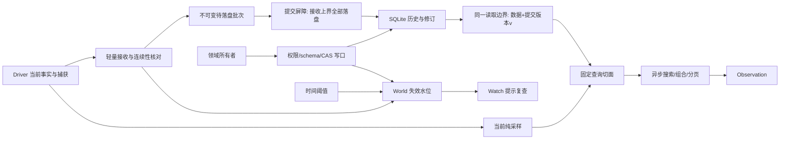

# World / 观察与记录详细设计

日期：2026-10-18，2026-10-24 校正状态。终态规格中，当前/静态读取、当前事实 Watch、事件与窗口观察历史及 SQLite Worker 已实现；批 9A 已补确切查询版本、事件 Watch 和历史库 v2（见 [实施记录](../archive/wait-implementation.md)）；批 9B 已接现有事件/窗口材料的 retain/release、显式清理与历史库 v3；通用领域记录、空间切片、名单/地图仍缺。容器历史复用 client.window@1 证据，不建第二份库存。文中历史研究不代替当前验收；标注“条件条款”的小节随实际消费者接入。

本文负责 World 的内部数据流、当前观察、查询快照、失效订阅、历史、领域记录及恢复。它承接已确认产品选择与 Driver 推荐，不重开身体控制设计。方法、参数、返回和错误形状的唯一来源是 [public-api §4.1–5](../public-api.md)；协作边界见 [contracts](../contracts.md)；Driver 的采集实现归 [Driver §11](driver.md)。本文不授权产品实现，不规定开发阶段、工期或人员。

## 1. 推荐结论与判断边界

推荐采用：**Driver 拥有当前客户端事实；World 接收选定的不可变证据，保存历史与领域修订；查询固定切面后异步计算；Watch 只提供保守失效提示。**

默认把 Driver 与 World 的轻量接收、版本发布和切面固定放在游戏执行进程的同一事件循环；SQLite、压缩、大范围搜索与结果展开放到工作线程。源码模块分离不等于必须拆线程。这减少正常路径的交付与对账成本，不让数据库进入物理循环。Program 的独立执行域和 Uina 接入进程保持既定边界。

若 Driver 与 World 实际拆域，按查询实际依赖使用本文 §6 的当前状态检查点或联合证据 fence；不能沿用“一个 JS 同步步骤”的论证。纯当前查询不等待历史证据，纯历史查询不调用 Driver。这个局部适配协议不升级成通用分布式事务、事件溯源或 MVCC 引擎。

评价标准是实际游玩：能找回旧地点、核验箱子、恢复工程、等待世界过程，并清楚知道哪些事实当前可用、哪些只是曾经观察。不得以通知数量、持久化行数或模块数量替代游玩效果。

### 1.1 不变量

1. 服务端是游戏权威；World 只管理自己知道的事实和判断。
2. 当前状态只能由 Driver 更新；World 索引与快照不能反向修改客户端。
3. 捕获、发送、World 接收、持久提交、目标满足是不同事实。
4. 选定证据不因合并通知、reset 或重传被静默丢弃；不能保留时明确缺口。
5. 每次查询只固定并读取其实际依赖的切面；异步期间不拼接新状态，不让无关历史成为当前读的前置条件。
6. 失效水位归 World，涵盖当前事实、历史、领域修订与相关时间条件。
7. Record CAS 只保护同一领域记录修订，不提供服务端事务或通用观察 CAS。
8. 清理不得破坏已发布持久引用或活动查询依赖。
9. read/watch 不移动、转头、开窗、同步游戏或调度复查动作。
10. 未知身份、覆盖、因果和效果保持未知；静态设计不等于验证通过。

## 2. 职责、所有权与依赖

| 内容 | 唯一权威 | World 的工作 |
| --- | --- | --- |
| 当前连接、协议状态、预测、覆盖、实体/窗口代次 | Driver | 读取受控事实，不建立可写副本 |
| 事实捕获时的来源、时间、源身份 | Driver | 验证身份与连续性，保留原值 |
| 世界绑定、历史分区、接收水位、查询失效水位 | World | 发布与恢复自己拥有的状态 |
| 历史空间/容器/事件与证据 | World | 不可变存储、索引、检索、缺口与保留 |
| 工程、过程、标注等领域含义 | 相应功能模块 | World 执行 schema/归属校验、版本及存储 |
| Run、segment、call、效果结论、停止与恢复入口 | Runtime | World 提供事实，不另写运行 phase |
| 目标、风险选择、是否主动复查 | 主脑及受委托能力 | 如实返回缺口，不暗中开展行动 |

“领域模块是语义所有者”和“World 是物理存储写入者”并不冲突。工程模块声明怎样解释工程记录，只有 World 写这些记录的数据库。

World 只依赖 Driver 事实端口、自己的存储及组合根注入的查询/领域定义。它不导入 Navigation、Combat、Construction 的内部算法，不拿 Bot/Chunk/Window，不穿透 Runtime 表。Runtime 通过公开的证据保留端口保护外部引用。

## 3. 内部组织与正常数据流

内部可按以下职责拆函数或文件，不要求独立服务/基类：

- 绑定与源接入：分区、源会话、重传核对、缺口。
- 接收与写盘：不可变批次、接收序号、连续提交与 ACK。
- 查询：参数规范化、依赖提取、切面固定、纯计算。
- Watch：失效索引、登记、源对账、时间阈值、关闭。
- 历史/领域存储：不可变观察、记录修订、索引与引用保留。

同域正常路径是：Driver 原始入口捕获 → World 轻量接收 → 后台批量提交（提交完成推进历史水位与 durable ACK）。历史 read 走提交屏障：等待接收上界全部落盘，再在**同一读取边界**取得数据与提交版本 v，cursor 即 v（§6.2）；当前 read 同步采样、不碰存储。writeRecord 在自己的事务中保存修订；投影纯读这些结果。当前接入不以历史数据库打开为前置条件（§13.1：历史独立 opening → ready/unavailable）。

## 4. 世界身份与分区

### 4.1 持久身份

空间记录使用 `worldId + worldRevision + dimension`。worldId 是明确绑定的持久世界，worldRevision 是该世界存档代次；dimension 是该代世界内的空间。

服务器地址、端口、服务器品牌、种子片段、出生点或局部地形相似都不能单独证明身份。可以使用确有可靠性的服务器/存档标识并记录依据，但不开发复杂指纹识别系统。

普通重连、玩家死亡、跨维度和普通方块变化不创建新 worldRevision。确认存档重置、回退备份或切换存档时，明确建立新代次或新世界；旧数据留原分区，不覆写成新世界历史。

### 4.2 未绑定范围与重绑

身份未知时分配显式的未绑定分区；它仍有可引用的 world/worldRevision 标识，但身份查询明确 `unbound`，不能自动继承旧历史。未知 dimension 保持 null，不默认主世界。

绑定由 World 拥有，Driver 使用组合根注入的当前绑定投影标注 Place/捕获 scope。绑定更新有独立临时代次 binding；旧异步请求、活引用和排队业务写不能只因 worldId 文本相同而被放行。

数据库不可读时，Host 明确提供且可信的本次绑定、或此前已核验并仍保留在当前进程的绑定可以继续使用。只有地址、旧记录猜测或无法核验的标识时，使用新的 unbound 分区；当前生命/背包仍可读，位置属于该临时分区，unknown 明示持久世界身份未确认。读取持久绑定失败不能触发“同地址沿用旧世界”。

重绑按受控生命周期执行：退役旧绑定，按既有 Runtime/Driver 停止与重接合同处理动作，再发布新绑定。它不是数据库改键。原始捕获归属不可变；如需认领未绑定历史，保存明确关联及范围，不重写原证据、自动消除冲突。

跨维度路线可以在领域 schema 中关联多个 Place；不能因通用 DomainRecord 没有顶层 dimension 就省掉实际空间约束。DomainRecord 统一绑定 worldRevision；领域 schema 决定单点、区域或多维度位置集合。

**批25（2026-11-05，v3 M1/M2）数据根与世界关联来源**：`world-history.db` 与 `library/` 位于稳定 MC 共享根（`sharedDataDir`），一份历史库容纳多世界/多 Profile；分区键 `(binding, world, world_revision)` 与 `records` 的 `(world, world_revision, ref)` 不变。连接目标的 world/worldRevision 由 `SessionController` 从 connect 输入或 settings 具名服务器给出（显式）或按 endpoint 生成默认关联（`endpoint:<host>:<port>` + `default`，状态标 `endpoint_default`，不冒充已证实相同世界）；同一 Profile 重访复用其 world/revision，显式换 revision 即新 Profile、旧分区原样保留（T05 语义）。runtime.db/runs/exports 归 `sessions/<profileId>/`（`sessionDataDir`），事件 binding 仍由 executor.db 的 worldOwner 派生，不同 Profile 不无意合并。

## 5. Driver → World 证据交付

### 5.1 为什么需要捕获载荷

合并的 changed 只表示某处需要复查。开窗后关窗与从未开窗都可能得到 window=null；实体出现又离开后也可能得到同样的最终实体集合。事后 sample 不能恢复已经失效的值。

固定 Mineflayer 的窗口关闭路径先置 currentWindow=null，再发布 windowClose，见[固定源码](../../../../.artifacts/minecraft-driver-targeted-20261015T200732/upstream/mineflayer--inventory.js)。实体消失、即时消息及伤害同样需要在实际入口保留载荷；证据定位集中在 [research](../archive/research.md)。不能把这些源码事实说成 Uina 已实现可靠历史。

### 5.2 四个承诺边界

| 边界 | 可以证明什么 | 不能证明什么 |
| --- | --- | --- |
| Driver captured | 原数据失效前已有不可变材料及稳定身份 | World 已收到 |
| sent/enqueued | 已交本域传输队列 | 对端接收、落盘 |
| World received | 指定接收代次持有载荷，已核验源前缀 | 进程崩溃后仍存在 |
| durable | SQLite 已提交载荷/依赖及连续水位 | 服务端效果、本次动作因果或全游戏历史完整 |

同域捕获/轻量接收可在一个本地提交边界安排；跨 Worker/进程的 postMessage、write 或 RPC 都不构成两侧原子提交。

### 5.3 身份、顺序和去重

Driver 为每个选定证据流分配不可复用 stream；流的源实例、绑定范围和采集规则版本固定，绑定/源重建时结束旧流并建新流。捕获序号 E 从 1 连续增加，只数选定证据。事实 stamp.sequence 数当前事实提交，两者不是同一计数器。一份捕获绑定 ref、stream/E、原 stamp、schema、实际 scope、来源与时间。

同一 ref 或 stream/E 的重发必须是同一语义载荷；相同身份不同载荷是源协议故障，不能覆盖。不同身份即使内容相同也是不同观察。不能用文本 hash 或时间邻近合并两次聊天/事故。

同一选定证据流的捕获批次、结束标记和联合查询所需 evidence fence 使用可证明前缀的接收序列。当前失效提示与当前采样回复可以走轻量元数据路径，按 stamp 对账，不被历史大载荷/重传挡住；不能把两个路径的发送顺序当作共同原子提交。底层若乱序，证据路径必须重排并证明前缀；源头缺 E 时暂停该证据前缀的推进并按原身份重传，不能把 E+1 当作已收到 E。它不暂停纯当前读取。

要宣称持久历史采集已建立，先持久登记源流元数据（绑定、采集范围/schema、源身份、起点）。数据库尚未就绪时，Driver 仍可捕获、World 可按实际能力接收 RAM 材料，但不能称元数据/载荷已持久，也不阻止当前 subscribe/sample。恢复后核验原分区和实际起点再提交；接入前、已丢尾部或未确认范围不能补造。这个声明只界定选定什么，不是采集策略框架。

### 5.4 durable ACK 与材料退役

World 返回唯一的 durableThrough（绑定 receiver 接收代次和源 stream）：每个序号都有已持久载荷，或已被已持久缺口记录覆盖。不能只收到 E+1 就越过 E；durable 单调不回退；旧 receiver 的 ACK 不更新新接收者。ACK 可以批量、重复、迟到。

Driver 只释放被所有已登记接收方 durableThrough 覆盖的不可变材料；同域直接移交同一份不可变材料，以提交完成推进一次归属。received 层确认、重传协议与 outbox 副本已删除——同域部署无第二消费者；真实跨 Worker/进程交付出现时，才按当时需求引入接收者代次、重传与乱序重排，不让当前实现预付该成本。

这不是 Driver 的第二套磁盘日志。整个游戏进程崩溃时，双方内存中的未落盘尾部仍可能丢失。不得以两次 ACK 协议宣称端到端绝不丢。

缓存长期增长时，应报告积压、最老未确认年龄和存储故障，停止承诺受影响历史完整。允许有依据地降级非关键采集或结束该源采集范围，但必须持久记录策略边界/缺口；不能悄悄裁剪选定证据，也不能阻塞心跳和急停等待磁盘。

### 5.5 缺口、封口与迟到数据

无法重传时记录有稳定 ref 的 evidence_gap：已知丢失区间或末端未知的后缀；受影响查询返回 coverage/unknown 和证据缺口。对外 ACK 只有 durableThrough 一个水位（同域无第二消费者，received/gaps 字段已删）：durable 越过已确认缺项的前提是该缺口记录本身已持久——连续性核对在 World 内部的缺口账本完成，不携带 gap ref 出境。仅“目前还没收到”不立即等于已确认丢失。through=null 的未知后缀不授权越过无限序号，确定 fence/封口后另加有限范围对账；原未知判断仍保留。

evidence_end 证明 Driver 不再为该流捕获新项，World 仍需收到并持久化此前前缀。缺可信封口的旧源，在崩溃恢复时保留未确认后缀。源可达且原缓存仍在时按接收者新代次重放；源缓存也已丢失则记录 gap 并建立新流。

reset 使当前覆盖/句柄失效，不能清除已捕获旧流证据。迟到的旧流材料可在原分区补历史，绝不能恢复旧当前覆盖或写入资格。确认缺口后获得补证可以追加修正缺口的依据，不改写曾经“不完整”的历史判断。

### 5.6 World 接收与持久水位

World 内部维护每流的接收前缀（载荷/缺口对账）用于缺口解析与去重；对外只有 durable 一个水位。源 E、数据库版本 v、查询 cursor 各自独立。

提交经单一有序队列发往专用存储 Worker。durable 只在批量提交完成且同一续体内发布确认时，推进到『每个序号都有已持久载荷或已持久缺口覆盖』的最大连续位置；绝不能用 MAX(已收序号) 越过洞。流封口（evidence_end）把已持久缺口解析为有限区间后，durable 无需新提交即可推进。

**durable 的物理前提必须如实核验**：存储打开时显式置 `journal_mode=WAL` 与 `synchronous=FULL`（不依赖 SQLite 编译默认值），并把实际生效值报告给上层；`durableThrough` 只在这组配置成立时才意味着"进程崩溃后仍在盘上"。提交返回的版本与读取视图版本同源。崩溃恢复后的重放**不做无核验的 `INSERT OR IGNORE`**：存储在入库前核对身份——同 (stream, seq) 必须同载荷 ref、同 gap ref 必须同区间；一致才幂等跳过，不一致报告源协议冲突（不入库、不冒认持久、不卡提交屏障，见 §5.3）。因此**"回应丢失/超时"不会被当作"未提交"**：调用方得到的是明确故障 + 可从盘上重新核对的状态，而不是一个关于提交与否的猜测。

gap 入项本身可被 durable 覆盖：这表示缺口记录已持久，不表示源缺失事实已找回。接收对账进度与源历史完整性必须分别报告。

发布 durable ACK 与从待落盘队列移除对应项在同一续体完成。

## 6. 不可变查询切面

### 6.1 只固定实际依赖

查询实现从既有参数/schema 和所用读取操作确定依赖，不让调用者选择一套新增的普通/严格模式。共同部分只有规范化查询、确切实现、分区/binding、有关 World 失效水位及实际需要的求值时间；其余按需固定：

| 查询实际读取什么 | 切面 C 需要什么 | 不承担什么 |
| --- | --- | --- |
| 纯当前：生命、背包、窗口、小范围方块 | 当前样本 S、来源/覆盖与有关 cursor | 不读 DB、不持有 tail、不等历史 F 或 durable ACK、不登记历史清理保护 |
| 纯历史/领域记录：容器最后观察、事故、已有工程修订 | 提交屏障（§6.2）+ 存储版本 v | 不调用 Driver、不采样当前状态、不默认追平源证据头 |
| 当前+历史/领域联合查询 | 实际读取的 S 与各自版本；只有确有对应关系要求时才核验其他相关版本 | 不为无关区域/记录复制数据或做领域核验 |
| 联合查询明确承诺历史包含截至 S 的选定证据 | 上一行加对应源前缀 F、连续性/缺口核对及 §6.3 联合 fence | 这项前缀追平不能隐式施加给所有 read |

联合结果若只是“当前样本 + World 已接收的历史”，可以固定各自版本、来源与采集进度并诚实返回，不暗示历史已追平 S。若 schema 要求两者有同源前缀对应关系，才使用最后一行；不能用弱结果冒充这项承诺。查询的范围与保证由对应描述唯一说明。

events 等历史查询的 Observation.history 按本次实际读取的证据流填写进度；纯历史的 targetThrough=null、alignment=unknown，不为填字段采样 Driver。纯当前不填写、不读取历史；只有首个承诺当前+历史对齐的联合查询才激活 §8.4 的条件合同。

切面是私有读上下文；可缺省未读取的部分，不新增公开通用 SnapshotManager 或 MVCC API。不会为一次 self read 固定全部 Section 或保留所有历史。数据库已是不可变观察/领域修订，读取所需旧版本即可；历史读取的视图版本 v 由读取边界返回（§6.2），World 不维护第二套 v/D/R 标量账本或 latest tail 索引。

### 6.2 历史读取的提交屏障

World 已订阅所需事实源。历史读取分三个明确边界：

1. **固定接收上界（同步）**：捕获本次需要的接收上界——这是查询开始时 World 已接收的证据范围，不追逐此后新到的事件，也不阻塞 Driver 当前读取。
2. **等待提交屏障（异步）**：向单一有序提交队列交付冲刷，等待该上界内的证据完成提交，或得到明确存储故障（STORE_UNAVAILABLE）。不静默用旧历史冒充『最新已接收』。
3. **在同一读取边界取证（单消息）**：向存储 Worker 发起一次读取，数据与提交版本 v 取自同一视图（Worker 单线程顺序处理，页内不可能混入半个事务）。
4. **以读取视图版本构造 cursor**：`cursor.sequence = v`。cursor 声明的不是『读取发生的时刻』，而是『本次读取覆盖到哪个提交视图』。

这条模型替代早期的『cursor 必须先于读取固定』：那个表述只在 cursor 恰好是存储视图版本时才成立，否则会同时产生两类错误——读取已包含的提交仍被通知（无效重唤醒），或读取未包含的提交被 cursor 提前消费（漏失效）。以读取视图版本作 cursor 后：**已读到的提交不再通知，读取边界之后的提交一定唤醒**。分批取页时 cursor 仍取该页版本，不伪造跨页的统一时刻。

纯当前读取完全不进入这条路径：同步采样、不读存储、不等历史；其 cursor 是该流在当前源上的失效事件水位，与读数取在同一同步段。混合查询（当前 + 历史）**不**合成单一水位，各自固定自己实际读到的版本（见 §9.2）。

领域记录写入引用证据时走同一屏障：先等被引用证据持久，再提交修订（不建立悬空持久引用）；retain 同理。

### 6.3 条件条款：拆域后的检查点与前缀协调

> **条件条款**：以下仅在 Driver↔World 真实拆域后激活；当前同域部署不实现、不预建。届时的最小要求：纯当前经 Driver 本地边界固定检查点（复用 ClientCaptureRequest/Reply 形状，不传活对象）；纯历史固定 World 已接收范围与存储版本，不向 Driver 发请求；只有声明『历史包含截至当前样本 S 的选定证据』的联合查询才需要源前缀 fence——等待 fence 只约束该查询，不施加给普通读，不升级为通用分布式协议。原 §6.4 的 tail 并集机制已随屏障模型删除，不再作为拆域替代物保留。

### 6.5 异步完成与世界重绑

await 后只能访问 C 和由 C 派生的纯数据。不得再取当前绑定、当前库存或 live Chunk；历史内容的增量经 read/watch 重新取得，不存在被 await 穿透的『最新 tail』。

依赖当前绑定的查询在返回前复核 binding；已变则 SNAPSHOT_INVALIDATED。显式旧分区历史查询可返回完整旧 C。旧异步结果后于新结果返回时，消费方按 stream/epoch/sequence 处理，不能直接覆盖新展示；World 不把旧值标成新值。

### 6.6 历史分页

分页 token 固定分区、查询、存储版本与最后 storeSeq，不是 ObservationCursor。页面不能每次读取『现在最新的历史』。

历史分页读取走 §6.2 提交屏障：先等要纳入的接收前缀持久化，再原子读取并生成 token；不需要等待 Driver 停止变化。token 携带其读取边界的存储版本；Worker 内单消息读取保证页内一致。token 版本过期明确 SNAPSHOT_EXPIRED，不返回看似连续的新版本页面。

提交版本只随**查询可观察状态**推进（证据/缺口/领域修订）。保留关系（retain/release）是记账不是数据：它不推进版本——否则 retain 会让未过期的分页 token 误报 SNAPSHOT_EXPIRED，并唤醒读不到任何新数据的历史 watcher。

## 7. 当前地形的不可变 Section 采样

### 7.1 当前权威与读材料

当前方块与覆盖仍归 Driver/Mineflayer。不可变 Section 是读取和传输材料，不是 World 可独立推进的第二世界。

选定地形历史在真实 section 入包时保存所需服务端基底与有意义更新。精确区域查询复用这些不可变材料，只对请求范围固定当前补丁/覆盖；Driver 导出与 World 历史共用相同内容，不各维护一套全加载区快照缓存。小范围 block/self/inventory 采样直接固定所需纯值，无须先建立 Section 版本体系。

> **旧实现记录（2026-10-17）**：当时小范围采样薄透传 `bot.section`，未实现区域历史版本链/补丁/压缩。该实现已删除；本节描述终态需求，不代表现有代码。

只有活动区域切面仍引用旧材料或历史本身要保存变化时，才为受影响 section 保留旧基底/必要补丁，不复制其他 section。当前预测由 Driver 原有状态和稀疏来源关联维护；没有活动区域切面或被核验引用时，不把每次预测追加成长期不可变链。需要时在固定边界捕获本区域的当前预测覆盖；它不升级为已确认历史地形。

后台可将必要基底+补丁压成新基底，发布前核验依据，过期结果不覆盖新版本。无活动查询/持久引用需要的旧读版本可释放；追加不可变修订不等于无限保留所有版本。物理计算仍读上游协议世界，不靠 World 快照推进当前状态。

### 7.2 捕获成本与载荷

只有实际请求区域的查询才在短边界固定相应 Section 修订与覆盖，普通查询不会附带整个 Section 集合。展开 palette/indices、合并补丁、编码和压缩移到关键路径外；不在 read 时逐格复制全加载区。公共纯值形状见 public-api，不在本文另建并列类型。共享引用减少重复字节，但保留基底、积压和旧版本仍有真实内存成本，不能以“不是第二权威”掩盖这些成本。

引用只能指向不可变读材料，不能是活 Chunk 或可写共享 Buffer。跨域的 JSON/二进制编码必须保持相同版本；直接 transfer 仍被客户端使用的 ArrayBuffer 会破坏当前状态，禁止这样优化。structuredClone/postMessage 大载荷也可能同步复制，不能仅凭“用了 worker”宣称低延迟；需把编码所需材料与所有权安排在关键路径外并测量。分块传输可以延迟到达，但各块都属于同一 C，不边传边改读源。

若请求范围尚无读材料，按所需范围建立并说明成本；选定地形历史可提前提供服务端基底，不因潜在高级查询而预建全加载区的预测版本。不能低成本取得精确大范围切面时，明确该区域查询不可用/资源故障或按其声明部分覆盖；小范围当前读继续可用。不能跨 Tick 扫描后声称同点完整，也不能把实际一次范围复制称为零成本。

### 7.3 覆盖与历史

光照创建的空 Chunk 不建立方块已知覆盖。indices 中 null 是未知，真实空气是明确 Block State。卸载使当前覆盖失效，已保存的 section 仅作为历史。

只收到单格更新时可以知道该格，不据此补齐整个 section。预测补丁不能覆盖最后服务端观察的证据；同值服务端确认仍更新来源和水位。

历史地形采用 section 基底+必要变化、压缩与派生空间索引。它保留最后观察和有价值变化，不承诺游戏完整方块时间线。

## 8. 查询定义、来源与领域值

### 8.1 一份定义，两种使用路径

组合根装配一份 QueryDescriptor 与其实际实现，覆盖当前、历史、静态知识与规划；不另导出 NativeCallable.read。查询实现包含参数规范化、依赖提取、结果 schema、实际需要的历史读取和可选纯客户端采样。实现按读取操作直接确定依赖，基础 self/inventory 已知只有当前依赖，不运行通用查询规划器、不增加依赖 Registry。feedback=true 仅表示可用于高频反馈；不是另一份传感目录。若结果要求截至当前样本的历史前缀，必须在该查询说明中写清；不让模型选择一套普通/严格模式。

World 的基础读取和 Driver 反馈复用同一纯采样实现。反馈不调用 World 数据库、不每帧生成 World cursor。基础 Block/Section、tracked 实体、带 known 标记的槽位及背包 layout 已在 public-api 的当前值类型中给出；未知值和已知空值不同。新增查询或模组事实需明确实际 schema/采样支持，不能把一个未知 JSON 交给所有消费者自行理解。

### 8.2 查询类别与真实性

| 类别 | 语义 |
| --- | --- |
| `self` / `inventory` / `window` 句柄 / `block`（含牌面）/ `region` | 当前可知；不可用返回 null/unknown 或 schema 声明的缺口 |
| 实体与空间搜索 | 覆盖实际可跟踪范围；未发现不证明全世界不存在 |
| players | 当前服务端公告名单，可关联当前实体；不认证服务器全体在线账户 |
| map | 本连接地图包的当前覆盖与同切面图像；不推断地图中心 |
| container.last / 地形最后观察 | 历史，保留原时间、覆盖和来源 |
| events / evidence 精确读取 | 返回已保存不可变记录，声明区间缺口与保留范围；events 的增量位置不代表模型已读 |
| 工程/过程/资源等领域查询 | 所有者解释记录与新事实，返回当前可用性或需复查 |
| 身份/来源/历史健康查询 | 显示绑定、连续范围、持久水位、积压与未知后缀 |

具体查询 ref、参数、返回字段及分页必须在同一 descriptor 中发布。上表是职责类别，不是默认为已实现的完整目录。

协议可知和视线可见分别表达。视线判断属于明确的派生算法，缺射线所需数据时只能部分可知，不能把未检测遮挡当可见。

mixed 的 basis 按实际判断需要分组，保留真实更新时间。历史读取不刷新 observedAt；求值时间与实际观察时间不同。UTC 用于持久记录，单调时钟用于本地年龄/期限；跨进程/重启不直接比较单调时钟，时钟无法可靠对齐时年龄也保持不确定。

当前查询默认不拿历史填未知值。需要记忆辅助的查询显式返回当前/历史分组及依据，不能把历史库存并入当前可取数量。

### 8.3 容器与实体的特殊归属

容器保存内容齐备的完整观察与有意义的更新；未完整覆盖的槽位不能变成空槽。保留最后服务端观察和未确认预测，不能把预测点击结果直接保存成已确认存取。

窗口身份不同于容器身份。只知道打开过一个窗口而不知道目标归属时，按本次窗口保留，不猜箱子坐标。方块容器、移动实体容器、私人存储及组合容器的实际身份由相关能力 schema 解释。

容器窗口内的玩家槽位不是另一份当前背包；关闭后的全部内容也只是历史。新背包读数不会被旧窗口覆盖。

实体历史保留出现代次、已知 UUID、位置和事件依据。离开跟踪范围不是死亡，UUID 也不使旧 EntityRef 复活。默认不为每个实体移动包保存轨迹；确有实验/追踪需要时由对应能力明确保存范围和证据。

### 8.4 条件条款：联合观察中的历史接收进度

> **条件条款**：Observation.history 是首个声明『历史 + 当前』联合语义的查询立项时才实现的能力；当前查询目录未使用，不预建。

source/basis/observedAt 解释值从哪来、何时观察，却不能单独证明历史已接收至当前样本。Observation.history 的唯一形状见 public-api：每个相关 stream 单独表达，不用一个跨源布尔值。

| 固定切面情况 | alignment | 含义 |
| --- | --- | --- |
| 同源实际载荷无相关 gap，receivedThrough=8，S 的 targetThrough=10 | behind | 历史尚未接收至本次当前样本 |
| receivedThrough>=10，但目标前缀含明确 gap | gapped | 序号已对账不等于缺失事实已找回 |
| receivedThrough>=10，目标前缀实际载荷齐全且无相关 gap | caught_up | 已接收范围至少覆盖目标，不表示已持久或值当前仍成立 |
| 没有同 S 的目标、不同 stream、接收范围不可核验 | unknown | 不对不可比数字作结论 |

纯历史 targetThrough=null，不为填字段去问 Driver；已知历史缺口仍由 evidence/unknown 保留。没有可比较证据源的领域数据可 history=[]，它不代表已追平。receivedThrough 是源 E 空间的接收对账水位，不是 stamp，也可能因显式 gap 对账已越过目标；判断必须检查实际载荷和缺口。进度从固定切面计算，await 后的新提交不改变旧结果。

“当前窗口为空、历史曾有钻石”的联合结果保留两组来源/真实时间，并例如给出 behind(8→10)。即使后来变成 caught_up，也只说明选定历史已接收至目标；历史记录可能是指定旧版本，当前值也可能只是预测，不能据此自动推断钻石已被谁取走。历史查询头若声明返回最新已接收观察，不能无视已到达的新空槽证据继续称旧钻石是最新。

### 8.5 事件历史

events@1 是既有选定证据的历史视图，输入/结果由 [能力面](capabilities.md#events) 唯一定义。Driver 在原始消息/伤害/死亡/连接入口捕获 client.event@1，World 沿现有接收与提交队列入库。查询按分区、kind、接收顺序建必要索引；不再持久一份聊天队列、消费账本或自动学习记录。

EventAfter 编码历史库身份、world/worldRevision（未绑定时为 binding 分区）、规范化 kinds 与扫描位置；它不绑定临时连接、Run 或模型回合。查询过滤是实际请求范围，不产生“全部游戏历史完整”的承诺。收到/存储时间只按捕获时间和本地入账顺序记录，缺少服务端时间或原因就不补造。

首次最近窗口及增量读取先固定本次 World 已接收上界，走 §6.2 提交屏障；结果与存储版本来自同一次 Worker 读取。增量页还固定本次扫描上界和过滤，next 继承它们；后来提交不使旧页自动过期，也不混进旧页。只有读版本/依赖材料已清理才 SNAPSHOT_EXPIRED，调用方从最后保存的完整 after 重读，按事件 ref 去重。首个无 after 的最近窗口只取尾部，不声称已经交付更早记录。

after 只有完整窗口的末页给出；空页也推进到本次扫描上界，过滤掉的其他 kind 不造成反复扫描。保留清理或已知源缺口以稳定 gap ref 返回；after 早于可读下界时明确说明跳过的不可读范围。gap 自身按发现/提交位置进入本次增量范围，即使它描述的是更早缺项；同 gap ref 的重复读取不代表新丢失。gap.after/through 无法精确映射增量位置时为 null，不用猜出的 token 表示完整。分页依赖和读取版本按 §6.6 保留，增量位置自身不永久钉住所有历史；没有已知 gap 也不认证采集起点之前或未获投递的事实。

events 的观察流按分区/kinds/固定 after 失效。新匹配事件或相关 gap 的提交推进历史水位；其他类型可以保守唤醒，但读不到新匹配数据时继续等。建立 watch 与提交水位比较沿 §9 执行，不以墙钟轮询替代。没有 after、分页输入或仍有 next 的读取，其程序 version=null；waitUntil 明确报 INVALID_INPUT，提示先读完页取得 after，不能在未读页前沉睡。连接断开本身可成为事件，历史流不因此丢失；进程重建使旧观察 version 失效，持久 after 仍可用于新 read。

read、分页、通知都不推进“模型已读”或删记录。Executor 可对重要事件生成有依据的提示，主脑仍能重读原 ref；交付合同见 [Executor §8.4](executor.md#game-event-delivery)。

### 8.6 地图与牌面读材料

地图当前像素由 Driver 的增量包缓存拥有。World 在一次纯当前 sample 内同时固定库存选择、地图元数据、像素已知掩码和图标；image=false 到此返回，image=true 才在关键循环外编码 PNG；不能先读图标、await 后再取新像素。尺寸固定、少量地图允许复制本次请求的 16384 格，不复制所有已见地图，不另建可写世界地图。

查询生成 `<worldDataDir>/exports/images/<sha256>.png`；完整编码后以自有临时文件原子替换为摘要名，ImageFileRef 的字节数/尺寸/摘要来自相同字节。图片是只读查询产生的可丢缓存，不是游戏写入、Library 项目或事实权威。旧引用只读原字节，不能以新地图覆盖同路径；缓存丢失明确不可读，重新 map 得到新截面，不假称恢复旧图。需要长期保存由现有文件工具显式复制。

128×128 色值按实际协议版本色表渲染；未知色表/编码失败保留元数据、image=null 和 unknown。未收到像素的棋盘遮罩不得与实际透明色混同。地图包没有中心/维度时保留 null，不读取本机服务器存档补成普通玩家的知识。工具附件复用 [Executor 图片适配](executor.md#observation-images)，不新增媒体数据库、图片下载工具或视觉模型。

告示牌只增加 block 的 typed SignValue 采样。更新牌面、颜色、发光、上蜡及覆盖时都失效有关 block 查询；牌面文本是游戏数据。写入协议由 Driver 执行，World 不为“读牌”打开编辑器、不对任何文本求值。

## 9. World Watch

### 9.1 统一失效水位

World 为依赖维护单调失效水位，至少覆盖：

- 当前值、来源、证据、覆盖与句柄有效期变化。
- 新历史证据接收、缺口/补证、历史导入或清理造成的可见变化。
- 领域修订持久提交与相关记录可用性变化。
- 查询声明的年龄阈值、时间区间等到期。

Driver stamp 只是其中一个输入。失效只按**查询实际可见边界**定义：当前依赖的可见边界是当前源采样，历史依赖的可见边界是存储提交版本（§6.2）——接收本身不是历史失效源（证据在提交前不可读），提交也不是『后台搬移』而是历史可见性的推进。当前源范围尚未分类时按 §9.2 保守扩大失效，不能以“只看精确依赖”漏变化。不能把全部逻辑变化变成每次查询的前置条件。

实现用**两个不同量纲**的单调水位，各自与"本类查询实际读到的东西"对齐：

- **当前依赖（current）**：World 单调的当前源失效事件序。读数与水位在同一同步段取得（sample → 纳入 stamp → 取水位），因此水位推进恰等于"读数已过时"。
- **历史依赖（history）**：存储提交版本 v。cursor 取读取边界版本（§6.2），水位只在提交成功后推进——不可读的提交不唤醒，因为那一刻重新读取得到的还是同样的历史。

两个量纲不可比，因此**不合并成一个虚假的全局版本**；合法混合查询仍须保留当前+历史联合查询的切面语义（§6.1）。旧实现只支持单类别并拒绝混合依赖；新实现只有在查询定义和 Watch 能提供多依赖映射及独立到期条件时才可声明支持。届时 Watch 在内部关联各真实水位与到期条件，任一依赖推进或到期即失效；外部 sequence 是该查询流自己的失效序。read 发布 cursor 前登记固定依赖向量，watch 按该向量核对后续推进；映射丢失/过期就 reset，不用当前最新向量跳过变化。底层没有实现此能力时，支持检查须明确不可用，不能静默漏失效或要求 Runtime 伪造联合版本。

时间阈值同理是 Watch 的内部失效源：到期是一次性失效语义（交付一次 changed/reset 提示复查），不依赖 v 前进、也不要求人为写库推进版本（§9.2 的『登记下一次真正影响结果的边界』由此落地）。查询 cursor 取足以覆盖其依赖的保守水位；不要求每个 Watch 保存中间事件或先重算结果。

### 9.2 依赖范围

附近实体查询订阅整个输入区域和可能进入的实体类别，不只订阅本次返回的实体 ID。资源搜索要包含未知/空区域相关覆盖变化，容器查询包括目标窗口/历史索引，领域查询包括自己的修订及所用事实范围。

复杂查询不能可靠提取精确依赖时，退回较粗范围的保守失效；宁可一次多复查，不伪称精确后漏掉新对象。时间阈值登记下一次真正影响结果的边界，不靠持续轮询制造主脑事件。

**当前 stamp 已前进但范围未知的规则：**对每个当前事实源，H 是最新已观察到的同 epoch stamp，C 是已经连续精确分类或已保守覆盖的源水位。C 不等于收到过的最大空间通知序号。一个恰好接续 C 的 notice 可以按其范围分类；合并、跳号、乱序或检查点 H>C，而无法证明 (C,H] 范围完整时，先给依赖这个当前源的查询发布一次全源保守失效，再把 C 推到 H。该失效归 World 自己的水位，不等待空间索引、DB 或历史 F；纯历史不受影响。若以后有可信完整范围证明可用它缩小范围，本轮不新增 notice 字段或区间日志。

例如 read(A) 固定 stamp20/cursor；Driver 已21，watch 得到21但空间索引仍是20，必须保守 changed。若先收到22的 B 范围而21的 A 范围未到，不能 MAX=22 后断言 A 没变：未能证明连续范围就对当前源保守覆盖至22。

同一个 H 的保守失效只入账一次；之后迟到的 <=C 范围只细化/去重，不重复分配“新变化”水位，也不撤回已经发布的保守失效。新 read 必须真实 sample 到该 H，纳入这次保守水位后才生成 cursor；因此 read21 后没有新 stamp 时可以等待，不会每次 watch 自激 changed。旧 read20 不能只因另一查询读过21而被当作已看见21。reset 仅用于 epoch/来源断裂等无法比较情形。

**批23 类别化实现**：当前源的保守失效按声明粒度落地——Driver stamp 携带各 `FactCategory` 的修订版本（`FactRevisions`，与 sequence 出自同一同步采样边界），commit 按事件源归类推进（[driver §11.6](driver.md)；无法精确归类的物理拍保守覆盖 self+entities+world）；current 查询描述符声明 `facts` 依赖，游标 = 依赖类别修订之和（`queryRevision`）——任一依赖推进必然改变和值，等值水位由 ObservationWatch 天然空转，无需订阅侧过滤层；未声明依赖的查询回退全局 sequence（全源保守）。公开 `WorldChange.changed` 合同不变，Driver 分类不向模型层泄露。

### 9.3 read → watch → next 无漏失效

同域：read 固定相关 cursor；watch 和 next 在一个 World 步骤内核验、比较所需水位并登记等待者。有当前依赖才纳入当下源 stamp，纯历史直接核验本地历史/领域/时间水位，不 sample Driver。状态已更新但当前通知仍排队也能被发现。

跨域：有当前依赖时先在 World 原子登记 waiter，再取得当前状态检查点；回复的 stamp 覆盖此前迟到通知，其后变化由已有当前订阅覆盖，旧通知不使水位回退。检查点不等待历史 evidenceThrough，不能把当前 Watch 接到大载荷队尾；对账失败明确 SOURCE_UNAVAILABLE 或 reset。纯历史 Watch 只在本地原子比较/登记，源断线不阻止它观察本地新历史、领域提交或时间变化。只有查询本身有同源历史前缀依赖时，才另外核对相关证据 fence，Watch 仍不承担游戏操作。

首次 next 立即返回 watch 登记时发现的 changed/reset。收到 changed 后重新 read，再把新 cursor 交给 next。取消某次 next 只取消该等待，不消费共享变化；多个观察者都可复查，不是工作队列。close 幂等退役，所属调用/Body scope 清理也关闭资源。

### 9.4 changed 与 reset

同源 prediction→server、同值再确认、证据时间/覆盖变化是 changed。世界/代次/维度/查询参数不同属于不同 stream；相关连接/事实源实例重建、计数重置或无法对账旧 cursor 需要 reset/新 epoch。纯历史没有当前连接依赖，不因 Driver 普通断线而失去本地历史水位连续性。

未知 cursor 不能只因 sequence 数字较小就当有效。计数必须是安全整数，接近上界时换 epoch 而不是溢出；实现容量不成为任意游戏轮次/并发限制。

WorldWatch 只提示重新看。完整聊天、死亡和所选历史事件从对应记录查询，不依赖 changed 穷举。World 不根据 Watch 定时器开炉、移动、避险或创建 Run；主动复查仍由能力和 Runtime 取得新身体执行。

### 9.5 请求前状态帧（批37，取代批20 的节流 digest）

Watch 是"等变化的拉取原语"；状态帧是"每次决策前读一眼"：`world/state-frame.ts` 只有采样与文本投影，没有定时器、没有订阅、没有去重、不落历史、不发消息。一次 `facts.sample` 提交边界采三段（self/inventory/world），复用现有查询读取器，与 observe 同口径，不建第二套事实提取。站位取脚下那一格（与全世界 `Math.floor` 的方块坐标一致，不是四舍五入）；背包超 10 种折叠成种类数加剩余项数；生命/饥饿没收到时说"未知"而不是留白（省略会被读成满血，填 0 会被读成已死）；未附着活连接时明确说"未连接，不要按旧坐标行动"，不沿用旧值。读取器报的字段级缺口（如地面上没有氧气）不算降级，只有整段读不到才进 `unknown`。

状态不是待办事项：旧坐标与旧背包排队等模型处理没有价值，只有当前值有意义，所以它既不进 `events@1` 也不排队——由 `state.snapshot` 只读 RPC 出，`WorldDef.requestContext` 在每次模型请求前取一份，经 `turn.transformContext`（`tail` 相位）附在该次投影尾部。宿主侧 250ms 超时即本轮不注入。

每回合都有一帧：取不到时正文写明原因（超时 / 读失败 / 世界没有提供内容 / 上一次读取仍未返回），通知文案同时改成"本轮没有取到世界状态"，并明确要求不要把它当成世界没有变化。让位置空着会被读成"世界没变"，那比没有状态更危险。同一时刻只允许一份采样在飞——世界侧卡住时，多个请求不该各压一份上去，也不该各留一个永不清理的 abort 监听器。宿主侧 250ms 超时只把正文换成占位，不挂住请求。

状态帧中的活跃任务段读取 `runtime.list {activeOnly:true}`。读取失败时正文说明任务状态暂不可查，并引导用户用 `tasks.list` 查证。只有确认没有活跃任务时才省略这一段。世界 Facts 与任务列表分别采样。

批42 增加第二类世界文本，与状态帧严格分工：`WorldDef.environmentGuide` 是**同步、纯读、无副作用**的 getter，返回"这个世界怎么理解、怎么做"的静态认知（如 Minecraft 的 ENV），由 `WorldActivation` 在 `turn.prepare` 追加到本轮 systemPrompt，带稳定边界名 `[world:<name>:environment]`。它只在世界自己判定适用时返回正文（Minecraft 只在有活动会话时给），每回合一次，不随事实变化；多个启用世界依次追加、互不覆盖，停用由 ResourceScope 摘除，不写 Session canonical history，不注入为用户消息。会变的坐标/库存仍只由上面的状态帧提供；API 合同与场景做法由 `describe {kind:'guide'}` 的官方只读 Guide 提供。三者不合并成一个 PromptManager。

## 10. 领域记录、证据引用与保留

### 10.1 记录写入

writeRecord 的 Runtime 绑定从真实当前调用取得权限。保存过的 act 代理不能被 read 子调用重新拿来写，不能信任业务传入的 owner 字符串自授 schema 所有权。

World 验证 schema、分区、引用和 CAS。null expectedRevision 仅创建；更新要求记录存在且 revision 相等。schema/world/worldRevision 不随普通修订偷换，迁移由领域所有者提供明确规则，不静默猜。

> **合同对齐（2026-10-17 审查修订）**：存储保留**最新修订值与单调 revision 计数**（`UPDATE ... revision+1` 覆盖前值；Memory 与 SQLite 实现一致）——修订历史不逐版追加，`revision` 不承诺可回读任意旧版。需要精确历史修订引用的领域启用前，先建修订追加表（`record_revisions`）并让引用指向 (ref, revision) 对，届时 §10.3 的"指向确切记录修订"才可解析。当前无消费者，不预建；在追加表存在之前，任何合同消费方不得假设旧修订可读。

验证器来自组合根已有模块定义，只做纯校验，不拿 Bot、不发协议、不在数据库事务内运行长算法。调用在进入提交前退役则拒绝；已提交修订保留其事实，不以随后取消假装回滚。关闭作用域须结算已登记的写入。

### 10.2 CAS 的准确含义

新方块观察 B 抵达而工程记录 revision 仍是 n 时，模块仍可基于旧观察 A 保存一条历史判断。这不会修改 A/B 原始观察；当前工程查询据新 B 显示需复查。

因此不添加通用 observation precondition、不把数据库 CAS 当服务端事务。某个领域确需“本地提交时条件仍成立”，由它的具体入口核验并说明竞态；多人在协议到达前仍可改变现实。

工程/过程 value 保存的是领域状态与依据，不是另一份 Run phase。熔炼预计到期、施工累计计数和程序 completed:true 都不能代替新观察。

### 10.3 引用精确修订

证据引用必须指向不可变事实或确切记录修订，不能指向一个会变的 latest 头。readRecord 返回的 record ref + revision 用于领域版本；精确修订/证据读取走相应 QueryDescriptor，不新增并列数据库穿透方法。当前存储只保留最新修订（见 §10.1 合同对齐），指向确切记录修订的读取是追加表建立后的条件能力；在那之前，可解析的记录引用只有最新修订。

普通 read 不意味着整份结果都永久归档。选定源观察按采集规则保存；需要长期引用的特定采样先物化不可变证据并持久保存。未保存的高频帧不能编造一个看似永久可解析的证据 ref；空 evidence 也不能被信封升级成独立确认。

### 10.4 Runtime 引用不能被历史清理遗漏

World 自己知道 DomainRecord 引用，却不能只据此判断外部持久证据无人使用。组合根向 Runtime 等明确持有强引用的记录所有者注入 WorldEvidencePort；Library 仅保存弱链接，不参与强保留：

1. 先 retain，确保 World 证据与本地传递依赖已持久，保留关系也已提交。
2. 再提交引用这些事实的 Runtime 不可变记录。
3. 只有引用已经持久移除，才 release。

retain 对可信 owner 幂等追加，不赋予任何身体/领域写权或读取权限，不给 Program。owner 使用持久运行/效果记录身份，不能是临时 call scope；普通弱溯源不进入强保留。DomainRecord 的保留与修订在 World 自己的事务完成。外部模块拥有的证据由原所有者保证，World 不遍历全 Subject 会话或增加通用 Registry。

retain 的存在性/本地依赖校验、活动切面保留登记和实际删除必须在同一 World 发布序列协调，不能让“校验存在”和“插入保留关系”之间被清理穿过。删除先完成则 retain 明确 EVIDENCE_UNAVAILABLE；retain 或活动切面先取得保护则删除跳过，不能成功返回后引用已不存在。

跨库中断可能留下孤立 retain；恢复宁可多保留，不能先误删。核对只针对强引用所有者及其持久记录；只有确认引用不会发布或已持久移除，才 release。无法确认时保留，不靠全会话扫描猜测。Library 的普通文件写入不创建此类保留关系，见 [Library](library.md)。

## 11. SQLite 与索引

### 11.1 权威内容

SQLite 保存世界绑定、源会话/范围/缺口、不可变观察、Section 对象依赖、领域修订、连续持久水位和引用保留。设计文件名为 `<worldDataDir>/world-history.db`；目录由 Host 提供，与源码、库条目、Runtime 记录（`runtime.db`）和段快照（`runs/`）并列在同一数据根下，互不代管。

建议逻辑表族如下，具体 SQL/库选择不在本文冻结：

| 数据族 | 主键/约束要点 |
| --- | --- |
| 分区与源会话 | world/revision、binding/source/stream 与采集范围、封口 |
| 接收/证据 | 稳定 evidence ref、stream/E 唯一、store_seq、提交版本（schema v3：无 receiver/R 列，接收代次只在 durable ACK 语义里） |
| 历史空间/Section | 世界/代次/维度/section、不可变修订、基底/补丁依赖 |
| 容器/实体/事件 | 原始归属与证据，不能仅坐标或网络 ID |
| 领域修订 | record/ref/revision、schema、世界代次、作者/调用与依据（schema v4 落地 records 表：分区 = world+worldRevision+ref，只保留最新修订值与单调 revision 计数；非空 evidence 同事务校验存在性，删除走 removeRecord 并推进 meta.record_version——它只随记录写推进、驱动记录观察失效，与提交版本分开） |
| 保留关系 | 持久 owner 到本地证据及依赖 |
| 派生索引 | 最近观察、空间/类别、时间、领域检索；可重建 |

源事实的观察顺序按实际源序列解释；存储提交顺序只是本地可见性顺序，不创造游戏全局因果。迟到旧事实保存为历史，不能因晚提交就反向覆盖当前客户端或当作更新的实际观察。

### 11.2 专用存储 Worker 与异步读

设计选择：SQLite 连接位于专用 Worker 线程（新实现的文件布局待定），有序提交、读取、迁移与关闭结算不占 World/Driver 事件循环。每条消息是一个原子边界，WAL 降低读写互阻。不能把普通入队或无 fsync 的性能配置称为断电持久；打开握手须返回实际生效的持久性配置。

构建产物必须带着 Worker 资产：新实现明确解析 Worker 文件；缺失时失败，不静默退化成内存实现。重新实现 Worker 后增加真实 emit 产物验证，覆盖缺资产失败、读写关闭和进程意外退出恢复。

Worker 崩溃/退出转为显式 history=unavailable，在途请求明确拒绝；当前读取不经过存储，不受影响。不引入通用线程池或任务框架。

SQLite 的数据库快照不自动覆盖 Driver。按 v 查询不可变行/修订即可，不自制通用多版本存储。当前 latest 索引只优化最新查询；as-of 必须回到对应权威修订或同版本可重建索引。

长事务/长快照可能阻碍 checkpoint，优先短事务读取确定版本的数据再计算；活动版本通过保留关系保护，不把数据库读事务跨整个主脑等待保持。依据见 [SQLite isolation](https://www.sqlite.org/isolation.html)、[WAL](https://www.sqlite.org/wal.html)；具体负载尚未测量。

## 12. 历史粒度、压缩与清理

| 内容 | 默认粒度 | 不承诺 |
| --- | --- | --- |
| 地形 | Section 基底、必要变化、已知覆盖与最后观察 | 所有游戏方块的完整时间线 |
| 容器 | 完整观察、有意义更新、窗口/目标绑定、预测分层 | 关窗后仍是当前库存 |
| 实体 | 出现/消失、最后必要位置、关键事件 | 每次移动轨迹或消失即死亡 |
| 聊天 | 实际收到的 public/private/system/action_bar 原文、可得身份与通道 | 相同文本自动去重、文本猜私聊、每条消息都唤醒主脑 |
| 事故/风险 | 实际伤害/死亡/断线及可得上下文、明确标注 | 自动推断未知凶手/损失 |
| 高频自身状态 | 当前读数；核验所需样本或控制段聚合 | 逐 Tick 保存 |
| 玩家名单、牌面与地图 | 当前读材料；被效果/领域记录引用的确切观察按需保留 | 所有名单变化、每帧地图或所有牌面永久入库 |
| 领域记录 | 所有者提交的确切修订及依据 | World 自动生成施工/过程算法 |

容器连续重复观察可复用相同内容对象，但保留再次确认的时间/来源身份；内容去重不消灭事件身份。聊天和事故按具体选定范围持久，不用静默限额掩盖长尾。

无引用历史可合并、压缩或清理，但必须同时检查持久 owner、DomainRecord、活动查询/分页和 Section 传递依赖。不能删掉仍被补丁依赖的基底。可先物化等价基底供以后新引用使用；已经发出的不可变引用仍保持原意义。

> **旧实现记录（2026-10-17）**：当时记录采用 append-only，清理/GC 未实现；旧 Assets 有 retain/release 消费者。旧 World/Assets 代码已删除；新 Library 不参与强保留，清理合同须由新实现验证。

清理改变可查询范围时保存保留边界并使有关 Watch 失效；不能删除 gap 后假装连续。引用本身及其解释所需 schema/codec/版本信息也在保留闭包内。无确定引用信息时宁可暂留，不猜“没人用了”。

清理候选枚举可在线程外执行，实际删除不能直接使用旧枚举结果。采用短的 World 历史发布门：先暂停新的历史切面/retain 登记（不暂停纯当前读取、Driver、当前检查点和证据接收），在同一 writer 序列最终复核持久保留、领域引用、已登记活动切面及依赖闭包，再事务删除；提交结果与新存储版本/保留边界一起发布后才重新开放登记。已有活动切面保护的版本不能删，retain 的校验与提交也经过此序列。删除在途时只有依赖该历史的请求等待短提交或明确失败，不能仍按旧 v 固定已删除材料。事务失败释放门而不发布删除；大范围删除拆短事务，不跨异步计算持门。这排除旧候选误删，不增加通用锁/Manager；只读生命/背包不因历史 GC 加入等待。

## 13. 启动、关闭与恢复

### 13.1 启动

同一个 World 内分别建立当前接入与历史存储，不用 SQLite 打开成功作为整个 World 的启动门。`createWorld` 的初始化分两段：**段1 立即建立当前基线并交付句柄**（订阅先行不漏 Driver 材料，当前 read 在任何 SQLite 状态下都可用且总是最新采样）；**段2 历史侧独立推进 opening → ready/unavailable**（打开握手 → 恢复播种 → 重放缓冲通知）。打开/播种期间到达的通知进缓冲、按到达序重放——证据的 durable 起步因此正确（播种先于任何提交）；缓冲期当前侧的迟到通知由检查点保守失效兜底（H>C → 全源失效），不漏、只是粗。需要“历史可用”这一个信号的调用方用 World 内部句柄上的 `historyReady` Promise（就绪或明确不可用都结算）；它不进公开查询面，模型看到的是 `world@1` 的 `history` 字段随时间从 `opening` 变为 `ready`/`unavailable`。

1. 建立运行期状态和可信绑定；没有可信持久身份就创建显式 unbound 分区。订阅当前元数据、初始化 World 失效水位。
2. 打开并核验历史数据库（专用 Worker 打开握手，含 schema 版本校验与一次性迁移）；打开失败、损坏或版本不兼容则 history=unavailable 并保留原因——当前源只依自己的就绪/绑定条件运行，不自动清空、替换损坏权威库以假装 ready，不凭地址恢复旧身份。默认历史查询明确 STORE_UNAVAILABLE。
3. 存储就绪后从真实持久状态播种接收代次的 durable 起点（不把 RAM 接收冒充持久），再重放缓冲通知进入实时分发。恢复后核验原分区和实际起点再提交；接入前、已丢尾部或未确认范围不能补造。打开失败是终态：不播种，但**接收继续运转**（证据照常接收、提交按 unavailable 明确失败、durable 停在真实起点）——无限缓冲会让 durable ACK 停摆并卡死 Driver 材料回收。

`world@1`（公开 schema 见 [capabilities.md §3](capabilities.md)）分别报告 current、history 与 binding 三个字段；它不等待二者就绪。各项可用性如下：

| 能力 | SQLite opening/无法打开/损坏时 |
| --- | --- |
| 当前生命、位置、背包、附近已知方块 | Driver 就绪且相应字段可用就可读（opening 不阻塞句柄交付，read 总是最新采样）；持久身份未知时标 unbound/partial，不虚构字段 |
| 当前 Watch | opening 期间注册可用，缓冲中的通知在历史结算后重放补齐唤醒（检查点保守失效兜底不漏） |
| 历史容器、事故/工程查询 | 默认 STORE_UNAVAILABLE；仅已独立核验且查询支持的范围可 partial，不能假空结果 |
| writeRecord | 不可写 ready 时拒绝；不宣称保存/修订成功 |
| 当前持久世界身份 | 可信 Host 显式绑定或本进程已核验信息可用；否则 unbound，不能猜旧分区 |
| retain/新持久证据引用 | 不能保证证据与保留关系已提交就拒绝；没有 durable ACK |

RAM 接收可以继续但不是无限缓存承诺。使用既有积压/缺口/停止采集规则，不让存储故障拖住当前读；两端缓存丢失的未持久尾部仍未知。接入前范围不能回溯补造。当前来源、位置与历史的可用性分别表达，Runtime 的受理/任务恢复仍由 Runtime 负责；当前可读不意味着可以绕过其持久受理门启动动作。

### 13.1.1 存储恢复后的发布

重新打开/核验存储先检查实际世界归属及源连续性，再登记/重放可得材料；未绑定期间的证据保留原分区，不因为 DB 恢复就改标签或自动合并旧地图。需要改变绑定时走既有明确重绑，不能把历史恢复悄悄变成当前世界切换。

历史存储代次/版本重新发布，使受影响历史查询和 Watch reset；如果 Driver 与 binding 没变，纯当前样本/Watch 不因单独 DB 恢复而重置。已有当前结果的 history 缺省不需补填，已有历史 Observation 的进度也不被恢复后 ACK 改写。不把数据库恢复成功推断为与服务器同步，不重放挖掘/点击或续建。

### 13.2 正常关闭

停止接收新业务请求，按既有 Runtime 生命周期关闭动作/调用；Driver 停止采集并封口源，World 接收完可得前缀，flush 数据和保留关系，返回 durable ACK 后关闭资源。Watch 关闭，不把暂时无数据当终态事件。

急停或进程堵塞的域外终止不能等待数据库刷盘；优先封闭动作。未能 flush/封口的历史尾部保留不确定，不报告“关闭成功所以全部落盘”。退出与进程树责任仍见 Driver §10.7。

### 13.3 崩溃位置

| 崩溃位置 | 恢复解释 |
| --- | --- |
| 捕获后尚未发送 | 源缓存仍在则重传；一起丢失则未确认后缀/gap |
| 发送后、World 接收前 | 发送不是收到；对账原 ref/序号 |
| World 已接收、尚未持久 | 新接收代次不继承旧 RAM ACK（durable 从播种的真实持久状态起步）；请求源重放 |
| SQLite 已提交、ACK 未发布 | 按持久身份去重后恢复确认，不重复插入 |
| retain 已提交、Runtime 记录未提交 | 允许孤立保留，后续确证后回收 |
| Runtime 引用已提交、release 未执行 | 多保留是安全结果 |
| 历史可读但 Driver 重建 | 旧记录仍是历史，新当前覆盖/epoch 重建 |

World 停用、重绑、源重建、存储恢复只使实际受影响的旧查询资源失效；单独存储变化不使纯当前源失效。禁止“恢复数据库成功”推导“已恢复与服务器同步”。

## 14. 故障与降级

| 故障 | 必须行为 |
| --- | --- |
| 存储满/IO 错误 | D 不前进、不发 durable ACK；当前事实仍可读，持久写失败，积压/历史缺口显式 |
| SQLite 启动损坏/无法打开，而 Driver 已就绪 | 当前接入/当前 Watch 可用；身份只用可信运行期绑定，否则 unbound；历史/持久写/retain 不假装成功 |
| 源重发/乱序 | 原身份核对，缺前缀等待/重传，不按最大序号跳过 |
| 同身份不同载荷 | 源故障，保留诊断，拒绝覆盖 |
| 原始源失联 | 当前事实依真实失效规则退役；历史保留，Watch 不永久假等待 |
| 源 gap | 保存缺口，受影响查询 partial/reset；不能靠 reset 补事实 |
| 查询取消/执行域退出 | 释放切面/Section 读材料和等待者，不撤销已提交历史 |
| 领域 CAS 冲突 | RECORD_CHANGED，返回可查询引用，不自动覆盖/重算业务意图 |
| schema/查询版本缺失 | 明确不可调用/不可解释，原记录仍可原样读取 |
| 分页材料过期 | SNAPSHOT_EXPIRED，不换版本接着翻页 |
| 大查询压力 | 线程外计算/分页/实际资源故障；不阻塞 Driver 或默默截断 |

正常结构不添加统一重试策略框架。无副作用的读/传输可用原请求身份重试；游戏动作是否可重试不归 World。即使存储故障，停止与本地自保仍沿既有控制机制处理。

## 15. 典型协作

### 15.1 开箱后离开

能力取得 Body 打开窗口。Driver 在内容齐备时捕获观察，后续更新保持来源，关窗前保留最后有效值。World 接收并保存，即使随后 window=null 仍可查询历史。

再次访问时，历史只用于选目标和估计；开箱的新当前事实覆盖实际决策。别人取走物品导致历史失效，不是 World 应在后台替主脑开箱的理由。

### 15.2 熔炼与其他工作

能力核验投入并写自己的过程记录，释放身体。World 保存观察和领域修订；预计时刻只使时间条件失效，由仍存活能力显式重新申请身体开炉。关窗期间没有新的槽位观察就不证明产出。

### 15.3 工程被其他玩家修改

工程模块保存基于 A 的核验修订；后来收到 B，原始事实追加，相关查询失效。工程查询结合 B 给出当前差异/需复查，工程记录 CAS 不因为所有新观察普遍失败。

### 15.4 程序反馈与长期证据

自写反馈直接读 Driver 快速采样，不逐帧访问 World。需要复盘一次关键落地/失败时，由对应执行记录保存特定事实与代码/操作关联，并在发布持久 World 引用前 retain。World 不从完整轨迹自动创造一份成功经验。

## 16. 替代方案及独立取舍

| 方案 | 竞争力 | 未选作默认的理由 |
| --- | --- | --- |
| 合并通知后周期采样 | 最少接缝 | 短暂窗口、消息/事故和已卸载数据无法恢复 |
| 选定不可变证据+当前视图+固定切面 | 保存真正需要的证据，控制实时成本 | 推荐；必须承担 ACK、水位与缺口语义 |
| 全包/全 Tick 事件溯源 | 适合完整回放研究 | 当前无完整回放需求，不能据此放大常态存储/维护 |
| 所有查询直接持 SQLite 长读事务 | DB 快照成熟 | 不含 Driver 原子性，且长读影响 checkpoint |
| 不断双读版本、变化就重算 | 代码表面简单 | 高频源可使大查询反复失效，正常路径不可预测 |
| 所有 read 固定全源历史与当前切面 | 易于统一叙述 | 无关历史积压会阻塞生命/背包查询；改为按实际依赖固定，联合前缀保证只约束声明它的查询 |
| 强制 Driver/World 独立进程 | 故障隔离更强 | 增加交付/快照协议；默认同域轻量协调已足够，拆域须有真实理由 |
| 所有领域写都检查通用观察版本 | 看似严格 | 混淆旧判断与当前条件事务，制造无关冲突 |
| 自动世界指纹识别 | 减少人工绑定 | 不能可靠证明重置；显式绑定和可靠证据更诚实 |

本文只描述 World 的内部机制与取舍。对外的类型、字段与错误码一律以 [public-api.md §2/§5](../public-api.md) 为唯一来源：`Observation.history`、`DomainRecord.worldRevision`、`WorldEvidencePort` 的增补理由记在 [../archive/research.md](../archive/research.md) 与 [changelog.md](../changelog.md)，不在这里再抄一份（抄两份必然漂移）。

基础查询 schema 需要随实际 descriptor 完整发布，不宣称当前已有全部原版 query 实现。接口开放不等于任意版本/服务器都支持。

## 18. 可证伪的故障场景

下表是设计验收要求；只有实际执行结果才能标为对应边界通过。

| 场景 | 应观察到的结果 |
| --- | --- |
| 窗口开→槽位到齐→关，在通知处理前完成 | 捕获载荷保留内容；当前 window=null，不臆补中间点击因果 |
| 实体出现→消失 | 留出现/离开证据；不能当死亡 |
| 预测空气→同值 server 空气 | World 水位推进，来源升级；不是 reset |
| 光照空 Chunk→卸载 | 无实际方块覆盖，不生成空气地图 |
| E=12 先于 E=11 抵达 | durable 不越 10；恢复 11 后继续，或持久缺口覆盖后有限对账，历史仍不完整 |
| durable ACK 后 World 崩溃 | 重放按 ref 去重，不重复入库；durable 从真实持久状态起步 |
| E=7 已持久而 E=6 未持久 | durable 不越 5；MAX 已收序号不是连续水位 |
| gap 入项也已持久 | durable 可连续，源历史仍不完整 |
| 查询开始前证据已接收未落盘 | 屏障等待提交后读取，不静默遗漏 |
| 拆域后远程采样且联合查询声明截至样本的源前缀（条件条款） | 不能宣称该前缀完整；等待/重排、明确 partial 或失败；纯当前不受此门约束 |
| read 后变化、watch 登记前 | 首次 next 提示 changed/reset |
| read(A)=20，Driver=21但空间范围尚未收到 | 当前源保守失效一次，不能仅看旧空间索引 |
| 22 的 B 范围先到，21 的 A 范围仍缺 | 无完整区间证明则全源保守覆盖；MAX=22 不能证明 A 未变 |
| read21 后多次 watch，同21范围迟到 | 无新提交可等待，迟到只细化，不回退水位或每次自激 |
| waiter 已登记但当前通知延迟 | 当前检查点发现既有变化，未来由订阅覆盖；仅前缀联合另核对证据 fence |
| 新实体进入原先空区域 | 区域依赖失效，不能只关注旧结果 ID |
| 无外部包但保留期到期 | 时间条件失效；不启动游戏动作 |
| 异步查询期间重绑 | 当前绑定查询失败；显式旧历史整份留原分区 |
| 旧查询晚于新查询返回 | 消费方不以旧 cursor 覆盖新状态 |
| 历史第二页期间有新证据 | 仍是同一版本和排序，不混入新记录 |
| retained 补丁的基底进入清理 | 基底保留；不能只保留直接 ref |
| GC 枚举无引用 A 后 retain/活动切面登记 | 最终删除复核；保护先胜则跳过，删除先胜则新引用失败，不返回悬空成功 |
| 无关地形/聊天积压、历史 gap 或存储故障时读 self/inventory | 当前源可用则照常固定当前结果，不读 DB、不 pin tail、不等 F，不宣称历史完整 |
| 历史 GC 发布门在途时读当前生命值 | 不进入历史门；当前样本/cursor 仍可取得 |
| Driver 离线时读 container.last / 登记历史 Watch | 使用固定已接收历史/本地水位，不向 Driver 发请求，不称当前库存 |
| SQLite 打开失败且无可信绑定 | self/inventory 可按 Driver 状态读取；Place 使用显式 unbound，不能凭地址继承旧地图 |
| DB 从 unavailable 恢复、Driver/binding 未变 | 仅历史资源按实际恢复 reset；当前 Watch 不因 DB 变化重置，不自动合并 unbound 历史 |
| 固定 received=8,target=10 的联合结果后接收追至10 | 旧 Observation 仍 behind；下次 read 才反映新进度 |
| received=100含目标前缀 gap，或 target未知/异源 | 分别 gapped/unknown，不能因数字较大变 caught_up |
| 远程当前检查点先于 bulk 历史证据回复 | 当前读取/Watch 仅核对 stamp；联合前缀查询仍须 F 连续性证明 |
| 无关工程修订发生于当前读取期间 | 不使纯当前读 G 校验失败；联合查询仅核对自己的领域依赖 |
| 普通 block 读取且无区域切面 | 不预建全加载区快照，不长期追加每次预测版本 |
| retain 成功后 Runtime 提交前崩溃 | 允许孤立保留，不误删 |
| 新事实 B 到达、工程 revision 未变 | 旧判断可保存，当前领域查询需复查 |
| 重启后提交旧 cursor | reset，不因数据库还在继续旧 epoch |

文档一致性/类型检查只证明声明自洽；协议模型探针只证明其简化调度中的性质。真实 IPC 顺序、源提取入口、原子切面实现、SQLite 故障、OS 崩溃和服务器效果分别验证，不相互替代。

## 19. 证据与当前未验证边界

截至 2026-10-18 清理的旧实现已由现行 World/Driver 替代：三路读取、事件历史/Watch、领域记录与 SQLite Worker 均在运行并经真服验收（批次记录见 dev/MC-WORLD.md）。真实断电与长期负载仍未验证（known-gaps G16）。

本稿依据当前权威文档、固定 Mineflayer 源码、Uina World 生命周期及 SQLite 官方合同。原 1–6.md 未恢复为规范；不以旧稿篇幅或第三方 AI 结论代替当前反例。

本轮文档/模型验证的范围与命令集中于 [research §2.5](../archive/research.md)。真实游戏、父子域同时崩溃、真实断电、Driver 实时延迟、长期内存/磁盘增长、全原版/模组覆盖和游玩质量仍未验证。它们不能由本稿不变量、ACK 字段名或模型探针宣称成立。
