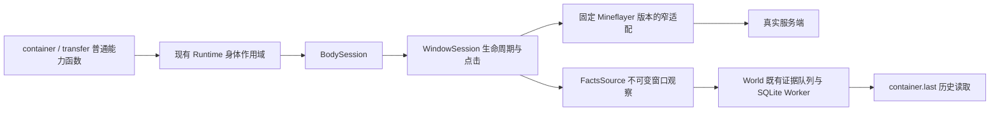

# 窗口与容器：批 2 设计及实施计划

日期：2026-10-24。范围：Driver WindowSession、真实窗口观察历史、container@1、transfer@1、container.last@1；不含 craft/smelt、Program、Executor、Host 回执。沿当前含批 1 未提交实现的工作树增量开发，不从旧 HEAD 另建丢失实现的工作树，不提交无关修改。

## 整体结构与取舍

选择局部扩展：现有身体、记录、水线和 SQLite 已有真实消费者，整体重写会重复这些有效职责。窗口的打开、点击、关闭和服务端证据是新寿命，单独放文件，避免继续扩大 body/session.ts。放弃直接在能力层调用 Bot，也不使用上游便利 transfer 隐藏数量与点击归属。槽位搬移采用一个普通函数，from/to 只交换源目标区域。

历史复用 evidence 表的 client.window@1 记录，不新建容器账本，不以本批为由实现无消费者的全部 DomainRecord。只有真实窗口快照/服务端内容更新进入历史；预测不落成确定内容。当前窗口关闭后清当前值，已经捕获的内容仍沿原队列落盘。历史分区以 world/worldRevision/dimension/目标格识别，binding 只标采集代次，不阻止同一显式世界重启后查历史。

## 模块边界与详细设计

### Driver

- 文件：driver/window/ 下实现窗口及所需纯值转换；body/session.ts 只负责打开接入、资格检查、退役和 pending 操作屏障。
- 消费现有 BodySession 的资格、signal、EffectRecorder、mintOp/mintEff。窗口 identity 用自己的 Operation ref 派生，不能复用网络 windowId。
- 对外使用 contracts/body.ts 的 WindowSession；WindowSnapshot 的 item 纯值为统一 ItemValue：name/count/stackSize/components/durability，未知组件与剩余耐久保留 null。普通 close 要求空光标，失败清理显式 close({force:true})，身体退役可强制清理。2026-10-25 的玩家库存、协议版本及取消修复见 [Driver 修复实施](driver-repair-implementation.md)，不再维护窗口专用物品类型。
- 客户端乐观预测不能认证点击完成。每个业务点击只发送一次 stateId=-1 的同步 raw click，服务端处理后强制返回完整 window_items（含 carriedItem）；不再发第二次 no-op 同步，避免两个无请求 ID 的完整包串到后续点击。不使用上游 clickWindow 的异步预测链。返回 confirmed 只包含本次 mode-0 前态能解释的目标槽/光标后态；重复旧完整包不能认证本次处理，未知不自动重复点击。
- expectedRevision、expectedSlots、expectedCursor 在预测/派发之前检查；串行化同一窗口在途点击；取消后旧异步路径不能改后来窗口，关闭只处理原窗口。关闭产生的光标后果如实记录。
- 打开前捕获窗口响应监听，实际交互使用本资格；窗口打开需等真实内容到齐。方块与实体容器均遵循当前连接/化身/维度身份。
- PlayerPortDeps/BodySessionDeps 增加可选 publishWindow(observation: ClientWindowObservation|null): void；正式 harness 必须接 FactsSource，测试可不装历史消费者。

### Facts / World

- contracts/client-facts.ts 定义 ClientWindowObservation = {target: BlockTarget|EntityRef; snapshot: WindowSnapshot}。publishWindow 只接受不可变、真实观察值；Fact 的 unknown/coverage 保留证据边界。
- FactsSource.publishWindow(observation: ClientWindowObservation|null) 更新当前窗口、推进事实失效并捕获非 null 的 client.window@1 证据。createView.window 返回该事实；断线/重生清当前窗口，不删除旧证据。
- World 增加 container.last@1 的历史读取分派，通过现有提交屏障读取最新匹配方块观察；返回 found/at/type/contents/counts/observedAt/source/complete，cursor=null，不可 watch。未观察过返回 found:false，存储故障明确失败。
- 原始窗口槽位和 layout 用作历史材料；只聚合容器区域，不能把玩家背包算进箱子。实体容器历史保留原事实，本批 container.last 合同仍只按方块位置读取。
- 用真实临时 SQLite 关闭重开验证同世界历史留存、不同世界/代次/维度隔离。

### 能力

- capabilities/actions/containers.ts：container、transfer；capabilities/queries/containers.ts：container.last 声明；共享槽位算法仅在实际复用处拆文件。
- container：走近指定格，取得身体，打开/读取/关闭，返回容器区域槽位与空位。
- transfer：from/to 恰一；Name/ItemSelector+可选 count 或 all:true。源区域/目的区域由 layout 得出，只包括容器与玩家背包/快捷栏，不含装备/光标。省略 count 或 all 时在首个快照固定清单，途中新增不扩大工作量。
- nearest：16 格内最多核验三个可达候选；取物找匹配内容，存物优先同类且可接收，再选空位；一旦开始转移不换箱。源不足、目标不足保留已转移与 remaining，不回滚。
- 用左右键模式 0 完成精确数量，避免一套 shift-click 隐式算法；每次使用最新可确认槽位与 revision，只有服务端可确认差量计 moved。未知立即结束并保留未知效果，不能再点击猜测结果。
- 容器打开与转移始终 finally 关闭；自行持身体与祖先委托共用既有 scope。导航在申请自有身体之前进行；已委托身体只操作当前触及的容器，需要移动时在新副作用前明确 CONTROL_CONFLICT，提示先 goto 再进入祖先 withBody，不扩展身体暂停/交接状态机。
- 组件为 null 时不能满足组件约束；耐久使用实际剩余值 durability，不把 minDurability 选择器字段当物品属性。拒绝无法核验的约束。

## 实施计划

采用 writing-plans 的任务边界；按既有 development-guide.md 选择必要测试，不为每个简单转发写镜像测试。

- [x] 任务 1：独立 builder 复查已完成，收口服务端同步和祖先身体边界；共享窗口观察及物品纯值合同已落。
- [x] 任务 2：Driver 窗口实现及窄故障回归（旧 revision/预期不符、取消晚写、窗口换代、无服务端确认）。独立负责 driver/window、driver/body，避免碰 World。
- [x] 任务 3：Facts 窗口捕获、World 历史分派与真实 SQLite 重开测试。独立负责 facts、world 和对应测试，消费任务 1 合同。
- [x] 任务 4：container/transfer 查询声明、槽位搬移与装配，测试精确量、两向、部分量、nearest、预取消/未知不重试；与任务 2/3 接通。
- [x] 任务 5：真服批 2 场景；复用独立开发服，不重置既有世界，不改认证/真实会话。在保留测试区准备并核验环境，源码和构建产物各通过 13 项。
- [x] 任务 6：format、边界、类型、MC 显式测试列表、构建、真服；独立复查本批 diff，同步 README/changelog/MC-WORLD 与过期事实。

完成判据：真实开箱与正确槽位、两个方向精确转移及部分剩余、关窗后重开复查、旧 revision 拒绝、停止后旧点击不能写、同一显式世界重启后 container.last 可读；既有 I1/K1/批 1 不回归。无法实测的边界明确记录，不提前写 PASS。

## 实施中复查与裁决

- 独立审阅发现双完整包确认竞态与未打开窗口取消的假屏障，均已修正并保留回归：单业务包强制完整回执；已派发而未绑定窗口时关闭屏障不明，同连接禁止再次授予身体，不建立脱离所有者的迟到窗口清理器。
- 实测 Paper 的 block-use 在 300ms 窗口过密时静默丢包。看向块后等待一个真实物理步再发送，复用既有停滞期限及取消，避免加入服务器专用限流配置。
- Facts 同一有序流允许不同观察 schema；修复订阅前证据未重放、reset 清掉旧未确认材料、历史关闭前未 flush 三个实际历史链缺口。gap 保留原身份直到 durable ACK，不猜丢失已提交状态。
- 真服场景使用保留测试区（10000 附近、y=199 平台），等待实际区块观察、核验平台及落脚后开始；服务端接受指令不等于准备完成。验收等待超时显式停止本脚本的 Run，不让它污染下一步；产品工具的等待取消语义不变。

## 本轮结果

- 工作树：codex/phase0-baseline，在已有未提交批 1 基础上增量实现；未提交，未修改 Core 或真实 Provider/会话/认证。
- 工程：pnpm typecheck（含 9 条边界）、pnpm build；16 个 MC 文件 / 125 项回归通过。
- 真服：Paper 1.21.11 build132，offline UinaDev；源码与构建产物的容器场景均 13 项通过，K1 19 项通过，I1 在实际可行走地面通过（含 stop 后 drift=0）。不把重叠登录或平台外导航的失败场景当作通过证据。
- 当前支持普通现代窗口 mode-0 左/右键；工作站、旧协议、feedback、Program/Library、Host 回执、Executor/WorldDef 均未包含在本批。祖先身体需要先导航；未确认开窗退役后须重连。
