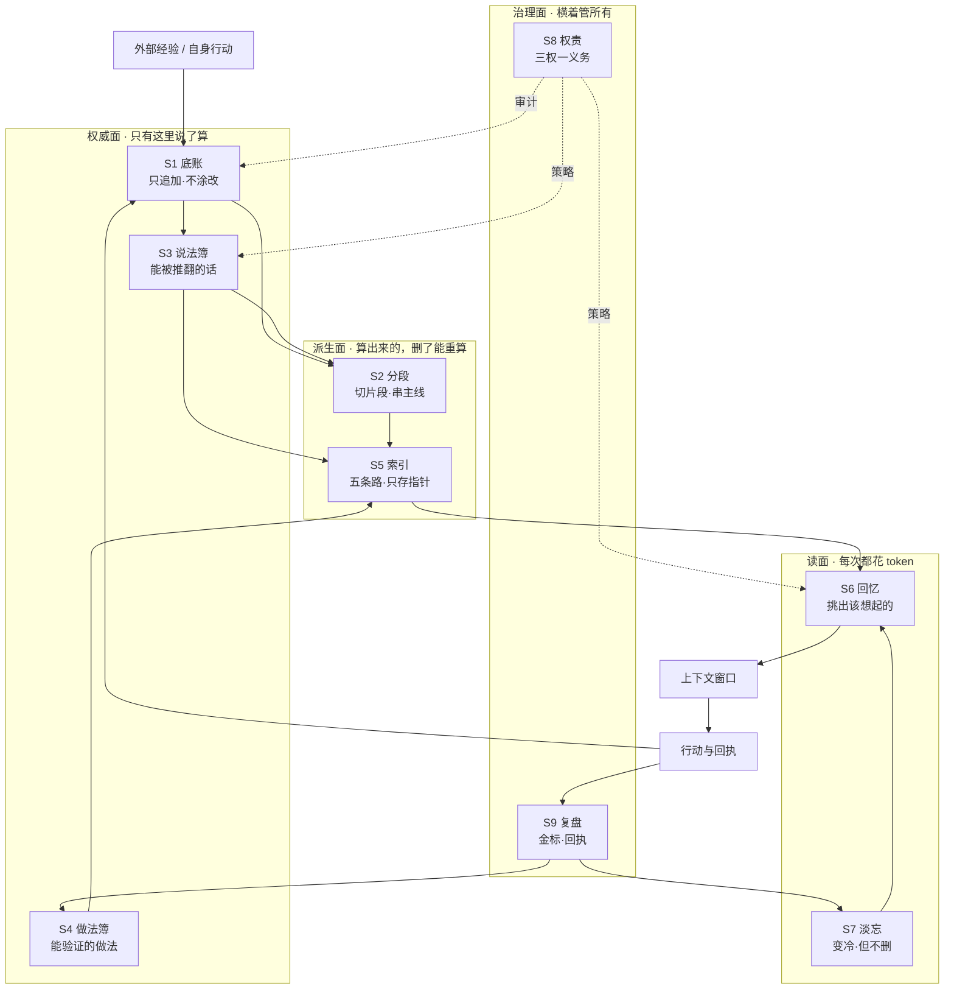
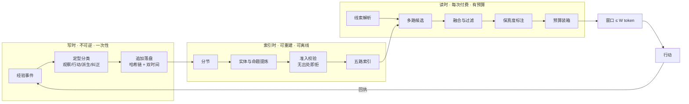
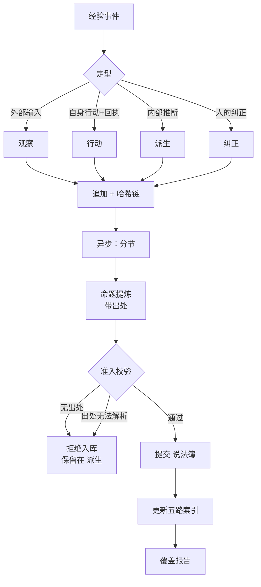
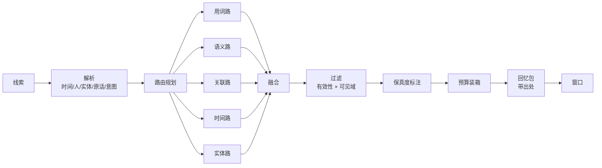
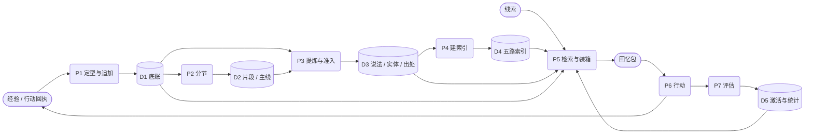
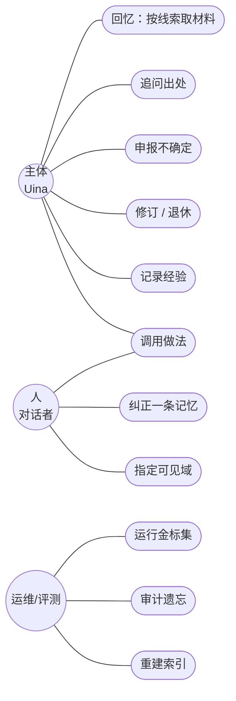
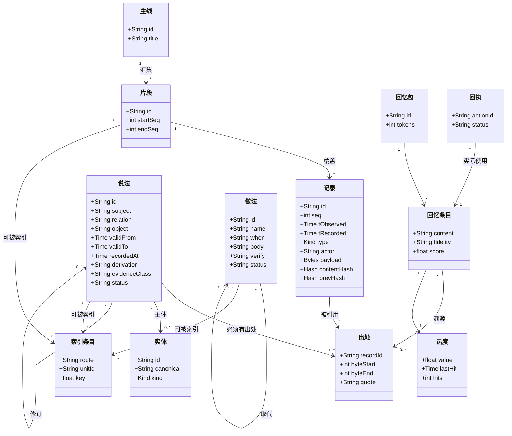
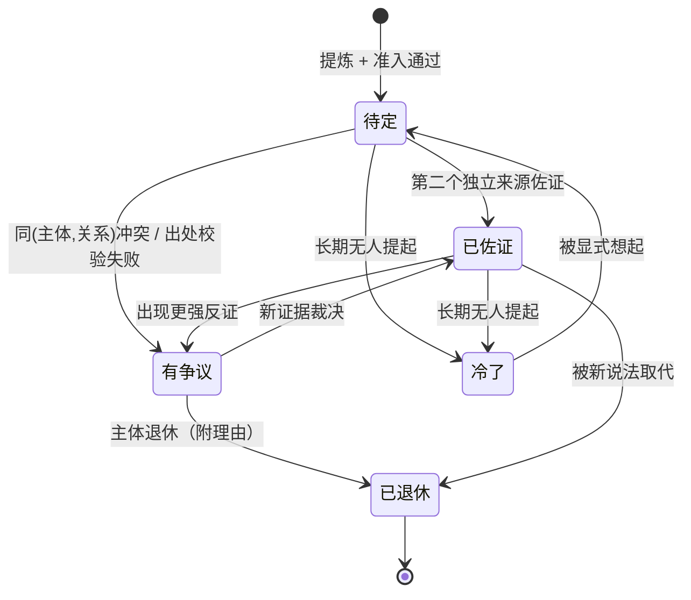
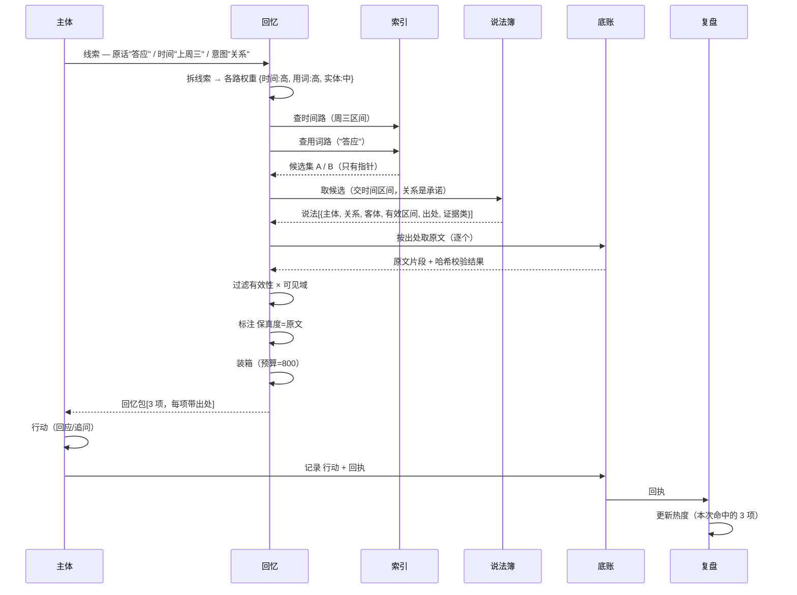

# 记忆系统设计（第一性原理推导）

状态：设计提案，未授权施工，无代码对应。
推导方法：不接受任何既有实现的形状。从"窗口有限、经验无限"这一条约束出发，逐步推出必要结构；每引入一个部件，必须回答"删掉它哪条保证会失效"。
配套：[技术调研](memory-tech-survey.md)（可行性）、[已撤回的认知扩展设计](../archive/proposals/cognition-extension-design.md)（反面教材）、[Subject Runtime 执行规格](subject-runtime-plan.md)（内核冻结约束）。

本文件不选技术。§9 只给载体必须满足的约束；具体用什么由调研报告决定。

---

## 命名规矩（先看这节，后面所有名字都按它来）

每个部件，名字只说一件事：**它做什么**。

- **不用英文品名。** "Chronolog / IndexFabric" 这类读起来像在设门槛，实际就是"流水账"和"索引"。一个词需要加括号才懂，就换词。
- **不用需要二次解释的抽象词。** "语义层"、"治理面"能省则省；实在要用，第一次出现时必须落成一句白话。
- **保留的英文只有字段名和代码标识符**（`recordId`、`validFrom`）——它们将来要落到代码里，改了反而对不上。
- **一个东西只有一个叫法**，全文不换同义词。

### 术语表

| 说法 | 一句话 | 代码里可能叫 |
|---|---|---|
| 底账 | 所有发生过的事，按顺序记，只追加不涂改 | Record |
| 出处 | 一段原文 + 它在底账里的位置 | Span |
| 片段 | 一次连续的经历（一场、一次、一晚） | Episode |
| 主线 | 跨天连着的那件事 | Thread |
| 说法 | 从经历里提炼出来、能被推翻的一句话 | Claim |
| 做法 | 一类事怎么做，做完怎么验 | Procedure |
| 实体 | 人、地方、东西、概念 | 实体 |
| 热度 | 常用就热、久了就凉；只影响排序，不影响留档 | Activation |
| 回忆包 | 这一轮想起来的一组东西，每项带出处 | RecallBundle |

九个部件直接用它们干的事命名：**底账 / 分段 / 说法簿 / 做法簿 / 索引 / 回忆 / 淡忘 / 权责 / 复盘**。

---

## 0. 问题定义

### 0.1 一句话

记忆系统解决的不是"存下来"，而是：**一个上下文窗口有限的主体，如何在无限经验里表现得像拥有无限上下文。**

### 0.2 形式化

设经验全集为历史 $H_{<t}$，窗口容量为 $W$（token），记忆系统是一个选择函数

$$M:\ (o_t,\ H_{<t},\ W)\ \rightarrow\ X,\qquad |X| \le W$$

其质量定义为"用 $X$ 行动"与"用 $H_{<t}$ 行动"的决策差异：

$$\text{quality} = 1 - \mathbb{E}\big[\,d\big(\pi(o_t, H_{<t}),\ \pi(o_t, X)\big)\big]$$

四条约定的可测形式由这个式子直接导出：

| 约定 | 本设计的定义 | 为什么是这个定义 |
|---|---|---|
| **记忆容量** | 可寻址率：$H$ 中每条记录至少被 1 条检索路由覆盖的比例；以及被 ≥2 条覆盖的比例 | 字节不是容量。无索引的 44 MB 实际容量为 0（已实测：无读路径） |
| **记忆效果** | 编码保真率：写入的语义项中，可用出处回溯到原始记录哈希的比例 | "记住了"的可验证形式是"指得回去"，不是"写得多" |
| **回忆效果** | $\text{recall}@k$ + **虚假确定率**（返回了但内容不成立或脱离语境的比例） | 缺失与错误定价不同：缺失导致不知道，虚假确定导致照着错做事 |
| **透明** | 对任一输出，三点溯源链可在 3 跳内返回原文；且每个记忆项在写入时定型保真度 | 事后写日志是摘要，摘要会撒谎。必须让"无出处的记忆"在类型上无法存在 |

### 0.3 非目标

- 不追求"像人脑"。人脑的遗忘来自容量约束，机器没有这个约束；照搬等于主动引入损失。
- 不追求"存下一切细节"。细节保留在原始记录里，说法簿只保留**可被反驳的命题**。
- 不做通用知识库。只服务一个主体的连续经验。
- 不做多主体共识。单机、单主体、单写入者。

---

## 1. 设计目标与判据

| # | 目标 | 判据（可证伪） |
|---|---|---|
| G1 | 每轮边际成本趋零 | 空闲轮次的记忆注入 token ≈ 0；召回只在主体调用时发生 |
| G2 | 永不丢失原始证据 | 权威面无删除 API；状态变更也是追加 |
| G3 | 任何结论可溯源到原文 | 派生项无出处 → 写入被拒（不是告警） |
| G4 | 矛盾可被发现、可被修订 | 同 (subject, relation, 时间重叠) 的冲突是一条查询，不是一次重读 |
| G5 | 遗忘可审计 | 能回答"三个月前我知道但现在想不起的是什么" |
| G6 | 学习可测量 | 每个做法有回执统计；每个召回有使用结果 |
| G7 | 索引可丢弃 | 删除全部派生数据后，`rebuild()` 能恢复等价状态 |

---

## 2. 第一性原理：七条推导

每条给：命题 → 论证 → 对结构的强制约束。

### D1 窗口是唯一稀缺资源

一年经验 44 MB ≈ 10⁷ token；窗口 10⁵ token 量级。比例约 1:80，且**每轮都付**。

> 约束：一切设计以"每轮边际 token"计价。任何按轮注入的机制，必须能证明其边际收益；证明不了的默认关闭。

### D2 记忆不是存储，是选择函数

存储只提供原料。真正的产物是"这一轮进窗口的那一小撮"。因此瓶颈部件是选择器，不是库。

> 约束：评价只落在选择上（命中率、虚假确定率、包内冗余），不落在存储上（条数、字节）。"存得更多"若不能改善选择，价值为零。

### D3 三个时刻不可合并

| 时刻 | 何时发生 | 可逆性 | 成本形态 |
|---|---|---|---|
| 写入 | 每一条经验 | **不可逆** | 一次性 |
| 索引 | 内容变化时（可离线） | 可重建 | 可摊销 |
| 读取 | 每一轮 | 无副作用 | **每次付费** |

把三者合成一步（"每条消息立刻提炼成事实并向量化"）的后果：写入变得昂贵且不可逆，读取失去保真度区分，索引一旦出错无法回滚。

> 约束：三个时刻各自独立的事务边界、失败模式与所有权。

### D4 保真度是类型，不是分数

召回有两类错误：**缺失**（需要的东西不在）与**虚假确定**（在，但错或脱离语境）。后者代价高一个数量级——主体会照它行动。

一个 `confidence: 0.7` 会把"引用错原文"和"推错了"平均成同一个数，而这两种错误的处置方式完全不同：前者要去核对，后者要去找证据。

> 约束：保真度必须是枚举 `原文 | 提炼 | 推断`，写入时定型、终身不可改、随每次返回。

**别和"证据类"混**：这是两个正交的轴，恰好都用了"推断"这个词。

| 轴 | 回答的问题 | 取值 | 何时定 |
|---|---|---|---|
| 保真度 | 这条**返回内容**离原文多远 | 原文 / 提炼 / 推断（无出处） | 写入时定型，读时原样带出 |
| 证据类 | 这条**说法**是从哪种记录里来的 | 观察 / 陈述 / 推断 | 写入时定型 |

所以：一条 `陈述` 类说法的保真度可以是 `原文`（人一字不差那么说的，引得出原句）；一条 `观察` 类说法永远不会是 `推断`（观察不到推断）。两个轴都只在写入时定，是为了让读时的标注是**搬运**而不是**判断**——读时再判断，就给了模型替自己找理由的空间。

### D5 容量 = 可寻址性

44 MB 无索引 = 容量 0。容量随**索引覆盖**增长，不随存储增长。

> 约束：容量保证表述为"覆盖率单调不降"，不是"能存多少"。新增路由是扩容的唯一手段。

### D6 遗忘必须是读时属性

删除不可逆，且删除错误**不可见**——你无法审计"我忘了什么"。机器没有人类的容量约束，所以写入侧删除是纯损失。

> 约束：遗忘 = 排序衰减 + 冷存标记；权威面永不删除；退休是状态而非行消失。

### D7 学习需要可观测量

只有读写两端的系统不能学习：它没有"做对没有"的信号，于是"显著度"只能靠编。

> 约束：每个记忆项携带 `热度`，其更新**只能**来自（召回 → 行动 → 回执 → 人工纠正）这条闭环。禁止自评打分。

---

## 3. 设计原则与取舍

原则写成"取舍"形式——每条都明确放弃什么。没有放弃项的"原则"是口号。

| # | 原则 | 放弃了什么 | 理由 |
|---|---|---|---|
| P1 | **单一权威**：每类事实只有一个写入者 | 多写入换取吞吐 | 多写入者必然产生"哪个版本是真的"这个无解问题 |
| P2 | **派生可重建**：索引是纯函数 | 不可重建的增量索引便利 | 见 Kùzu：索引一旦成为第二权威，它的死亡就是记忆的死亡 |
| P3 | **出处优先**：无出处不入库 | "先存后补"的流畅感 | 补出来的出处是按结论伪造的，比没有更坏 |
| P4 | **类型先于分数** | 用一个 float 表达一切 | D4 |
| P5 | **读时付费** | 启动时全量注入的简单 | D1 |
| P6 | **单调不删** | 清理换空间 | 44 MB/年，空间不稀缺；可审计性稀缺 |
| P7 | **命题最小**：说法是最小可反驳单元 | 用整段笔记当一条记忆 | 只有命题能被反驳；能被反驳才能被修订；能修订才算学习 |
| P8 | **权利与义务成对**：给治理权，同时禁无出处断言 | 完全自主 | 有修订权而无出处义务，等于允许篡改 |

补充一条元原则：

> **P9 每个部件必须通过删除测试。** 去掉它 → §1 的某条保证失效，且没有其他部件能代偿。通不过的部件要么合并，要么明确标注为"质量优化"（见 S7）。

---

## 4. 总体结构

### 4.1 什么时候各干什么

```text
写的时候   —— 记下来    ：底账、分段
闲下来时   —— 想明白     ：说法簿、做法簿、索引
用的时候   —— 想起来     ：回忆、淡忘
一直都在   —— 管着       ：权责、复盘
```

**和之前"四层"怎么对上**（[技术调研](memory-tech-survey.md) 里的 journal / notes / index / recall）：

| 之前四层 | 这里 | 为什么 |
|---|---|---|
| journal | 底账 | 一对一 |
| notes | 说法簿 + 做法簿 | 因为两者**验收方式不同**：说法靠"有没有出处"，做法靠"跑不跑得对"。混在一本里就没法各自验收 |
| index | 索引 | 一对一 |
| recall | 回忆（+ 淡忘） | 淡忘只改排序、不改取回，所以挂在读面 |

结论：**四层没有变成五层，只是"本子"分成了两本。**

### 4.2 系统结构图

分层的依据只有一条：**谁有最终解释权**。有最终解释权的那一层说了算（权威面）；算出来的、删了能重算的不算数（派生面）；每用一次花一次 token 的只在被调用时活（读面）；横着管所有、自己不下判断的（治理面）。

权威自上而下单向流；派生只读权威，读只读派生 + 溯源权威；治理横切，不拥有任何事实。



**读法**：实线是数据，虚线是策略。注意唯一一条回到 `CH` 的箭头来自"行动与回执"——这是学习回路的物理形态，不是概念装饰。

### 4.3 删除测试表

| 部件 | 去掉后失效的保证 | 能否代偿 |
|---|---|---|
| S1 底账 | 透明（无原文可指）、G2 | 否 |
| S2 分段 | 容量（粒度只有两极）、包内冗余失控 | 否 |
| S3 说法簿 | 记忆效果（无可反驳单元）、G4 | 否 |
| S4 做法簿 | 记忆效果缺一类（做法）、G6 | 否 |
| S5 索引 | 容量归零（D5） | 否 |
| S6 回忆 | D1 + D2 同时崩 | 否 |
| S7 淡忘 | **无**——只影响排序质量，不影响正确性 | 标注为质量优化 |
| S8 权责 | 透明从"结构"退化为"日志"、治理权无法执行 | 否 |
| S9 复盘 | 学习不可测（G6）、记忆效果无法验证 | 否 |

S7 是本设计里唯一通不过删除测试的部件。诚实地标注它，比假装九个部件同等必需更可靠。

### 4.4 整体架构图（三时刻 × 预算）



**关键**：图上唯一的横跨箭头是 `回执 → 经验事件`。这表示学习不是一条独立机制，而是**行动结果重新变成经验**。

---

## 5. 子系统细化

每个子系统给：职责 / 明确不负责 / 关键机制 / 数据结构 / 不变量。

### S1 底账：只追加的流水账

**职责**：唯一事实权威。追加式、无解释。

**不负责**：分类、摘要、判断重要性、任何形式的"理解"。

**关键机制**

1. **五类记录互斥**：`观察`（外部输入）/ `行动`（自身行动 + 回执）/ `派生`（内部推断，永不进权威面）/ `纠正`（人给的纠正，指向被纠正项）/ `记账`（生命周期）。
   - 采集时定型，是整套设计的第一个防错点：把"他说的"记成"我做的"，后面所有推理都会错。
2. **双时间**：`t_observed`（事情发生的时间）与 `t_recorded`（我记下它的时间）。补录、离线导入、时钟漂移都要求两者分离。
3. **哈希链**：`content_hash` + `prev_hash`。用途只有一个——检测截断与篡改，让"证据完整"可被机械验证。

**数据结构**

| 字段 | 类型 | 说明 |
|---|---|---|
| `id` | 稳定标识 | 内容派生，非自增 |
| `seq` | 单调整数 | 唯一排序依据 |
| `t_observed` / `t_recorded` | 时间 | 双时间 |
| `type` | 枚举 | 五类互斥 |
| `actor` / `channel` | 标识 | 谁、经什么通道 |
| `payload` | 原始字节 | 不解释、不改写 |
| `content_hash` / `prev_hash` | 哈希 | 完整性 |

**不变量**：`seq` 严格单调；无更新无删除 API；`type` 不可变；`payload` 写入后字节不变。

---

### S2 分段：切成片段，串成主线

**职责**：把记录流切成可检索、可挂载的单元。两级：`片段`（时间/任务边界围出的连续区间）与 `主线`（跨 片段 的主题线）。

**不负责**：判断哪条重要。

**关键机制**

- **边界信号**：显式结束、时间间隔超阈值、参与者变化、实体重叠率骤降。
- **片段 内共现 = 免费联想**：同一 片段 内的实体天然相邻，不需要显式连边就有"同场出现过"的关系。这是对抗"什么都要建图"的杠杆。
- **主线 是跨天连续性的唯一载体**：没有它，跨天回忆只能靠向量撞运气。

**数据结构**：`片段{id, start_seq, end_seq, t_start, t_end, actors[], labels[], density}`；`主线{id, title, 片段列表[], 状态, last_seq}`。

**不变量**：片段 区间不重叠、并集覆盖全部含正文的记录；主线 只引用 片段，不直接引用记录（否则换分节策略就要重连）。

---

### S3 说法簿：能被推翻的说法

**职责**：把经验变成**可被反驳的命题**。

**不负责**：排序、摘要、决定该不该说。

**关键机制**

1. **三对象**：`实体` / `说法` / `出处`。
2. **关系词表开放，但按证据类分层**：

   | 证据类 | 允许表达 | 禁止表达 |
   |---|---|---|
   | `观察` | 时间、发言者、工具回执状态、位置变化 | 因果、动机、评价 |
   | `陈述` | 某人说过什么 | 把"他说"升级为"事实" |
   | `推断` | 因果、意图、预测、归纳 | 伪装成 观察 |

   > **因果边只能是 `陈述` 或 `推断`，永远不能是 `观察`。** 因果从不被观测，只被断言。这一条不是谨慎，是事实。

3. **可反驳性判据**：一条记忆能被称为说法，前提是它能与另一条冲突——同 `(subject, relation)`、`t_valid` 区间重叠、`object` 不同，即为冲突。不能冲突的东西（一段原文、一句闲聊）不是说法，它只是记录。
4. **修订而非覆盖**：新说法带上 `取代` 或 `矛盾` 标记；旧的保留，写 `t_valid_to`，状态改为 `有争议` 或 `已退休`。
5. **社交关系不是特例**：人是一个实体，关系是一条说法（角色 / 地位 / 义务），同一张表、同一套过期规则。不为"关系"单开一套模型，否则矛盾检测要写两遍。

**数据结构**

| 对象 | 字段 |
|---|---|
| `实体` | `id, canonical, aliases[], kind{person,place,artifact,concept,self}, first_seq, last_seq` |
| `说法` | `id, subject, relation, object|value, polarity, t_valid_from, t_valid_to, t_recorded, 出处[], derivation, evidence_class, status, 取代?, scope` |
| `出处` | `record_id, byte_start, byte_end, quote` |

**不变量**：`出处[]` 非空；`derivation`（来路：这段原文怎么变成这条说法的）写入后不可变；`观察` 类说法必须带可解析的出处，且只能解析到 `观察` / `行动` 记录；同 `(subject, relation)` 的活跃区间不得重叠（重叠即强制进入 `有争议` 并留痕）。

---

### S4 做法簿：能验证的做法

**职责**：承载程序性记忆，并持有其验收证据。

**不负责**：判断做法好不好（那是回执与验收集的事）。

**关键机制**

- **入库门槛**：至少一次**带回执**的通过。自评不算。
- **退役**：连续 N 次失败 → `退化`；被更好的 `取代` → `已退休`。
- **读路径不同**：理解取的是命题（短），做法取的是正文（长），因此做法的召回默认只返回 `name + when`，正文由主体显式展开——渐进披露。

**数据结构**：`做法{id, name, when, body, verify{验收集路径|判定式}, 取代?, stats{last_success, last_fail, runs}, status{候选,已验证,退化,已退休}}`。

**不变量**：无 `verify` 不入库；`last_success` / `last_fail` 只能来自执行回执；`已退休` 不可直接复活，必须新建。

---

### S5 索引：五条找得到的路

**职责**：让每个单元从多条线索可被找到。

**不负责**：任何写入权威、判断相关性上限。

**五条独立路由**

| 路由 | 键 | 适合的线索 |
|---|---|---|
| 用词路（lexical） | 词项 | 原话、"他当时说的那个词" |
| 语义路（vector） | 语义向量 | "意思差不多"、同义改写 |
| 关联路（graph） | 边 | "和这个相关的还有谁/什么" |
| 时间路（temporal） | 时间区间 | "上周三"、"那次之前" |
| 实体路（entity） | 实体 id | "关于 X 的一切" |

**关键机制**

- 每条路由只存**指针**（`unit_id` / `record_id` + 出处区段），不存真相副本。
- **独立可丢**：任一路由损坏 → 删除重建，不影响其他路由。
- **融合在读时做，不在写时做**：写时融合会把某一次的打分偏好固化成事实。
- **覆盖报告**：每单元至少 1 条路由覆盖；≥2 条覆盖的比例是**容量指标**（G1/§1）。

**不变量**：所有条目可回溯到权威 id；`rebuild(prefix)` 的结果哈希唯一。

---

### S6 回忆：在预算里挑出该想起的

**职责**：在预算内把线索变成一组带出处的候选。

**不负责**：改写内容（不改写是透明性的前提）、决定要不要用。

**流程（七步）**

1. **线索解析**：从当前输入、当前 片段、主体状态抽出 `(time?, actor?, entity?, literal?, intent)`。
2. **路由选择**：线索类型决定路由权重（原话 → 用词路；"上周三" → 时间路；"谁" → 实体路 + 关联路）。
3. **候选生成**：各路各取一批，不做跨路裁剪。
4. **融合**：名次融合（rank fusion），不比较不可比的分数——只合并名次，不合并分数量纲。
5. **过滤**：有效性（`t_valid` 是否覆盖查询时点）× 可见域（前置过滤，不是排序后过滤）。
6. **保真度标注**：把写入时定型的 `原文 | 提炼 | 推断` 原样带到每一项上——是搬运，不是重新判断。
7. **预算装箱**：最大化

   $$\sum_i u_i,\quad u_i = R_i \times w(F_i) \times H_i - \lambda\cdot D_i$$

   $R$ 相关度，$w(F)$ 保真度权重，$H$ 热度，$D$ 与已选项的冗余（同片段者惩罚）。

   约束：所有入选项的 token 之和 $\\le$ 预算。$D_i$ 惩罚同片段里的重复内容——这正是"挑前几名"与"装箱"的实际差别：前几名可以全是同一段的复述，装箱不会。

**输出**：一个回忆包，里面若干项；每项带 `{内容, 保真度, 出处[], 得分, 为什么{哪条路, 什么线索}}`。

**关键参数**：预算是**参数不是常量**。缺省极小（G1），由主体显式放大；这既是成本控制，也是主体性的落点——"想回忆多少"是她的决定。

**不变量**：任何一项必须有出处与保真度；回忆包的 token 上界不可被单项突破（超长项必须被截断并标记 `已截断`）。

---

### S7 淡忘：变冷，但不删

**职责**：让不常用的东西变难想起，但永不销毁。（质量优化，见 §4.3）

**机制**

热度记作 $H$：

```text
热度 = 衰减（距上次命中过了多久） + Σ 命中权重 − Σ 被纠正的罚分
```

三项都不是手工填的：第一项由时间算，后两项只能来自回执与人工纠正。

- 低于阈值 → `冷了`：不参与常规排序，**仍可显式查询命中**。
- 遗忘是排序属性，不是存储操作；`冷了` 的项在审计视图里始终可见。

**不变量**：热度只由回执与人工纠正更新；无"重要度"手工字段。

---

### S8 权责：她对这些账有什么权力

**职责**：把"治理权"落成可执行策略 + 可查询视图。

**三权一义务**

| 项 | 内容 | 实现约束 |
|---|---|---|
| 修订权 | 改说法 | 必须产生新版本 + `取代` |
| 退休权 | 改状态 | 必须附理由与证据指针 |
| 可见域权 | `scope` | **检索前置过滤**，不可后置 |
| **义务** | 不得无出处断言 | 无出处的写入被拒，不是告警 |

**三个视图（透明性的具体形态）**

- `explain(output)` → 回忆包 → 各项 → 出处 → 原文（三跳）
- `what_do_i_know(entity, at_time)` → 该时点有效的说法 + 各自状态
- `what_am_i_unsure_about()` → `有争议` + 低佐证 `推断`

> 第三个视图是本设计里最不常见、也最重要的一项：**系统必须能主动报告自己的不确定**。否则"透明"只是解释已说的话，不覆盖"她本不该那么确定"。

---

### S9 复盘：这次记对了吗、做对了吗

**职责**：闭合学习回路。

**三输入**：金标集、执行回执、人工纠正。
**四输出**：前 k 条命中率（`recall@k`）、虚假确定率、覆盖报告、`热度` 与统计更新。

**机制**

- 金标集三类查询：精确（原话）/ 同义（改写）/ 关系（谁在何时承诺过什么），各 10–15 条起。
- 每次索引策略变更跑一遍；指标下降即回滚。
- 回执是 `热度` 与统计的**唯一**更新源。

**判据**：A 方案（无向量）前 5 条命中率（`recall@5`）≥ 0.8 则不加语义路；< 0.5 且集中在"同义"类，语义路才有存在理由。

---

## 6. 交互与一致性

### 6.1 写入流程



**两处硬门**：`无出处拒绝` 与 `出处无法解析拒绝`。这是 G3 的物理实现——不是检查，是类型不允许。

### 6.2 回忆流程



### 6.3 数据流图（DFD 一级）



**读法**：`P6 → IN` 那条回环是学习；`P5` 读 D1 说明**溯源链是真实调用，不是概念**——每个结果都可能回到原文。

### 6.4 一致性五条

| # | 规则 | 失效时的表现 |
|---|---|---|
| C1 | **单权威**：底账 / 说法簿 / 做法簿 各拥有自己的事实；索引与回忆不拥有任何真相 | 出现"索引说有、原文没有" |
| C2 | **出处完备**：派生项无出处即拒；出处哈希不符即该项失效并入 `有争议` | 静默的错误记忆 |
| C3 | **单调性**：权威面永不删改；状态变更也是追加 | 无法审计"我忘了什么" |
| C4 | **可重建**：`rebuild(prefix)` 纯函数，结果哈希唯一 | 索引成为第二权威，随它一起死 |
| C5 | **可见域前置**：过滤在建候选时发生 | 越界内容进入排序，即使被过滤也已泄露在候选里 |

**读时冲突解决**（唯一允许裁决的地方，且裁决规则固定）

- 关于世界的事实：`t_valid` 覆盖查询时点者优先；多个覆盖 → `t_recorded` 晚者优先，并标 `有争议`。
- 关于他人的主张：**永不裁决真值**，只报"谁在何时说过"。
- 因果：只报"谁断言了因果"，不报"因果成立"。

这三条合起来是本设计对"主体性"的技术回答：**她可以有自己的判断，但系统不允许判断冒充观察。**

---

## 7. UML 视图

### 7.1 用例图



**说明**：主体同时是记忆的写入者、读者与治理者——这是"治理权"的落点。人只有纠正权与可见域权，没有直接改写权：**人不能替她决定她相信什么，只能提供证据。** 运维不做任何语义操作。

### 7.2 类图


**说明**：三处结构性的东西值得注意——

1. `说法 → 出处` 的 `1..*` 是**强制**：类图里不存在"没有出处的说法"这种合法对象。
2. `说法 → 说法（修订）` 是自环而不是树——允许多条并行存在（`有争议`），因为"当时我拿不准"本身是事实。
3. `回执 → 回忆条目` 是学习回路的唯一入口；没有这条边，热度无从更新。

### 7.3 状态图（记忆项生命周期，以说法为例）



**说明**：`冷了` 是**排序状态**，不是存储状态——它仍在 `已退休` 之前、仍可被查询命中。`已退休` 是唯一终点，且不可逆：复活必须新建（新 id + 指向旧的那条），这一条保证"修订"永远留痕。

做法的生命周期同构，差别只有两点：`待定` 换成 `候选`，且 `候选 → 已验证` 必须有一次带回执的通过。

### 7.4 时序图：一次"上周三答应过谁什么"



**说明**：三个细节是设计意图的直接体现——

1. `I` 只回指针，原文只从 `C` 取。**索引永远不持有真相**（C1）。
2. `C` 回传时带哈希校验结果；校验失败则该项在 `L` 里被降为 `有争议`（C2）。
3. 回执回到 `E` 才关闭回路。没有这一步，`热度` 就是编的（D7）。

---

## 8. 四条保证如何兑现

| 保证 | 机制（结构） | 测法（可执行） |
|---|---|---|
| **容量** | 五路索引 + 覆盖报告；无删除 API | 覆盖率与"≥2 路覆盖比例"随每次重建单调不降；抽查随机 50 条记录均有路径可达 |
| **记忆效果** | 强制出处、写入定型、双时间 | 编码保真率 = 可解析出处 / 全部说法；目标 100%，任何 <100% 均为缺陷 |
| **回忆效果** | 线索分型 → 多路 → 融合 → 装箱 | 三类金标查询各 10–15 条：前 5 条命中率（`recall@5`）、平均倒数排名（`MRR`）、虚假确定率（目标 0，靠保真度类型结构保证） |
| **透明** | 出处为必填字段 + 三视图 | `explain()` 对任一输出 3 跳内返回原文；`what_am_i_unsure_about()` 返回非空且可解释 |

**注意"虚假确定率目标 0"的精确含义**：它保证的是"每条结果都标明了自己是什么"，不是"每条结果都正确"。把不可保证的东西写成保证，是设计文档最常见的谎。

---

## 9. 载体映射（只给约束，不选技术）

本设计的逻辑结构对物理载体提出五条要求，任何满足者皆可：

| # | 约束 | 理由 |
|---|---|---|
| L1 | 单文件或文件+目录，无守护进程 | 单机、单用户；进程即故障源 |
| L2 | 支持"删库重建" | C4 |
| L3 | 支持范围查询与多字段过滤 | 时间与可见域是前置过滤 |
| L4 | 支持中文子串检索（或可预分词） | 语料以中文口语为主 |
| L5 | 同步/异步边界清晰，可移入 worker | 建索引是秒级，查询是毫秒级，不可混在同一线程 |

按 [技术调研](memory-tech-survey.md) 的实测，L1–L5 在单文件嵌入式存储 + 预分词 + 自建向量扫描下全部满足，成本约 114 ms 建索引、0.5–1.5 ms 查询。**但这属于实现选择，不属于本设计。**

---

## 10. 自洽性验证

四类检查，从便宜到贵。

### 10.1 结构检查（静态，一次性）

| 检查 | 判据 |
|---|---|
| 每个派生物有出处 | 类图里 `说法 --> 出处` 基数 ≥1；实现里是 NOT NULL |
| 每个权威有唯一写入者 | 依赖图上每个权威面节点入度 = 1 |
| 每条保证有对应部件 | §8 表每行至少映射到一个 S*，且该 S* 通过删除测试（S7 例外已声明） |
| 无循环权威 | 依赖图无环；派生面不指向权威面之外 |

### 10.2 反例搜索（写完文档后立刻做）

故意构造下列场景，看设计是否会自相矛盾：

1. **纠正一条已在环境里生效的说法** → 旧说法保留、`t_valid_to` 写入、新说法 `取代`。若设计允许直接改旧行 → 违反 C3，需修。
2. **同一时刻两个互相矛盾的说法** → 允许并存（`有争议`），读时按 `t_recorded` 取并标注。若设计强制唯一 → 会丢失"当时不确定"这一事实。
3. **索引全量损坏** → `rebuild()` 从底账恢复；若恢复后覆盖率下降 → 说明有派生数据没有源头，违反 C2。
4. **人在中途撤回授予的可见域** → 前置过滤立刻生效，已在窗口内的内容无法回收（这是**已知边界**，见 §11）。
5. **一条说法的出处指向的记录被截断** → 哈希不符 → 自动 `有争议`。若设计允许"尽量匹配" → 违反 C2。

### 10.3 可执行验证（施工后）

- `rebuild()` 幂等性：连续两次重建，状态哈希相同。
- 覆盖率单调性：每次索引策略变更后覆盖率不得下降，CI 拦截。
- 金标集：三类查询，指标回归即回滚。
- 虚假确定率：人工抽检 50 条召回，`原文` 项必须逐字匹配原文（可用脚本全量校验）。

### 10.4 逻辑检查（本文档自身的）

- 七条推导之间无冲突：D1（预算）× D4（保真度）在 S6 装箱公式里相容——`w(保真度)` 是权重，不是过滤器。
- 九个子系统的接口两两不重叠：每个 S* 的"不负责"列表互不覆盖其"职责"。
- 四条保证互不蕴含：容量不保证效果（能查到 ≠ 查得对）、效果不保证回忆（存得准 ≠ 找得到）、回忆不保证透明（取回来 ≠ 说得清来路）。四者正交，缺一不可。

---

## 11. 边界条件

| # | 边界 | 本设计的处理 | 遗留风险 |
|---|---|---|---|
| B1 | 时钟漂移 / 时区变更 | 双时间；查询按 `t_observed`，排序可按 `t_recorded` | 两者矛盾时无自动裁决，需人工标注 |
| B2 | 外部发言被误当授权 | `陈述` 与 `观察` 分离；授权必须显式记录为 `行动` 的前置条件 | 模型仍可能自己混淆，系统只能保证"记录不混淆" |
| B3 | 撤回可见域后已进入窗口的内容 | 无法回收；只能保证后续轮次不可见 | **这是不可修的边界**，必须在策略上承认 |
| B4 | 出处指向的原文被后续编辑 | 权威面不可编辑；笔记类可编辑 → 哈希不符即降级 | 笔记编辑会让旧说法失据，这是有意设计（迫使重新确认） |
| B5 | 冷启动：无金标集 | 无法验收；只能先跑"覆盖率"这类结构指标 | 前 40 条查询需要人工构造 |
| B6 | 语料跨语言混杂 | 索引路由可选配；本设计不强制统一 | 分词质量成为效果上限 |
| B7 | 极端长单条记录 | 索引按段切分，召回按出处返回局部 | 段边界可能切断语义 |
| B8 | 主体故意写错 | 无解。治理权包含"可以犯错" | 只能保证错误可追溯，不能保证不犯 |

---

## 12. 权衡与已知弱点

| 权衡 | 选了什么 | 放弃什么 | 若反过来会怎样 |
|---|---|---|---|
| 存储 vs 注意力 | 存储无限增长，注意力严格预算 | 磁盘整洁 | 反过来：为省空间删数据，损失不可审计 |
| 保真 vs 覆盖 | 强制出处，宁可不入库 | 提炼的召回率 | 反过来：留下无出处的漂亮摘要，日后无法核对 |
| 命题 vs 原文 | 提炼成说法，原文另存 | 说法本身的可读性 | 反过来：存整段笔记，矛盾检测每次一个模型调用 |
| 结构 vs 简单 | 九个部件 | 实现成本 | 反过来（三个部件）：容量与透明同时失效，回到"向量库 + 提示词" |
| 自动 vs 按需 | 常驻趋零，召回按需 | "她总是自然记得"的体验 | 反过来：每轮注入，成本线性上涨且污染上下文 |
| 裁决 vs 陈述 | 只对世界事实裁决，对他人主张只陈述 | "她有一个明确态度"的直觉 | 反过来：系统替她裁决他人意图，等于伪造观察 |

**已知最弱的一环**：S3 的提炼质量。整个说法簿依赖"从口语里抽出命题且标对证据类"，而这恰好是最容易出错、最难验证的一步。缓解只有两条：出处强制（错的能被发现）+ 金标集（错的能被计数）。**没有任何设计能让提炼变正确，只能让它可核对。**

---

## 13. 施工前置条件

以下四项未完成前不应写记忆代码（详见调研报告 §8）：

1. 40 条金标查询（三类各 10–15 条），格式复用 `evals.json`。
2. 中文分词路线定型（影响 L4）。
3. 建索引耗时与查询耗时在同线程/worker 分界上的实测。
4. 索引载体选定（L1–L5）。

第 1 项是唯一无法绕过的一项：没有它，本设计的 §1 判据无法计算，"记忆效果"和"回忆效果"都只能被声明。
